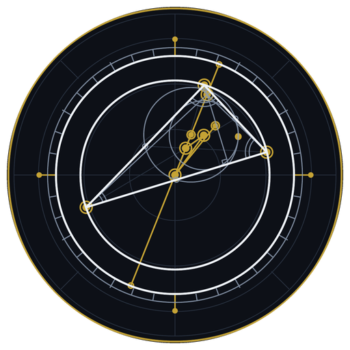

GEOMETOR • etc
==============

**Visit the Online Archive:** https://geometor.github.io/etc/

**Encyclopedia of Triangle Centers • Clark Kimberling's X(1)–X(73310) • semantic digital archive**

Mission
-------

``geometor/etc`` is part of the interconnected `GEOMETOR <https://geometor.com>`_ semantic digital archive. It provides a computable, exact symbolic digital edition of Clark Kimberling's *Encyclopedia of Triangle Centers* (ETC), evaluating all **73,310 triangle centers** (:math:`X_1`–:math:`X_{73310}`, Parts 1–37) and **925 geometric family constellations** in exact algebraic number fields across **7 canonical reference triangles** (Heronian, Right, Kepler, Kimberling, Golden, Gnomon, Equilateral). Liberating the archive from static HTML listings into addressable symbolic shards and interactive vector constructions, the repository bridges classical triangle loci with automated theorem proving and symbolic geometry across the GEOMETOR corpus.

Catalogs in This Archive
------------------------

- `Live Exact Symbolic Center Explorer (X_1–X_73310) <https://geometor.github.io/etc/centers/explore.html>`_ — Instant search by ``X(n)``, name, or Kimberling ``(6, 9, 13)`` search value, live 7-triangle geometric constructions, 987 interactive family constellations, and Fullscreen App Mode (``F``).
- `Encyclopedia of Triangle Centers Collections <https://geometor.github.io/etc/centers/>`_ — 62 curated thematic collection chapters with exact symbolic constellations and member tables.
- `Collection 1 Topics: Conjugacies, Lines, Circles & Triangles <https://geometor.github.io/etc/topics/>`_ — 24 focused geometric guides covering classical conjugacies, central lines, notable circles, and derived triangles.

Repository Contents
-------------------

- ``docsrc/`` — RST book codex chapters, topic guides, 925-family preambles guide, and Live Explorer frontend compiled by `PHOTON publish <https://github.com/photon-platform/publish>`_.
- ``resources/`` — Archival ETC HTML volumes (Parts 1–37) and extracted apparatus registries (glossary, persons, citations).
- ``src/geometor/etc/`` — Exact algebraic number-field evaluator (``field_eval.py``), sharded JSON corpus builder (``shards.py``), classical ``geometor.model`` constructions (``models/x_00001.py``–``x_00019.py``), parser, and SVG renderer.

Local Build & Verification
--------------------------

.. code-block:: bash

   publish build
   uv run --no-sync pytest

Part of the GEOMETOR Knowledge Archive
--------------------------------------

Explore all **74 Book Codices** and **11 Mathematical Catalogs** at https://geometor.com/books/.
