:order: 3
:canonical_id: X_3
:subtitle: CIRCUMCENTER
:dependencies: X_1, X_2, X_4, X_5, X_6, X_7, X_8, X_9, X_10, X_11, X_12, X_13, X_14, X_15, X_16, X_17, X_18, X_19, X_20, X_21, X_22, X_23, X_24, X_25, X_26, X_28, X_29, X_30, X_31, X_32, X_33, X_34, X_35, X_36, X_37, X_38, X_39, X_40, X_41, X_42, X_43, X_46, X_47, X_48, X_49, X_50, X_51, X_52, X_53, X_54, X_55, X_56, X_57, X_58, X_59, X_60, X_61, X_62, X_63, X_64, X_65, X_66, X_67, X_68, X_69, X_71, X_72, X_73, X_74, X_75, X_76, X_77, X_78, X_80, X_81, X_83, X_84, X_85, X_86, X_90, X_91, X_92, X_93, X_95, X_96, X_97, X_98, X_99, X_100, X_101, X_102, X_103, X_104, X_105, X_106, X_107, X_108, X_109, X_110, X_111, X_112, X_113, X_114, X_115, X_116, X_117, X_118, X_119, X_120, X_121, X_122, X_123, X_124, X_125, X_126, X_127, X_128, X_131, X_136, X_140, X_141, X_142, X_143, X_144, X_145, X_147, X_149, X_154, X_155, X_156, X_157, X_158, X_159, X_160, X_161, X_164, X_165, X_169, X_171, X_172, X_175, X_182, X_183, X_184, X_185, X_186, X_187, X_188, X_191, X_193, X_194, X_195, X_197, X_198, X_199, X_200, X_201, X_207, X_209, X_211, X_212, X_214, X_216, X_217, X_218, X_219, X_220, X_221, X_222, X_223, X_225, X_226, X_227, X_228, X_230, X_231, X_232, X_235, X_237, X_238, X_243, X_248, X_249, X_250, X_252, X_254, X_255, X_256, X_259, X_262, X_264, X_265, X_268, X_269, X_271, X_272, X_277, X_283, X_284, X_295, X_296, X_298, X_299, X_302, X_303, X_305, X_315, X_323, X_325, X_329, X_332, X_333, X_343, X_345, X_347, X_348, X_351, X_352, X_353, X_354, X_355, X_356, X_358, X_371, X_372, X_373, X_376, X_377, X_378, X_379, X_380, X_381, X_382, X_384, X_385, X_386, X_388, X_389, X_390, X_392, X_393, X_394, X_395, X_396, X_397, X_398, X_399, X_401, X_403, X_404, X_405, X_408, X_411, X_412, X_416, X_417, X_418, X_426, X_427, X_428, X_440, X_441, X_442, X_450, X_452, X_454, X_458, X_464, X_465, X_466, X_468, X_469, X_474, X_476, X_477, X_480, X_484, X_485, X_486, X_487, X_488, X_489, X_490, X_491, X_492, X_495, X_496, X_497, X_498, X_499, X_500, X_501, X_511, X_512, X_513, X_514, X_515, X_516, X_517, X_518, X_519, X_520, X_521, X_522, X_523, X_524, X_525, X_528, X_532, X_533, X_539, X_541, X_542, X_543, X_546, X_547, X_548, X_549, X_550, X_551, X_566, X_567, X_568, X_569, X_570, X_571, X_572, X_573, X_574, X_575, X_576, X_577, X_578, X_579, X_580, X_581, X_582, X_583, X_584, X_590, X_595, X_597, X_599, X_601, X_602, X_603, X_604, X_607, X_608, X_609, X_610, X_611, X_612, X_613, X_614, X_615, X_616, X_617, X_618, X_619, X_620, X_621, X_622, X_623, X_624, X_626, X_627, X_628, X_629, X_630, X_631, X_632, X_633, X_634, X_635, X_636, X_637, X_638, X_639, X_640, X_641, X_642, X_643, X_647, X_650, X_653, X_659, X_662, X_667, X_669, X_671, X_672, X_690, X_691, X_692, X_695, X_732, X_741, X_758, X_759, X_800, X_805, X_820, X_840, X_842, X_843, X_846, X_847, X_858, X_859, X_878, X_879, X_885, X_895, X_901, X_902, X_905, X_910, X_915, X_917, X_920, X_924, X_925, X_927, X_929, X_930, X_934, X_935, X_936, X_938, X_939, X_940, X_942, X_943, X_944, X_945, X_946, X_947, X_950, X_951, X_953, X_954, X_955, X_956, X_958, X_960, X_962, X_963, X_965, X_967, X_968, X_970, X_972, X_974, X_975, X_976, X_978, X_980, X_984, X_987, X_991, X_993, X_995, X_997, X_999, X_1000, X_1001, X_1003, X_1006, X_1010, X_1011, X_1012, X_1014, X_1015, X_1018, X_1030, X_1033, X_1035, X_1037, X_1038, X_1040, X_1045, X_1046, X_1047, X_1054, X_1055, X_1056, X_1057, X_1058, X_1060, X_1062, X_1064, X_1066, X_1069, X_1072, X_1074, X_1075, X_1076, X_1078, X_1083, X_1092, X_1093, X_1098, X_1101, X_1104, X_1105, X_1106, X_1107, X_1113, X_1114, X_1119, X_1124, X_1125, X_1131, X_1132, X_1135, X_1137, X_1138, X_1139, X_1140, X_1147, X_1148, X_1150, X_1151, X_1152, X_1154, X_1155, X_1158, X_1160, X_1161, X_1167, X_1170, X_1173, X_1175, X_1177, X_1180, X_1181, X_1184, X_1191, X_1192, X_1193, X_1194, X_1196, X_1199, X_1201, X_1203, X_1204, X_1209, X_1210, X_1211, X_1212, X_1213, X_1216, X_1217, X_1246, X_1247, X_1249, X_1253, X_1259, X_1260, X_1263, X_1270, X_1271, X_1276, X_1277, X_1283, X_1290, X_1293, X_1294, X_1295, X_1296, X_1297, X_1298, X_1301, X_1303, X_1304, X_1305, X_1308, X_1309, X_1312, X_1313, X_1316, X_1319, X_1330, X_1331, X_1333, X_1334, X_1335, X_1337, X_1338, X_1340, X_1341, X_1342, X_1343, X_1344, X_1345, X_1348, X_1349, X_1350, X_1351, X_1352, X_1353, X_1364, X_1368, X_1370, X_1376, X_1379, X_1380, X_1384, X_1385, X_1386, X_1388, X_1389, X_1397, X_1398, X_1399, X_1400, X_1406, X_1407, X_1410, X_1411, X_1412, X_1413, X_1420, X_1425, X_1427, X_1428, X_1433, X_1436, X_1437, X_1445, X_1446, X_1447, X_1448, X_1450, X_1452, X_1453, X_1455, X_1457, X_1460, X_1464, X_1465, X_1466, X_1467, X_1469, X_1470, X_1471, X_1475, X_1476, X_1478, X_1479, X_1482, X_1483, X_1484, X_1490, X_1495, X_1496, X_1498, X_1499, X_1500, X_1504, X_1505, X_1506, X_1511, X_1532, X_1565, X_1568, X_1570, X_1575, X_1576, X_1577, X_1578, X_1579, X_1583, X_1584, X_1587, X_1588, X_1589, X_1590, X_1593, X_1594, X_1595, X_1596, X_1597, X_1598, X_1599, X_1600, X_1601, X_1602, X_1603, X_1611, X_1612, X_1613, X_1614, X_1617, X_1620, X_1621, X_1625, X_1627, X_1630, X_1632, X_1633, X_1640, X_1656, X_1657, X_1658, X_1661, X_1662, X_1663, X_1664, X_1665, X_1666, X_1667, X_1668, X_1669, X_1670, X_1671, X_1672, X_1673, X_1676, X_1677, X_1682, X_1685, X_1686, X_1687, X_1688, X_1689, X_1690, X_1691, X_1692, X_1696, X_1697, X_1698, X_1699, X_1709, X_1714, X_1723, X_1724, X_1728, X_1737, X_1745, X_1753, X_1754, X_1762, X_1764, X_1767, X_1768, X_1770, X_1772, X_1779, X_1780, X_1788, X_1790, X_1791, X_1794, X_1795, X_1796, X_1797, X_1799, X_1805, X_1806, X_1807, X_1808, X_1810, X_1811, X_1813, X_1816, X_1817, X_1818, X_1834, X_1836, X_1837, X_1858, X_1864, X_1870, X_1871, X_1872, X_1885, X_1898, X_1901, X_1905, X_1907, X_1914, X_1916, X_1918, X_1935, X_1939, X_1940, X_1941, X_1946, X_1950, X_1951, X_1960, X_1968, X_1975, X_1982, X_1986, X_1987, X_1993, X_1994, X_1995, X_2007, X_2008, X_2021, X_2028, X_2029, X_2039, X_2040, X_2041, X_2042, X_2043, X_2044, X_2045, X_2046, X_2047, X_2048, X_2049, X_2050, X_2052, X_2053, X_2055, X_2060, X_2066, X_2067, X_2070, X_2071, X_2072, X_2076, X_2077, X_2078, X_2079, X_2080, X_2092, X_2093, X_2095, X_2096, X_2098, X_2099, X_2108, X_2120, X_2121, X_2130, X_2131, X_2133, X_2163, X_2174, X_2183, X_2188, X_2193, X_2196, X_2197, X_2207, X_2213, X_2220, X_2222, X_2241, X_2242, X_2245, X_2257, X_2264, X_2267, X_2268, X_2269, X_2271, X_2274, X_2275, X_2276, X_2278, X_2280, X_2286, X_2292, X_2293, X_2305, X_2320, X_2329, X_2330, X_2334, X_2346, X_2361, X_2407, X_2435, X_2446, X_2447, X_2448, X_2449, X_2452, X_2454, X_2455, X_2456, X_2459, X_2460, X_2475, X_2476, X_2478, X_2479, X_2480, X_2482, X_2536, X_2537, X_2548, X_2549, X_2550, X_2551, X_2554, X_2555, X_2558, X_2559, X_2560, X_2561, X_2562, X_2563, X_2564, X_2565, X_2566, X_2567, X_2568, X_2569, X_2570, X_2571, X_2572, X_2573, X_2636, X_2640, X_2646, X_2673, X_2674, X_2675, X_2676, X_2687, X_2688, X_2689, X_2690, X_2691, X_2692, X_2693, X_2694, X_2695, X_2696, X_2697, X_2698, X_2699, X_2700, X_2701, X_2702, X_2703, X_2704, X_2705, X_2706, X_2707, X_2708, X_2709, X_2710, X_2711, X_2712, X_2713, X_2714, X_2715, X_2716, X_2717, X_2718, X_2719, X_2720, X_2721, X_2722, X_2723, X_2724, X_2725, X_2726, X_2727, X_2728, X_2729, X_2730, X_2731, X_2732, X_2733, X_2734, X_2735, X_2736, X_2737, X_2738, X_2739, X_2740, X_2742, X_2743, X_2744, X_2745, X_2746, X_2747, X_2751, X_2752, X_2757, X_2758, X_2762, X_2765, X_2766, X_2768, X_2770, X_2780, X_2782, X_2783, X_2790, X_2792, X_2797, X_2800, X_2801, X_2807, X_2810, X_2814, X_2821, X_2826, X_2827, X_2854, X_2883, X_2886, X_2888, X_2896, X_2904, X_2911, X_2915, X_2916, X_2936, X_2937, X_2938, X_2939, X_2944, X_2951, X_2962, X_2964, X_2969, X_2970, X_2971, X_2975, X_2979, X_2999, X_3003, X_3006, X_3011, X_3052, X_3053, X_3056, X_3057, X_3058, X_3060, X_3061, X_3065, X_3066, X_3068, X_3069, X_3070, X_3071, X_3079, X_3085, X_3086, X_3088, X_3089, X_3090, X_3091, X_3092, X_3093, X_3094, X_3095, X_3098, X_3100, X_3101, X_3102, X_3103, X_3109, X_3111, X_3129, X_3130, X_3131, X_3132, X_3145, X_3146, X_3147, X_3148, X_3149, X_3151, X_3152, X_3153, X_3155, X_3156, X_3157, X_3165, X_3166, X_3167, X_3173, X_3177, X_3188, X_3197, X_3200, X_3201, X_3205, X_3206, X_3207, X_3216, X_3218, X_3219, X_3224, X_3229, X_3235, X_3236, X_3237, X_3238, X_3269, X_3270, X_3272, X_3276, X_3277, X_3278, X_3279, X_3280, X_3281, X_3282, X_3283, X_3284, X_3285, X_3286, X_3289, X_3295, X_3296, X_3303, X_3304, X_3305, X_3306, X_3311, X_3312, X_3313, X_3316, X_3317, X_3332, X_3333, X_3334, X_3335, X_3336, X_3338, X_3340, X_3341, X_3343, X_3347, X_3350, X_3351, X_3354, X_3360, X_3361, X_3364, X_3365, X_3366, X_3367, X_3368, X_3369, X_3370, X_3371, X_3372, X_3373, X_3374, X_3379, X_3380, X_3381, X_3382, X_3385, X_3386, X_3387, X_3388, X_3389, X_3390, X_3391, X_3392, X_3393, X_3394, X_3395, X_3396, X_3397, X_3398, X_3399, X_3406, X_3407, X_3413, X_3414, X_3417, X_3418, X_3420, X_3426, X_3428, X_3430, X_3431, X_3433, X_3436, X_3437, X_3440, X_3441, X_3447, X_3448, X_3452, X_3455, X_3456, X_3459, X_3460, X_3461, X_3462, X_3463, X_3464, X_3465, X_3466, X_3467, X_3471, X_3474, X_3482, X_3483, X_3485, X_3486, X_3487, X_3488, X_3489, X_3490, X_3496, X_3497, X_3501, X_3513, X_3514, X_3515, X_3516, X_3517, X_3518, X_3519, X_3520, X_3521, X_3522, X_3523, X_3524, X_3525, X_3526, X_3527, X_3528, X_3529, X_3530, X_3533, X_3534, X_3537, X_3538, X_3541, X_3542, X_3543, X_3545, X_3546, X_3547, X_3548, X_3549, X_3550, X_3552, X_3555, X_3557, X_3558, X_3560, X_3561, X_3563, X_3567, X_3575, X_3576, X_3579, X_3581, X_3582, X_3583, X_3584, X_3585, X_3587, X_3589, X_3592, X_3594, X_3600, X_3601, X_3612, X_3614, X_3616, X_3620, X_3624, X_3627, X_3628, X_3632, X_3646, X_3647, X_3651, X_3652, X_3653, X_3654, X_3656, X_3657, X_3658, X_3659, X_3667, X_3673, X_3678, X_3679, X_3681, X_3683, X_3687, X_3690, X_3694, X_3705, X_3710, X_3711, X_3724, X_3730, X_3731, X_3732, X_3733, X_3734, X_3736, X_3740, X_3746, X_3752, X_3767, X_3781, X_3784, X_3785, X_3788, X_3796, X_3813, X_3815, X_3824, X_3830, X_3832, X_3839, X_3843, X_3845, X_3849, X_3850, X_3851, X_3853, X_3854, X_3855, X_3856, X_3858, X_3861, X_3869, X_3870, X_3874, X_3876, X_3877, X_3889, X_3901, X_3911, X_3915, X_3916, X_3917, X_3925, X_3926, X_3927, X_3933, X_3934, X_3939, X_3940, X_3941, X_3945, X_3951, X_3955, X_3957, X_3960, X_3977, X_3984, X_4000, X_4001, X_4049, X_4057, X_4101, X_4173, X_4184, X_4187, X_4188, X_4189, X_4190, X_4191, X_4193, X_4195, X_4203, X_4210, X_4216, X_4218, X_4219, X_4225, X_4226, X_4245, X_4251, X_4252, X_4253, X_4254, X_4255, X_4256, X_4257, X_4258, X_4259, X_4260, X_4261, X_4262, X_4263, X_4264, X_4265, X_4266, X_4267, X_4268, X_4271, X_4272, X_4273, X_4274, X_4275, X_4276, X_4277, X_4278, X_4279, X_4283, X_4284, X_4286, X_4287, X_4289, X_4290, X_4292, X_4293, X_4294, X_4295, X_4297, X_4299, X_4300, X_4301, X_4302, X_4303, X_4304, X_4309, X_4313, X_4316, X_4317, X_4324, X_4325, X_4330, X_4338, X_4340, X_4383, X_4386, X_4413, X_4417, X_4420, X_4423, X_4426, X_4436, X_4491, X_4511, X_4513, X_4549, X_4558, X_4571, X_4587, X_4648, X_4650, X_4652, X_4653, X_4655, X_4720, X_4846, X_4850, X_4855, X_4857, X_4870, X_4880, X_4881, X_4973, X_4993, X_4994, X_4995, X_4999, X_5004, X_5005, X_5008, X_5009, X_5010, X_5012, X_5013, X_5015, X_5017, X_5019, X_5020, X_5021, X_5022, X_5023, X_5024, X_5028, X_5030, X_5033, X_5034, X_5035, X_5036, X_5037, X_5041, X_5042, X_5043, X_5044, X_5045, X_5046, X_5050, X_5052, X_5053, X_5054, X_5055, X_5056, X_5058, X_5059, X_5062, X_5063, X_5065, X_5066, X_5067, X_5068, X_5069, X_5070, X_5071, X_5072, X_5073, X_5076, X_5079, X_5084, X_5085, X_5088, X_5092, X_5093, X_5094, X_5096, X_5097, X_5102, X_5105, X_5109, X_5110, X_5114, X_5115, X_5116, X_5118, X_5119, X_5120, X_5122, X_5124, X_5125, X_5126, X_5127, X_5128, X_5131, X_5132, X_5135, X_5138, X_5145, X_5152, X_5153, X_5156, X_5157, X_5158, X_5162, X_5165, X_5169, X_5171, X_5172, X_5188, X_5189, X_5198, X_5204, X_5206, X_5210, X_5217, X_5218, X_5221, X_5223, X_5224, X_5226, X_5227, X_5237, X_5238, X_5239, X_5240, X_5247, X_5248, X_5253, X_5254, X_5255, X_5258, X_5259, X_5260, X_5262, X_5264, X_5267, X_5268, X_5270, X_5275, X_5277, X_5280, X_5283, X_5284, X_5286, X_5288, X_5292, X_5300, X_5302, X_5303, X_5305, X_5306, X_5310, X_5313, X_5319, X_5322, X_5323, X_5326, X_5329, X_5337, X_5345, X_5346, X_5351, X_5352, X_5355, X_5359, X_5372, X_5392, X_5396, X_5398, X_5399, X_5401, X_5402, X_5403, X_5404, X_5406, X_5407, X_5408, X_5409, X_5412, X_5413, X_5414, X_5418, X_5420, X_5428, X_5432, X_5433, X_5435, X_5436, X_5437, X_5438, X_5439, X_5440, X_5441, X_5442, X_5443, X_5444, X_5445, X_5446, X_5447, X_5450, X_5453, X_5462, X_5463, X_5464, X_5475, X_5480, X_5482, X_5486, X_5493, X_5498, X_5504, X_5505, X_5530, X_5531, X_5535, X_5538, X_5541, X_5550, X_5552, X_5556, X_5562, X_5563, X_5569, X_5570, X_5576, X_5584, X_5585, X_5587, X_5590, X_5591, X_5594, X_5595, X_5597, X_5598, X_5603, X_5606, X_5611, X_5615, X_5638, X_5639, X_5640, X_5642, X_5643, X_5650, X_5651, X_5656, X_5657, X_5658, X_5664, X_5667, X_5668, X_5669, X_5670, X_5672, X_5673, X_5674, X_5675, X_5687, X_5690, X_5691, X_5692, X_5693, X_5694, X_5695, X_5697, X_5698, X_5699, X_5700, X_5703, X_5706, X_5707, X_5708, X_5709, X_5710, X_5711, X_5714, X_5715, X_5719, X_5720, X_5721, X_5722, X_5725, X_5728, X_5730, X_5731, X_5732, X_5735, X_5736, X_5737, X_5744, X_5745, X_5747, X_5751, X_5752, X_5753, X_5754, X_5755, X_5757, X_5758, X_5759, X_5760, X_5761, X_5763, X_5767, X_5768, X_5769, X_5770, X_5771, X_5776, X_5777, X_5778, X_5779, X_5780, X_5786, X_5787, X_5788, X_5789, X_5790, X_5791, X_5810, X_5811, X_5814, X_5816, X_5818, X_5843, X_5858, X_5859, X_5864, X_5865, X_5870, X_5871, X_5874, X_5875, X_5876, X_5884, X_5885, X_5886, X_5887, X_5889, X_5890, X_5892, X_5897, X_5899, X_5901, X_5902, X_5903, X_5918, X_5921, X_5927, X_5944, X_5946, X_5951, X_5962, X_5963, X_5971, X_5980, X_5981, X_5989, X_5999, X_6003, X_6010, X_6011, X_6031, X_6039, X_6040, X_6051, X_6082, X_6093, X_6101, X_6102, X_6118, X_6119, X_6120, X_6121, X_6122, X_6123, X_6124, X_6125, X_6130, X_6141, X_6142, X_6143, X_6147, X_6173, X_6176, X_6177, X_6178, X_6181, X_6191, X_6192, X_6197, X_6198, X_6199, X_6200, X_6214, X_6215, X_6221, X_6225, X_6228, X_6229, X_6230, X_6231, X_6232, X_6233, X_6234, X_6236, X_6238, X_6240, X_6241, X_6243, X_6244, X_6245, X_6250, X_6251, X_6253, X_6259, X_6264, X_6282, X_6284, X_6294, X_6295, X_6296, X_6297, X_6298, X_6299, X_6300, X_6301, X_6302, X_6303, X_6304, X_6305, X_6306, X_6307, X_6308, X_6311, X_6312, X_6313, X_6314, X_6315, X_6316, X_6317, X_6318, X_6323, X_6325, X_6326, X_6328, X_6334, X_6337, X_6353, X_6361, X_6390, X_6391, X_6395, X_6396, X_6398, X_6407, X_6408, X_6409, X_6410, X_6411, X_6412, X_6413, X_6414, X_6417, X_6418, X_6419, X_6420, X_6421, X_6422, X_6423, X_6424, X_6425, X_6426, X_6427, X_6428, X_6429, X_6430, X_6431, X_6432, X_6433, X_6434, X_6435, X_6436, X_6437, X_6438, X_6439, X_6440, X_6441, X_6442, X_6445, X_6446, X_6447, X_6448, X_6449, X_6450, X_6451, X_6452, X_6453, X_6454, X_6455, X_6456, X_6457, X_6458, X_6459, X_6460, X_6461, X_6465, X_6466, X_6467, X_6468, X_6469, X_6470, X_6471, X_6472, X_6473, X_6474, X_6475, X_6476, X_6477, X_6478, X_6479, X_6480, X_6481, X_6482, X_6483, X_6484, X_6485, X_6486, X_6487, X_6488, X_6489, X_6490, X_6491, X_6492, X_6493, X_6494, X_6495, X_6496, X_6497, X_6498, X_6499, X_6500, X_6501, X_6502, X_6519, X_6522, X_6560, X_6561, X_6566, X_6567, X_6581, X_6582, X_6585, X_6617, X_6621, X_6622, X_6623, X_6624, X_6636, X_6638, X_6639, X_6640, X_6641, X_6642, X_6643, X_6644, X_9147, X_9149, X_35225, X_35901, X_38474

.. _X_3:
.. _Circumcenter:

X_3
====

.. rubric:: CIRCUMCENTER

``circumcenter(A, B, C) -> X_3`` • **Euclid IV.5** • **Kimberling** ``X(3)`` • **Search Value** :math:`(6, 9, 13)`: :math:`\frac{321 \sqrt{35}}{280} \approx 6.782362894196`

.. enunciation::

   :ref:`X_3 <X_3>` is the point of concurrence of the perpendicular bisectors of the sides of :g:`ABC << A B C >>`. The lengths of segments ``AX``, ``BX``, ``CX`` are equal if and only if ``X`` = :ref:`X_3 <X_3>`. This common distance is the radius of the circumcircle, which passes through vertices :g:`A <A>`, :g:`B <B>`, :g:`C <C>`. Called the circumradius, it is given by :math:`R = a/(2 \sin A) = abc/(4 \operatorname{area}(ABC))`.

   **X_3** (*CIRCUMCENTER*) constructed at :g:`X_3 <X_3>` = :math:`\left(7,\; \frac{33}{8}\right)` in exact rational coordinates on the Heronian reference triangle :math:`(a, b, c) = (15, 13, 14)` over :math:`\mathbb{Q}` with vertices :g:`A <A>` = :math:`(0, 0)`, :g:`B <B>` = :math:`(14, 0)`, :g:`C <C>` = :math:`(5, 12)`, and area :math:`\Delta = 84`, and circumcircle radius :math:`R = \frac{65}{8}`. Switch tabs above to inspect exact constructions on Right :math:`(3, 4, 5)`, Kepler :math:`(1, \sqrt{\phi}, \phi)`, and Kimberling :math:`(6, 9, 13)`.

.. admonition:: Constructed Elements
   :class: note

   * **Auxiliary Points:** :g:`M_a <M_a>`, :g:`M_b <M_b>`, :g:`M_c <M_c>` — Side midpoints of :g:`BC <[ B C ]>`, :g:`CA <[ C A ]>`, :g:`AB <[ A B ]>`
   * **Circle:** **Circumcircle** (:g:`circumcircle <circumcircle>`) — Passes through vertices A, B, C; centered at X_3 CIRCUMCENTER
   * **Concurrence Lines (Perpendicular Bisectors):** :g:`X_3–M_a <[ X_3 M_a ]>`, :g:`X_3–M_b <[ X_3 M_b ]>`, :g:`X_3–M_c <[ X_3 M_c ]>` concurring at :g:`X_3 <X_3>`

Homogeneous Coordinates & Exact Invariants
------------------------------------------

   **Homogeneous Coordinates of X_3** on Heronian :math:`(15, 13, 14)`: orthogonal trilinear struts :math:`(\alpha, \beta, \gamma)` and signed barycentric sub-triangles :math:`(\Delta_a, \Delta_b, \Delta_c)`.

* **Trilinear Coordinates** (:math:`\alpha : \beta : \gamma = 25 : 39 : 33`): Dropping orthogonal perpendiculars :g:`X_3T_a </ X_3 T_a />`, :g:`X_3T_b </ X_3 T_b />`, and :g:`X_3T_c </ X_3 T_c />` from :g:`X_3 <X_3>` to sidelines :g:`BC <[ B C ]>`, :g:`CA <[ C A ]>`, and :g:`AB <[ A B ]>` meets the sides at right-spread pedal feet :g:`T_a <T_a>` = :math:`\left(\frac{19}{2},\; 6\right)`, :g:`T_b <T_b>` = :math:`\left(\frac{5}{2},\; 6\right)`, and :g:`T_c <T_c>` = :math:`\left(7,\; 0\right)`. The orthogonal strut lengths are :math:`\left(\frac{25}{8},\; \frac{39}{8},\; \frac{33}{8}\right)`, realizing :math:`\alpha : \beta : \gamma = 25 : 39 : 33`, while :g:`circumcircle <circumcircle>` has exact radius :math:`R = \frac{65}{8}` (quadrance :math:`Q_R = \frac{4225}{64}`).
* **Barycentric Coordinates** (:math:`u : v : w = 125 : 169 : 154`): Joining :g:`X_3 <X_3>` to the vertices along :g:`X_3A </ X_3 A />`, :g:`X_3B </ X_3 B />`, and :g:`X_3C </ X_3 C />` forms signed sub-triangles :g:`△X_3BC << X_3 B C >>`, :g:`△X_3CA << X_3 C A >>`, and :g:`△X_3AB << X_3 A B >>` of exact signed areas :math:`\Delta_a = \frac{375}{16}`, :math:`\Delta_b = \frac{507}{16}`, and :math:`\Delta_c = \frac{231}{8}` (summing to :math:`\Delta_a + \Delta_b + \Delta_c = 84 = \Delta`), in homogeneous ratio :math:`u : v : w = 125 : 169 : 154`.

.. list-table:: Exact Symbolic Coordinates & Invariants Across the Four Reference Triangles
   :header-rows: 1
   :widths: 18 10 18 14 16 14 14

   * - Reference Triangle
     - Field
     - Cartesian :math:`(x, y)`
     - Trilinears :math:`\alpha : \beta : \gamma`
     - Barycentrics :math:`u : v : w`
     - Sub-Areas :math:`(\Delta_a, \Delta_b, \Delta_c)`
     - Circumradius & Quadrance :math:`(R,\, Q_R)`
   * - **Heronian** :math:`(15, 13, 14)`
     - :math:`\mathbb{Q}`
     - :math:`\left(7,\; \frac{33}{8}\right)`
     - :math:`25 : 39 : 33`
     - :math:`125 : 169 : 154`
     - :math:`\left(\frac{375}{16},\; \frac{507}{16},\; \frac{231}{8}\right)`
     - :math:`R = \frac{65}{8},\; Q_R = \frac{4225}{64}`
   * - **Right** :math:`(3, 4, 5)`
     - :math:`\mathbb{Q}`
     - :math:`\left(\frac{5}{2},\; 0\right)`
     - :math:`4 : 3 : 0`
     - :math:`1 : 1 : 0`
     - :math:`\left(3,\; 3,\; 0\right)`
     - :math:`R = \frac{5}{2},\; Q_R = \frac{25}{4}`
   * - **Kepler** :math:`(1, \sqrt{\phi}, \phi)`
     - :math:`\mathbb{Q}(\sqrt{\phi})`
     - :math:`\left(\frac{\phi}{2},\; 0\right)`
     - :math:`1 : \sqrt{\phi} \left(\phi - 1\right) : 0`
     - :math:`1 : 1 : 0`
     - :math:`\left(\frac{\sqrt{\phi}}{4},\; \frac{\sqrt{\phi}}{4},\; 0\right)`
     - :math:`R = \frac{\phi}{2},\; Q_R = \frac{\phi}{4} + \frac{1}{4}`
   * - **Kimberling** :math:`(6, 9, 13)`
     - :math:`\mathbb{Q}(\sqrt{35})`
     - :math:`\left(\frac{13}{2},\; - \frac{169 \sqrt{35}}{280}\right)`
     - :math:`321 : 279 : -169`
     - :math:`1926 : 2511 : -2197`
     - :math:`\left(\frac{963 \sqrt{35}}{280},\; \frac{2511 \sqrt{35}}{560},\; - \frac{2197 \sqrt{35}}{560}\right)`
     - :math:`R = \frac{351 \sqrt{35}}{280},\; Q_R = \frac{123201}{2240}`

.. signature:: center

   | **Trilinears:** :math:`\cos A : \cos B : \cos C`
   | **Barycentrics:** :math:`\sin 2A : \sin 2B : \sin 2C`
   | **Tripolars:** :math:`1 : 1 : 1`
   | **Search Value (6, 9, 13):** :math:`\frac{321 \sqrt{35}}{280} \approx 6.782362894196`

.. collapse:: Alternate Coordinates
   :badge: 4 forms

   * **Trilinears:** :math:`a(b^{2} + c^{2} - a^{2}) : b(c^{2} + a^{2} - b^{2}) : c(a^{2} + b^{2} - c^{2})`
   * **Barycentrics:** :math:`\tan B + \tan C : \tan C + \tan A: \tan A + \tan B`
   * **Barycentrics:** :math:`S^{2} - S_{B} S_{C} : :`
   * **Barycentrics:** :math:`1 - \cot B \cot C : :`

Incident Central Lines
----------------------

   **Principal Central Lines Through X_3** on Heronian :math:`(15, 13, 14)`.

* **Nagel Point–Anticomplement Of Feuerbach Point Central Line** :g:`{3, 8, 100} <{ 8, 100 }>` — collinear axis through :g:`X_3 <X_3>`, :g:`X_8 <X_8>` (:ref:`Nagel Point <X_8>`, :math:`\left(7,\; 4\right)`), :g:`X_100 <X_100>` (:ref:`Anticomplement Of Feuerbach Point <X_100>`, :math:`\left(7,\; -4\right)`), with exact Cartesian equation :math:`x - 7 = 0` (spread :math:`1`, **perpendicular to baseline** :g:`AB <[ A B ]>`).
* **Euler Line** :g:`{2, 3, 4, 5} <{ 2, 4 }>` — collinear axis through :g:`X_2 <X_2>` (:ref:`Centroid <X_2>`, :math:`\left(\frac{19}{3},\; 4\right)`), :g:`X_3 <X_3>`, :g:`X_4 <X_4>` (:ref:`Orthocenter <X_4>`, :math:`\left(5,\; \frac{15}{4}\right)`), :g:`X_5 <X_5>` (:ref:`Nine-Point Center <X_5>`, :math:`\left(6,\; \frac{63}{16}\right)`), with exact Cartesian equation :math:`3 x - 16 y + 45 = 0` (spread :math:`\frac{9}{265}` relative to :g:`AB <[ A B ]>`).
* **Brocard Axis** :g:`{3, 6, 32} <{ 6, 32 }>` — collinear axis through :g:`X_3 <X_3>`, :g:`X_6 <X_6>` (:ref:`Symmedian Point <X_6>`, :math:`\left(\frac{1673}{295},\; \frac{1176}{295}\right)`), :g:`X_32 <X_32>` (:ref:`3rd POWER POINT <X_32>`, :math:`\left(\frac{295967}{58801},\; \frac{230496}{58801}\right)`), with exact Cartesian equation :math:`327 x - 3136 y + 10647 = 0` (spread :math:`\frac{106929}{9941425}` relative to :g:`AB <[ A B ]>`).
* **OI Line (Incenter–Circumcenter Axis)** :g:`{1, 3, 40} <{ 1, 40 }>` — collinear axis through :g:`X_1 <X_1>` (:ref:`Incenter <X_1>`, :math:`\left(6,\; 4\right)`), :g:`X_3 <X_3>`, :g:`X_40 <X_40>` (:ref:`Bevan Point <X_40>`, :math:`\left(8,\; \frac{17}{4}\right)`), with exact Cartesian equation :math:`x - 8 y + 26 = 0` (spread :math:`\frac{1}{65}` relative to :g:`AB <[ A B ]>`).

.. container:: note-item

   :ref:`X_3 <X_3>` lies on the Thomson cubic, the Darboux cubic, the Napoleon cubic, the Neuberg cubic, the McCay cubic, then Darboux quintic.

.. collapse:: Full Incident Central Line Catalog
   :badge: 500 lines
   :class: line-catalog

   {:ref:`1 <X_1>`, :ref:`35 <X_35>`}, {:ref:`2 <X_2>`, :ref:`4 <X_4>`}, {:ref:`6 <X_6>`, :ref:`15 <X_15>`}, {:ref:`7 <X_7>`, :ref:`943 <X_943>`}, {:ref:`8 <X_8>`, :ref:`100 <X_100>`}, {:ref:`9 <X_9>`, :ref:`84 <X_84>`}, {:ref:`10 <X_10>`, :ref:`197 <X_197>`}, {:ref:`11 <X_11>`, :ref:`499 <X_499>`}, {:ref:`12 <X_12>`, :ref:`498 <X_498>`}, {:ref:`13 <X_13>`, :ref:`17 <X_17>`}, {:ref:`14 <X_14>`, :ref:`18 <X_18>`}, {:ref:`19 <X_19>`, :ref:`1871 <X_1871>`}, {:ref:`31 <X_31>`, :ref:`601 <X_601>`}, {:ref:`33 <X_33>`, :ref:`1753 <X_1753>`}, {:ref:`34 <X_34>`, :ref:`1465 <X_1465>`}, {:ref:`37 <X_37>`, :ref:`975 <X_975>`}, {:ref:`38 <X_38>`, :ref:`976 <X_976>`}, {:ref:`41 <X_41>`, :ref:`218 <X_218>`}, {:ref:`42 <X_42>`, :ref:`967 <X_967>`}, {:ref:`43 <X_43>`, 5247}, {:ref:`47 <X_47>`, :ref:`1399 <X_1399>`}, {:ref:`48 <X_48>`, :ref:`71 <X_71>`}, {:ref:`49 <X_49>`, :ref:`155 <X_155>`}, {:ref:`51 <X_51>`, :ref:`3527 <X_3527>`}, {:ref:`54 <X_54>`, :ref:`97 <X_97>`}, {:ref:`60 <X_60>`, :ref:`1175 <X_1175>`}, {:ref:`63 <X_63>`, :ref:`72 <X_72>`}, {:ref:`64 <X_64>`, :ref:`154 <X_154>`}, {:ref:`66 <X_66>`, :ref:`141 <X_141>`}, {:ref:`67 <X_67>`, :ref:`542 <X_542>`}, {:ref:`68 <X_68>`, :ref:`343 <X_343>`}, {:ref:`69 <X_69>`, :ref:`332 <X_332>`}, {:ref:`73 <X_73>`, :ref:`212 <X_212>`}, {:ref:`74 <X_74>`, :ref:`110 <X_110>`}, {:ref:`76 <X_76>`, :ref:`98 <X_98>`}, {:ref:`77 <X_77>`, :ref:`1410 <X_1410>`}, {:ref:`80 <X_80>`, 5445}, {:ref:`81 <X_81>`, 5453}, {:ref:`83 <X_83>`, :ref:`262 <X_262>`}, {:ref:`85 <X_85>`, 5088}, {:ref:`86 <X_86>`, :ref:`1246 <X_1246>`}, {:ref:`90 <X_90>`, :ref:`1898 <X_1898>`}, {:ref:`95 <X_95>`, :ref:`264 <X_264>`}, {:ref:`96 <X_96>`, 5392}, {:ref:`101 <X_101>`, :ref:`103 <X_103>`}, {:ref:`102 <X_102>`, :ref:`109 <X_109>`}, {:ref:`105 <X_105>`, :ref:`277 <X_277>`}, {:ref:`106 <X_106>`, :ref:`1293 <X_1293>`}, {:ref:`107 <X_107>`, :ref:`1294 <X_1294>`}, {:ref:`108 <X_108>`, :ref:`1295 <X_1295>`}, {:ref:`111 <X_111>`, :ref:`1296 <X_1296>`}, {:ref:`112 <X_112>`, :ref:`1297 <X_1297>`}, {:ref:`113 <X_113>`, :ref:`122 <X_122>`}, {:ref:`114 <X_114>`, :ref:`127 <X_127>`}, {:ref:`115 <X_115>`, :ref:`2079 <X_2079>`}, {:ref:`119 <X_119>`, :ref:`123 <X_123>`}, {:ref:`125 <X_125>`, :ref:`131 <X_131>`}, {:ref:`128 <X_128>`, :ref:`1601 <X_1601>`}, {:ref:`142 <X_142>`, :ref:`516 <X_516>`}, {:ref:`143 <X_143>`, :ref:`1173 <X_1173>`}, {:ref:`144 <X_144>`, 5843}, {:ref:`145 <X_145>`, :ref:`1483 <X_1483>`}, {:ref:`147 <X_147>`, :ref:`2896 <X_2896>`}, {:ref:`149 <X_149>`, :ref:`1484 <X_1484>`}, {:ref:`158 <X_158>`, :ref:`243 <X_243>`}, {:ref:`161 <X_161>`, :ref:`1209 <X_1209>`}, {:ref:`164 <X_164>`, :ref:`3659 <X_3659>`}, {:ref:`169 <X_169>`, :ref:`910 <X_910>`}, {:ref:`172 <X_172>`, :ref:`2276 <X_2276>`}, {:ref:`191 <X_191>`, :ref:`1768 <X_1768>`}, {:ref:`193 <X_193>`, :ref:`1353 <X_1353>`}, {:ref:`194 <X_194>`, :ref:`385 <X_385>`}, {:ref:`200 <X_200>`, :ref:`963 <X_963>`}, {:ref:`201 <X_201>`, :ref:`1807 <X_1807>`}, {:ref:`207 <X_207>`, :ref:`1767 <X_1767>`}, {:ref:`214 <X_214>`, :ref:`2800 <X_2800>`}, {:ref:`217 <X_217>`, :ref:`3289 <X_3289>`}, {:ref:`223 <X_223>`, :ref:`1035 <X_1035>`}, {:ref:`225 <X_225>`, :ref:`1074 <X_1074>`}, {:ref:`226 <X_226>`, 4292}, {:ref:`227 <X_227>`, :ref:`1455 <X_1455>`}, {:ref:`230 <X_230>`, :ref:`2549 <X_2549>`}, {:ref:`232 <X_232>`, :ref:`1968 <X_1968>`}, {:ref:`238 <X_238>`, :ref:`978 <X_978>`}, {:ref:`248 <X_248>`, :ref:`3269 <X_3269>`}, {:ref:`252 <X_252>`, :ref:`930 <X_930>`}, {:ref:`256 <X_256>`, :ref:`987 <X_987>`}, {:ref:`269 <X_269>`, :ref:`939 <X_939>`}, {:ref:`295 <X_295>`, :ref:`2196 <X_2196>`}, {:ref:`296 <X_296>`, :ref:`820 <X_820>`}, {:ref:`298 <X_298>`, :ref:`617 <X_617>`}, {:ref:`299 <X_299>`, :ref:`616 <X_616>`}, {:ref:`302 <X_302>`, :ref:`621 <X_621>`}, {:ref:`303 <X_303>`, :ref:`622 <X_622>`}, {:ref:`305 <X_305>`, :ref:`1799 <X_1799>`}, {:ref:`315 <X_315>`, :ref:`325 <X_325>`}, {:ref:`323 <X_323>`, :ref:`3431 <X_3431>`}, {:ref:`329 <X_329>`, :ref:`2096 <X_2096>`}, {:ref:`345 <X_345>`, :ref:`1791 <X_1791>`}, {:ref:`347 <X_347>`, :ref:`1119 <X_1119>`}, {:ref:`348 <X_348>`, :ref:`1565 <X_1565>`}, {:ref:`351 <X_351>`, :ref:`2780 <X_2780>`}, {:ref:`352 <X_352>`, :ref:`353 <X_353>`}, {:ref:`356 <X_356>`, :ref:`3278 <X_3278>`}, {:ref:`358 <X_358>`, 6120}, {:ref:`373 <X_373>`, :ref:`3066 <X_3066>`}, {:ref:`380 <X_380>`, :ref:`2257 <X_2257>`}, {:ref:`388 <X_388>`, :ref:`495 <X_495>`}, {:ref:`390 <X_390>`, :ref:`1058 <X_1058>`}, {:ref:`392 <X_392>`, :ref:`3420 <X_3420>`}, {:ref:`393 <X_393>`, :ref:`1217 <X_1217>`}, {:ref:`395 <X_395>`, :ref:`398 <X_398>`}, {:ref:`396 <X_396>`, :ref:`397 <X_397>`}, {:ref:`476 <X_476>`, :ref:`477 <X_477>`}, {:ref:`480 <X_480>`, 5223}, {:ref:`485 <X_485>`, :ref:`590 <X_590>`}, {:ref:`486 <X_486>`, :ref:`615 <X_615>`}, {:ref:`489 <X_489>`, :ref:`492 <X_492>`}, {:ref:`490 <X_490>`, :ref:`491 <X_491>`}, {:ref:`496 <X_496>`, :ref:`497 <X_497>`}, {:ref:`501 <X_501>`, 5127}, {:ref:`513 <X_513>`, :ref:`3657 <X_3657>`}, {:ref:`518 <X_518>`, :ref:`3433 <X_3433>`}, {:ref:`519 <X_519>`, :ref:`3654 <X_3654>`}, {:ref:`523 <X_523>`, 5664}, {:ref:`524 <X_524>`, 5486}, {:ref:`525 <X_525>`, :ref:`878 <X_878>`}, {:ref:`528 <X_528>`, :ref:`3813 <X_3813>`}, {:ref:`532 <X_532>`, 5859}, {:ref:`533 <X_533>`, 5858}, {:ref:`539 <X_539>`, :ref:`3519 <X_3519>`}, {:ref:`541 <X_541>`, 5642}, {:ref:`543 <X_543>`, 5569}, {:ref:`551 <X_551>`, :ref:`3653 <X_3653>`}, {:ref:`595 <X_595>`, :ref:`995 <X_995>`}, {:ref:`604 <X_604>`, :ref:`2269 <X_2269>`}, {:ref:`607 <X_607>`, :ref:`1951 <X_1951>`}, {:ref:`608 <X_608>`, :ref:`1950 <X_1950>`}, {:ref:`609 <X_609>`, 5280}, {:ref:`611 <X_611>`, :ref:`1469 <X_1469>`}, {:ref:`612 <X_612>`, 5322}, {:ref:`613 <X_613>`, :ref:`1428 <X_1428>`}, {:ref:`614 <X_614>`, 5310}, {:ref:`618 <X_618>`, :ref:`635 <X_635>`}, {:ref:`619 <X_619>`, :ref:`636 <X_636>`}, {:ref:`623 <X_623>`, :ref:`629 <X_629>`}, {:ref:`624 <X_624>`, :ref:`630 <X_630>`}, {:ref:`639 <X_639>`, :ref:`641 <X_641>`}, {:ref:`640 <X_640>`, :ref:`642 <X_642>`}, {:ref:`653 <X_653>`, :ref:`1148 <X_1148>`}, {:ref:`659 <X_659>`, :ref:`2826 <X_2826>`}, {:ref:`662 <X_662>`, :ref:`1098 <X_1098>`}, {:ref:`667 <X_667>`, :ref:`1083 <X_1083>`}, {:ref:`669 <X_669>`, :ref:`1499 <X_1499>`}, {:ref:`690 <X_690>`, 6334}, {:ref:`691 <X_691>`, :ref:`842 <X_842>`}, {:ref:`692 <X_692>`, :ref:`2807 <X_2807>`}, {:ref:`695 <X_695>`, :ref:`1613 <X_1613>`}, {:ref:`732 <X_732>`, 6308}, {:ref:`741 <X_741>`, 6010}, {:ref:`758 <X_758>`, 5884}, {:ref:`759 <X_759>`, 6011}, {:ref:`805 <X_805>`, :ref:`2698 <X_2698>`}, {:ref:`840 <X_840>`, :ref:`2742 <X_2742>`}, {:ref:`843 <X_843>`, :ref:`2709 <X_2709>`}, {:ref:`846 <X_846>`, :ref:`2944 <X_2944>`}, {:ref:`847 <X_847>`, :ref:`925 <X_925>`}, {:ref:`895 <X_895>`, 4558}, {:ref:`901 <X_901>`, :ref:`953 <X_953>`}, {:ref:`902 <X_902>`, :ref:`1201 <X_1201>`}, {:ref:`905 <X_905>`, :ref:`1946 <X_1946>`}, {:ref:`915 <X_915>`, :ref:`2969 <X_2969>`}, {:ref:`917 <X_917>`, :ref:`1305 <X_1305>`}, {:ref:`920 <X_920>`, :ref:`1858 <X_1858>`}, {:ref:`927 <X_927>`, :ref:`2724 <X_2724>`}, {:ref:`929 <X_929>`, :ref:`2723 <X_2723>`}, {:ref:`934 <X_934>`, :ref:`972 <X_972>`}, {:ref:`935 <X_935>`, :ref:`2697 <X_2697>`}, {:ref:`938 <X_938>`, :ref:`3488 <X_3488>`}, {:ref:`945 <X_945>`, :ref:`1457 <X_1457>`}, {:ref:`947 <X_947>`, 5399}, {:ref:`950 <X_950>`, :ref:`1210 <X_1210>`}, {:ref:`951 <X_951>`, :ref:`1407 <X_1407>`}, {:ref:`955 <X_955>`, :ref:`1170 <X_1170>`}, {:ref:`960 <X_960>`, :ref:`997 <X_997>`}, {:ref:`962 <X_962>`, :ref:`1621 <X_1621>`}, {:ref:`968 <X_968>`, 6051}, {:ref:`974 <X_974>`, 5504}, {:ref:`984 <X_984>`, :ref:`3497 <X_3497>`}, {:ref:`1000 <X_1000>`, :ref:`1476 <X_1476>`}, {:ref:`1014 <X_1014>`, :ref:`3945 <X_3945>`}, {:ref:`1015 <X_1015>`, :ref:`2241 <X_2241>`}, {:ref:`1018 <X_1018>`, 4513}, {:ref:`1033 <X_1033>`, :ref:`1249 <X_1249>`}, {:ref:`1037 <X_1037>`, :ref:`1066 <X_1066>`}, {:ref:`1046 <X_1046>`, 4650}, {:ref:`1047 <X_1047>`, :ref:`2636 <X_2636>`}, {:ref:`1054 <X_1054>`, :ref:`1283 <X_1283>`}, {:ref:`1055 <X_1055>`, :ref:`1334 <X_1334>`}, {:ref:`1056 <X_1056>`, :ref:`3600 <X_3600>`}, {:ref:`1057 <X_1057>`, :ref:`1450 <X_1450>`}, {:ref:`1069 <X_1069>`, 6238}, {:ref:`1072 <X_1072>`, :ref:`3011 <X_3011>`}, {:ref:`1075 <X_1075>`, :ref:`1941 <X_1941>`}, {:ref:`1093 <X_1093>`, :ref:`1105 <X_1105>`}, {:ref:`1104 <X_1104>`, :ref:`3752 <X_3752>`}, {:ref:`1107 <X_1107>`, 4386}, {:ref:`1124 <X_1124>`, :ref:`2066 <X_2066>`}, {:ref:`1131 <X_1131>`, :ref:`3316 <X_3316>`}, {:ref:`1132 <X_1132>`, :ref:`3317 <X_3317>`}, {:ref:`1135 <X_1135>`, 6121}, {:ref:`1137 <X_1137>`, 6122}, {:ref:`1138 <X_1138>`, :ref:`3471 <X_3471>`}, {:ref:`1139 <X_1139>`, :ref:`3370 <X_3370>`}, {:ref:`1140 <X_1140>`, :ref:`3397 <X_3397>`}, {:ref:`1167 <X_1167>`, :ref:`1413 <X_1413>`}, {:ref:`1177 <X_1177>`, :ref:`1576 <X_1576>`}, {:ref:`1180 <X_1180>`, :ref:`1627 <X_1627>`}, {:ref:`1184 <X_1184>`, :ref:`1194 <X_1194>`}, {:ref:`1196 <X_1196>`, :ref:`1611 <X_1611>`}, {:ref:`1199 <X_1199>`, :ref:`1994 <X_1994>`}, {:ref:`1203 <X_1203>`, 5313}, {:ref:`1211 <X_1211>`, 5810}, {:ref:`1213 <X_1213>`, 5816}, {:ref:`1247 <X_1247>`, :ref:`2640 <X_2640>`}, {:ref:`1263 <X_1263>`, :ref:`3459 <X_3459>`}, {:ref:`1270 <X_1270>`, 5874}, {:ref:`1271 <X_1271>`, 5875}, {:ref:`1276 <X_1276>`, 5240}, {:ref:`1277 <X_1277>`, 5239}, {:ref:`1290 <X_1290>`, :ref:`2687 <X_2687>`}, {:ref:`1298 <X_1298>`, :ref:`1303 <X_1303>`}, {:ref:`1301 <X_1301>`, 5897}, {:ref:`1304 <X_1304>`, :ref:`2693 <X_2693>`}, {:ref:`1308 <X_1308>`, :ref:`2717 <X_2717>`}, {:ref:`1309 <X_1309>`, :ref:`2734 <X_2734>`}, {:ref:`1330 <X_1330>`, 4417}, {:ref:`1331 <X_1331>`, :ref:`1797 <X_1797>`}, {:ref:`1335 <X_1335>`, :ref:`2067 <X_2067>`}, {:ref:`1337 <X_1337>`, :ref:`3489 <X_3489>`}, {:ref:`1338 <X_1338>`, :ref:`3490 <X_3490>`}, {:ref:`1348 <X_1348>`, :ref:`2040 <X_2040>`}, {:ref:`1349 <X_1349>`, :ref:`2039 <X_2039>`}, {:ref:`1364 <X_1364>`, :ref:`1795 <X_1795>`}, {:ref:`1386 <X_1386>`, :ref:`3941 <X_3941>`}, {:ref:`1389 <X_1389>`, :ref:`2320 <X_2320>`}, {:ref:`1397 <X_1397>`, :ref:`1682 <X_1682>`}, {:ref:`1398 <X_1398>`, :ref:`1870 <X_1870>`}, {:ref:`1400 <X_1400>`, :ref:`2268 <X_2268>`}, {:ref:`1406 <X_1406>`, :ref:`1464 <X_1464>`}, {:ref:`1411 <X_1411>`, :ref:`1772 <X_1772>`}, {:ref:`1412 <X_1412>`, :ref:`2213 <X_2213>`}, {:ref:`1425 <X_1425>`, :ref:`3561 <X_3561>`}, {:ref:`1427 <X_1427>`, :ref:`1448 <X_1448>`}, {:ref:`1433 <X_1433>`, :ref:`2188 <X_2188>`}, {:ref:`1445 <X_1445>`, 5728}, {:ref:`1446 <X_1446>`, :ref:`3188 <X_3188>`}, {:ref:`1447 <X_1447>`, :ref:`3673 <X_3673>`}, {:ref:`1452 <X_1452>`, :ref:`1905 <X_1905>`}, {:ref:`1453 <X_1453>`, :ref:`2999 <X_2999>`}, {:ref:`1471 <X_1471>`, :ref:`2293 <X_2293>`}, {:ref:`1475 <X_1475>`, :ref:`2280 <X_2280>`}, {:ref:`1495 <X_1495>`, :ref:`3426 <X_3426>`}, {:ref:`1500 <X_1500>`, :ref:`2242 <X_2242>`}, {:ref:`1506 <X_1506>`, 5475}, {:ref:`1568 <X_1568>`, :ref:`3521 <X_3521>`}, {:ref:`1575 <X_1575>`, 4426}, {:ref:`1587 <X_1587>`, :ref:`3068 <X_3068>`}, {:ref:`1588 <X_1588>`, :ref:`3069 <X_3069>`}, {:ref:`1602 <X_1602>`, :ref:`2550 <X_2550>`}, {:ref:`1603 <X_1603>`, :ref:`2551 <X_2551>`}, {:ref:`1612 <X_1612>`, :ref:`4000 <X_4000>`}, {:ref:`1625 <X_1625>`, :ref:`1987 <X_1987>`}, {:ref:`1630 <X_1630>`, :ref:`3197 <X_3197>`}, {:ref:`1632 <X_1632>`, :ref:`2790 <X_2790>`}, {:ref:`1633 <X_1633>`, 5698}, {:ref:`1661 <X_1661>`, :ref:`2883 <X_2883>`}, {:ref:`1672 <X_1672>`, :ref:`3238 <X_3238>`}, {:ref:`1673 <X_1673>`, :ref:`3237 <X_3237>`}, {:ref:`1676 <X_1676>`, 5403}, {:ref:`1677 <X_1677>`, 5404}, {:ref:`1696 <X_1696>`, :ref:`3731 <X_3731>`}, {:ref:`1698 <X_1698>`, 4413}, {:ref:`1699 <X_1699>`, :ref:`3624 <X_3624>`}, {:ref:`1709 <X_1709>`, :ref:`3683 <X_3683>`}, {:ref:`1714 <X_1714>`, 5721}, {:ref:`1723 <X_1723>`, :ref:`2264 <X_2264>`}, {:ref:`1724 <X_1724>`, :ref:`3216 <X_3216>`}, {:ref:`1728 <X_1728>`, :ref:`1864 <X_1864>`}, {:ref:`1737 <X_1737>`, :ref:`1837 <X_1837>`}, {:ref:`1745 <X_1745>`, :ref:`1935 <X_1935>`}, {:ref:`1762 <X_1762>`, :ref:`2939 <X_2939>`}, {:ref:`1770 <X_1770>`, :ref:`1836 <X_1836>`}, {:ref:`1779 <X_1779>`, :ref:`1780 <X_1780>`}, {:ref:`1788 <X_1788>`, :ref:`3486 <X_3486>`}, {:ref:`1794 <X_1794>`, :ref:`3173 <X_3173>`}, {:ref:`1796 <X_1796>`, :ref:`3690 <X_3690>`}, {:ref:`1808 <X_1808>`, 4173}, {:ref:`1810 <X_1810>`, 4587}, {:ref:`1811 <X_1811>`, 4571}, {:ref:`1813 <X_1813>`, :ref:`3270 <X_3270>`}, {:ref:`1834 <X_1834>`, 5292}, {:ref:`1901 <X_1901>`, 5747}, {:ref:`1914 <X_1914>`, :ref:`2275 <X_2275>`}, {:ref:`1916 <X_1916>`, :ref:`3406 <X_3406>`}, {:ref:`1918 <X_1918>`, :ref:`2274 <X_2274>`}, {:ref:`1939 <X_1939>`, 6181}, {:ref:`1960 <X_1960>`, :ref:`2821 <X_2821>`}, {:ref:`1986 <X_1986>`, :ref:`2904 <X_2904>`}, {:ref:`2007 <X_2007>`, :ref:`3235 <X_3235>`}, {:ref:`2008 <X_2008>`, :ref:`3236 <X_3236>`}, {:ref:`2053 <X_2053>`, :ref:`2108 <X_2108>`}, {:ref:`2120 <X_2120>`, :ref:`3463 <X_3463>`}, {:ref:`2121 <X_2121>`, :ref:`3482 <X_3482>`}, {:ref:`2130 <X_2130>`, :ref:`3343 <X_3343>`}, {:ref:`2131 <X_2131>`, :ref:`3350 <X_3350>`}, {:ref:`2133 <X_2133>`, 5670}, {:ref:`2163 <X_2163>`, :ref:`2334 <X_2334>`}, {:ref:`2174 <X_2174>`, :ref:`2911 <X_2911>`}, {:ref:`2183 <X_2183>`, :ref:`2267 <X_2267>`}, {:ref:`2197 <X_2197>`, :ref:`2286 <X_2286>`}, {:ref:`2222 <X_2222>`, :ref:`2716 <X_2716>`}, {:ref:`2292 <X_2292>`, :ref:`3724 <X_3724>`}, {:ref:`2329 <X_2329>`, :ref:`3501 <X_3501>`}, {:ref:`2346 <X_2346>`, :ref:`3296 <X_3296>`}, {:ref:`2407 <X_2407>`, :ref:`2452 <X_2452>`}, {:ref:`2548 <X_2548>`, :ref:`3815 <X_3815>`}, {:ref:`2688 <X_2688>`, :ref:`2690 <X_2690>`}, {:ref:`2689 <X_2689>`, :ref:`2695 <X_2695>`}, {:ref:`2691 <X_2691>`, :ref:`2752 <X_2752>`}, {:ref:`2692 <X_2692>`, :ref:`2758 <X_2758>`}, {:ref:`2694 <X_2694>`, :ref:`2766 <X_2766>`}, {:ref:`2696 <X_2696>`, :ref:`2770 <X_2770>`}, {:ref:`2699 <X_2699>`, :ref:`2703 <X_2703>`}, {:ref:`2700 <X_2700>`, :ref:`2702 <X_2702>`}, {:ref:`2701 <X_2701>`, :ref:`2708 <X_2708>`}, {:ref:`2704 <X_2704>`, :ref:`2711 <X_2711>`}, {:ref:`2705 <X_2705>`, :ref:`2712 <X_2712>`}, {:ref:`2706 <X_2706>`, :ref:`2713 <X_2713>`}, {:ref:`2707 <X_2707>`, :ref:`2714 <X_2714>`}, {:ref:`2710 <X_2710>`, :ref:`2715 <X_2715>`}, {:ref:`2718 <X_2718>`, :ref:`2743 <X_2743>`}, {:ref:`2719 <X_2719>`, :ref:`2744 <X_2744>`}, {:ref:`2720 <X_2720>`, :ref:`2745 <X_2745>`}, {:ref:`2721 <X_2721>`, :ref:`2746 <X_2746>`}, {:ref:`2722 <X_2722>`, :ref:`2747 <X_2747>`}, {:ref:`2725 <X_2725>`, :ref:`2736 <X_2736>`}, {:ref:`2726 <X_2726>`, :ref:`2737 <X_2737>`}, {:ref:`2727 <X_2727>`, :ref:`2738 <X_2738>`}, {:ref:`2728 <X_2728>`, :ref:`2739 <X_2739>`}, {:ref:`2729 <X_2729>`, :ref:`2740 <X_2740>`}, {:ref:`2730 <X_2730>`, :ref:`2751 <X_2751>`}, {:ref:`2731 <X_2731>`, :ref:`2757 <X_2757>`}, {:ref:`2732 <X_2732>`, :ref:`2762 <X_2762>`}, {:ref:`2733 <X_2733>`, :ref:`2765 <X_2765>`}, {:ref:`2735 <X_2735>`, :ref:`2768 <X_2768>`}, {:ref:`2783 <X_2783>`, 4436}, {:ref:`2792 <X_2792>`, 4655}, {:ref:`2797 <X_2797>`, 6130}, {:ref:`2801 <X_2801>`, :ref:`3678 <X_3678>`}, {:ref:`2810 <X_2810>`, :ref:`3939 <X_3939>`}, {:ref:`2814 <X_2814>`, :ref:`3960 <X_3960>`}, {:ref:`2827 <X_2827>`, 4491}, {:ref:`2854 <X_2854>`, 5505}, {:ref:`2886 <X_2886>`, 4999}, {:ref:`2888 <X_2888>`, :ref:`3448 <X_3448>`}, {:ref:`2916 <X_2916>`, :ref:`3456 <X_3456>`}, {:ref:`2951 <X_2951>`, :ref:`3646 <X_3646>`}, {:ref:`2971 <X_2971>`, :ref:`3563 <X_3563>`}, {:ref:`3006 <X_3006>`, 5300}, {:ref:`3058 <X_3058>`, 4309}, {:ref:`3061 <X_3061>`, :ref:`3496 <X_3496>`}, {:ref:`3065 <X_3065>`, :ref:`3467 <X_3467>`}, {:ref:`3092 <X_3092>`, 5413}, {:ref:`3093 <X_3093>`, 5412}, {:ref:`3100 <X_3100>`, 6198}, {:ref:`3101 <X_3101>`, 6197}, {:ref:`3165 <X_3165>`, 5669}, {:ref:`3166 <X_3166>`, 5668}, {:ref:`3177 <X_3177>`, :ref:`3732 <X_3732>`}, {:ref:`3200 <X_3200>`, :ref:`3205 <X_3205>`}, {:ref:`3201 <X_3201>`, :ref:`3206 <X_3206>`}, {:ref:`3218 <X_3218>`, :ref:`3418 <X_3418>`}, {:ref:`3219 <X_3219>`, :ref:`3876 <X_3876>`}, {:ref:`3224 <X_3224>`, 6234}, {:ref:`3229 <X_3229>`, :ref:`3360 <X_3360>`}, {:ref:`3272 <X_3272>`, :ref:`3334 <X_3334>`}, {:ref:`3276 <X_3276>`, :ref:`3280 <X_3280>`}, {:ref:`3277 <X_3277>`, :ref:`3282 <X_3282>`}, {:ref:`3305 <X_3305>`, 5927}, {:ref:`3306 <X_3306>`, 5439}, {:ref:`3332 <X_3332>`, 4648}, {:ref:`3341 <X_3341>`, :ref:`3347 <X_3347>`}, {:ref:`3351 <X_3351>`, :ref:`3354 <X_3354>`}, {:ref:`3366 <X_3366>`, :ref:`3391 <X_3391>`}, {:ref:`3367 <X_3367>`, :ref:`3392 <X_3392>`}, {:ref:`3373 <X_3373>`, :ref:`3387 <X_3387>`}, {:ref:`3374 <X_3374>`, :ref:`3388 <X_3388>`}, {:ref:`3381 <X_3381>`, 5402}, {:ref:`3382 <X_3382>`, 5401}, {:ref:`3399 <X_3399>`, :ref:`3407 <X_3407>`}, {:ref:`3413 <X_3413>`, 6178}, {:ref:`3414 <X_3414>`, 6177}, {:ref:`3417 <X_3417>`, :ref:`3869 <X_3869>`}, {:ref:`3436 <X_3436>`, 5552}, {:ref:`3437 <X_3437>`, 5224}, {:ref:`3440 <X_3440>`, 5674}, {:ref:`3441 <X_3441>`, 5675}, {:ref:`3447 <X_3447>`, 6328}, {:ref:`3452 <X_3452>`, 6259}, {:ref:`3460 <X_3460>`, :ref:`3465 <X_3465>`}, {:ref:`3461 <X_3461>`, :ref:`3483 <X_3483>`}, {:ref:`3462 <X_3462>`, 5667}, {:ref:`3464 <X_3464>`, :ref:`3466 <X_3466>`}, {:ref:`3474 <X_3474>`, :ref:`3485 <X_3485>`}, {:ref:`3555 <X_3555>`, :ref:`3870 <X_3870>`}, {:ref:`3582 <X_3582>`, 4330}, {:ref:`3583 <X_3583>`, 4324}, {:ref:`3584 <X_3584>`, 4325}, {:ref:`3585 <X_3585>`, 4316}, {:ref:`3589 <X_3589>`, 5480}, {:ref:`3614 <X_3614>`, 5326}, {:ref:`3620 <X_3620>`, 5921}, {:ref:`3632 <X_3632>`, 5288}, {:ref:`3647 <X_3647>`, :ref:`3652 <X_3652>`}, {:ref:`3667 <X_3667>`, 4057}, {:ref:`3679 <X_3679>`, 5258}, {:ref:`3681 <X_3681>`, 4420}, {:ref:`3687 <X_3687>`, 5814}, {:ref:`3694 <X_3694>`, 5227}, {:ref:`3705 <X_3705>`, 5015}, {:ref:`3710 <X_3710>`, :ref:`3977 <X_3977>`}, {:ref:`3711 <X_3711>`, 5531}, {:ref:`3733 <X_3733>`, 6003}, {:ref:`3734 <X_3734>`, :ref:`3934 <X_3934>`}, {:ref:`3740 <X_3740>`, 5302}, {:ref:`3824 <X_3824>`, 5715}, {:ref:`3849 <X_3849>`, 6232}, {:ref:`3874 <X_3874>`, 4973}, {:ref:`3877 <X_3877>`, 4881}, {:ref:`3889 <X_3889>`, :ref:`3957 <X_3957>`}, {:ref:`3901 <X_3901>`, 4880}, {:ref:`3925 <X_3925>`, 6253}, {4001, 4101}, {4317, 4995}, {4338, 4870}, {4340, 5323}, {4549, 4846}, {4653, 6176}, {4720, 5372}, {4850, 5262}, {4993, 4994}, {5226, 5714}, {5260, 5818}, {5268, 5345}, {5275, 5277}, {5284, 5550}, {5286, 5305}, {5306, 5319}, {5346, 5355}, {5436, 5437}, {5441, 5442}, {5443, 5444}, {5530, 5725}, {5541, 6264}, {5590, 5594}, {5591, 5595}, {5606, 5951}, {5638, 6141}, {5639, 6142}, {5640, 5643}, {5656, 6225}, {5658, 5811}, {5672, 6191}, {5673, 6192}, {5735, 6173}, {5962, 5963}, {5971, 6031}, {6082, 6093}, {6118, 6250}, {6119, 6251}, {6228, 6230}, {6229, 6231}, {6233, 6323}, {6236, 6325}, {6294, 6295}, {6296, 6298}, {6297, 6299}, {6300, 6302}, {6301, 6303}, {6304, 6306}, {6305, 6307}, {6311, 6313}, {6312, 6314}, {6315, 6317}, {6316, 6318}, {6391, 6461}, {6413, 6458}, {6414, 6457}, {6581, 6582}

Functional Relations & Conjugates
---------------------------------

   **Conjugate & Homothetic Partners of X_3** on Heronian :math:`(15, 13, 14)`.

* **Isogonal Conjugate:** :g:`X_4 <X_4>` (:ref:`Orthocenter <X_4>`, homogeneous barycentrics :math:`99 : 55 : 70`) at :math:`\left(5,\; \frac{15}{4}\right)`, joined along :g:`{3, 4} <{ 3, 4 }>` (:term:`isogonal conjugate <isogonal-conjugate>` via :math:`a^2 vw : b^2 wu : c^2 uv`).
* **Isotomic Conjugate:** :g:`X_264 <X_264>` (:ref:`Isotomic Conjugate Of Circumcenter <X_264>`, homogeneous barycentrics :math:`26026 : 19250 : 21125`) at :math:`\left(\frac{375125}{66401},\; \frac{253500}{66401}\right)`, joined along :g:`{3, 264} <{ 3, 264 }>` (:term:`isotomic conjugate <isotomic-conjugate>` via :math:`vw : wu : uv`).
* **Complement:** :g:`X_5 <X_5>` (:ref:`Nine-Point Center <X_5>`) at :math:`\left(6,\; \frac{63}{16}\right)`, joined along :g:`{3, 5} <{ 3, 5 }>` — :term:`complement <complement>` of :g:`X_3 <X_3>` dilated from :g:`X_2 <X_2>` by factor :math:`-\frac{1}{2}`.
* **Anticomplement:** :g:`X_4 <X_4>` (:ref:`Orthocenter <X_4>`) at :math:`\left(5,\; \frac{15}{4}\right)`, joined along :g:`{3, 4} <{ 3, 4 }>` — :term:`anticomplement <anticomplement>` of :g:`X_3 <X_3>` dilated from :g:`X_2 <X_2>` by factor :math:`-2`.
* **Center of Circumcircle Inversion:** :g:`X_3 <X_3>` is the center of :g:`circumcircle <circumcircle>` (:math:`R = \frac{65}{8}`, :math:`Q_R = \frac{4225}{64}`), mapping under circumcircle inversion to the ideal line at infinity :math:`u + v + w = 0`.

.. collapse:: Full Functional Relations Catalog
   :badge: 138 relations

   * :ref:`X_3 <X_3>` = midpoint of X_i and X_j for these (i,j): (:ref:`1 <X_1>`, :ref:`40 <X_40>`), (:ref:`2 <X_2>`, :ref:`376 <X_376>`), (:ref:`4 <X_4>`, :ref:`20 <X_20>`), (:ref:`22 <X_22>`, :ref:`378 <X_378>`), (:ref:`74 <X_74>`, :ref:`110 <X_110>`), (:ref:`98 <X_98>`, :ref:`99 <X_99>`), (:ref:`100 <X_100>`, :ref:`104 <X_104>`), (:ref:`101 <X_101>`, :ref:`103 <X_103>`), (:ref:`102 <X_102>`, :ref:`109 <X_109>`), (:ref:`476 <X_476>`, :ref:`477 <X_477>`)
   * :ref:`X_3 <X_3>` = reflection of X_i in X_j for these (i,j): (:ref:`1 <X_1>`, :ref:`1385 <X_1385>`), (:ref:`2 <X_2>`, :ref:`549 <X_549>`), (:ref:`4 <X_4>`, :ref:`5 <X_5>`), (:ref:`5 <X_5>`, :ref:`140 <X_140>`), (:ref:`6 <X_6>`, :ref:`182 <X_182>`), (:ref:`20 <X_20>`, :ref:`550 <X_550>`), (:ref:`52 <X_52>`, :ref:`389 <X_389>`), (:ref:`110 <X_110>`, :ref:`1511 <X_1511>`), (:ref:`114 <X_114>`, :ref:`620 <X_620>`), (:ref:`145 <X_145>`, :ref:`1483 <X_1483>`), (:ref:`149 <X_149>`, :ref:`1484 <X_1484>`), (:ref:`155 <X_155>`, :ref:`1147 <X_1147>`), (:ref:`193 <X_193>`, :ref:`1353 <X_1353>`), (:ref:`195 <X_195>`, :ref:`54 <X_54>`), (:ref:`265 <X_265>`, :ref:`125 <X_125>`), (:ref:`355 <X_355>`, :ref:`10 <X_10>`), (:ref:`381 <X_381>`, :ref:`2 <X_2>`), (:ref:`382 <X_382>`, :ref:`4 <X_4>`), (:ref:`399 <X_399>`, :ref:`110 <X_110>`), (:ref:`550 <X_550>`, :ref:`548 <X_548>`), (:ref:`576 <X_576>`, :ref:`575 <X_575>`), (:ref:`946 <X_946>`, :ref:`1125 <X_1125>`), (:ref:`1351 <X_1351>`, :ref:`6 <X_6>`), (:ref:`1352 <X_1352>`, :ref:`141 <X_141>`), (:ref:`1482 <X_1482>`, :ref:`1 <X_1>`)
   * :ref:`X_3 <X_3>` = :term:`isogonal conjugate <isogonal-conjugate>` of :ref:`X_4 <X_4>`
   * :ref:`X_3 <X_3>` = :term:`isotomic conjugate <isotomic-conjugate>` of :ref:`X_264 <X_264>`
   * :ref:`X_3 <X_3>` = :term:`complement <complement>` of :ref:`X_4 <X_4>`
   * :ref:`X_3 <X_3>` = :term:`anticomplement <anticomplement>` of :ref:`X_5 <X_5>`
   * :ref:`X_3 <X_3>` = :term:`complementary conjugate <complementary-conjugate>` of :ref:`X_5 <X_5>`
   * :ref:`X_3 <X_3>` = :term:`anticomplementary conjugate <anticomplementary-conjugate>` of :ref:`X_2888 <X_2888>`
   * :ref:`X_3 <X_3>` = nine-point-circle-inverse of :ref:`X_2072 <X_2072>`
   * :ref:`X_3 <X_3>` = orthocentroidal-circle-inverse of :ref:`X_5 <X_5>`
   * :ref:`X_3 <X_3>` = 1st-Lemoine-circle-inverse of :ref:`X_2456 <X_2456>`
   * :ref:`X_3 <X_3>` = 2nd-Lemoine-circle-inverse of :ref:`X_1570 <X_1570>`
   * :ref:`X_3 <X_3>` = Conway-circle-inverse of X_38474
   * :ref:`X_3 <X_3>` = :term:`eigencenter <eigencenter>` of the :term:`medial triangle <medial-triangle>`
   * :ref:`X_3 <X_3>` = eigencenter of the :term:`tangential triangle <tangential-triangle>`
   * :ref:`X_3 <X_3>` = exsimilicenter of 1st and 2nd Kenmotu circles
   * :ref:`X_3 <X_3>` = exsimilicenter of nine-point circle and tangential circle
   * :ref:`X_3 <X_3>` = :ref:`X_1 <X_1>`-of-Trinh-triangle if :g:`ABC << A B C >>` is acute
   * :ref:`X_3 <X_3>` = X_i-:term:`Ceva conjugate <ceva-conjugate>` of X_j for these (i,j): (:ref:`2 <X_2>`, :ref:`6 <X_6>`), (:ref:`4 <X_4>`, :ref:`155 <X_155>`), (:ref:`5 <X_5>`, :ref:`195 <X_195>`), (:ref:`20 <X_20>`, :ref:`1498 <X_1498>`), (:ref:`21 <X_21>`, :ref:`1 <X_1>`), (:ref:`22 <X_22>`, :ref:`159 <X_159>`), (:ref:`30 <X_30>`, :ref:`399 <X_399>`), (:ref:`63 <X_63>`, :ref:`219 <X_219>`), (:ref:`69 <X_69>`, :ref:`394 <X_394>`), (:ref:`77 <X_77>`, :ref:`222 <X_222>`), (:ref:`95 <X_95>`, :ref:`2 <X_2>`), (:ref:`96 <X_96>`, :ref:`68 <X_68>`), (:ref:`99 <X_99>`, :ref:`525 <X_525>`), (:ref:`100 <X_100>`, :ref:`521 <X_521>`), (:ref:`110 <X_110>`, :ref:`520 <X_520>`), (:ref:`250 <X_250>`, :ref:`110 <X_110>`), (:ref:`283 <X_283>`, :ref:`255 <X_255>`)
   * :ref:`X_3 <X_3>` = :term:`cevapoint <cevapoint>` of X_i and X_j for these (i,j): (:ref:`6 <X_6>`, :ref:`154 <X_154>`), (:ref:`48 <X_48>`, :ref:`212 <X_212>`), (:ref:`55 <X_55>`, :ref:`198 <X_198>`), (:ref:`71 <X_71>`, :ref:`228 <X_228>`), (:ref:`185 <X_185>`, :ref:`417 <X_417>`), (:ref:`216 <X_216>`, :ref:`418 <X_418>`)
   * :ref:`X_3 <X_3>` = X_i-:term:`cross conjugate <cross-conjugate>` of X_j for these (i,j): (:ref:`48 <X_48>`, :ref:`222 <X_222>`), (:ref:`55 <X_55>`, :ref:`268 <X_268>`), (:ref:`71 <X_71>`, :ref:`63 <X_63>`), (:ref:`73 <X_73>`, :ref:`1 <X_1>`), (:ref:`184 <X_184>`, :ref:`6 <X_6>`), (:ref:`185 <X_185>`, :ref:`4 <X_4>`), (:ref:`212 <X_212>`, :ref:`219 <X_219>`), (:ref:`216 <X_216>`, :ref:`2 <X_2>`), (:ref:`228 <X_228>`, :ref:`48 <X_48>`), (:ref:`520 <X_520>`, :ref:`110 <X_110>`)
   * :ref:`X_3 <X_3>` = :term:`crosspoint <crosspoint>` of X_i and X_j for these (i,j): (:ref:`1 <X_1>`, :ref:`90 <X_90>`), (:ref:`2 <X_2>`, :ref:`69 <X_69>`), (:ref:`4 <X_4>`, :ref:`254 <X_254>`), (:ref:`21 <X_21>`, :ref:`283 <X_283>`), (:ref:`54 <X_54>`, :ref:`96 <X_96>`), (:ref:`59 <X_59>`, :ref:`100 <X_100>`), (:ref:`63 <X_63>`, :ref:`77 <X_77>`), (:ref:`78 <X_78>`, :ref:`271 <X_271>`), (:ref:`81 <X_81>`, :ref:`272 <X_272>`), (:ref:`95 <X_95>`, :ref:`97 <X_97>`), (:ref:`99 <X_99>`, :ref:`249 <X_249>`), (:ref:`110 <X_110>`, :ref:`250 <X_250>`), (:ref:`485 <X_485>`, :ref:`486 <X_486>`)
   * :ref:`X_3 <X_3>` = :term:`crosssum <crosssum>` of X_i and X_j for these (i,j): (:ref:`1 <X_1>`, :ref:`46 <X_46>`), (:ref:`2 <X_2>`, :ref:`193 <X_193>`), (:ref:`3 <X_3>`, :ref:`155 <X_155>`), (:ref:`5 <X_5>`, :ref:`52 <X_52>`), (:ref:`6 <X_6>`, :ref:`25 <X_25>`), (:ref:`11 <X_11>`, :ref:`513 <X_513>`), (:ref:`19 <X_19>`, :ref:`33 <X_33>`), (:ref:`30 <X_30>`, :ref:`113 <X_113>`), (:ref:`37 <X_37>`, :ref:`209 <X_209>`), (:ref:`39 <X_39>`, :ref:`211 <X_211>`), (:ref:`51 <X_51>`, :ref:`53 <X_53>`), (:ref:`65 <X_65>`, :ref:`225 <X_225>`), (:ref:`114 <X_114>`, :ref:`511 <X_511>`), (:ref:`115 <X_115>`, :ref:`512 <X_512>`), (:ref:`116 <X_116>`, :ref:`514 <X_514>`), (:ref:`117 <X_117>`, :ref:`515 <X_515>`), (:ref:`118 <X_118>`, :ref:`516 <X_516>`), (:ref:`119 <X_119>`, :ref:`517 <X_517>`), (:ref:`120 <X_120>`, :ref:`518 <X_518>`), (:ref:`121 <X_121>`, :ref:`519 <X_519>`), (:ref:`122 <X_122>`, :ref:`520 <X_520>`), (:ref:`123 <X_123>`, :ref:`521 <X_521>`), (:ref:`124 <X_124>`, :ref:`522 <X_522>`), (:ref:`125 <X_125>`, :ref:`523 <X_523>`), (:ref:`126 <X_126>`, :ref:`524 <X_524>`), (:ref:`127 <X_127>`, :ref:`525 <X_525>`), (:ref:`128 <X_128>`, :ref:`1154 <X_1154>`), (:ref:`136 <X_136>`, :ref:`924 <X_924>`), (:ref:`184 <X_184>`, :ref:`571 <X_571>`), (:ref:`185 <X_185>`, :ref:`235 <X_235>`), (:ref:`371 <X_371>`, :ref:`372 <X_372>`), (:ref:`487 <X_487>`, :ref:`488 <X_488>`)
   * :ref:`X_3 <X_3>` = :term:`crossdifference <crossdifference>` of every pair of points on the line :ref:`X_230 <X_230>`\ \ :ref:`X_231 <X_231>`
   * :ref:`X_3 <X_3>` = X_i-:term:`Hirst inverse <hirst-inverse>` of X_j for these (i,j): (:ref:`2 <X_2>`, :ref:`401 <X_401>`), (:ref:`4 <X_4>`, :ref:`450 <X_450>`), (:ref:`6 <X_6>`, :ref:`511 <X_511>`), (:ref:`21 <X_21>`, :ref:`416 <X_416>`), (:ref:`194 <X_194>`, :ref:`385 <X_385>`)
   * :ref:`X_3 <X_3>` = :ref:`X_2 <X_2>`-:term:`line conjugate <line-conjugate>` of :ref:`X_468 <X_468>`
   * :ref:`X_3 <X_3>` = X_i-:term:`aleph conjugate <aleph-conjugate>` of X_j for these (i,j): (:ref:`1 <X_1>`, :ref:`1046 <X_1046>`), (:ref:`21 <X_21>`, :ref:`3 <X_3>`), (:ref:`188 <X_188>`, :ref:`191 <X_191>`), (:ref:`259 <X_259>`, :ref:`1045 <X_1045>`)
   * :ref:`X_3 <X_3>` = X_i-:term:`beth conjugate <beth-conjugate>` of X_j for these (i,j): (:ref:`3 <X_3>`, :ref:`603 <X_603>`), (:ref:`8 <X_8>`, :ref:`355 <X_355>`), (:ref:`21 <X_21>`, :ref:`56 <X_56>`), (:ref:`78 <X_78>`, :ref:`78 <X_78>`), (:ref:`100 <X_100>`, :ref:`3 <X_3>`), (:ref:`110 <X_110>`, :ref:`221 <X_221>`), (:ref:`271 <X_271>`, :ref:`84 <X_84>`), (:ref:`283 <X_283>`, :ref:`3 <X_3>`), (:ref:`333 <X_333>`, :ref:`379 <X_379>`), (:ref:`643 <X_643>`, :ref:`8 <X_8>`)
   * :ref:`X_3 <X_3>` = center of inverse-in-de-Longchamps-circle-of-anticomplementary-circle
   * :ref:`X_3 <X_3>` = perspector of inner and :term:`outer Napoleon triangles <outer-napoleon-triangle>`
   * :ref:`X_3 <X_3>` = Hofstadter 2 point
   * :ref:`X_3 <X_3>` = trilinear product of vertices of :term:`2nd Brocard triangle <2nd-brocard-triangle>`
   * :ref:`X_3 <X_3>` = orthocenter of X_iX_jX_k for these (i,j,k): (:ref:`1 <X_1>`, :ref:`8 <X_8>`, 5556), (:ref:`1 <X_1>`, :ref:`9 <X_9>`, :ref:`885 <X_885>`), (:ref:`2 <X_2>`, :ref:`6 <X_6>`, :ref:`1640 <X_1640>`), (:ref:`2 <X_2>`, :ref:`10 <X_10>`, 4049), (:ref:`3 <X_3>`, :ref:`6 <X_6>`, :ref:`879 <X_879>`), (:ref:`3 <X_3>`, :ref:`66 <X_66>`, :ref:`2435 <X_2435>`), (:ref:`4 <X_4>`, :ref:`6 <X_6>`, :ref:`879 <X_879>`), (:ref:`7 <X_7>`, :ref:`8 <X_8>`, :ref:`885 <X_885>`), (:ref:`67 <X_67>`, :ref:`74 <X_74>`, :ref:`879 <X_879>`), (:ref:`6 <X_6>`, :ref:`64 <X_64>`, :ref:`2435 <X_2435>`), (:ref:`4 <X_4>`, :ref:`66 <X_66>`, :ref:`2435 <X_2435>`)
   * :ref:`X_3 <X_3>` = intersection of tangents at :ref:`X_3 <X_3>` and :ref:`X_4 <X_4>` to Orthocubic K006
   * :ref:`X_3 <X_3>` = homothetic center of tangential triangle and 2nd isogonal triangle of :ref:`X_4 <X_4>`; see :ref:`X_36 <X_36>`
   * :ref:`X_3 <X_3>` = :term:`trilinear pole <trilinear-pole>` of line :ref:`X_520 <X_520>`\ \ :ref:`X_647 <X_647>`
   * :ref:`X_3 <X_3>` = crossdifference of PU(4)
   * :ref:`X_3 <X_3>` = trilinear product of PU(16)
   * :ref:`X_3 <X_3>` = barycentric product of PU(22)
   * :ref:`X_3 <X_3>` = midpoint of PU(i) for these i: 37, 44
   * :ref:`X_3 <X_3>` = bicentric sum of PU(i) for these i: 37, 44, 63, 125
   * :ref:`X_3 <X_3>` = :term:`vertex conjugate <vertex-conjugate>` of PU(39)
   * :ref:`X_3 <X_3>` = PU(63)-harmonic conjugate of :ref:`X_351 <X_351>`
   * :ref:`X_3 <X_3>` = PU(125)-harmonic conjugate of :ref:`X_650 <X_650>`
   * :ref:`X_3 <X_3>` = intersection of tangents to orthocentroidal circle at PU(5)
   * :ref:`X_3 <X_3>` = :ref:`X_3398 <X_3398>` of 5th Brocard triangle (see :ref:`X_32 <X_32>`)
   * :ref:`X_3 <X_3>` = :ref:`X_182 <X_182>` of 6th Brocard triangle (see :ref:`X_384 <X_384>`)
   * :ref:`X_3 <X_3>` = homothetic center of 1st anti-Brocard triangle and 6th Brocard triangle
   * :ref:`X_3 <X_3>` = similitude center of :term:`antipedal triangles <antipedal-triangle>` of the 1st and 2nd Brocard points (PU(1))
   * :ref:`X_3 <X_3>` = inverse-in-polar-circle of :ref:`X_403 <X_403>`
   * :ref:`X_3 <X_3>` = inverse-in-{circumcircle, nine-point circle}-inverter of :ref:`X_858 <X_858>`
   * :ref:`X_3 <X_3>` = inverse-in-de-Longchamps-circle of :ref:`X_3153 <X_3153>`
   * :ref:`X_3 <X_3>` = inverse-in-Steiner-circumellipse of :ref:`X_401 <X_401>`
   * :ref:`X_3 <X_3>` = inverse-in-Steiner-inellipse of :ref:`X_441 <X_441>`
   * :ref:`X_3 <X_3>` = inverse-in-MacBeath-circumconic of :ref:`X_3284 <X_3284>`
   * :ref:`X_3 <X_3>` = :term:`radical trace <radical-trace>` of circumcircle and 8th Lozada circle
   * :ref:`X_3 <X_3>` = perspector of medial triangle and polar triangle of the complement of the polar circle
   * :ref:`X_3 <X_3>` = pole of line :ref:`X_6 <X_6>`\ \ :ref:`X_110 <X_110>` wrt Parry circle
   * :ref:`X_3 <X_3>` = pole wrt polar circle of :term:`trilinear polar <trilinear-polar>` of :ref:`X_2052 <X_2052>` (line :ref:`X_403 <X_403>`\ \ :ref:`X_523 <X_523>`)
   * :ref:`X_3 <X_3>` = pole wrt {circumcircle, nine-point circle}-inverter of de Longchamps line
   * :ref:`X_3 <X_3>` = polar conjugate of :ref:`X_2052 <X_2052>`
   * :ref:`X_3 <X_3>` = X_i-:term:`isoconjugate <isoconjugate>` of X_j for these (i,j): (:ref:`6 <X_6>`, :ref:`92 <X_92>`), (:ref:`24 <X_24>`, :ref:`91 <X_91>`), (:ref:`25 <X_25>`, :ref:`75 <X_75>`), (:ref:`48 <X_48>`, :ref:`2052 <X_2052>`), (:ref:`93 <X_93>`, :ref:`2964 <X_2964>`), (:ref:`112 <X_112>`, :ref:`1577 <X_1577>`), (:ref:`1101 <X_1101>`, :ref:`2970 <X_2970>`), (:ref:`2962 <X_2962>`, :ref:`3518 <X_3518>`)
   * :ref:`X_3 <X_3>` = :ref:`X_30 <X_30>`-vertex conjugate of :ref:`X_523 <X_523>`
   * :ref:`X_3 <X_3>` = homothetic center of any 2 of {tangential, Kosnita, 2nd Euler} triangles
   * :ref:`X_3 <X_3>` = :ref:`X_5 <X_5>`-of-excentral-triangle
   * :ref:`X_3 <X_3>` = :ref:`X_26 <X_26>`-of-intouch-triangle
   * :ref:`X_3 <X_3>` = :term:`antigonal image <antigonal-image>` of :ref:`X_265 <X_265>`
   * :ref:`X_3 <X_3>` = :ref:`X_2 <X_2>`-of-antipedal-triangle-of-:ref:`X_6 <X_6>`
   * :ref:`X_3 <X_3>` = perspector of the MacBeath Circumconic
   * :ref:`X_3 <X_3>` = perspector of :g:`ABC << A B C >>` and :term:`unary cofactor triangle <unary-cofactor-triangle>` of 5th :term:`Euler triangle <euler-triangle>`
   * :ref:`X_3 <X_3>` = intersection of trilinear polars of any 2 points on the MacBeath circumconic
   * :ref:`X_3 <X_3>` = circumcevian isogonal conjugate of :ref:`X_1 <X_1>`
   * :ref:`X_3 <X_3>` = orthology center of :g:`ABC << A B C >>` and :term:`orthic triangle <orthic-triangle>`
   * :ref:`X_3 <X_3>` = orthology center of :term:`Fuhrmann triangle <fuhrmann-triangle>` and :g:`ABC << A B C >>`
   * :ref:`X_3 <X_3>` = orthic isogonal conjugate of :ref:`X_155 <X_155>`
   * :ref:`X_3 <X_3>` = Miquel associate of :ref:`X_2 <X_2>`
   * :ref:`X_3 <X_3>` = :ref:`X_40 <X_40>`-of-orthic-triangle if :g:`ABC << A B C >>` is acute
   * :ref:`X_3 <X_3>` = :ref:`X_98 <X_98>`-of-1st-Brocard-triangle
   * :ref:`X_3 <X_3>` = :ref:`X_1380 <X_1380>`-of-2nd-Brocard-triangle
   * :ref:`X_3 <X_3>` = :ref:`X_399 <X_399>`-of-orthocentroidal-triangle
   * :ref:`X_3 <X_3>` = :ref:`X_104 <X_104>`-of :ref:`X_1 <X_1>`-Brocard-triangle
   * :ref:`X_3 <X_3>` = :ref:`X_74 <X_74>`-of :ref:`X_2 <X_2>`-Brocard-triangle
   * :ref:`X_3 <X_3>` = :ref:`X_74 <X_74>`-of-:ref:`X_4 <X_4>`-Brocard-triangle
   * :ref:`X_3 <X_3>` = :ref:`X_597 <X_597>`-of-antipedal-triangle-of-:ref:`X_2 <X_2>`
   * :ref:`X_3 <X_3>` = :ref:`X_182 <X_182>`-of-1st-anti-Brocard-triangle
   * :ref:`X_3 <X_3>` = :ref:`X_381 <X_381>`-of-4th-anti-Brocard-triangle
   * :ref:`X_3 <X_3>` = ``QA``-P12 (Orthocenter of the ``QA``-Diagonal Triangle)-of-quadrilateral :ref:`X_98 <X_98>`\ \ :ref:`X_99 <X_99>`\ \ :ref:`X_110 <X_110>`\ \ :ref:`X_111 <X_111>`
   * :ref:`X_3 <X_3>` = orthocenter of :ref:`X_2 <X_2>`\ X_9147X_9149
   * :ref:`X_3 <X_3>` = perspector of :g:`ABC << A B C >>` and :term:`1st Brocard triangle <1st-brocard-triangle>` of 6th Brocard triangle
   * :ref:`X_3 <X_3>` = perspector of :g:`ABC << A B C >>` and 1st Brocard triangle of circumorthic triangle
   * :ref:`X_3 <X_3>` = perspector of :g:`ABC << A B C >>` and 1st Brocard triangle of dual of orthic triangle
   * :ref:`X_3 <X_3>` = perspector of :g:`ABC << A B C >>` and cross-triangle of :g:`ABC << A B C >>` and :term:`half-altitude triangle <half-altitude-triangle>`
   * :ref:`X_3 <X_3>` = homothetic center of inner Yff triangle and cross-triangle of :g:`ABC << A B C >>` and 1st Johnson-Yff triangle
   * :ref:`X_3 <X_3>` = homothetic center of outer Yff triangle and cross-triangle of :g:`ABC << A B C >>` and 2nd Johnson-Yff triangle
   * :ref:`X_3 <X_3>` = anti-Artzt-to-4th-anti-Brocard :term:`similarity image <similarity-image>` of :ref:`X_6 <X_6>`
   * :ref:`X_3 <X_3>` = Thomson-isogonal conjugate of :ref:`X_2 <X_2>`
   * :ref:`X_3 <X_3>` = Lucas-isogonal conjugate of :ref:`X_2979 <X_2979>`
   * :ref:`X_3 <X_3>` = :ref:`X_4 <X_4>`-of-2nd-anti-:term:`extouch triangle <extouch-triangle>`
   * :ref:`X_3 <X_3>` = :ref:`X_185 <X_185>`-of-``A'B'C'``, as described in :cite:`ADGEOM #2697 <adgeom>` (8/26/2015, Tran Quang Hung)
   * :ref:`X_3 <X_3>` = :ref:`X_5 <X_5>`-of-3rd-anti-Euler-triangle
   * :ref:`X_3 <X_3>` = :ref:`X_5 <X_5>`-of-4th-anti-Euler-triangle
   * :ref:`X_3 <X_3>` = :ref:`X_671 <X_671>`-of-McCay-triangle
   * :ref:`X_3 <X_3>` = Dao image of :ref:`X_4 <X_4>`
   * :ref:`X_3 <X_3>` = centroid of :g:`ABC << A B C >>`\ :ref:`X_20 <X_20>`
   * :ref:`X_3 <X_3>` = Kosnita(:ref:`X_20 <X_20>`,\ :ref:`X_2 <X_2>`) point
   * :ref:`X_3 <X_3>` = centroid of incenter and excenters
   * :ref:`X_3 <X_3>` = :ref:`X_265 <X_265>`-of-Fuhrmann-triangle
   * :ref:`X_3 <X_3>` = intersection of tangents to 2nd Lemoine circle at intersections with Brocard circle
   * :ref:`X_3 <X_3>` = perspector of :g:`ABC << A B C >>` and antipedal triangle of :ref:`X_64 <X_64>`
   * :ref:`X_3 <X_3>` = trisector nearest :ref:`X_5 <X_5>` of segment :ref:`X_5 <X_5>`\ \ :ref:`X_20 <X_20>`
   * :ref:`X_3 <X_3>` = Ehrmann-vertex-to-Ehrmann-side similarity image of :ref:`X_4 <X_4>`
   * :ref:`X_3 <X_3>` = Ehrmann-mid-to-:g:`ABC << A B C >>` similarity image of :ref:`X_4 <X_4>`
   * :ref:`X_3 <X_3>` = Ehrmann-mid-to-Johnson similarity image of :ref:`X_5 <X_5>`
   * :ref:`X_3 <X_3>` = Johnson-to-Ehrmann-mid similarity image of :ref:`X_20 <X_20>`
   * :ref:`X_3 <X_3>` = center of inverse similitude of AAOA triangle and Ehrmann side-triangle
   * :ref:`X_3 <X_3>` = :ref:`X_5 <X_5>`-of-hexyl-triangle
   * :ref:`X_3 <X_3>` = :ref:`X_175 <X_175>`-of-Lucas-central-triangle
   * :ref:`X_3 <X_3>` = reflection of :ref:`X_2080 <X_2080>` in the Lemoine axis
   * :ref:`X_3 <X_3>` = excentral-isogonal conjugate of :ref:`X_191 <X_191>`
   * :ref:`X_3 <X_3>` = excentral-isotomic conjugate of :ref:`X_2938 <X_2938>`
   * :ref:`X_3 <X_3>` = crosssum of foci of orthic inconic
   * :ref:`X_3 <X_3>` = crosspoint of foci of orthic inconic
   * :ref:`X_3 <X_3>` = similicenter of antipedal triangles of PU(1)
   * :ref:`X_3 <X_3>` = excentral-to-:g:`ABC << A B C >>` :term:`functional image <functional-image>` of :ref:`X_40 <X_40>`
   * :ref:`X_3 <X_3>` = orthic-to-:g:`ABC << A B C >>` :term:`barycentric image <barycentric-image>` of :ref:`X_4 <X_4>`
   * :ref:`X_3 <X_3>` = orthic-to-:g:`ABC << A B C >>` functional image of :ref:`X_5 <X_5>`
   * :ref:`X_3 <X_3>` = Feuerbach-to-:g:`ABC << A B C >>` functional image of :ref:`X_5 <X_5>`
   * :ref:`X_3 <X_3>` = intouch-to-:g:`ABC << A B C >>` functional image of :ref:`X_1 <X_1>`
   * :ref:`X_3 <X_3>` = :g:`ABC << A B C >>`-to-excentral barycentric image of :ref:`X_10 <X_10>`
   * :ref:`X_3 <X_3>` = concurrence of Euler lines of :term:`intouch triangle <intouch-triangle>` and A-, B-, and C-extouch triangles
   * :ref:`X_3 <X_3>` = perspector of :term:`hexyl triangle <hexyl-triangle>` and :term:`cevian triangle <cevian-triangle>` of :ref:`X_21 <X_21>`
   * :ref:`X_3 <X_3>` = perspector of pedal and :term:`anticevian triangles <anticevian-triangle>` of :ref:`X_1498 <X_1498>`
   * :ref:`X_3 <X_3>` = perspector of :g:`ABC << A B C >>` and medial triangle of :term:`pedal triangle <pedal-triangle>` of :ref:`X_20 <X_20>`
   * :ref:`X_3 <X_3>` = perspector of :g:`ABC << A B C >>` and the reflection in :ref:`X_6 <X_6>` of the antipedal triangle of :ref:`X_6 <X_6>`
   * :ref:`X_3 <X_3>` = tangential-isotomic conjugate of tangential-isogonal conjugate of X_35225
   * :ref:`X_3 <X_3>` = Moses-radical-circle-inverse of X_35901
   * :ref:`X_3 <X_3>` = 1st-Brocard-isogonal conjugate of :ref:`X_2782 <X_2782>`
   * :ref:`X_3 <X_3>` = {X_i,X_j}-harmonic conjugate of X_k for these (i,j,k): (:ref:`1 <X_1>`, :ref:`35 <X_35>`, :ref:`55 <X_55>`), (:ref:`1 <X_1>`, :ref:`36 <X_36>`, :ref:`56 <X_56>`), (:ref:`1 <X_1>`, :ref:`46 <X_46>`, :ref:`65 <X_65>`), (:ref:`1 <X_1>`, :ref:`55 <X_55>`, :ref:`3295 <X_3295>`), (:ref:`1 <X_1>`, :ref:`56 <X_56>`, :ref:`999 <X_999>`), (:ref:`1 <X_1>`, :ref:`57 <X_57>`, :ref:`942 <X_942>`), (:ref:`1 <X_1>`, :ref:`165 <X_165>`, :ref:`40 <X_40>`), (:ref:`1 <X_1>`, :ref:`171 <X_171>`, 5711), (:ref:`1 <X_1>`, :ref:`484 <X_484>`, 5903), (:ref:`1 <X_1>`, :ref:`1038 <X_1038>`, :ref:`1060 <X_1060>`), (:ref:`1 <X_1>`, :ref:`1040 <X_1040>`, :ref:`1062 <X_1062>`), (:ref:`1 <X_1>`, :ref:`1754 <X_1754>`, 5706), (:ref:`1 <X_1>`, :ref:`2093 <X_2093>`, :ref:`3340 <X_3340>`), (:ref:`1 <X_1>`, :ref:`3333 <X_3333>`, 5045), (:ref:`1 <X_1>`, :ref:`3336 <X_3336>`, 5902), (:ref:`1 <X_1>`, :ref:`3338 <X_3338>`, :ref:`354 <X_354>`), (:ref:`1 <X_1>`, :ref:`3361 <X_3361>`, :ref:`3333 <X_3333>`), (:ref:`1 <X_1>`, :ref:`3550 <X_3550>`, 5255), (:ref:`1 <X_1>`, :ref:`3576 <X_3576>`, :ref:`1385 <X_1385>`), (:ref:`1 <X_1>`, :ref:`3612 <X_3612>`, :ref:`2646 <X_2646>`), (:ref:`1 <X_1>`, :ref:`3746 <X_3746>`, :ref:`3303 <X_3303>`), (:ref:`1 <X_1>`, 5010, :ref:`35 <X_35>`), (:ref:`1 <X_1>`, 5119, :ref:`3057 <X_3057>`), (:ref:`1 <X_1>`, 5131, :ref:`3336 <X_3336>`), (:ref:`1 <X_1>`, 5264, 5710), (:ref:`1 <X_1>`, 5563, :ref:`3304 <X_3304>`), (:ref:`1 <X_1>`, 5697, :ref:`2098 <X_2098>`), (:ref:`1 <X_1>`, 5903, :ref:`2099 <X_2099>`), (:ref:`2 <X_2>`, :ref:`4 <X_4>`, :ref:`5 <X_5>`), (:ref:`2 <X_2>`, :ref:`5 <X_5>`, :ref:`1656 <X_1656>`), (:ref:`2 <X_2>`, :ref:`20 <X_20>`, :ref:`4 <X_4>`), (:ref:`2 <X_2>`, :ref:`21 <X_21>`, :ref:`405 <X_405>`), (:ref:`2 <X_2>`, :ref:`22 <X_22>`, :ref:`25 <X_25>`), (:ref:`2 <X_2>`, :ref:`23 <X_23>`, :ref:`1995 <X_1995>`), (:ref:`2 <X_2>`, :ref:`24 <X_24>`, 6642), (:ref:`2 <X_2>`, :ref:`25 <X_25>`, 5020), (:ref:`2 <X_2>`, :ref:`140 <X_140>`, :ref:`3526 <X_3526>`), (:ref:`2 <X_2>`, :ref:`186 <X_186>`, 6644), (:ref:`2 <X_2>`, :ref:`377 <X_377>`, :ref:`442 <X_442>`), (:ref:`2 <X_2>`, :ref:`381 <X_381>`, 5055), (:ref:`2 <X_2>`, :ref:`382 <X_382>`, :ref:`3851 <X_3851>`), (:ref:`2 <X_2>`, :ref:`401 <X_401>`, :ref:`458 <X_458>`), (:ref:`2 <X_2>`, :ref:`404 <X_404>`, :ref:`474 <X_474>`), (:ref:`2 <X_2>`, :ref:`411 <X_411>`, :ref:`3149 <X_3149>`), (:ref:`2 <X_2>`, :ref:`418 <X_418>`, 6638), (:ref:`2 <X_2>`, :ref:`452 <X_452>`, 5084), (:ref:`2 <X_2>`, :ref:`464 <X_464>`, :ref:`440 <X_440>`), (:ref:`2 <X_2>`, :ref:`546 <X_546>`, 5079), (:ref:`2 <X_2>`, :ref:`548 <X_548>`, :ref:`1657 <X_1657>`), (:ref:`2 <X_2>`, :ref:`549 <X_549>`, 5054), (:ref:`2 <X_2>`, :ref:`550 <X_550>`, :ref:`382 <X_382>`), (:ref:`2 <X_2>`, :ref:`631 <X_631>`, :ref:`140 <X_140>`), (:ref:`2 <X_2>`, :ref:`858 <X_858>`, 5094), (:ref:`2 <X_2>`, :ref:`859 <X_859>`, 4245), (:ref:`2 <X_2>`, :ref:`1010 <X_1010>`, :ref:`2049 <X_2049>`), (:ref:`2 <X_2>`, :ref:`1113 <X_1113>`, :ref:`1344 <X_1344>`), (:ref:`2 <X_2>`, :ref:`1114 <X_1114>`, :ref:`1345 <X_1345>`), (:ref:`2 <X_2>`, :ref:`1370 <X_1370>`, :ref:`427 <X_427>`), (:ref:`2 <X_2>`, :ref:`1599 <X_1599>`, :ref:`1583 <X_1583>`), (:ref:`2 <X_2>`, :ref:`1600 <X_1600>`, :ref:`1584 <X_1584>`), (:ref:`2 <X_2>`, :ref:`1656 <X_1656>`, 5070), (:ref:`2 <X_2>`, :ref:`1657 <X_1657>`, :ref:`3843 <X_3843>`), (:ref:`2 <X_2>`, :ref:`2071 <X_2071>`, :ref:`378 <X_378>`), (:ref:`2 <X_2>`, :ref:`2475 <X_2475>`, :ref:`2476 <X_2476>`), (:ref:`2 <X_2>`, :ref:`2478 <X_2478>`, 4187), (:ref:`2 <X_2>`, :ref:`2554 <X_2554>`, :ref:`2570 <X_2570>`), (:ref:`2 <X_2>`, :ref:`2555 <X_2555>`, :ref:`2571 <X_2571>`), (:ref:`2 <X_2>`, :ref:`2675 <X_2675>`, :ref:`2676 <X_2676>`), (:ref:`2 <X_2>`, :ref:`3090 <X_3090>`, :ref:`3628 <X_3628>`), (:ref:`2 <X_2>`, :ref:`3091 <X_3091>`, :ref:`3090 <X_3090>`), (:ref:`2 <X_2>`, :ref:`3146 <X_3146>`, :ref:`3091 <X_3091>`), (:ref:`2 <X_2>`, :ref:`3151 <X_3151>`, :ref:`469 <X_469>`), (:ref:`2 <X_2>`, :ref:`3152 <X_3152>`, 5125), (:ref:`2 <X_2>`, :ref:`3522 <X_3522>`, :ref:`20 <X_20>`), (:ref:`2 <X_2>`, :ref:`3523 <X_3523>`, :ref:`631 <X_631>`), (:ref:`2 <X_2>`, :ref:`3524 <X_3524>`, :ref:`549 <X_549>`), (:ref:`2 <X_2>`, :ref:`3525 <X_3525>`, :ref:`632 <X_632>`), (:ref:`2 <X_2>`, :ref:`3528 <X_3528>`, :ref:`550 <X_550>`), (:ref:`2 <X_2>`, :ref:`3529 <X_3529>`, :ref:`546 <X_546>`), (:ref:`2 <X_2>`, :ref:`3534 <X_3534>`, :ref:`3830 <X_3830>`), (:ref:`2 <X_2>`, :ref:`3543 <X_3543>`, :ref:`3545 <X_3545>`), (:ref:`2 <X_2>`, :ref:`3545 <X_3545>`, :ref:`547 <X_547>`), (:ref:`2 <X_2>`, :ref:`3546 <X_3546>`, :ref:`3548 <X_3548>`), (:ref:`2 <X_2>`, :ref:`3547 <X_3547>`, :ref:`3549 <X_3549>`), (:ref:`2 <X_2>`, :ref:`3548 <X_3548>`, 6640), (:ref:`2 <X_2>`, :ref:`3549 <X_3549>`, 6639), (:ref:`2 <X_2>`, :ref:`3552 <X_3552>`, :ref:`384 <X_384>`), (:ref:`2 <X_2>`, :ref:`3627 <X_3627>`, 5072), (:ref:`2 <X_2>`, :ref:`3832 <X_3832>`, 5056), (:ref:`2 <X_2>`, :ref:`3839 <X_3839>`, 5071), (:ref:`2 <X_2>`, 4184, :ref:`1011 <X_1011>`), (:ref:`2 <X_2>`, 4188, :ref:`404 <X_404>`), (:ref:`2 <X_2>`, 4189, :ref:`21 <X_21>`), (:ref:`2 <X_2>`, 4190, :ref:`377 <X_377>`), (:ref:`2 <X_2>`, 4210, 4191), (:ref:`2 <X_2>`, 4216, :ref:`859 <X_859>`), (:ref:`2 <X_2>`, 4226, :ref:`1316 <X_1316>`), (:ref:`2 <X_2>`, 5046, 4193), (:ref:`2 <X_2>`, 5056, 5067), (:ref:`2 <X_2>`, 5059, :ref:`3832 <X_3832>`), (:ref:`2 <X_2>`, 5189, 5169), (:ref:`2 <X_2>`, 6636, :ref:`22 <X_22>`), (:ref:`4 <X_4>`, :ref:`5 <X_5>`, :ref:`381 <X_381>`), (:ref:`4 <X_4>`, :ref:`21 <X_21>`, :ref:`3560 <X_3560>`), (:ref:`4 <X_4>`, :ref:`24 <X_24>`, :ref:`25 <X_25>`), (:ref:`4 <X_4>`, :ref:`25 <X_25>`, :ref:`1598 <X_1598>`), (:ref:`4 <X_4>`, :ref:`140 <X_140>`, :ref:`1656 <X_1656>`), (:ref:`4 <X_4>`, :ref:`186 <X_186>`, :ref:`24 <X_24>`), (:ref:`4 <X_4>`, :ref:`376 <X_376>`, :ref:`20 <X_20>`), (:ref:`4 <X_4>`, :ref:`378 <X_378>`, :ref:`1593 <X_1593>`), (:ref:`4 <X_4>`, :ref:`381 <X_381>`, :ref:`3843 <X_3843>`), (:ref:`4 <X_4>`, :ref:`382 <X_382>`, :ref:`3830 <X_3830>`), (:ref:`4 <X_4>`, :ref:`548 <X_548>`, :ref:`3534 <X_3534>`), (:ref:`4 <X_4>`, :ref:`549 <X_549>`, :ref:`3526 <X_3526>`), (:ref:`4 <X_4>`, :ref:`550 <X_550>`, :ref:`1657 <X_1657>`), (:ref:`4 <X_4>`, :ref:`631 <X_631>`, :ref:`2 <X_2>`), (:ref:`4 <X_4>`, :ref:`632 <X_632>`, 5079), (:ref:`4 <X_4>`, :ref:`1006 <X_1006>`, :ref:`405 <X_405>`), (:ref:`4 <X_4>`, :ref:`1593 <X_1593>`, :ref:`1597 <X_1597>`), (:ref:`4 <X_4>`, :ref:`1656 <X_1656>`, :ref:`3851 <X_3851>`), (:ref:`4 <X_4>`, :ref:`1657 <X_1657>`, 5073), (:ref:`4 <X_4>`, :ref:`1658 <X_1658>`, :ref:`2070 <X_2070>`), (:ref:`4 <X_4>`, :ref:`2937 <X_2937>`, 5899), (:ref:`4 <X_4>`, :ref:`3088 <X_3088>`, :ref:`1595 <X_1595>`), (:ref:`4 <X_4>`, :ref:`3089 <X_3089>`, :ref:`1596 <X_1596>`), (:ref:`4 <X_4>`, :ref:`3090 <X_3090>`, :ref:`3091 <X_3091>`), (:ref:`4 <X_4>`, :ref:`3091 <X_3091>`, :ref:`546 <X_546>`), (:ref:`4 <X_4>`, :ref:`3146 <X_3146>`, :ref:`3627 <X_3627>`), (:ref:`4 <X_4>`, :ref:`3147 <X_3147>`, :ref:`3542 <X_3542>`), (:ref:`4 <X_4>`, :ref:`3515 <X_3515>`, :ref:`3517 <X_3517>`), (:ref:`4 <X_4>`, :ref:`3520 <X_3520>`, :ref:`378 <X_378>`), (:ref:`4 <X_4>`, :ref:`3522 <X_3522>`, :ref:`550 <X_550>`), (:ref:`4 <X_4>`, :ref:`3523 <X_3523>`, :ref:`140 <X_140>`), (:ref:`4 <X_4>`, :ref:`3524 <X_3524>`, :ref:`631 <X_631>`), (:ref:`4 <X_4>`, :ref:`3525 <X_3525>`, :ref:`3090 <X_3090>`), (:ref:`4 <X_4>`, :ref:`3526 <X_3526>`, 5055), (:ref:`4 <X_4>`, :ref:`3528 <X_3528>`, :ref:`376 <X_376>`), (:ref:`4 <X_4>`, :ref:`3529 <X_3529>`, :ref:`3146 <X_3146>`), (:ref:`4 <X_4>`, :ref:`3530 <X_3530>`, 5054), (:ref:`4 <X_4>`, :ref:`3533 <X_3533>`, 5056), (:ref:`4 <X_4>`, :ref:`3541 <X_3541>`, :ref:`427 <X_427>`), (:ref:`4 <X_4>`, :ref:`3542 <X_3542>`, :ref:`235 <X_235>`), (:ref:`4 <X_4>`, :ref:`3543 <X_3543>`, :ref:`3853 <X_3853>`), (:ref:`4 <X_4>`, :ref:`3545 <X_3545>`, :ref:`3832 <X_3832>`), (:ref:`4 <X_4>`, :ref:`3548 <X_3548>`, :ref:`2072 <X_2072>`), (:ref:`4 <X_4>`, :ref:`3627 <X_3627>`, 5076), (:ref:`4 <X_4>`, :ref:`3628 <X_3628>`, 5072), (:ref:`4 <X_4>`, :ref:`3832 <X_3832>`, :ref:`3845 <X_3845>`), (:ref:`4 <X_4>`, :ref:`3839 <X_3839>`, :ref:`3861 <X_3861>`), (:ref:`4 <X_4>`, :ref:`3855 <X_3855>`, :ref:`3839 <X_3839>`), (:ref:`4 <X_4>`, 5054, 5070), (:ref:`4 <X_4>`, 5056, :ref:`3850 <X_3850>`), (:ref:`4 <X_4>`, 5067, :ref:`3545 <X_3545>`), (:ref:`4 <X_4>`, 5068, :ref:`3858 <X_3858>`), (:ref:`4 <X_4>`, 5071, :ref:`3855 <X_3855>`), (:ref:`4 <X_4>`, 6353, :ref:`3089 <X_3089>`), (:ref:`4 <X_4>`, 6621, 6624), (:ref:`4 <X_4>`, 6622, 6623), (:ref:`5 <X_5>`, :ref:`20 <X_20>`, :ref:`382 <X_382>`), (:ref:`5 <X_5>`, :ref:`26 <X_26>`, :ref:`25 <X_25>`), (:ref:`5 <X_5>`, :ref:`140 <X_140>`, :ref:`2 <X_2>`), (:ref:`5 <X_5>`, :ref:`376 <X_376>`, :ref:`1657 <X_1657>`), (:ref:`5 <X_5>`, :ref:`381 <X_381>`, :ref:`3851 <X_3851>`), (:ref:`5 <X_5>`, :ref:`382 <X_382>`, :ref:`3843 <X_3843>`), (:ref:`5 <X_5>`, :ref:`427 <X_427>`, 5576), (:ref:`5 <X_5>`, :ref:`546 <X_546>`, :ref:`3091 <X_3091>`), (:ref:`5 <X_5>`, :ref:`547 <X_547>`, 5056), (:ref:`5 <X_5>`, :ref:`548 <X_548>`, :ref:`20 <X_20>`), (:ref:`5 <X_5>`, :ref:`549 <X_549>`, :ref:`140 <X_140>`), (:ref:`5 <X_5>`, :ref:`631 <X_631>`, :ref:`3526 <X_3526>`), (:ref:`5 <X_5>`, :ref:`632 <X_632>`, :ref:`3628 <X_3628>`), (:ref:`5 <X_5>`, :ref:`1656 <X_1656>`, 5055), (:ref:`5 <X_5>`, :ref:`1657 <X_1657>`, :ref:`3830 <X_3830>`), (:ref:`5 <X_5>`, :ref:`1658 <X_1658>`, :ref:`24 <X_24>`), (:ref:`5 <X_5>`, :ref:`3090 <X_3090>`, 5079), (:ref:`5 <X_5>`, :ref:`3091 <X_3091>`, 5072), (:ref:`5 <X_5>`, :ref:`3522 <X_3522>`, :ref:`3534 <X_3534>`), (:ref:`5 <X_5>`, :ref:`3523 <X_3523>`, 5054), (:ref:`5 <X_5>`, :ref:`3526 <X_3526>`, 5070), (:ref:`5 <X_5>`, :ref:`3529 <X_3529>`, 5076), (:ref:`5 <X_5>`, :ref:`3530 <X_3530>`, :ref:`631 <X_631>`), (:ref:`5 <X_5>`, :ref:`3534 <X_3534>`, 5073), (:ref:`5 <X_5>`, :ref:`3627 <X_3627>`, :ref:`546 <X_546>`), (:ref:`5 <X_5>`, :ref:`3628 <X_3628>`, :ref:`3090 <X_3090>`), (:ref:`5 <X_5>`, :ref:`3845 <X_3845>`, :ref:`3850 <X_3850>`), (:ref:`5 <X_5>`, :ref:`3850 <X_3850>`, :ref:`3545 <X_3545>`), (:ref:`5 <X_5>`, :ref:`3853 <X_3853>`, :ref:`3832 <X_3832>`), (:ref:`5 <X_5>`, :ref:`3858 <X_3858>`, 5066), (:ref:`5 <X_5>`, :ref:`3861 <X_3861>`, :ref:`3855 <X_3855>`), (:ref:`5 <X_5>`, 5066, 5068), (:ref:`5 <X_5>`, 5498, 6143), (:ref:`5 <X_5>`, 6642, 5020), (:ref:`5 <X_5>`, 6644, 6642), (:ref:`6 <X_6>`, :ref:`182 <X_182>`, 5050), (:ref:`6 <X_6>`, :ref:`187 <X_187>`, :ref:`1384 <X_1384>`), (:ref:`6 <X_6>`, :ref:`371 <X_371>`, :ref:`3311 <X_3311>`), (:ref:`6 <X_6>`, :ref:`372 <X_372>`, :ref:`3312 <X_3312>`), (:ref:`6 <X_6>`, :ref:`574 <X_574>`, 5024), (:ref:`6 <X_6>`, :ref:`1151 <X_1151>`, :ref:`371 <X_371>`), (:ref:`6 <X_6>`, :ref:`1152 <X_1152>`, :ref:`372 <X_372>`), (:ref:`6 <X_6>`, :ref:`1351 <X_1351>`, 5093), (:ref:`6 <X_6>`, :ref:`1620 <X_1620>`, :ref:`1192 <X_1192>`), (:ref:`6 <X_6>`, :ref:`2076 <X_2076>`, 5017), (:ref:`6 <X_6>`, :ref:`3053 <X_3053>`, :ref:`32 <X_32>`), (:ref:`6 <X_6>`, :ref:`3311 <X_3311>`, 6417), (:ref:`6 <X_6>`, :ref:`3312 <X_3312>`, 6418), (:ref:`6 <X_6>`, :ref:`3592 <X_3592>`, 6419), (:ref:`6 <X_6>`, :ref:`3594 <X_3594>`, 6420), (:ref:`6 <X_6>`, 4252, :ref:`58 <X_58>`), (:ref:`6 <X_6>`, 4255, :ref:`386 <X_386>`), (:ref:`6 <X_6>`, 4258, 4251), (:ref:`6 <X_6>`, 5013, :ref:`39 <X_39>`), (:ref:`6 <X_6>`, 5022, 4253), (:ref:`6 <X_6>`, 5023, :ref:`3053 <X_3053>`), (:ref:`6 <X_6>`, 5085, :ref:`182 <X_182>`), (:ref:`6 <X_6>`, 5102, 5097), (:ref:`6 <X_6>`, 5210, :ref:`187 <X_187>`), (:ref:`6 <X_6>`, 5585, 5210), (:ref:`6 <X_6>`, 6200, 6221), (:ref:`6 <X_6>`, 6221, 6199), (:ref:`6 <X_6>`, 6396, 6398), (:ref:`6 <X_6>`, 6398, 6395), (:ref:`6 <X_6>`, 6409, :ref:`1151 <X_1151>`), (:ref:`6 <X_6>`, 6410, :ref:`1152 <X_1152>`), (:ref:`6 <X_6>`, 6411, 6200), (:ref:`6 <X_6>`, 6412, 6396), (:ref:`6 <X_6>`, 6417, 6500), (:ref:`6 <X_6>`, 6418, 6501), (:ref:`6 <X_6>`, 6419, 6427), (:ref:`6 <X_6>`, 6420, 6428), (:ref:`6 <X_6>`, 6425, :ref:`3592 <X_3592>`), (:ref:`6 <X_6>`, 6426, :ref:`3594 <X_3594>`), (:ref:`6 <X_6>`, 6433, 6437), (:ref:`6 <X_6>`, 6434, 6438), (:ref:`6 <X_6>`, 6451, 6445), (:ref:`6 <X_6>`, 6452, 6446), (:ref:`6 <X_6>`, 6455, 6407), (:ref:`6 <X_6>`, 6456, 6408), (:ref:`7 <X_7>`, :ref:`3487 <X_3487>`, 6147), (:ref:`7 <X_7>`, 5703, :ref:`3487 <X_3487>`), (:ref:`8 <X_8>`, :ref:`100 <X_100>`, 5687), (:ref:`8 <X_8>`, :ref:`2975 <X_2975>`, :ref:`956 <X_956>`), (:ref:`8 <X_8>`, 5657, 5690), (:ref:`8 <X_8>`, 5731, :ref:`944 <X_944>`), (:ref:`9 <X_9>`, :ref:`936 <X_936>`, 5044), (:ref:`9 <X_9>`, :ref:`1490 <X_1490>`, 5777), (:ref:`9 <X_9>`, 5438, :ref:`936 <X_936>`), (:ref:`10 <X_10>`, :ref:`355 <X_355>`, 5790), (:ref:`10 <X_10>`, :ref:`993 <X_993>`, :ref:`958 <X_958>`), (:ref:`10 <X_10>`, 5267, :ref:`993 <X_993>`), (:ref:`10 <X_10>`, 5745, 5791), (:ref:`11 <X_11>`, 5433, :ref:`499 <X_499>`), (:ref:`11 <X_11>`, 6284, :ref:`1479 <X_1479>`), (:ref:`12 <X_12>`, 5432, :ref:`498 <X_498>`), (:ref:`15 <X_15>`, :ref:`16 <X_16>`, :ref:`6 <X_6>`), (:ref:`15 <X_15>`, :ref:`62 <X_62>`, :ref:`61 <X_61>`), (:ref:`15 <X_15>`, :ref:`3364 <X_3364>`, :ref:`371 <X_371>`), (:ref:`15 <X_15>`, :ref:`3365 <X_3365>`, :ref:`372 <X_372>`), (:ref:`15 <X_15>`, 5237, :ref:`62 <X_62>`), (:ref:`15 <X_15>`, 5352, 5238), (:ref:`16 <X_16>`, :ref:`61 <X_61>`, :ref:`62 <X_62>`), (:ref:`16 <X_16>`, :ref:`3389 <X_3389>`, :ref:`371 <X_371>`), (:ref:`16 <X_16>`, :ref:`3390 <X_3390>`, :ref:`372 <X_372>`), (:ref:`16 <X_16>`, 5238, :ref:`61 <X_61>`), (:ref:`16 <X_16>`, 5351, 5237), (:ref:`20 <X_20>`, :ref:`21 <X_21>`, :ref:`1012 <X_1012>`), (:ref:`20 <X_20>`, :ref:`140 <X_140>`, :ref:`381 <X_381>`), (:ref:`20 <X_20>`, :ref:`186 <X_186>`, :ref:`26 <X_26>`), (:ref:`20 <X_20>`, :ref:`376 <X_376>`, :ref:`550 <X_550>`), (:ref:`20 <X_20>`, :ref:`381 <X_381>`, 5073), (:ref:`20 <X_20>`, :ref:`404 <X_404>`, :ref:`3149 <X_3149>`), (:ref:`20 <X_20>`, :ref:`417 <X_417>`, 6638), (:ref:`20 <X_20>`, :ref:`549 <X_549>`, :ref:`1656 <X_1656>`), (:ref:`20 <X_20>`, :ref:`550 <X_550>`, :ref:`3534 <X_3534>`), (:ref:`20 <X_20>`, :ref:`631 <X_631>`, :ref:`5 <X_5>`), (:ref:`20 <X_20>`, :ref:`1006 <X_1006>`, :ref:`3560 <X_3560>`), (:ref:`20 <X_20>`, :ref:`1656 <X_1656>`, :ref:`3830 <X_3830>`), (:ref:`20 <X_20>`, :ref:`1658 <X_1658>`, :ref:`2937 <X_2937>`), (:ref:`20 <X_20>`, :ref:`2060 <X_2060>`, :ref:`3079 <X_3079>`), (:ref:`20 <X_20>`, :ref:`3090 <X_3090>`, :ref:`3627 <X_3627>`), (:ref:`20 <X_20>`, :ref:`3091 <X_3091>`, :ref:`3146 <X_3146>`), (:ref:`20 <X_20>`, :ref:`3146 <X_3146>`, :ref:`3529 <X_3529>`), (:ref:`20 <X_20>`, :ref:`3522 <X_3522>`, :ref:`376 <X_376>`), (:ref:`20 <X_20>`, :ref:`3523 <X_3523>`, :ref:`2 <X_2>`), (:ref:`20 <X_20>`, :ref:`3524 <X_3524>`, :ref:`140 <X_140>`), (:ref:`20 <X_20>`, :ref:`3525 <X_3525>`, :ref:`546 <X_546>`), (:ref:`20 <X_20>`, :ref:`3526 <X_3526>`, :ref:`3843 <X_3843>`), (:ref:`20 <X_20>`, :ref:`3528 <X_3528>`, :ref:`548 <X_548>`), (:ref:`20 <X_20>`, :ref:`3530 <X_3530>`, :ref:`3526 <X_3526>`), (:ref:`20 <X_20>`, :ref:`3533 <X_3533>`, :ref:`3845 <X_3845>`), (:ref:`20 <X_20>`, :ref:`3543 <X_3543>`, 5059), (:ref:`20 <X_20>`, :ref:`3628 <X_3628>`, 5076), (:ref:`20 <X_20>`, 5054, :ref:`3851 <X_3851>`), (:ref:`20 <X_20>`, 5056, :ref:`3543 <X_3543>`), (:ref:`20 <X_20>`, 5067, :ref:`3853 <X_3853>`), (:ref:`21 <X_21>`, :ref:`404 <X_404>`, :ref:`2 <X_2>`), (:ref:`21 <X_21>`, :ref:`411 <X_411>`, :ref:`4 <X_4>`), (:ref:`21 <X_21>`, :ref:`416 <X_416>`, :ref:`1982 <X_1982>`), (:ref:`21 <X_21>`, :ref:`1816 <X_1816>`, :ref:`29 <X_29>`), (:ref:`21 <X_21>`, :ref:`1817 <X_1817>`, :ref:`28 <X_28>`), (:ref:`21 <X_21>`, :ref:`3658 <X_3658>`, :ref:`3109 <X_3109>`), (:ref:`21 <X_21>`, 4188, :ref:`474 <X_474>`), (:ref:`21 <X_21>`, 4203, 4195), (:ref:`21 <X_21>`, 4225, :ref:`859 <X_859>`), (:ref:`22 <X_22>`, :ref:`24 <X_24>`, :ref:`26 <X_26>`), (:ref:`22 <X_22>`, :ref:`26 <X_26>`, :ref:`2937 <X_2937>`), (:ref:`22 <X_22>`, :ref:`381 <X_381>`, 5899), (:ref:`22 <X_22>`, :ref:`426 <X_426>`, 6638), (:ref:`22 <X_22>`, :ref:`631 <X_631>`, 6642), (:ref:`22 <X_22>`, :ref:`1599 <X_1599>`, :ref:`3155 <X_3155>`), (:ref:`22 <X_22>`, :ref:`1600 <X_1600>`, :ref:`3156 <X_3156>`), (:ref:`22 <X_22>`, :ref:`1995 <X_1995>`, :ref:`23 <X_23>`), (:ref:`22 <X_22>`, 6644, :ref:`2070 <X_2070>`), (:ref:`23 <X_23>`, :ref:`1995 <X_1995>`, :ref:`25 <X_25>`), (:ref:`24 <X_24>`, :ref:`25 <X_25>`, :ref:`3517 <X_3517>`), (:ref:`24 <X_24>`, :ref:`26 <X_26>`, :ref:`2070 <X_2070>`), (:ref:`24 <X_24>`, :ref:`186 <X_186>`, :ref:`3515 <X_3515>`), (:ref:`24 <X_24>`, :ref:`378 <X_378>`, :ref:`4 <X_4>`), (:ref:`24 <X_24>`, :ref:`1593 <X_1593>`, :ref:`1598 <X_1598>`), (:ref:`24 <X_24>`, :ref:`1657 <X_1657>`, 5899), (:ref:`24 <X_24>`, :ref:`3516 <X_3516>`, :ref:`1597 <X_1597>`), (:ref:`24 <X_24>`, :ref:`3520 <X_3520>`, :ref:`1593 <X_1593>`), (:ref:`25 <X_25>`, :ref:`378 <X_378>`, :ref:`1597 <X_1597>`), (:ref:`25 <X_25>`, :ref:`426 <X_426>`, 6617), (:ref:`25 <X_25>`, :ref:`1593 <X_1593>`, :ref:`4 <X_4>`), (:ref:`25 <X_25>`, :ref:`3515 <X_3515>`, :ref:`24 <X_24>`), (:ref:`25 <X_25>`, :ref:`3516 <X_3516>`, :ref:`1593 <X_1593>`), (:ref:`26 <X_26>`, :ref:`140 <X_140>`, 6642), (:ref:`26 <X_26>`, :ref:`378 <X_378>`, :ref:`382 <X_382>`), (:ref:`26 <X_26>`, :ref:`382 <X_382>`, 5899), (:ref:`26 <X_26>`, 6642, :ref:`3517 <X_3517>`), (:ref:`26 <X_26>`, 6644, :ref:`24 <X_24>`), (:ref:`28 <X_28>`, 4219, :ref:`4 <X_4>`), (:ref:`29 <X_29>`, :ref:`412 <X_412>`, :ref:`4 <X_4>`), (:ref:`32 <X_32>`, :ref:`39 <X_39>`, :ref:`6 <X_6>`), (:ref:`32 <X_32>`, :ref:`182 <X_182>`, :ref:`3398 <X_3398>`), (:ref:`32 <X_32>`, :ref:`187 <X_187>`, :ref:`3053 <X_3053>`), (:ref:`32 <X_32>`, :ref:`574 <X_574>`, :ref:`39 <X_39>`), (:ref:`32 <X_32>`, :ref:`3053 <X_3053>`, :ref:`1384 <X_1384>`), (:ref:`32 <X_32>`, 5171, :ref:`2080 <X_2080>`), (:ref:`32 <X_32>`, 5206, :ref:`187 <X_187>`), (:ref:`33 <X_33>`, :ref:`1753 <X_1753>`, :ref:`1872 <X_1872>`), (:ref:`35 <X_35>`, :ref:`36 <X_36>`, :ref:`1 <X_1>`), (:ref:`35 <X_35>`, :ref:`56 <X_56>`, :ref:`3295 <X_3295>`), (:ref:`35 <X_35>`, 5010, 5217), (:ref:`35 <X_35>`, 5204, :ref:`999 <X_999>`), (:ref:`35 <X_35>`, 5563, :ref:`3746 <X_3746>`), (:ref:`35 <X_35>`, 5584, 6244), (:ref:`36 <X_36>`, :ref:`55 <X_55>`, :ref:`999 <X_999>`), (:ref:`36 <X_36>`, :ref:`165 <X_165>`, :ref:`3428 <X_3428>`), (:ref:`36 <X_36>`, :ref:`2078 <X_2078>`, 5126), (:ref:`36 <X_36>`, :ref:`3746 <X_3746>`, 5563), (:ref:`36 <X_36>`, 5010, :ref:`55 <X_55>`), (:ref:`36 <X_36>`, 5217, :ref:`3295 <X_3295>`), (:ref:`39 <X_39>`, :ref:`187 <X_187>`, :ref:`32 <X_32>`), (:ref:`39 <X_39>`, :ref:`574 <X_574>`, 5013), (:ref:`39 <X_39>`, 5008, 5041), (:ref:`39 <X_39>`, 5013, 5024), (:ref:`39 <X_39>`, 5023, :ref:`1384 <X_1384>`), (:ref:`39 <X_39>`, 5206, :ref:`3053 <X_3053>`), (:ref:`40 <X_40>`, :ref:`57 <X_57>`, 5709), (:ref:`40 <X_40>`, :ref:`165 <X_165>`, :ref:`3579 <X_3579>`), (:ref:`40 <X_40>`, :ref:`1385 <X_1385>`, :ref:`1482 <X_1482>`), (:ref:`40 <X_40>`, :ref:`3576 <X_3576>`, :ref:`1 <X_1>`), (:ref:`41 <X_41>`, :ref:`672 <X_672>`, :ref:`218 <X_218>`), (:ref:`46 <X_46>`, :ref:`3612 <X_3612>`, :ref:`1 <X_1>`), (:ref:`48 <X_48>`, :ref:`71 <X_71>`, :ref:`219 <X_219>`), (:ref:`50 <X_50>`, :ref:`566 <X_566>`, :ref:`6 <X_6>`), (:ref:`52 <X_52>`, :ref:`389 <X_389>`, :ref:`568 <X_568>`), (:ref:`52 <X_52>`, :ref:`569 <X_569>`, :ref:`6 <X_6>`), (:ref:`55 <X_55>`, :ref:`56 <X_56>`, :ref:`1 <X_1>`), (:ref:`55 <X_55>`, :ref:`165 <X_165>`, 6244), (:ref:`55 <X_55>`, :ref:`3303 <X_3303>`, :ref:`3746 <X_3746>`), (:ref:`55 <X_55>`, :ref:`3304 <X_3304>`, :ref:`3303 <X_3303>`), (:ref:`55 <X_55>`, 5204, :ref:`56 <X_56>`), (:ref:`55 <X_55>`, 5217, :ref:`35 <X_35>`), (:ref:`55 <X_55>`, 5584, :ref:`40 <X_40>`), (:ref:`56 <X_56>`, :ref:`1466 <X_1466>`, :ref:`57 <X_57>`), (:ref:`56 <X_56>`, :ref:`3303 <X_3303>`, :ref:`3304 <X_3304>`), (:ref:`56 <X_56>`, :ref:`3304 <X_3304>`, 5563), (:ref:`56 <X_56>`, 5204, :ref:`36 <X_36>`), (:ref:`56 <X_56>`, 5217, :ref:`55 <X_55>`), (:ref:`56 <X_56>`, 5584, :ref:`3428 <X_3428>`), (:ref:`57 <X_57>`, :ref:`942 <X_942>`, 5708), (:ref:`57 <X_57>`, :ref:`1420 <X_1420>`, :ref:`1467 <X_1467>`), (:ref:`57 <X_57>`, :ref:`3601 <X_3601>`, :ref:`1 <X_1>`), (:ref:`58 <X_58>`, :ref:`386 <X_386>`, :ref:`6 <X_6>`), (:ref:`58 <X_58>`, :ref:`580 <X_580>`, 5398), (:ref:`58 <X_58>`, 4256, :ref:`386 <X_386>`), (:ref:`58 <X_58>`, 4257, 4252), (:ref:`58 <X_58>`, 4276, 4267), (:ref:`58 <X_58>`, 4278, :ref:`3286 <X_3286>`), (:ref:`61 <X_61>`, :ref:`62 <X_62>`, :ref:`6 <X_6>`), (:ref:`61 <X_61>`, 5238, :ref:`15 <X_15>`), (:ref:`61 <X_61>`, 5351, :ref:`16 <X_16>`), (:ref:`61 <X_61>`, 5864, :ref:`1351 <X_1351>`), (:ref:`62 <X_62>`, 5237, :ref:`16 <X_16>`), (:ref:`62 <X_62>`, 5352, :ref:`15 <X_15>`), (:ref:`62 <X_62>`, 5865, :ref:`1351 <X_1351>`), (:ref:`63 <X_63>`, :ref:`72 <X_72>`, :ref:`3927 <X_3927>`), (:ref:`63 <X_63>`, :ref:`78 <X_78>`, :ref:`72 <X_72>`), (:ref:`63 <X_63>`, :ref:`3984 <X_3984>`, :ref:`3951 <X_3951>`), (:ref:`63 <X_63>`, 4652, :ref:`3916 <X_3916>`), (:ref:`63 <X_63>`, 4855, :ref:`78 <X_78>`), (:ref:`63 <X_63>`, 5440, :ref:`3940 <X_3940>`), (:ref:`64 <X_64>`, :ref:`154 <X_154>`, :ref:`1498 <X_1498>`), (:ref:`65 <X_65>`, :ref:`1155 <X_1155>`, :ref:`46 <X_46>`), (:ref:`65 <X_65>`, :ref:`2646 <X_2646>`, :ref:`1 <X_1>`), (:ref:`69 <X_69>`, :ref:`3926 <X_3926>`, :ref:`3933 <X_3933>`), (:ref:`69 <X_69>`, 6337, :ref:`3926 <X_3926>`), (:ref:`71 <X_71>`, :ref:`1818 <X_1818>`, :ref:`3781 <X_3781>`), (:ref:`72 <X_72>`, :ref:`78 <X_78>`, :ref:`3940 <X_3940>`), (:ref:`72 <X_72>`, :ref:`3916 <X_3916>`, :ref:`63 <X_63>`), (:ref:`72 <X_72>`, 5440, :ref:`78 <X_78>`), (:ref:`73 <X_73>`, :ref:`255 <X_255>`, :ref:`3157 <X_3157>`), (:ref:`73 <X_73>`, :ref:`603 <X_603>`, :ref:`222 <X_222>`), (:ref:`74 <X_74>`, :ref:`1511 <X_1511>`, :ref:`399 <X_399>`), (:ref:`74 <X_74>`, :ref:`1614 <X_1614>`, 6241), (:ref:`76 <X_76>`, :ref:`99 <X_99>`, :ref:`1975 <X_1975>`), (:ref:`76 <X_76>`, :ref:`1078 <X_1078>`, :ref:`183 <X_183>`), (:ref:`78 <X_78>`, :ref:`1259 <X_1259>`, :ref:`1260 <X_1260>`), (:ref:`78 <X_78>`, :ref:`3916 <X_3916>`, :ref:`3927 <X_3927>`), (:ref:`78 <X_78>`, :ref:`3951 <X_3951>`, :ref:`3984 <X_3984>`), (:ref:`78 <X_78>`, 4652, :ref:`63 <X_63>`), (:ref:`78 <X_78>`, 4855, 5440), (:ref:`84 <X_84>`, :ref:`936 <X_936>`, 5777), (:ref:`84 <X_84>`, 5044, 5779), (:ref:`84 <X_84>`, 5438, 5720), (:ref:`99 <X_99>`, :ref:`1078 <X_1078>`, :ref:`76 <X_76>`), (:ref:`99 <X_99>`, 5152, 5989), (:ref:`100 <X_100>`, :ref:`2975 <X_2975>`, :ref:`8 <X_8>`), (:ref:`100 <X_100>`, 5303, :ref:`2975 <X_2975>`), (:ref:`101 <X_101>`, :ref:`3730 <X_3730>`, :ref:`220 <X_220>`), (:ref:`104 <X_104>`, 5657, :ref:`956 <X_956>`), (:ref:`110 <X_110>`, :ref:`1614 <X_1614>`, :ref:`156 <X_156>`), (:ref:`140 <X_140>`, :ref:`376 <X_376>`, :ref:`382 <X_382>`), (:ref:`140 <X_140>`, :ref:`381 <X_381>`, 5070), (:ref:`140 <X_140>`, :ref:`382 <X_382>`, 5055), (:ref:`140 <X_140>`, :ref:`546 <X_546>`, :ref:`3628 <X_3628>`), (:ref:`140 <X_140>`, :ref:`549 <X_549>`, :ref:`631 <X_631>`), (:ref:`140 <X_140>`, :ref:`550 <X_550>`, :ref:`4 <X_4>`), (:ref:`140 <X_140>`, :ref:`631 <X_631>`, 5054), (:ref:`140 <X_140>`, :ref:`632 <X_632>`, :ref:`3525 <X_3525>`), (:ref:`140 <X_140>`, :ref:`1368 <X_1368>`, :ref:`3548 <X_3548>`), (:ref:`140 <X_140>`, :ref:`1657 <X_1657>`, :ref:`3851 <X_3851>`), (:ref:`140 <X_140>`, :ref:`1658 <X_1658>`, 6644), (:ref:`140 <X_140>`, :ref:`3146 <X_3146>`, 5079), (:ref:`140 <X_140>`, :ref:`3522 <X_3522>`, :ref:`1657 <X_1657>`), (:ref:`140 <X_140>`, :ref:`3528 <X_3528>`, :ref:`3534 <X_3534>`), (:ref:`140 <X_140>`, :ref:`3529 <X_3529>`, 5072), (:ref:`140 <X_140>`, :ref:`3530 <X_3530>`, :ref:`549 <X_549>`), (:ref:`140 <X_140>`, :ref:`3534 <X_3534>`, :ref:`3843 <X_3843>`), (:ref:`140 <X_140>`, :ref:`3627 <X_3627>`, :ref:`3090 <X_3090>`), (:ref:`140 <X_140>`, :ref:`3628 <X_3628>`, :ref:`632 <X_632>`), (:ref:`140 <X_140>`, :ref:`3845 <X_3845>`, 5067), (:ref:`140 <X_140>`, :ref:`3853 <X_3853>`, :ref:`547 <X_547>`), (:ref:`140 <X_140>`, 5428, :ref:`1006 <X_1006>`), (:ref:`140 <X_140>`, 6636, :ref:`2937 <X_2937>`), (:ref:`143 <X_143>`, 5946, :ref:`3567 <X_3567>`), (:ref:`155 <X_155>`, :ref:`1147 <X_1147>`, :ref:`3167 <X_3167>`), (:ref:`157 <X_157>`, :ref:`160 <X_160>`, :ref:`159 <X_159>`), (:ref:`165 <X_165>`, 5010, :ref:`2077 <X_2077>`), (:ref:`165 <X_165>`, 6282, :ref:`3587 <X_3587>`), (:ref:`171 <X_171>`, 5329, :ref:`1460 <X_1460>`), (:ref:`182 <X_182>`, :ref:`576 <X_576>`, :ref:`575 <X_575>`), (:ref:`182 <X_182>`, :ref:`578 <X_578>`, :ref:`569 <X_569>`), (:ref:`182 <X_182>`, :ref:`1160 <X_1160>`, 6418), (:ref:`182 <X_182>`, :ref:`1161 <X_1161>`, 6417), (:ref:`182 <X_182>`, :ref:`1350 <X_1350>`, :ref:`1351 <X_1351>`), (:ref:`182 <X_182>`, 5092, 5085), (:ref:`182 <X_182>`, 5171, :ref:`32 <X_32>`), (:ref:`183 <X_183>`, :ref:`1975 <X_1975>`, :ref:`76 <X_76>`), (:ref:`184 <X_184>`, :ref:`185 <X_185>`, :ref:`1181 <X_1181>`), (:ref:`184 <X_184>`, :ref:`394 <X_394>`, :ref:`3167 <X_3167>`), (:ref:`184 <X_184>`, :ref:`1092 <X_1092>`, :ref:`1147 <X_1147>`), (:ref:`184 <X_184>`, :ref:`1147 <X_1147>`, :ref:`49 <X_49>`), (:ref:`184 <X_184>`, :ref:`1204 <X_1204>`, :ref:`185 <X_185>`), (:ref:`184 <X_184>`, :ref:`3917 <X_3917>`, :ref:`394 <X_394>`), (:ref:`184 <X_184>`, 5562, :ref:`155 <X_155>`), (:ref:`185 <X_185>`, :ref:`1092 <X_1092>`, :ref:`155 <X_155>`), (:ref:`185 <X_185>`, :ref:`3917 <X_3917>`, 5562), (:ref:`186 <X_186>`, :ref:`376 <X_376>`, :ref:`22 <X_22>`), (:ref:`186 <X_186>`, :ref:`378 <X_378>`, :ref:`25 <X_25>`), (:ref:`186 <X_186>`, :ref:`550 <X_550>`, :ref:`2937 <X_2937>`), (:ref:`186 <X_186>`, :ref:`1593 <X_1593>`, :ref:`3517 <X_3517>`), (:ref:`186 <X_186>`, :ref:`3516 <X_3516>`, :ref:`1598 <X_1598>`), (:ref:`186 <X_186>`, :ref:`3520 <X_3520>`, :ref:`4 <X_4>`), (:ref:`186 <X_186>`, :ref:`3651 <X_3651>`, :ref:`2915 <X_2915>`), (:ref:`187 <X_187>`, :ref:`574 <X_574>`, :ref:`6 <X_6>`), (:ref:`187 <X_187>`, :ref:`2021 <X_2021>`, :ref:`1691 <X_1691>`), (:ref:`187 <X_187>`, 5162, :ref:`2076 <X_2076>`), (:ref:`187 <X_187>`, 5188, 5171), (:ref:`187 <X_187>`, 5206, 5023), (:ref:`191 <X_191>`, 6326, 5694), (:ref:`198 <X_198>`, :ref:`1436 <X_1436>`, :ref:`610 <X_610>`), (:ref:`199 <X_199>`, :ref:`1011 <X_1011>`, :ref:`25 <X_25>`), (:ref:`199 <X_199>`, :ref:`3145 <X_3145>`, :ref:`2915 <X_2915>`), (:ref:`212 <X_212>`, :ref:`603 <X_603>`, :ref:`255 <X_255>`), (:ref:`212 <X_212>`, 4303, :ref:`3157 <X_3157>`), (:ref:`216 <X_216>`, :ref:`577 <X_577>`, :ref:`6 <X_6>`), (:ref:`216 <X_216>`, :ref:`3284 <X_3284>`, 5158), (:ref:`220 <X_220>`, :ref:`3207 <X_3207>`, :ref:`101 <X_101>`), (:ref:`230 <X_230>`, 5254, :ref:`3767 <X_3767>`), (:ref:`232 <X_232>`, :ref:`1968 <X_1968>`, :ref:`2207 <X_2207>`), (:ref:`235 <X_235>`, :ref:`468 <X_468>`, :ref:`3542 <X_3542>`), (:ref:`235 <X_235>`, :ref:`1885 <X_1885>`, :ref:`4 <X_4>`), (:ref:`237 <X_237>`, :ref:`3148 <X_3148>`, :ref:`25 <X_25>`), (:ref:`243 <X_243>`, :ref:`1940 <X_1940>`, :ref:`158 <X_158>`), (:ref:`255 <X_255>`, 4303, :ref:`222 <X_222>`), (:ref:`283 <X_283>`, :ref:`1790 <X_1790>`, :ref:`1437 <X_1437>`), (:ref:`284 <X_284>`, :ref:`579 <X_579>`, :ref:`6 <X_6>`), (:ref:`371 <X_371>`, :ref:`372 <X_372>`, :ref:`6 <X_6>`), (:ref:`371 <X_371>`, :ref:`1151 <X_1151>`, 6221), (:ref:`371 <X_371>`, :ref:`1152 <X_1152>`, :ref:`3312 <X_3312>`), (:ref:`371 <X_371>`, :ref:`1350 <X_1350>`, :ref:`1161 <X_1161>`), (:ref:`371 <X_371>`, :ref:`2459 <X_2459>`, 6423), (:ref:`371 <X_371>`, :ref:`3103 <X_3103>`, 6422), (:ref:`371 <X_371>`, :ref:`3311 <X_3311>`, 6199), (:ref:`371 <X_371>`, :ref:`3312 <X_3312>`, 6417), (:ref:`371 <X_371>`, :ref:`3594 <X_3594>`, 6427), (:ref:`371 <X_371>`, 6200, :ref:`1151 <X_1151>`), (:ref:`371 <X_371>`, 6395, 6500), (:ref:`371 <X_371>`, 6396, :ref:`372 <X_372>`), (:ref:`371 <X_371>`, 6398, 6418), (:ref:`371 <X_371>`, 6409, 6449), (:ref:`371 <X_371>`, 6410, 6398), (:ref:`371 <X_371>`, 6411, 6455), (:ref:`371 <X_371>`, 6412, 6450), (:ref:`371 <X_371>`, 6419, :ref:`3592 <X_3592>`), (:ref:`371 <X_371>`, 6420, 6419), (:ref:`371 <X_371>`, 6425, 6447), (:ref:`371 <X_371>`, 6426, 6428), (:ref:`371 <X_371>`, 6449, 6407), (:ref:`371 <X_371>`, 6450, 6395), (:ref:`371 <X_371>`, 6452, 6408), (:ref:`371 <X_371>`, 6453, 6425), (:ref:`371 <X_371>`, 6454, 6420), (:ref:`371 <X_371>`, 6455, 6445), (:ref:`371 <X_371>`, 6481, 6432), (:ref:`371 <X_371>`, 6484, 6429), (:ref:`371 <X_371>`, 6486, 6480), (:ref:`371 <X_371>`, 6497, 6446), (:ref:`372 <X_372>`, :ref:`1151 <X_1151>`, :ref:`3311 <X_3311>`), (:ref:`372 <X_372>`, :ref:`1152 <X_1152>`, 6398), (:ref:`372 <X_372>`, :ref:`1350 <X_1350>`, :ref:`1160 <X_1160>`), (:ref:`372 <X_372>`, :ref:`2460 <X_2460>`, 6424), (:ref:`372 <X_372>`, :ref:`3102 <X_3102>`, 6421), (:ref:`372 <X_372>`, :ref:`3311 <X_3311>`, 6418), (:ref:`372 <X_372>`, :ref:`3312 <X_3312>`, 6395), (:ref:`372 <X_372>`, :ref:`3592 <X_3592>`, 6428), (:ref:`372 <X_372>`, 6199, 6501), (:ref:`372 <X_372>`, 6200, :ref:`371 <X_371>`), (:ref:`372 <X_372>`, 6221, 6417), (:ref:`372 <X_372>`, 6396, :ref:`1152 <X_1152>`), (:ref:`372 <X_372>`, 6409, 6221), (:ref:`372 <X_372>`, 6410, 6450), (:ref:`372 <X_372>`, 6411, 6449), (:ref:`372 <X_372>`, 6412, 6456), (:ref:`372 <X_372>`, 6419, 6420), (:ref:`372 <X_372>`, 6420, :ref:`3594 <X_3594>`), (:ref:`372 <X_372>`, 6425, 6427), (:ref:`372 <X_372>`, 6426, 6448), (:ref:`372 <X_372>`, 6449, 6199), (:ref:`372 <X_372>`, 6450, 6408), (:ref:`372 <X_372>`, 6451, 6407), (:ref:`372 <X_372>`, 6453, 6419), (:ref:`372 <X_372>`, 6454, 6426), (:ref:`372 <X_372>`, 6456, 6446), (:ref:`372 <X_372>`, 6480, 6431), (:ref:`372 <X_372>`, 6485, 6430), (:ref:`372 <X_372>`, 6487, 6481), (:ref:`372 <X_372>`, 6496, 6445), (:ref:`376 <X_376>`, :ref:`549 <X_549>`, :ref:`381 <X_381>`), (:ref:`376 <X_376>`, :ref:`631 <X_631>`, :ref:`4 <X_4>`), (:ref:`376 <X_376>`, :ref:`1006 <X_1006>`, :ref:`1012 <X_1012>`), (:ref:`376 <X_376>`, :ref:`3090 <X_3090>`, :ref:`3529 <X_3529>`), (:ref:`376 <X_376>`, :ref:`3522 <X_3522>`, :ref:`548 <X_548>`), (:ref:`376 <X_376>`, :ref:`3523 <X_3523>`, :ref:`5 <X_5>`), (:ref:`376 <X_376>`, :ref:`3524 <X_3524>`, :ref:`2 <X_2>`), (:ref:`376 <X_376>`, :ref:`3525 <X_3525>`, :ref:`3146 <X_3146>`), (:ref:`376 <X_376>`, :ref:`3526 <X_3526>`, 5073), (:ref:`376 <X_376>`, :ref:`3528 <X_3528>`, :ref:`3522 <X_3522>`), (:ref:`376 <X_376>`, :ref:`3530 <X_3530>`, :ref:`1656 <X_1656>`), (:ref:`376 <X_376>`, 5054, :ref:`3830 <X_3830>`), (:ref:`376 <X_376>`, 5067, 5059), (:ref:`378 <X_378>`, :ref:`2070 <X_2070>`, :ref:`3830 <X_3830>`), (:ref:`378 <X_378>`, :ref:`2937 <X_2937>`, 5073), (:ref:`378 <X_378>`, :ref:`3515 <X_3515>`, :ref:`1598 <X_1598>`), (:ref:`378 <X_378>`, :ref:`3520 <X_3520>`, :ref:`3516 <X_3516>`), (:ref:`378 <X_378>`, 6644, :ref:`381 <X_381>`), (:ref:`381 <X_381>`, :ref:`382 <X_382>`, :ref:`4 <X_4>`), (:ref:`381 <X_381>`, :ref:`1656 <X_1656>`, :ref:`5 <X_5>`), (:ref:`381 <X_381>`, :ref:`1657 <X_1657>`, :ref:`382 <X_382>`), (:ref:`381 <X_381>`, :ref:`2070 <X_2070>`, :ref:`25 <X_25>`), (:ref:`381 <X_381>`, :ref:`3526 <X_3526>`, :ref:`1656 <X_1656>`), (:ref:`381 <X_381>`, 5054, :ref:`2 <X_2>`), (:ref:`381 <X_381>`, 5072, :ref:`3091 <X_3091>`), (:ref:`381 <X_381>`, 5079, 5072), (:ref:`382 <X_382>`, :ref:`631 <X_631>`, 5070), (:ref:`382 <X_382>`, :ref:`1656 <X_1656>`, :ref:`381 <X_381>`), (:ref:`382 <X_382>`, :ref:`3526 <X_3526>`, :ref:`5 <X_5>`), (:ref:`382 <X_382>`, :ref:`3534 <X_3534>`, :ref:`1657 <X_1657>`), (:ref:`382 <X_382>`, 5054, :ref:`1656 <X_1656>`), (:ref:`382 <X_382>`, 5076, :ref:`3627 <X_3627>`), (:ref:`382 <X_382>`, 5079, :ref:`546 <X_546>`), (:ref:`384 <X_384>`, :ref:`3552 <X_3552>`, :ref:`1003 <X_1003>`), (:ref:`384 <X_384>`, 5999, :ref:`4 <X_4>`), (:ref:`386 <X_386>`, :ref:`573 <X_573>`, :ref:`970 <X_970>`), (:ref:`386 <X_386>`, :ref:`581 <X_581>`, 5396), (:ref:`386 <X_386>`, :ref:`991 <X_991>`, :ref:`581 <X_581>`), (:ref:`386 <X_386>`, 4256, 4255), (:ref:`386 <X_386>`, 4257, :ref:`58 <X_58>`), (:ref:`386 <X_386>`, 5752, 5754), (:ref:`388 <X_388>`, :ref:`3085 <X_3085>`, :ref:`495 <X_495>`), (:ref:`388 <X_388>`, 5218, :ref:`3085 <X_3085>`), (:ref:`389 <X_389>`, :ref:`578 <X_578>`, :ref:`6 <X_6>`), (:ref:`394 <X_394>`, :ref:`1181 <X_1181>`, :ref:`155 <X_155>`), (:ref:`394 <X_394>`, :ref:`3796 <X_3796>`, :ref:`184 <X_184>`), (:ref:`394 <X_394>`, 5406, 5408), (:ref:`394 <X_394>`, 5407, 5409), (:ref:`404 <X_404>`, :ref:`1006 <X_1006>`, :ref:`140 <X_140>`), (:ref:`404 <X_404>`, 4189, :ref:`405 <X_405>`), (:ref:`404 <X_404>`, 6636, :ref:`2915 <X_2915>`), (:ref:`405 <X_405>`, :ref:`474 <X_474>`, :ref:`2 <X_2>`), (:ref:`405 <X_405>`, :ref:`1012 <X_1012>`, :ref:`3560 <X_3560>`), (:ref:`405 <X_405>`, :ref:`2915 <X_2915>`, :ref:`25 <X_25>`), (:ref:`405 <X_405>`, :ref:`3149 <X_3149>`, :ref:`5 <X_5>`), (:ref:`408 <X_408>`, 4189, 6638), (:ref:`411 <X_411>`, :ref:`1006 <X_1006>`, :ref:`5 <X_5>`), (:ref:`411 <X_411>`, :ref:`3523 <X_3523>`, :ref:`474 <X_474>`), (:ref:`411 <X_411>`, 4189, :ref:`1012 <X_1012>`), (:ref:`417 <X_417>`, :ref:`1593 <X_1593>`, 6617), (:ref:`418 <X_418>`, 6641, :ref:`25 <X_25>`), (:ref:`426 <X_426>`, :ref:`3148 <X_3148>`, :ref:`441 <X_441>`), (:ref:`426 <X_426>`, 6641, :ref:`2 <X_2>`), (:ref:`427 <X_427>`, :ref:`3575 <X_3575>`, :ref:`4 <X_4>`), (:ref:`428 <X_428>`, :ref:`1907 <X_1907>`, :ref:`4 <X_4>`), (:ref:`454 <X_454>`, :ref:`3548 <X_3548>`, 6617), (:ref:`465 <X_465>`, :ref:`466 <X_466>`, :ref:`2 <X_2>`), (:ref:`468 <X_468>`, :ref:`1885 <X_1885>`, :ref:`235 <X_235>`), (:ref:`474 <X_474>`, :ref:`1012 <X_1012>`, :ref:`5 <X_5>`), (:ref:`474 <X_474>`, :ref:`3560 <X_3560>`, :ref:`1656 <X_1656>`), (:ref:`485 <X_485>`, 5418, :ref:`590 <X_590>`), (:ref:`485 <X_485>`, 6560, :ref:`3070 <X_3070>`), (:ref:`486 <X_486>`, 5420, :ref:`615 <X_615>`), (:ref:`486 <X_486>`, 6561, :ref:`3071 <X_3071>`), (:ref:`487 <X_487>`, :ref:`488 <X_488>`, :ref:`69 <X_69>`), (:ref:`489 <X_489>`, :ref:`492 <X_492>`, :ref:`637 <X_637>`), (:ref:`490 <X_490>`, :ref:`491 <X_491>`, :ref:`638 <X_638>`), (:ref:`497 <X_497>`, :ref:`3086 <X_3086>`, :ref:`496 <X_496>`), (:ref:`498 <X_498>`, :ref:`1478 <X_1478>`, :ref:`12 <X_12>`), (:ref:`498 <X_498>`, 4299, :ref:`1478 <X_1478>`), (:ref:`499 <X_499>`, :ref:`1479 <X_1479>`, :ref:`11 <X_11>`), (:ref:`499 <X_499>`, 4302, :ref:`1479 <X_1479>`), (:ref:`500 <X_500>`, :ref:`582 <X_582>`, :ref:`6 <X_6>`), (:ref:`500 <X_500>`, 5396, :ref:`581 <X_581>`), (:ref:`546 <X_546>`, :ref:`549 <X_549>`, :ref:`3525 <X_3525>`), (:ref:`546 <X_546>`, :ref:`550 <X_550>`, :ref:`3529 <X_3529>`), (:ref:`546 <X_546>`, :ref:`632 <X_632>`, :ref:`3090 <X_3090>`), (:ref:`546 <X_546>`, :ref:`3090 <X_3090>`, 5072), (:ref:`546 <X_546>`, :ref:`3091 <X_3091>`, :ref:`381 <X_381>`), (:ref:`546 <X_546>`, :ref:`3146 <X_3146>`, 5076), (:ref:`546 <X_546>`, :ref:`3525 <X_3525>`, :ref:`1656 <X_1656>`), (:ref:`546 <X_546>`, :ref:`3529 <X_3529>`, :ref:`382 <X_382>`), (:ref:`546 <X_546>`, :ref:`3627 <X_3627>`, :ref:`4 <X_4>`), (:ref:`546 <X_546>`, :ref:`3628 <X_3628>`, :ref:`5 <X_5>`), (:ref:`546 <X_546>`, 5079, :ref:`3851 <X_3851>`), (:ref:`547 <X_547>`, :ref:`3543 <X_3543>`, :ref:`381 <X_381>`), (:ref:`547 <X_547>`, :ref:`3845 <X_3845>`, :ref:`3545 <X_3545>`), (:ref:`547 <X_547>`, :ref:`3850 <X_3850>`, :ref:`5 <X_5>`), (:ref:`547 <X_547>`, :ref:`3853 <X_3853>`, :ref:`3850 <X_3850>`), (:ref:`547 <X_547>`, 5067, :ref:`1656 <X_1656>`), (:ref:`548 <X_548>`, :ref:`549 <X_549>`, :ref:`4 <X_4>`), (:ref:`548 <X_548>`, :ref:`550 <X_550>`, :ref:`376 <X_376>`), (:ref:`548 <X_548>`, :ref:`631 <X_631>`, :ref:`382 <X_382>`), (:ref:`548 <X_548>`, :ref:`632 <X_632>`, :ref:`3529 <X_3529>`), (:ref:`548 <X_548>`, :ref:`3523 <X_3523>`, :ref:`381 <X_381>`), (:ref:`548 <X_548>`, :ref:`3524 <X_3524>`, :ref:`1656 <X_1656>`), (:ref:`548 <X_548>`, :ref:`3530 <X_3530>`, :ref:`5 <X_5>`), (:ref:`548 <X_548>`, 5054, 5073), (:ref:`549 <X_549>`, :ref:`550 <X_550>`, :ref:`5 <X_5>`), (:ref:`549 <X_549>`, :ref:`1657 <X_1657>`, 5070), (:ref:`549 <X_549>`, :ref:`3522 <X_3522>`, :ref:`382 <X_382>`), (:ref:`549 <X_549>`, :ref:`3528 <X_3528>`, :ref:`1657 <X_1657>`), (:ref:`549 <X_549>`, :ref:`3530 <X_3530>`, :ref:`3523 <X_3523>`), (:ref:`549 <X_549>`, :ref:`3534 <X_3534>`, 5055), (:ref:`549 <X_549>`, :ref:`3627 <X_3627>`, :ref:`632 <X_632>`), (:ref:`549 <X_549>`, :ref:`3853 <X_3853>`, :ref:`3533 <X_3533>`), (:ref:`549 <X_549>`, 6636, :ref:`2070 <X_2070>`), (:ref:`550 <X_550>`, :ref:`631 <X_631>`, :ref:`381 <X_381>`), (:ref:`550 <X_550>`, :ref:`632 <X_632>`, :ref:`3627 <X_3627>`), (:ref:`550 <X_550>`, :ref:`1656 <X_1656>`, 5073), (:ref:`550 <X_550>`, :ref:`1658 <X_1658>`, :ref:`22 <X_22>`), (:ref:`550 <X_550>`, :ref:`3523 <X_3523>`, :ref:`1656 <X_1656>`), (:ref:`550 <X_550>`, :ref:`3524 <X_3524>`, :ref:`3526 <X_3526>`), (:ref:`550 <X_550>`, :ref:`3525 <X_3525>`, 5076), (:ref:`550 <X_550>`, :ref:`3526 <X_3526>`, :ref:`3830 <X_3830>`), (:ref:`550 <X_550>`, :ref:`3530 <X_3530>`, :ref:`2 <X_2>`), (:ref:`550 <X_550>`, :ref:`3628 <X_3628>`, :ref:`3146 <X_3146>`), (:ref:`550 <X_550>`, :ref:`3850 <X_3850>`, 5059), (:ref:`550 <X_550>`, 5054, :ref:`3843 <X_3843>`), (:ref:`550 <X_550>`, 5498, :ref:`3153 <X_3153>`), (:ref:`551 <X_551>`, 5493, 4301), (:ref:`567 <X_567>`, :ref:`568 <X_568>`, :ref:`6 <X_6>`), (:ref:`567 <X_567>`, :ref:`3581 <X_3581>`, :ref:`568 <X_568>`), (:ref:`568 <X_568>`, 6243, :ref:`52 <X_52>`), (:ref:`569 <X_569>`, :ref:`578 <X_578>`, :ref:`567 <X_567>`), (:ref:`570 <X_570>`, :ref:`571 <X_571>`, :ref:`6 <X_6>`), (:ref:`572 <X_572>`, :ref:`573 <X_573>`, :ref:`6 <X_6>`), (:ref:`572 <X_572>`, :ref:`3430 <X_3430>`, :ref:`581 <X_581>`), (:ref:`573 <X_573>`, :ref:`579 <X_579>`, 5755), (:ref:`573 <X_573>`, :ref:`581 <X_581>`, 5752), (:ref:`574 <X_574>`, 5171, :ref:`3095 <X_3095>`), (:ref:`574 <X_574>`, 5206, :ref:`32 <X_32>`), (:ref:`574 <X_574>`, 5210, :ref:`1384 <X_1384>`), (:ref:`575 <X_575>`, :ref:`576 <X_576>`, :ref:`6 <X_6>`), (:ref:`577 <X_577>`, :ref:`578 <X_578>`, :ref:`2055 <X_2055>`), (:ref:`577 <X_577>`, 5158, :ref:`3284 <X_3284>`), (:ref:`579 <X_579>`, :ref:`991 <X_991>`, 5751), (:ref:`579 <X_579>`, 5751, 5753), (:ref:`580 <X_580>`, :ref:`581 <X_581>`, :ref:`6 <X_6>`), (:ref:`580 <X_580>`, :ref:`3430 <X_3430>`, 5752), (:ref:`581 <X_581>`, :ref:`991 <X_991>`, :ref:`500 <X_500>`), (:ref:`582 <X_582>`, 5398, :ref:`580 <X_580>`), (:ref:`583 <X_583>`, :ref:`584 <X_584>`, :ref:`6 <X_6>`), (:ref:`590 <X_590>`, :ref:`3070 <X_3070>`, :ref:`485 <X_485>`), (:ref:`595 <X_595>`, :ref:`995 <X_995>`, :ref:`1191 <X_1191>`), (:ref:`601 <X_601>`, :ref:`602 <X_602>`, :ref:`31 <X_31>`), (:ref:`615 <X_615>`, :ref:`3071 <X_3071>`, :ref:`486 <X_486>`), (:ref:`616 <X_616>`, :ref:`628 <X_628>`, :ref:`634 <X_634>`), (:ref:`617 <X_617>`, :ref:`627 <X_627>`, :ref:`633 <X_633>`), (:ref:`620 <X_620>`, :ref:`626 <X_626>`, :ref:`3788 <X_3788>`), (:ref:`627 <X_627>`, :ref:`633 <X_633>`, :ref:`298 <X_298>`), (:ref:`628 <X_628>`, :ref:`634 <X_634>`, :ref:`299 <X_299>`), (:ref:`631 <X_631>`, :ref:`1657 <X_1657>`, 5055), (:ref:`631 <X_631>`, :ref:`3090 <X_3090>`, :ref:`3525 <X_3525>`), (:ref:`631 <X_631>`, :ref:`3091 <X_3091>`, :ref:`632 <X_632>`), (:ref:`631 <X_631>`, :ref:`3146 <X_3146>`, :ref:`3628 <X_3628>`), (:ref:`631 <X_631>`, :ref:`3523 <X_3523>`, :ref:`549 <X_549>`), (:ref:`631 <X_631>`, :ref:`3524 <X_3524>`, :ref:`3523 <X_3523>`), (:ref:`631 <X_631>`, :ref:`3528 <X_3528>`, :ref:`20 <X_20>`), (:ref:`631 <X_631>`, :ref:`3529 <X_3529>`, :ref:`3090 <X_3090>`), (:ref:`631 <X_631>`, :ref:`3534 <X_3534>`, :ref:`3851 <X_3851>`), (:ref:`631 <X_631>`, :ref:`3545 <X_3545>`, :ref:`3533 <X_3533>`), (:ref:`631 <X_631>`, :ref:`3651 <X_3651>`, :ref:`3149 <X_3149>`), (:ref:`631 <X_631>`, 5059, :ref:`547 <X_547>`), (:ref:`631 <X_631>`, 6636, :ref:`26 <X_26>`), (:ref:`631 <X_631>`, 6643, :ref:`3548 <X_3548>`), (:ref:`632 <X_632>`, :ref:`3091 <X_3091>`, :ref:`1656 <X_1656>`), (:ref:`632 <X_632>`, :ref:`3146 <X_3146>`, 5072), (:ref:`632 <X_632>`, :ref:`3525 <X_3525>`, :ref:`3526 <X_3526>`), (:ref:`632 <X_632>`, :ref:`3529 <X_3529>`, :ref:`381 <X_381>`), (:ref:`632 <X_632>`, :ref:`3627 <X_3627>`, :ref:`5 <X_5>`), (:ref:`632 <X_632>`, :ref:`3628 <X_3628>`, :ref:`2 <X_2>`), (:ref:`632 <X_632>`, 5079, 5070), (:ref:`800 <X_800>`, 5065, :ref:`6 <X_6>`), (:ref:`902 <X_902>`, :ref:`1201 <X_1201>`, :ref:`3915 <X_3915>`), (:ref:`910 <X_910>`, :ref:`1212 <X_1212>`, :ref:`169 <X_169>`), (:ref:`936 <X_936>`, :ref:`1490 <X_1490>`, 5720), (:ref:`936 <X_936>`, 5732, :ref:`1490 <X_1490>`), (:ref:`936 <X_936>`, 5777, 5780), (:ref:`938 <X_938>`, 4313, :ref:`3488 <X_3488>`), (:ref:`940 <X_940>`, 5706, 5707), (:ref:`942 <X_942>`, 5709, :ref:`2095 <X_2095>`), (:ref:`943 <X_943>`, :ref:`3487 <X_3487>`, :ref:`954 <X_954>`), (:ref:`944 <X_944>`, 5657, :ref:`8 <X_8>`), (:ref:`946 <X_946>`, :ref:`1125 <X_1125>`, 5886), (:ref:`950 <X_950>`, :ref:`1210 <X_1210>`, 5722), (:ref:`950 <X_950>`, :ref:`3911 <X_3911>`, :ref:`1210 <X_1210>`), (:ref:`956 <X_956>`, 5687, :ref:`8 <X_8>`), (:ref:`958 <X_958>`, :ref:`1376 <X_1376>`, :ref:`10 <X_10>`), (:ref:`962 <X_962>`, :ref:`3616 <X_3616>`, 5603), (:ref:`965 <X_965>`, 5776, 5778), (:ref:`970 <X_970>`, 5396, 5754), (:ref:`980 <X_980>`, 5337, :ref:`940 <X_940>`), (:ref:`997 <X_997>`, :ref:`1158 <X_1158>`, 5887), (:ref:`999 <X_999>`, :ref:`3295 <X_3295>`, :ref:`1 <X_1>`), (:ref:`1006 <X_1006>`, :ref:`3651 <X_3651>`, :ref:`4 <X_4>`), (:ref:`1011 <X_1011>`, 4191, :ref:`2 <X_2>`), (:ref:`1012 <X_1012>`, :ref:`3149 <X_3149>`, :ref:`4 <X_4>`), (:ref:`1030 <X_1030>`, 5096, 5132), (:ref:`1030 <X_1030>`, 5124, :ref:`6 <X_6>`), (:ref:`1038 <X_1038>`, :ref:`1040 <X_1040>`, :ref:`1 <X_1>`), (:ref:`1060 <X_1060>`, :ref:`1062 <X_1062>`, :ref:`1 <X_1>`), (:ref:`1074 <X_1074>`, :ref:`1076 <X_1076>`, :ref:`225 <X_225>`), (:ref:`1092 <X_1092>`, :ref:`1181 <X_1181>`, :ref:`3167 <X_3167>`), (:ref:`1092 <X_1092>`, 5562, :ref:`394 <X_394>`), (:ref:`1106 <X_1106>`, :ref:`1253 <X_1253>`, :ref:`1496 <X_1496>`), (:ref:`1125 <X_1125>`, 5248, :ref:`1001 <X_1001>`), (:ref:`1147 <X_1147>`, :ref:`1216 <X_1216>`, :ref:`394 <X_394>`), (:ref:`1150 <X_1150>`, 5767, 5769), (:ref:`1151 <X_1151>`, :ref:`1152 <X_1152>`, :ref:`6 <X_6>`), (:ref:`1151 <X_1151>`, :ref:`3312 <X_3312>`, 6199), (:ref:`1151 <X_1151>`, :ref:`3592 <X_3592>`, 6425), (:ref:`1151 <X_1151>`, :ref:`3594 <X_3594>`, :ref:`3592 <X_3592>`), (:ref:`1151 <X_1151>`, 6200, 6449), (:ref:`1151 <X_1151>`, 6221, 6407), (:ref:`1151 <X_1151>`, 6396, :ref:`3312 <X_3312>`), (:ref:`1151 <X_1151>`, 6398, 6417), (:ref:`1151 <X_1151>`, 6408, 6500), (:ref:`1151 <X_1151>`, 6409, 6200), (:ref:`1151 <X_1151>`, 6410, :ref:`372 <X_372>`), (:ref:`1151 <X_1151>`, 6411, 6409), (:ref:`1151 <X_1151>`, 6412, :ref:`1152 <X_1152>`), (:ref:`1151 <X_1151>`, 6419, 6447), (:ref:`1151 <X_1151>`, 6425, 6453), (:ref:`1151 <X_1151>`, 6426, 6419), (:ref:`1151 <X_1151>`, 6429, 6480), (:ref:`1151 <X_1151>`, 6431, 6437), (:ref:`1151 <X_1151>`, 6433, 6484), (:ref:`1151 <X_1151>`, 6437, 6429), (:ref:`1151 <X_1151>`, 6438, 6431), (:ref:`1151 <X_1151>`, 6446, 6501), (:ref:`1151 <X_1151>`, 6449, 6445), (:ref:`1151 <X_1151>`, 6450, 6418), (:ref:`1151 <X_1151>`, 6453, 6519), (:ref:`1151 <X_1151>`, 6454, 6427), (:ref:`1151 <X_1151>`, 6456, 6395), (:ref:`1151 <X_1151>`, 6497, 6408), (:ref:`1152 <X_1152>`, :ref:`3311 <X_3311>`, 6395), (:ref:`1152 <X_1152>`, :ref:`3592 <X_3592>`, :ref:`3594 <X_3594>`), (:ref:`1152 <X_1152>`, :ref:`3594 <X_3594>`, 6426), (:ref:`1152 <X_1152>`, 6200, :ref:`3311 <X_3311>`), (:ref:`1152 <X_1152>`, 6221, 6418), (:ref:`1152 <X_1152>`, 6396, 6450), (:ref:`1152 <X_1152>`, 6398, 6408), (:ref:`1152 <X_1152>`, 6407, 6501), (:ref:`1152 <X_1152>`, 6409, :ref:`371 <X_371>`), (:ref:`1152 <X_1152>`, 6410, 6396), (:ref:`1152 <X_1152>`, 6411, :ref:`1151 <X_1151>`), (:ref:`1152 <X_1152>`, 6412, 6410), (:ref:`1152 <X_1152>`, 6420, 6448), (:ref:`1152 <X_1152>`, 6425, 6420), (:ref:`1152 <X_1152>`, 6426, 6454), (:ref:`1152 <X_1152>`, 6430, 6481), (:ref:`1152 <X_1152>`, 6432, 6438), (:ref:`1152 <X_1152>`, 6434, 6485), (:ref:`1152 <X_1152>`, 6437, 6432), (:ref:`1152 <X_1152>`, 6438, 6430), (:ref:`1152 <X_1152>`, 6445, 6500), (:ref:`1152 <X_1152>`, 6449, 6417), (:ref:`1152 <X_1152>`, 6450, 6446), (:ref:`1152 <X_1152>`, 6453, 6428), (:ref:`1152 <X_1152>`, 6454, 6522), (:ref:`1152 <X_1152>`, 6455, 6199), (:ref:`1152 <X_1152>`, 6496, 6407), (:ref:`1155 <X_1155>`, :ref:`2646 <X_2646>`, :ref:`65 <X_65>`), (:ref:`1160 <X_1160>`, :ref:`3311 <X_3311>`, :ref:`1351 <X_1351>`), (:ref:`1161 <X_1161>`, :ref:`3312 <X_3312>`, :ref:`1351 <X_1351>`), (:ref:`1180 <X_1180>`, :ref:`1627 <X_1627>`, 5359), (:ref:`1191 <X_1191>`, :ref:`3052 <X_3052>`, :ref:`595 <X_595>`), (:ref:`1193 <X_1193>`, 4300, :ref:`1064 <X_1064>`), (:ref:`1210 <X_1210>`, 4304, :ref:`950 <X_950>`), (:ref:`1216 <X_1216>`, 5447, :ref:`3917 <X_3917>`), (:ref:`1312 <X_1312>`, :ref:`1313 <X_1313>`, :ref:`2072 <X_2072>`), (:ref:`1319 <X_1319>`, :ref:`3057 <X_3057>`, :ref:`1 <X_1>`), (:ref:`1333 <X_1333>`, 4261, :ref:`6 <X_6>`), (:ref:`1340 <X_1340>`, :ref:`1341 <X_1341>`, :ref:`182 <X_182>`), (:ref:`1340 <X_1340>`, :ref:`1380 <X_1380>`, :ref:`6 <X_6>`), (:ref:`1341 <X_1341>`, :ref:`1379 <X_1379>`, :ref:`6 <X_6>`), (:ref:`1342 <X_1342>`, :ref:`1343 <X_1343>`, :ref:`182 <X_182>`), (:ref:`1342 <X_1342>`, :ref:`1670 <X_1670>`, :ref:`6 <X_6>`), (:ref:`1343 <X_1343>`, :ref:`1671 <X_1671>`, :ref:`6 <X_6>`), (:ref:`1344 <X_1344>`, :ref:`1345 <X_1345>`, :ref:`381 <X_381>`), (:ref:`1350 <X_1350>`, 5023, 5171), (:ref:`1350 <X_1350>`, 5085, :ref:`6 <X_6>`), (:ref:`1350 <X_1350>`, 5092, 5050), (:ref:`1351 <X_1351>`, 5050, :ref:`6 <X_6>`), (:ref:`1368 <X_1368>`, :ref:`3547 <X_3547>`, :ref:`1656 <X_1656>`), (:ref:`1384 <X_1384>`, 5024, :ref:`6 <X_6>`), (:ref:`1385 <X_1385>`, 6585, :ref:`1617 <X_1617>`), (:ref:`1388 <X_1388>`, :ref:`2098 <X_2098>`, :ref:`1 <X_1>`), (:ref:`1399 <X_1399>`, :ref:`2361 <X_2361>`, :ref:`47 <X_47>`), (:ref:`1420 <X_1420>`, :ref:`1697 <X_1697>`, :ref:`1 <X_1>`), (:ref:`1428 <X_1428>`, :ref:`3056 <X_3056>`, :ref:`613 <X_613>`), (:ref:`1469 <X_1469>`, :ref:`2330 <X_2330>`, :ref:`611 <X_611>`), (:ref:`1470 <X_1470>`, 5172, :ref:`1617 <X_1617>`), (:ref:`1479 <X_1479>`, 4302, 6284), (:ref:`1495 <X_1495>`, 5650, 5651), (:ref:`1504 <X_1504>`, :ref:`1505 <X_1505>`, :ref:`1570 <X_1570>`), (:ref:`1504 <X_1504>`, 5062, :ref:`6 <X_6>`), (:ref:`1505 <X_1505>`, 5058, :ref:`6 <X_6>`), (:ref:`1532 <X_1532>`, 4187, :ref:`5 <X_5>`), (:ref:`1578 <X_1578>`, :ref:`1579 <X_1579>`, :ref:`6 <X_6>`), (:ref:`1583 <X_1583>`, :ref:`1584 <X_1584>`, :ref:`2 <X_2>`), (:ref:`1583 <X_1583>`, :ref:`3156 <X_3156>`, 5020), (:ref:`1584 <X_1584>`, :ref:`3155 <X_3155>`, 5020), (:ref:`1589 <X_1589>`, :ref:`1590 <X_1590>`, :ref:`2 <X_2>`), (:ref:`1593 <X_1593>`, :ref:`3515 <X_3515>`, :ref:`25 <X_25>`), (:ref:`1593 <X_1593>`, :ref:`3516 <X_3516>`, :ref:`378 <X_378>`), (:ref:`1593 <X_1593>`, 6642, :ref:`381 <X_381>`), (:ref:`1594 <X_1594>`, 6240, :ref:`4 <X_4>`), (:ref:`1597 <X_1597>`, :ref:`1598 <X_1598>`, :ref:`4 <X_4>`), (:ref:`1597 <X_1597>`, :ref:`3517 <X_3517>`, :ref:`1598 <X_1598>`), (:ref:`1597 <X_1597>`, 5020, :ref:`381 <X_381>`), (:ref:`1598 <X_1598>`, :ref:`3517 <X_3517>`, :ref:`25 <X_25>`), (:ref:`1599 <X_1599>`, :ref:`1600 <X_1600>`, :ref:`2 <X_2>`), (:ref:`1614 <X_1614>`, 5876, :ref:`399 <X_399>`), (:ref:`1621 <X_1621>`, 5253, :ref:`3616 <X_3616>`), (:ref:`1656 <X_1656>`, :ref:`1657 <X_1657>`, :ref:`4 <X_4>`), (:ref:`1656 <X_1656>`, :ref:`2937 <X_2937>`, :ref:`25 <X_25>`), (:ref:`1656 <X_1656>`, :ref:`3526 <X_3526>`, :ref:`2 <X_2>`), (:ref:`1656 <X_1656>`, :ref:`3534 <X_3534>`, :ref:`382 <X_382>`), (:ref:`1656 <X_1656>`, 5054, :ref:`3526 <X_3526>`), (:ref:`1656 <X_1656>`, 5072, 5079), (:ref:`1656 <X_1656>`, 5076, :ref:`3091 <X_3091>`), (:ref:`1656 <X_1656>`, 5079, :ref:`3090 <X_3090>`), (:ref:`1657 <X_1657>`, :ref:`3526 <X_3526>`, :ref:`381 <X_381>`), (:ref:`1657 <X_1657>`, :ref:`3534 <X_3534>`, :ref:`20 <X_20>`), (:ref:`1657 <X_1657>`, 5054, :ref:`5 <X_5>`), (:ref:`1657 <X_1657>`, 5072, :ref:`3627 <X_3627>`), (:ref:`1657 <X_1657>`, 5079, 5076), (:ref:`1658 <X_1658>`, :ref:`2071 <X_2071>`, :ref:`1657 <X_1657>`), (:ref:`1658 <X_1658>`, :ref:`3520 <X_3520>`, :ref:`382 <X_382>`), (:ref:`1658 <X_1658>`, 6644, :ref:`3515 <X_3515>`), (:ref:`1662 <X_1662>`, :ref:`1663 <X_1663>`, :ref:`2456 <X_2456>`), (:ref:`1662 <X_1662>`, :ref:`1664 <X_1664>`, :ref:`6 <X_6>`), (:ref:`1663 <X_1663>`, :ref:`1665 <X_1665>`, :ref:`6 <X_6>`), (:ref:`1666 <X_1666>`, :ref:`1667 <X_1667>`, :ref:`1570 <X_1570>`), (:ref:`1666 <X_1666>`, :ref:`1668 <X_1668>`, :ref:`6 <X_6>`), (:ref:`1667 <X_1667>`, :ref:`1669 <X_1669>`, :ref:`6 <X_6>`), (:ref:`1685 <X_1685>`, :ref:`1686 <X_1686>`, :ref:`2092 <X_2092>`), (:ref:`1687 <X_1687>`, :ref:`1688 <X_1688>`, :ref:`32 <X_32>`), (:ref:`1687 <X_1687>`, :ref:`1689 <X_1689>`, :ref:`6 <X_6>`), (:ref:`1688 <X_1688>`, :ref:`1690 <X_1690>`, :ref:`6 <X_6>`), (:ref:`1689 <X_1689>`, :ref:`1690 <X_1690>`, :ref:`39 <X_39>`), (:ref:`1691 <X_1691>`, :ref:`3094 <X_3094>`, :ref:`6 <X_6>`), (:ref:`1692 <X_1692>`, 5028, :ref:`6 <X_6>`), (:ref:`1698 <X_1698>`, 5691, 5587), (:ref:`1724 <X_1724>`, :ref:`3216 <X_3216>`, 4383), (:ref:`1805 <X_1805>`, :ref:`1806 <X_1806>`, :ref:`2193 <X_2193>`), (:ref:`1995 <X_1995>`, :ref:`3146 <X_3146>`, 5198), (:ref:`2028 <X_2028>`, :ref:`2029 <X_2029>`, :ref:`1570 <X_1570>`), (:ref:`2041 <X_2041>`, :ref:`2042 <X_2042>`, :ref:`5 <X_5>`), (:ref:`2041 <X_2041>`, :ref:`2044 <X_2044>`, :ref:`4 <X_4>`), (:ref:`2041 <X_2041>`, :ref:`2045 <X_2045>`, :ref:`2 <X_2>`), (:ref:`2042 <X_2042>`, :ref:`2043 <X_2043>`, :ref:`4 <X_4>`), (:ref:`2042 <X_2042>`, :ref:`2046 <X_2046>`, :ref:`2 <X_2>`), (:ref:`2043 <X_2043>`, :ref:`2045 <X_2045>`, :ref:`5 <X_5>`), (:ref:`2043 <X_2043>`, :ref:`2046 <X_2046>`, :ref:`2041 <X_2041>`), (:ref:`2044 <X_2044>`, :ref:`2045 <X_2045>`, :ref:`2042 <X_2042>`), (:ref:`2044 <X_2044>`, :ref:`2046 <X_2046>`, :ref:`5 <X_5>`), (:ref:`2045 <X_2045>`, :ref:`2046 <X_2046>`, :ref:`140 <X_140>`), (:ref:`2047 <X_2047>`, :ref:`2048 <X_2048>`, :ref:`5 <X_5>`), (:ref:`2049 <X_2049>`, :ref:`2050 <X_2050>`, :ref:`5 <X_5>`), (:ref:`2066 <X_2066>`, 6502, :ref:`1124 <X_1124>`), (:ref:`2067 <X_2067>`, 5414, :ref:`1335 <X_1335>`), (:ref:`2070 <X_2070>`, :ref:`2937 <X_2937>`, :ref:`26 <X_26>`), (:ref:`2070 <X_2070>`, :ref:`3526 <X_3526>`, 6642), (:ref:`2071 <X_2071>`, 6636, :ref:`376 <X_376>`), (:ref:`2072 <X_2072>`, 6639, :ref:`1656 <X_1656>`), (:ref:`2076 <X_2076>`, 5116, :ref:`6 <X_6>`), (:ref:`2077 <X_2077>`, :ref:`3428 <X_3428>`, 6244), (:ref:`2077 <X_2077>`, :ref:`3576 <X_3576>`, :ref:`55 <X_55>`), (:ref:`2080 <X_2080>`, :ref:`3398 <X_3398>`, :ref:`32 <X_32>`), (:ref:`2080 <X_2080>`, 5024, 5093), (:ref:`2092 <X_2092>`, 5019, :ref:`6 <X_6>`), (:ref:`2220 <X_2220>`, 5069, :ref:`6 <X_6>`), (:ref:`2245 <X_2245>`, :ref:`2278 <X_2278>`, :ref:`6 <X_6>`), (:ref:`2271 <X_2271>`, 5021, :ref:`6 <X_6>`), (:ref:`2305 <X_2305>`, 5110, :ref:`6 <X_6>`), (:ref:`2446 <X_2446>`, :ref:`2447 <X_2447>`, 5570), (:ref:`2448 <X_2448>`, :ref:`2449 <X_2449>`, 5535), (:ref:`2454 <X_2454>`, :ref:`2455 <X_2455>`, :ref:`441 <X_441>`), (:ref:`2459 <X_2459>`, :ref:`2460 <X_2460>`, :ref:`1691 <X_1691>`), (:ref:`2459 <X_2459>`, :ref:`3103 <X_3103>`, :ref:`372 <X_372>`), (:ref:`2460 <X_2460>`, :ref:`3102 <X_3102>`, :ref:`371 <X_371>`), (:ref:`2479 <X_2479>`, :ref:`2480 <X_2480>`, :ref:`401 <X_401>`), (:ref:`2482 <X_2482>`, :ref:`3455 <X_3455>`, :ref:`2936 <X_2936>`), (:ref:`2536 <X_2536>`, :ref:`2537 <X_2537>`, :ref:`10 <X_10>`), (:ref:`2549 <X_2549>`, :ref:`3767 <X_3767>`, 5254), (:ref:`2558 <X_2558>`, :ref:`2559 <X_2559>`, :ref:`182 <X_182>`), (:ref:`2560 <X_2560>`, :ref:`2561 <X_2561>`, :ref:`6 <X_6>`), (:ref:`2562 <X_2562>`, :ref:`2563 <X_2563>`, :ref:`39 <X_39>`), (:ref:`2564 <X_2564>`, :ref:`2565 <X_2565>`, :ref:`1 <X_1>`), (:ref:`2566 <X_2566>`, :ref:`2567 <X_2567>`, :ref:`5 <X_5>`), (:ref:`2568 <X_2568>`, :ref:`2569 <X_2569>`, :ref:`10 <X_10>`), (:ref:`2570 <X_2570>`, :ref:`2571 <X_2571>`, :ref:`381 <X_381>`), (:ref:`2572 <X_2572>`, :ref:`2573 <X_2573>`, :ref:`40 <X_40>`), (:ref:`2673 <X_2673>`, :ref:`2674 <X_2674>`, :ref:`6 <X_6>`), (:ref:`2937 <X_2937>`, 5054, 6642), (:ref:`2979 <X_2979>`, 5012, :ref:`1993 <X_1993>`), (:ref:`3003 <X_3003>`, 5063, :ref:`6 <X_6>`), (:ref:`3053 <X_3053>`, 5013, :ref:`6 <X_6>`), (:ref:`3053 <X_3053>`, 5023, :ref:`187 <X_187>`), (:ref:`3053 <X_3053>`, 5210, 5023), (:ref:`3060 <X_3060>`, :ref:`3567 <X_3567>`, :ref:`143 <X_143>`), (:ref:`3068 <X_3068>`, 6460, :ref:`1587 <X_1587>`), (:ref:`3069 <X_3069>`, 6459, :ref:`1588 <X_1588>`), (:ref:`3085 <X_3085>`, 4293, :ref:`388 <X_388>`), (:ref:`3086 <X_3086>`, 4294, :ref:`497 <X_497>`), (:ref:`3090 <X_3090>`, :ref:`3091 <X_3091>`, :ref:`5 <X_5>`), (:ref:`3090 <X_3090>`, :ref:`3146 <X_3146>`, :ref:`546 <X_546>`), (:ref:`3090 <X_3090>`, :ref:`3518 <X_3518>`, :ref:`1995 <X_1995>`), (:ref:`3090 <X_3090>`, :ref:`3525 <X_3525>`, :ref:`2 <X_2>`), (:ref:`3090 <X_3090>`, :ref:`3529 <X_3529>`, :ref:`4 <X_4>`), (:ref:`3090 <X_3090>`, :ref:`3627 <X_3627>`, :ref:`381 <X_381>`), (:ref:`3090 <X_3090>`, :ref:`3628 <X_3628>`, :ref:`1656 <X_1656>`), (:ref:`3090 <X_3090>`, 5079, 5055), (:ref:`3091 <X_3091>`, :ref:`3146 <X_3146>`, :ref:`4 <X_4>`), (:ref:`3091 <X_3091>`, :ref:`3525 <X_3525>`, :ref:`3628 <X_3628>`), (:ref:`3091 <X_3091>`, :ref:`3529 <X_3529>`, :ref:`3627 <X_3627>`), (:ref:`3091 <X_3091>`, :ref:`3628 <X_3628>`, 5079), (:ref:`3091 <X_3091>`, 5072, :ref:`3851 <X_3851>`), (:ref:`3091 <X_3091>`, 5076, :ref:`3843 <X_3843>`), (:ref:`3095 <X_3095>`, :ref:`3398 <X_3398>`, :ref:`6 <X_6>`), (:ref:`3098 <X_3098>`, 5085, :ref:`1351 <X_1351>`), (:ref:`3098 <X_3098>`, 5092, :ref:`6 <X_6>`), (:ref:`3098 <X_3098>`, 5171, 5188), (:ref:`3102 <X_3102>`, :ref:`3103 <X_3103>`, :ref:`3094 <X_3094>`), (:ref:`3111 <X_3111>`, 5118, :ref:`6 <X_6>`), (:ref:`3129 <X_3129>`, :ref:`3130 <X_3130>`, :ref:`25 <X_25>`), (:ref:`3129 <X_3129>`, :ref:`3132 <X_3132>`, :ref:`3130 <X_3130>`), (:ref:`3130 <X_3130>`, :ref:`3131 <X_3131>`, :ref:`3129 <X_3129>`), (:ref:`3131 <X_3131>`, :ref:`3132 <X_3132>`, :ref:`25 <X_25>`), (:ref:`3146 <X_3146>`, :ref:`3523 <X_3523>`, :ref:`3525 <X_3525>`), (:ref:`3146 <X_3146>`, :ref:`3525 <X_3525>`, :ref:`5 <X_5>`), (:ref:`3146 <X_3146>`, :ref:`3627 <X_3627>`, :ref:`382 <X_382>`), (:ref:`3146 <X_3146>`, :ref:`3628 <X_3628>`, :ref:`381 <X_381>`), (:ref:`3146 <X_3146>`, 5079, :ref:`3843 <X_3843>`), (:ref:`3147 <X_3147>`, :ref:`3542 <X_3542>`, :ref:`468 <X_468>`), (:ref:`3149 <X_3149>`, :ref:`3560 <X_3560>`, :ref:`381 <X_381>`), (:ref:`3155 <X_3155>`, :ref:`3156 <X_3156>`, :ref:`25 <X_25>`), (:ref:`3278 <X_3278>`, :ref:`3279 <X_3279>`, :ref:`356 <X_356>`), (:ref:`3280 <X_3280>`, :ref:`3281 <X_3281>`, :ref:`3276 <X_3276>`), (:ref:`3282 <X_3282>`, :ref:`3283 <X_3283>`, :ref:`3277 <X_3277>`), (:ref:`3284 <X_3284>`, 5158, :ref:`6 <X_6>`), (:ref:`3285 <X_3285>`, 4286, :ref:`6 <X_6>`), (:ref:`3286 <X_3286>`, 4267, :ref:`58 <X_58>`), (:ref:`3286 <X_3286>`, 5132, :ref:`6 <X_6>`), (:ref:`3303 <X_3303>`, :ref:`3304 <X_3304>`, :ref:`1 <X_1>`), (:ref:`3303 <X_3303>`, :ref:`3746 <X_3746>`, :ref:`3295 <X_3295>`), (:ref:`3304 <X_3304>`, 5563, :ref:`999 <X_999>`), (:ref:`3311 <X_3311>`, :ref:`3312 <X_3312>`, :ref:`6 <X_6>`), (:ref:`3311 <X_3311>`, 6200, 6407), (:ref:`3311 <X_3311>`, 6221, :ref:`371 <X_371>`), (:ref:`3311 <X_3311>`, 6395, 6501), (:ref:`3311 <X_3311>`, 6398, :ref:`3312 <X_3312>`), (:ref:`3311 <X_3311>`, 6409, 6445), (:ref:`3311 <X_3311>`, 6410, 6408), (:ref:`3311 <X_3311>`, 6418, 6500), (:ref:`3311 <X_3311>`, 6427, 6419), (:ref:`3311 <X_3311>`, 6428, 6427), (:ref:`3311 <X_3311>`, 6448, 6420), (:ref:`3311 <X_3311>`, 6449, 6221), (:ref:`3311 <X_3311>`, 6450, :ref:`372 <X_372>`), (:ref:`3311 <X_3311>`, 6451, 6449), (:ref:`3311 <X_3311>`, 6452, :ref:`1152 <X_1152>`), (:ref:`3311 <X_3311>`, 6455, :ref:`1151 <X_1151>`), (:ref:`3311 <X_3311>`, 6456, 6398), (:ref:`3311 <X_3311>`, 6495, 6499), (:ref:`3311 <X_3311>`, 6496, 6200), (:ref:`3311 <X_3311>`, 6497, 6450), (:ref:`3311 <X_3311>`, 6498, 6435), (:ref:`3311 <X_3311>`, 6519, 6447), (:ref:`3311 <X_3311>`, 6522, :ref:`3594 <X_3594>`), (:ref:`3312 <X_3312>`, 6199, 6500), (:ref:`3312 <X_3312>`, 6221, :ref:`3311 <X_3311>`), (:ref:`3312 <X_3312>`, 6396, 6408), (:ref:`3312 <X_3312>`, 6398, :ref:`372 <X_372>`), (:ref:`3312 <X_3312>`, 6409, 6407), (:ref:`3312 <X_3312>`, 6410, 6446), (:ref:`3312 <X_3312>`, 6417, 6501), (:ref:`3312 <X_3312>`, 6427, 6428), (:ref:`3312 <X_3312>`, 6428, 6420), (:ref:`3312 <X_3312>`, 6447, 6419), (:ref:`3312 <X_3312>`, 6449, :ref:`371 <X_371>`), (:ref:`3312 <X_3312>`, 6450, 6398), (:ref:`3312 <X_3312>`, 6451, :ref:`1151 <X_1151>`), (:ref:`3312 <X_3312>`, 6452, 6450), (:ref:`3312 <X_3312>`, 6455, 6221), (:ref:`3312 <X_3312>`, 6456, :ref:`1152 <X_1152>`), (:ref:`3312 <X_3312>`, 6494, 6498), (:ref:`3312 <X_3312>`, 6496, 6449), (:ref:`3312 <X_3312>`, 6497, 6396), (:ref:`3312 <X_3312>`, 6499, 6436), (:ref:`3312 <X_3312>`, 6519, :ref:`3592 <X_3592>`), (:ref:`3312 <X_3312>`, 6522, 6448), (:ref:`3313 <X_3313>`, 5157, :ref:`6 <X_6>`), (:ref:`3334 <X_3334>`, :ref:`3335 <X_3335>`, :ref:`3272 <X_3272>`), (:ref:`3336 <X_3336>`, 5902, 5221), (:ref:`3340 <X_3340>`, 5128, :ref:`2093 <X_2093>`), (:ref:`3364 <X_3364>`, :ref:`3365 <X_3365>`, :ref:`16 <X_16>`), (:ref:`3364 <X_3364>`, :ref:`3389 <X_3389>`, :ref:`1151 <X_1151>`), (:ref:`3364 <X_3364>`, :ref:`3390 <X_3390>`, :ref:`6 <X_6>`), (:ref:`3365 <X_3365>`, :ref:`3389 <X_3389>`, :ref:`6 <X_6>`), (:ref:`3365 <X_3365>`, :ref:`3390 <X_3390>`, :ref:`1152 <X_1152>`), (:ref:`3368 <X_3368>`, :ref:`3369 <X_3369>`, :ref:`3393 <X_3393>`), (:ref:`3368 <X_3368>`, :ref:`3395 <X_3395>`, :ref:`6 <X_6>`), (:ref:`3369 <X_3369>`, :ref:`3396 <X_3396>`, :ref:`6 <X_6>`), (:ref:`3371 <X_3371>`, :ref:`3372 <X_3372>`, :ref:`372 <X_372>`), (:ref:`3371 <X_3371>`, :ref:`3386 <X_3386>`, :ref:`6 <X_6>`), (:ref:`3372 <X_3372>`, :ref:`3385 <X_3385>`, :ref:`6 <X_6>`), (:ref:`3379 <X_3379>`, :ref:`3380 <X_3380>`, :ref:`3368 <X_3368>`), (:ref:`3379 <X_3379>`, :ref:`3393 <X_3393>`, :ref:`6 <X_6>`), (:ref:`3380 <X_3380>`, :ref:`3394 <X_3394>`, :ref:`6 <X_6>`), (:ref:`3385 <X_3385>`, :ref:`3386 <X_3386>`, :ref:`371 <X_371>`), (:ref:`3389 <X_3389>`, :ref:`3390 <X_3390>`, :ref:`15 <X_15>`), (:ref:`3393 <X_3393>`, :ref:`3394 <X_3394>`, :ref:`3395 <X_3395>`), (:ref:`3395 <X_3395>`, :ref:`3396 <X_3396>`, :ref:`3379 <X_3379>`), (:ref:`3428 <X_3428>`, :ref:`3576 <X_3576>`, :ref:`999 <X_999>`), (:ref:`3474 <X_3474>`, :ref:`3485 <X_3485>`, 4295), (:ref:`3487 <X_3487>`, 5703, 5719), (:ref:`3487 <X_3487>`, 5759, 5758), (:ref:`3513 <X_3513>`, :ref:`3514 <X_3514>`, :ref:`1617 <X_1617>`), (:ref:`3515 <X_3515>`, :ref:`3516 <X_3516>`, :ref:`4 <X_4>`), (:ref:`3515 <X_3515>`, :ref:`3520 <X_3520>`, :ref:`1597 <X_1597>`), (:ref:`3520 <X_3520>`, 6636, :ref:`550 <X_550>`), (:ref:`3522 <X_3522>`, :ref:`3523 <X_3523>`, :ref:`4 <X_4>`), (:ref:`3522 <X_3522>`, :ref:`3524 <X_3524>`, :ref:`5 <X_5>`), (:ref:`3522 <X_3522>`, :ref:`3530 <X_3530>`, :ref:`381 <X_381>`), (:ref:`3522 <X_3522>`, 4188, :ref:`411 <X_411>`), (:ref:`3523 <X_3523>`, :ref:`3524 <X_3524>`, :ref:`3530 <X_3530>`), (:ref:`3523 <X_3523>`, :ref:`3529 <X_3529>`, :ref:`632 <X_632>`), (:ref:`3523 <X_3523>`, :ref:`3534 <X_3534>`, 5070), (:ref:`3523 <X_3523>`, 4189, :ref:`1006 <X_1006>`), (:ref:`3523 <X_3523>`, 5059, :ref:`3533 <X_3533>`), (:ref:`3523 <X_3523>`, 6636, :ref:`24 <X_24>`), (:ref:`3524 <X_3524>`, :ref:`3528 <X_3528>`, :ref:`4 <X_4>`), (:ref:`3524 <X_3524>`, :ref:`3651 <X_3651>`, :ref:`474 <X_474>`), (:ref:`3524 <X_3524>`, 6636, 6644), (:ref:`3525 <X_3525>`, :ref:`3529 <X_3529>`, :ref:`3091 <X_3091>`), (:ref:`3525 <X_3525>`, :ref:`3627 <X_3627>`, 5079), (:ref:`3525 <X_3525>`, 5072, 5070), (:ref:`3525 <X_3525>`, 5076, 5055), (:ref:`3526 <X_3526>`, :ref:`3534 <X_3534>`, :ref:`4 <X_4>`), (:ref:`3526 <X_3526>`, 5054, :ref:`140 <X_140>`), (:ref:`3526 <X_3526>`, 5072, :ref:`3628 <X_3628>`), (:ref:`3526 <X_3526>`, 5076, 5079), (:ref:`3528 <X_3528>`, :ref:`3530 <X_3530>`, :ref:`382 <X_382>`), (:ref:`3529 <X_3529>`, 5072, :ref:`3830 <X_3830>`), (:ref:`3529 <X_3529>`, 5076, 5073), (:ref:`3533 <X_3533>`, :ref:`3543 <X_3543>`, :ref:`5 <X_5>`), (:ref:`3533 <X_3533>`, :ref:`3545 <X_3545>`, 5067), (:ref:`3533 <X_3533>`, :ref:`3832 <X_3832>`, :ref:`547 <X_547>`), (:ref:`3533 <X_3533>`, :ref:`3850 <X_3850>`, :ref:`1656 <X_1656>`), (:ref:`3533 <X_3533>`, 5059, :ref:`3850 <X_3850>`), (:ref:`3533 <X_3533>`, 5067, :ref:`2 <X_2>`), (:ref:`3534 <X_3534>`, 5054, :ref:`381 <X_381>`), (:ref:`3534 <X_3534>`, 5076, :ref:`3529 <X_3529>`), (:ref:`3534 <X_3534>`, 5079, :ref:`3146 <X_3146>`), (:ref:`3534 <X_3534>`, 6644, 5899), (:ref:`3537 <X_3537>`, :ref:`3538 <X_3538>`, :ref:`4 <X_4>`), (:ref:`3543 <X_3543>`, :ref:`3545 <X_3545>`, :ref:`3845 <X_3845>`), (:ref:`3543 <X_3543>`, :ref:`3832 <X_3832>`, :ref:`4 <X_4>`), (:ref:`3543 <X_3543>`, 5056, :ref:`3832 <X_3832>`), (:ref:`3543 <X_3543>`, 5067, :ref:`3850 <X_3850>`), (:ref:`3545 <X_3545>`, :ref:`3832 <X_3832>`, :ref:`3850 <X_3850>`), (:ref:`3545 <X_3545>`, :ref:`3845 <X_3845>`, :ref:`381 <X_381>`), (:ref:`3545 <X_3545>`, 5056, :ref:`5 <X_5>`), (:ref:`3545 <X_3545>`, 5059, :ref:`3853 <X_3853>`), (:ref:`3545 <X_3545>`, 5067, 5056), (:ref:`3546 <X_3546>`, :ref:`3547 <X_3547>`, :ref:`2 <X_2>`), (:ref:`3546 <X_3546>`, :ref:`3549 <X_3549>`, 6640), (:ref:`3546 <X_3546>`, 6643, :ref:`1368 <X_1368>`), (:ref:`3547 <X_3547>`, :ref:`3548 <X_3548>`, 6639), (:ref:`3547 <X_3547>`, 6643, :ref:`5 <X_5>`), (:ref:`3548 <X_3548>`, :ref:`3549 <X_3549>`, :ref:`2 <X_2>`), (:ref:`3549 <X_3549>`, 6643, :ref:`2072 <X_2072>`), (:ref:`3557 <X_3557>`, :ref:`3558 <X_3558>`, :ref:`576 <X_576>`), (:ref:`3576 <X_3576>`, :ref:`3579 <X_3579>`, :ref:`1482 <X_1482>`), (:ref:`3579 <X_3579>`, 5482, :ref:`1764 <X_1764>`), (:ref:`3582 <X_3582>`, 4330, 4857), (:ref:`3584 <X_3584>`, 4325, 5270), (:ref:`3587 <X_3587>`, 5709, :ref:`40 <X_40>`), (:ref:`3592 <X_3592>`, :ref:`3594 <X_3594>`, :ref:`6 <X_6>`), (:ref:`3592 <X_3592>`, 6200, 6519), (:ref:`3592 <X_3592>`, 6396, 6448), (:ref:`3592 <X_3592>`, 6410, 6454), (:ref:`3592 <X_3592>`, 6419, :ref:`3311 <X_3311>`), (:ref:`3592 <X_3592>`, 6420, 6427), (:ref:`3592 <X_3592>`, 6425, :ref:`371 <X_371>`), (:ref:`3592 <X_3592>`, 6426, 6420), (:ref:`3592 <X_3592>`, 6428, 6417), (:ref:`3592 <X_3592>`, 6448, 6418), (:ref:`3592 <X_3592>`, 6453, 6447), (:ref:`3592 <X_3592>`, 6454, :ref:`3312 <X_3312>`), (:ref:`3594 <X_3594>`, 6200, 6447), (:ref:`3594 <X_3594>`, 6396, 6522), (:ref:`3594 <X_3594>`, 6409, 6453), (:ref:`3594 <X_3594>`, 6419, 6428), (:ref:`3594 <X_3594>`, 6420, :ref:`3312 <X_3312>`), (:ref:`3594 <X_3594>`, 6425, 6419), (:ref:`3594 <X_3594>`, 6426, :ref:`372 <X_372>`), (:ref:`3594 <X_3594>`, 6427, 6418), (:ref:`3594 <X_3594>`, 6447, 6417), (:ref:`3594 <X_3594>`, 6453, :ref:`3311 <X_3311>`), (:ref:`3594 <X_3594>`, 6454, 6448), (:ref:`3601 <X_3601>`, 5122, 5708), (:ref:`3616 <X_3616>`, 5603, 5901), (:ref:`3624 <X_3624>`, 5259, 4423), (:ref:`3627 <X_3627>`, :ref:`3628 <X_3628>`, :ref:`3091 <X_3091>`), (:ref:`3627 <X_3627>`, 5072, :ref:`3843 <X_3843>`), (:ref:`3627 <X_3627>`, 5076, :ref:`3830 <X_3830>`), (:ref:`3628 <X_3628>`, 5072, 5055), (:ref:`3628 <X_3628>`, 5076, :ref:`3851 <X_3851>`), (:ref:`3653 <X_3653>`, :ref:`3656 <X_3656>`, :ref:`551 <X_551>`), (:ref:`3683 <X_3683>`, 5918, :ref:`1709 <X_1709>`), (:ref:`3736 <X_3736>`, 5156, :ref:`6 <X_6>`), (:ref:`3746 <X_3746>`, 5563, :ref:`1 <X_1>`), (:ref:`3784 <X_3784>`, :ref:`3955 <X_3955>`, :ref:`222 <X_222>`), (:ref:`3785 <X_3785>`, :ref:`3926 <X_3926>`, :ref:`69 <X_69>`), (:ref:`3785 <X_3785>`, 6337, :ref:`3933 <X_3933>`), (:ref:`3796 <X_3796>`, :ref:`3917 <X_3917>`, :ref:`3167 <X_3167>`), (:ref:`3830 <X_3830>`, :ref:`3843 <X_3843>`, :ref:`4 <X_4>`), (:ref:`3830 <X_3830>`, :ref:`3851 <X_3851>`, :ref:`3843 <X_3843>`), (:ref:`3830 <X_3830>`, 5055, :ref:`381 <X_381>`), (:ref:`3830 <X_3830>`, 5070, :ref:`3851 <X_3851>`), (:ref:`3830 <X_3830>`, 5073, :ref:`382 <X_382>`), (:ref:`3832 <X_3832>`, :ref:`3850 <X_3850>`, :ref:`381 <X_381>`), (:ref:`3832 <X_3832>`, 5056, :ref:`3545 <X_3545>`), (:ref:`3832 <X_3832>`, 5059, :ref:`3543 <X_3543>`), (:ref:`3832 <X_3832>`, 5067, :ref:`5 <X_5>`), (:ref:`3839 <X_3839>`, :ref:`3855 <X_3855>`, :ref:`3858 <X_3858>`), (:ref:`3839 <X_3839>`, 5066, :ref:`381 <X_381>`), (:ref:`3839 <X_3839>`, 5068, :ref:`3855 <X_3855>`), (:ref:`3839 <X_3839>`, 5071, 5066), (:ref:`3843 <X_3843>`, :ref:`3851 <X_3851>`, :ref:`381 <X_381>`), (:ref:`3843 <X_3843>`, 5055, :ref:`3851 <X_3851>`), (:ref:`3843 <X_3843>`, 5070, :ref:`5 <X_5>`), (:ref:`3843 <X_3843>`, 5073, :ref:`3830 <X_3830>`), (:ref:`3845 <X_3845>`, :ref:`3850 <X_3850>`, :ref:`3832 <X_3832>`), (:ref:`3845 <X_3845>`, :ref:`3853 <X_3853>`, :ref:`4 <X_4>`), (:ref:`3845 <X_3845>`, 5059, :ref:`382 <X_382>`), (:ref:`3850 <X_3850>`, :ref:`3853 <X_3853>`, :ref:`3845 <X_3845>`), (:ref:`3851 <X_3851>`, 5055, :ref:`5 <X_5>`), (:ref:`3851 <X_3851>`, 5070, 5055), (:ref:`3851 <X_3851>`, 5073, :ref:`4 <X_4>`), (:ref:`3851 <X_3851>`, 5899, :ref:`1598 <X_1598>`), (:ref:`3853 <X_3853>`, 5056, :ref:`381 <X_381>`), (:ref:`3854 <X_3854>`, :ref:`3856 <X_3856>`, :ref:`381 <X_381>`), (:ref:`3855 <X_3855>`, :ref:`3858 <X_3858>`, :ref:`381 <X_381>`), (:ref:`3855 <X_3855>`, 5068, 5066), (:ref:`3855 <X_3855>`, 5071, 5068), (:ref:`3858 <X_3858>`, :ref:`3861 <X_3861>`, :ref:`3839 <X_3839>`), (:ref:`3858 <X_3858>`, 5066, :ref:`3855 <X_3855>`), (:ref:`3861 <X_3861>`, 5066, :ref:`3858 <X_3858>`), (:ref:`3861 <X_3861>`, 5068, :ref:`381 <X_381>`), (:ref:`3869 <X_3869>`, 4511, 5730), (:ref:`3911 <X_3911>`, 4304, 5722), (:ref:`3916 <X_3916>`, 4855, :ref:`3940 <X_3940>`), (:ref:`3916 <X_3916>`, 5440, :ref:`72 <X_72>`), (:ref:`3917 <X_3917>`, 5562, :ref:`1216 <X_1216>`), (:ref:`3926 <X_3926>`, 6337, 6390), (:ref:`3927 <X_3927>`, :ref:`3940 <X_3940>`, :ref:`72 <X_72>`), (:ref:`3933 <X_3933>`, 6390, :ref:`3926 <X_3926>`), (:ref:`3951 <X_3951>`, :ref:`3984 <X_3984>`, :ref:`72 <X_72>`), (4184, 4210, :ref:`2 <X_2>`), (4184, 4225, :ref:`21 <X_21>`), (4188, 4189, :ref:`2 <X_2>`), (4188, 4225, 4191), (4188, 5428, 5054), (4210, 6636, :ref:`199 <X_199>`), (4218, 6636, :ref:`859 <X_859>`), (4251, 4253, :ref:`6 <X_6>`), (4251, 4262, 4258), (4251, 5030, 4253), (4252, 4255, :ref:`6 <X_6>`), (4253, 4262, 4251), (4253, 5030, 5022), (4254, 5120, :ref:`6 <X_6>`), (4256, 4257, :ref:`6 <X_6>`), (4256, 4276, 5132), (4258, 5022, :ref:`6 <X_6>`), (4259, 5135, :ref:`6 <X_6>`), (4260, 5138, :ref:`6 <X_6>`), (4262, 5030, :ref:`6 <X_6>`), (4263, 5042, :ref:`6 <X_6>`), (4264, 5105, :ref:`6 <X_6>`), (4265, 5096, :ref:`6 <X_6>`), (4265, 5124, :ref:`3286 <X_3286>`), (4266, 5053, :ref:`6 <X_6>`), (4268, 4271, :ref:`6 <X_6>`), (4272, 5115, :ref:`6 <X_6>`), (4273, 5165, :ref:`6 <X_6>`), (4274, 5114, :ref:`6 <X_6>`), (4275, 5153, :ref:`6 <X_6>`), (4276, 4278, :ref:`58 <X_58>`), (4277, 5035, :ref:`6 <X_6>`), (4279, 5145, :ref:`6 <X_6>`), (4283, 5009, :ref:`6 <X_6>`), (4284, 5037, :ref:`6 <X_6>`), (4287, 5036, :ref:`6 <X_6>`), (4289, 5043, :ref:`6 <X_6>`), (4290, 5109, :ref:`6 <X_6>`), (4293, 5218, :ref:`495 <X_495>`), (4297, 5267, 5450), (4297, 5745, 5787), (4313, 5435, :ref:`938 <X_938>`), (4652, 4855, :ref:`72 <X_72>`), (4652, 5440, :ref:`3927 <X_3927>`), (5004, 5005, :ref:`2 <X_2>`), (5010, 5204, :ref:`3295 <X_3295>`), (5012, 6101, :ref:`195 <X_195>`), (5013, 5023, :ref:`32 <X_32>`), (5013, 5171, :ref:`1351 <X_1351>`), (5013, 5206, :ref:`1384 <X_1384>`), (5013, 5210, :ref:`3053 <X_3053>`), (5013, 5585, 5206), (5023, 5210, 5206), (5028, 5033, :ref:`1692 <X_1692>`), (5034, 5052, :ref:`6 <X_6>`), (5044, 5720, 5780), (5054, 5076, :ref:`3628 <X_3628>`), (5054, 5079, :ref:`632 <X_632>`), (5055, 5070, :ref:`1656 <X_1656>`), (5055, 5073, :ref:`3843 <X_3843>`), (5056, 5059, :ref:`4 <X_4>`), (5056, 5067, :ref:`547 <X_547>`), (5058, 6567, :ref:`371 <X_371>`), (5059, 5067, :ref:`3845 <X_3845>`), (5062, 6566, :ref:`372 <X_372>`), (5068, 5071, :ref:`5 <X_5>`), (5070, 5073, :ref:`381 <X_381>`), (5072, 5076, :ref:`546 <X_546>`), (5072, 5079, :ref:`5 <X_5>`), (5076, 5079, :ref:`381 <X_381>`), (5092, 5188, :ref:`3398 <X_3398>`), (5131, 5538, 5535), (5204, 5217, :ref:`1 <X_1>`), (5237, 5238, :ref:`6 <X_6>`), (5237, 5352, :ref:`61 <X_61>`), (5238, 5351, :ref:`62 <X_62>`), (5277, 5283, 5275), (5351, 5352, :ref:`6 <X_6>`), (5396, 5398, :ref:`6 <X_6>`), (5406, 5407, :ref:`394 <X_394>`), (5408, 5409, :ref:`394 <X_394>`), (5418, 6560, :ref:`485 <X_485>`), (5420, 6561, :ref:`486 <X_486>`), (5433, 6284, :ref:`11 <X_11>`), (5446, 5462, :ref:`51 <X_51>`), (5446, 5892, 5462), (5463, 5464, :ref:`599 <X_599>`), (5538, 5885, :ref:`1482 <X_1482>`), (5590, 5870, 6214), (5591, 5871, 6215), (5597, 5598, :ref:`354 <X_354>`), (5603, 6361, :ref:`962 <X_962>`), (5611, 5615, :ref:`1351 <X_1351>`), (5657, 5744, 5771), (5692, 5693, 5694), (5699, 5700, 5695), (5703, 5758, 5761), (5703, 5759, 5763), (5719, 5763, 5761), (5719, 6147, :ref:`3487 <X_3487>`), (5731, 5744, 5768), (5736, 5757, 5760), (5737, 5786, 5788), (5744, 5768, 5770), (5745, 5787, 5789), (5791, 6245, 5789), (5876, 5944, :ref:`156 <X_156>`), (5889, 5890, 6102), (5980, 5981, :ref:`183 <X_183>`), (6039, 6040, 5999), (6120, 6123, :ref:`358 <X_358>`), (6121, 6124, :ref:`1135 <X_1135>`), (6122, 6125, :ref:`1137 <X_1137>`), (6199, 6395, :ref:`6 <X_6>`), (6199, 6408, :ref:`3312 <X_3312>`), (6199, 6417, :ref:`3311 <X_3311>`), (6199, 6418, 6417), (6199, 6445, 6221), (6199, 6446, 6395), (6200, 6221, 6445), (6200, 6396, :ref:`6 <X_6>`), (6200, 6398, 6199), (6200, 6409, 6455), (6200, 6410, :ref:`3312 <X_3312>`), (6200, 6411, 6451), (6200, 6412, 6398), (6200, 6419, 6453), (6200, 6420, 6425), (6200, 6450, 6417), (6200, 6452, 6395), (6200, 6454, :ref:`3592 <X_3592>`), (6200, 6456, 6418), (6200, 6480, 6433), (6200, 6484, 6486), (6200, 6485, 6431), (6200, 6500, 6472), (6200, 6501, 6474), (6221, 6396, 6395), (6221, 6398, :ref:`6 <X_6>`), (6221, 6408, 6501), (6221, 6412, 6446), (6221, 6428, :ref:`3592 <X_3592>`), (6221, 6447, 6425), (6221, 6448, 6427), (6221, 6449, :ref:`1151 <X_1151>`), (6221, 6450, :ref:`3312 <X_3312>`), (6221, 6451, 6200), (6221, 6452, 6398), (6221, 6455, 6449), (6221, 6456, :ref:`372 <X_372>`), (6221, 6496, 6455), (6221, 6497, :ref:`1152 <X_1152>`), (6221, 6519, 6453), (6221, 6522, 6428), (6395, 6407, :ref:`3311 <X_3311>`), (6395, 6417, 6418), (6395, 6418, :ref:`3312 <X_3312>`), (6395, 6445, 6199), (6395, 6446, 6398), (6396, 6398, 6446), (6396, 6409, :ref:`3311 <X_3311>`), (6396, 6410, 6456), (6396, 6411, 6221), (6396, 6412, 6452), (6396, 6419, 6426), (6396, 6420, 6454), (6396, 6449, 6418), (6396, 6451, 6199), (6396, 6453, :ref:`3594 <X_3594>`), (6396, 6455, 6417), (6396, 6481, 6434), (6396, 6484, 6432), (6396, 6485, 6487), (6396, 6500, 6475), (6396, 6501, 6473), (6398, 6407, 6500), (6398, 6411, 6445), (6398, 6427, :ref:`3594 <X_3594>`), (6398, 6447, 6428), (6398, 6448, 6426), (6398, 6449, :ref:`3311 <X_3311>`), (6398, 6450, :ref:`1152 <X_1152>`), (6398, 6451, 6221), (6398, 6452, 6396), (6398, 6455, :ref:`371 <X_371>`), (6398, 6456, 6450), (6398, 6496, :ref:`1151 <X_1151>`), (6398, 6497, 6456), (6398, 6519, 6427), (6398, 6522, 6454), (6407, 6408, :ref:`6 <X_6>`), (6407, 6417, :ref:`371 <X_371>`), (6407, 6418, 6199), (6407, 6445, :ref:`1151 <X_1151>`), (6407, 6446, 6418), (6408, 6417, 6395), (6408, 6418, :ref:`372 <X_372>`), (6408, 6445, 6417), (6408, 6446, :ref:`1152 <X_1152>`), (6409, 6410, :ref:`6 <X_6>`), (6409, 6412, :ref:`372 <X_372>`), (6409, 6420, 6519), (6409, 6426, 6425), (6409, 6430, 6437), (6409, 6431, 6484), (6409, 6432, 6480), (6409, 6437, 6486), (6409, 6450, 6199), (6409, 6452, 6418), (6409, 6454, 6447), (6409, 6456, 6417), (6409, 6471, 6468), (6409, 6497, 6395), (6410, 6411, :ref:`371 <X_371>`), (6410, 6419, 6522), (6410, 6425, 6426), (6410, 6429, 6438), (6410, 6431, 6481), (6410, 6432, 6485), (6410, 6438, 6487), (6410, 6449, 6395), (6410, 6451, 6417), (6410, 6453, 6448), (6410, 6455, 6418), (6410, 6470, 6469), (6410, 6496, 6199), (6411, 6412, :ref:`6 <X_6>`), (6411, 6430, 6484), (6411, 6434, 6480), (6411, 6438, 6433), (6411, 6450, 6407), (6411, 6452, 6199), (6411, 6497, 6417), (6412, 6429, 6485), (6412, 6433, 6481), (6412, 6437, 6434), (6412, 6449, 6408), (6412, 6451, 6395), (6412, 6496, 6418), (6417, 6418, :ref:`6 <X_6>`), (6417, 6446, :ref:`372 <X_372>`), (6418, 6445, :ref:`371 <X_371>`), (6419, 6420, :ref:`6 <X_6>`), (6419, 6426, :ref:`3312 <X_3312>`), (6419, 6427, 6417), (6419, 6447, 6199), (6419, 6453, :ref:`371 <X_371>`), (6419, 6454, :ref:`3594 <X_3594>`), (6419, 6522, 6395), (6420, 6425, :ref:`3311 <X_3311>`), (6420, 6428, 6418), (6420, 6448, 6395), (6420, 6453, :ref:`3592 <X_3592>`), (6420, 6454, :ref:`372 <X_372>`), (6420, 6519, 6199), (6421, 6424, :ref:`6 <X_6>`), (6422, 6423, :ref:`6 <X_6>`), (6425, 6426, :ref:`6 <X_6>`), (6425, 6427, 6199), (6425, 6453, 6221), (6425, 6454, 6428), (6425, 6522, 6418), (6426, 6428, 6395), (6426, 6453, 6427), (6426, 6454, 6398), (6426, 6519, 6417), (6427, 6428, :ref:`6 <X_6>`), (6427, 6447, :ref:`3592 <X_3592>`), (6427, 6448, :ref:`3312 <X_3312>`), (6427, 6449, 6425), (6427, 6450, 6448), (6427, 6454, 6395), (6427, 6455, 6519), (6427, 6456, 6454), (6427, 6519, :ref:`371 <X_371>`), (6428, 6447, :ref:`3311 <X_3311>`), (6428, 6448, :ref:`3594 <X_3594>`), (6428, 6449, 6447), (6428, 6450, 6426), (6428, 6453, 6199), (6428, 6455, 6453), (6428, 6456, 6522), (6428, 6522, :ref:`372 <X_372>`), (6429, 6430, :ref:`6 <X_6>`), (6429, 6431, :ref:`371 <X_371>`), (6429, 6433, :ref:`1151 <X_1151>`), (6429, 6434, 6432), (6429, 6483, 6428), (6429, 6487, :ref:`3312 <X_3312>`), (6430, 6432, :ref:`372 <X_372>`), (6430, 6433, 6431), (6430, 6434, :ref:`1152 <X_1152>`), (6430, 6482, 6427), (6430, 6486, :ref:`3311 <X_3311>`), (6431, 6432, :ref:`6 <X_6>`), (6431, 6434, :ref:`372 <X_372>`), (6431, 6438, 6432), (6431, 6482, 6447), (6431, 6486, 6221), (6432, 6433, :ref:`371 <X_371>`), (6432, 6437, 6431), (6432, 6483, 6448), (6432, 6487, 6398), (6433, 6434, :ref:`6 <X_6>`), (6433, 6437, 6480), (6433, 6486, 6449), (6434, 6438, 6481), (6434, 6487, 6450), (6435, 6436, :ref:`6 <X_6>`), (6437, 6438, :ref:`6 <X_6>`), (6437, 6480, 6221), (6437, 6485, :ref:`3312 <X_3312>`), (6438, 6481, 6398), (6438, 6484, :ref:`3311 <X_3311>`), (6439, 6440, :ref:`6 <X_6>`), (6441, 6442, :ref:`6 <X_6>`), (6441, 6479, :ref:`3312 <X_3312>`), (6442, 6478, :ref:`3311 <X_3311>`), (6445, 6446, :ref:`6 <X_6>`), (6445, 6450, 6501), (6446, 6449, 6500), (6447, 6448, :ref:`6 <X_6>`), (6447, 6449, 6519), (6447, 6450, :ref:`3594 <X_3594>`), (6447, 6452, 6454), (6447, 6454, 6418), (6447, 6456, 6448), (6447, 6519, 6221), (6447, 6522, 6420), (6448, 6449, :ref:`3592 <X_3592>`), (6448, 6450, 6522), (6448, 6451, 6453), (6448, 6453, 6417), (6448, 6455, 6447), (6448, 6519, 6419), (6448, 6522, 6398), (6449, 6450, :ref:`6 <X_6>`), (6449, 6451, 6455), (6449, 6452, :ref:`372 <X_372>`), (6449, 6455, 6200), (6449, 6456, :ref:`3312 <X_3312>`), (6449, 6496, 6409), (6449, 6497, 6398), (6449, 6522, 6419), (6450, 6451, :ref:`371 <X_371>`), (6450, 6452, 6456), (6450, 6455, :ref:`3311 <X_3311>`), (6450, 6456, 6396), (6450, 6496, 6221), (6450, 6497, 6410), (6450, 6519, 6420), (6451, 6452, :ref:`6 <X_6>`), (6451, 6455, 6409), (6451, 6456, :ref:`3311 <X_3311>`), (6451, 6497, :ref:`3312 <X_3312>`), (6451, 6522, 6425), (6452, 6455, :ref:`3312 <X_3312>`), (6452, 6456, 6410), (6452, 6496, :ref:`3311 <X_3311>`), (6452, 6519, 6426), (6453, 6454, :ref:`6 <X_6>`), (6453, 6482, 6480), (6453, 6484, 6482), (6453, 6519, 6407), (6454, 6483, 6481), (6454, 6485, 6483), (6454, 6522, 6408), (6455, 6456, :ref:`6 <X_6>`), (6455, 6496, 6451), (6455, 6497, :ref:`372 <X_372>`), (6456, 6496, :ref:`371 <X_371>`), (6456, 6497, 6452), (6465, 6466, 6467), (6468, 6469, :ref:`6 <X_6>`), (6468, 6471, 6470), (6469, 6470, 6471), (6470, 6471, :ref:`6 <X_6>`), (6472, 6473, :ref:`6 <X_6>`), (6472, 6474, 6221), (6473, 6475, 6398), (6474, 6475, :ref:`6 <X_6>`), (6476, 6477, :ref:`6 <X_6>`), (6478, 6479, :ref:`6 <X_6>`), (6480, 6481, :ref:`6 <X_6>`), (6480, 6484, :ref:`1151 <X_1151>`), (6480, 6486, 6484), (6480, 6487, 6432), (6481, 6485, :ref:`1152 <X_1152>`), (6481, 6486, 6431), (6481, 6487, 6485), (6482, 6483, :ref:`6 <X_6>`), (6482, 6487, 6420), (6483, 6486, 6419), (6484, 6485, :ref:`6 <X_6>`), (6484, 6486, 6433), (6485, 6487, 6434), (6486, 6487, :ref:`6 <X_6>`), (6488, 6489, :ref:`6 <X_6>`), (6490, 6491, :ref:`6 <X_6>`), (6492, 6493, :ref:`6 <X_6>`), (6494, 6495, :ref:`6 <X_6>`), (6494, 6499, 6435), (6495, 6498, 6436), (6496, 6497, :ref:`6 <X_6>`), (6496, 6522, 6519), (6497, 6519, 6522), (6498, 6499, :ref:`6 <X_6>`), (6500, 6501, :ref:`6 <X_6>`), (6519, 6522, :ref:`6 <X_6>`), (6566, 6567, :ref:`1570 <X_1570>`), (6639, 6640, :ref:`2 <X_2>`)

Four-Triangle Symbolic Invariance
---------------------------------

   **Four-Triangle Invariance of X_3** across :g:`Heronian (15, 13, 14) <panel-heronian>`, :g:`Right (3, 4, 5) <panel-right>`, :g:`Kepler (1, √φ, φ) <panel-kepler>`, and :g:`Kimberling (6, 9, 13) <panel-kimberling>`.

Across the four canonical algebraic number fields — :g:`Heronian (15, 13, 14) <heronian-X_3>` over :math:`\mathbb{Q}` (:math:`X_3 = \left(7,\; \frac{33}{8}\right)`, :g:`R <heronian-circumcircle>` = :math:`\frac{65}{8}`), :g:`Right (3, 4, 5) <right-X_3>` over :math:`\mathbb{Q}` (:math:`X_3 = \left(\frac{5}{2},\; 0\right)`, :g:`R <right-circumcircle>` = :math:`\frac{5}{2}`), :g:`Kepler (1, √φ, φ) <kepler-X_3>` over :math:`\mathbb{Q}(\sqrt{\phi})` (:math:`X_3 = \left(\frac{\phi}{2},\; 0\right)`, :g:`R <kepler-circumcircle>` = :math:`\frac{\phi}{2}`), and :g:`Kimberling (6, 9, 13) <kimberling-X_3>` over :math:`\mathbb{Q}(\sqrt{35})` (:math:`X_3 = \left(\frac{13}{2},\; - \frac{169 \sqrt{35}}{280}\right)`, :g:`R <kimberling-circumcircle>` = :math:`\frac{351 \sqrt{35}}{280}`) — by Thales's theorem (:math:`\angle C = 90^\circ`), **X_3** falls directly on the midpoint of hypotenuse :math:`AB` (:math:`\Delta_c = 0`) on both :g:`Right (3, 4, 5) <panel-right>` and :g:`Kepler (1, √φ, φ) <panel-kepler>`, lies strictly interior on acute :g:`Heronian <panel-heronian>`, and moves strictly exterior (:math:`\Delta_c < 0`) on obtuse :g:`Kimberling <panel-kimberling>`.

.. admonition:: Related Collection 1 Topic Guides
   :class: tip

   :doc:`T_1: Isogonal Conjugate <../../../topics/isogonal-conjugate/index>` • :doc:`T_3: Complement & Anticomplement <../../../topics/complement-and-anticomplement/index>` • :doc:`T_4: Harmonic Conjugate & Cross-Ratio <../../../topics/harmonic-conjugate/index>` • :doc:`T_5: Circle Inversion <../../../topics/circle-inversion/index>` • :doc:`T_6: The Euler Line <../../../topics/euler-line/index>` • :doc:`T_8: The Brocard Axis <../../../topics/brocard-axis/index>` • :doc:`T_10: The OI Line (Incenter–Circumcenter Axis) <../../../topics/oi-line/index>` • :doc:`T_11: The Soddy Line <../../../topics/soddy-line/index>` • :doc:`T_12: The Fuhrmann & Spieker Central Lines <../../../topics/fuhrmann-and-spieker-lines/index>` • :doc:`T_13: The Isogonic & Napoleon Central Lines <../../../topics/isogonic-and-napoleon-lines/index>` • :doc:`T_15: The Circumcircle <../../../topics/circumcircle/index>` • :doc:`T_16: The Nine-Point (Feuerbach) Circle <../../../topics/nine-point-circle/index>` • :doc:`T_18: The Apollonian Circles <../../../topics/apollonian-circles/index>` • :doc:`T_19: The Brocard & Orthocentroidal Circles <../../../topics/brocard-and-orthocentroidal-circles/index>` • :doc:`T_20: Medial & Anticomplementary Triangles <../../../topics/medial-and-anticomplementary-triangles/index>` • :doc:`T_21: Orthic & Tangential Triangles <../../../topics/orthic-and-tangential-triangles/index>` • :doc:`T_23: Incentral & Excentral Triangles <../../../topics/incentral-and-excentral-triangles/index>` • :doc:`T_24: Equilateral, Isogonic & Napoleon Triangles <../../../topics/isogonic-and-napoleon-triangles/index>`

Notes
-----

.. container:: note-item

   As a point on the Euler line, :ref:`X_3 <X_3>` has Shinagawa coefficients :math:`(1, -1)`.

.. container:: note-item

   The tangents at vertices of :term:`excentral triangle <excentral-triangle>` to the McCay cubic K003 concur in :ref:`X_3 <X_3>`. Also, the tangents at :g:`A <A>`, :g:`B <B>`, :g:`C <C>` to the orthocubic K006 concur in :ref:`X_3 <X_3>`. (:person:`Randy Hutson <randy-hutson>`, November 18, 2015)

.. container:: note-item

   Let ``H_aH_bH_c`` be the cevian triangle of :ref:`X_4 <X_4>`. Let ``A″`` be :ref:`X_4 <X_4>`-of-``AH_bH_c``, and define ``B″``, ``C″`` cyclically. The lines ``AA″``, ``BB″``, ``CC″`` concur in :ref:`X_3 <X_3>`. (Randy Hutson, June 27, 2018)

.. container:: note-item

   Let ``P`` be a point in the plane of :g:`ABC << A B C >>`. Let ``P'`` be the isogonal conjugate of P. Let ``P″`` be the pedal antipodal perspector of ``P``. :ref:`X_3 <X_3>` is the unique point ``P`` for which ``P'`` = ``P″``. (Randy Hutson, June 27, 2018)

.. container:: note-item

   Taking a reference triangle :g:`ABC << A B C >>` and a variable point ``P`` on the plane, ``P``\ =\ :ref:`X_3 <X_3>` is the point of maximal area of its pedal triangle when considering all points P inside the circumcircle of :g:`ABC << A B C >>`. There are points P far away from the circumcircle for which the area of their pedal triangles is much larger. However, if you consider the signed area of the pedal triangle of P (of which sign depends on whether the points are in clockwise or anti-clockwise order), you could just say that the area of the pedal triangle of ``P`` is always negative whenever P is outside of the circumcircle so that ``P``\ =\ :ref:`X_3 <X_3>` gives the global maximum. (Mark Helman, July 10, 2020)

.. container:: note-item

   A slightly similar thing happens regarding the area of the antipedal triangle of ``P``. ``P``\ =\ :ref:`X_4 <X_4>` has the smallest area of its antipedal amongst all P in the interior of triangle :g:`ABC << A B C >>` (when :ref:`X_4 <X_4>` is in this interior). There are points P (on the circumcircle) for which this area goes to 0. However, if we consider the signed area of the antipedal, even though there are still regions of the plane outside of :g:`ABC << A B C >>` where the signed area is positive, ``P``\ =\ :ref:`X_4 <X_4>` gives the smallest area of the antipedal among all P for which this area is positive (this works even when :g:`ABC << A B C >>` is obtuse, and points close to the circumcircle (on both sides) have negative antipedal area). (Mark Helman, July 10, 2020)

.. container:: note-item

   View `Extremal Area Pedal and Antipedal Triangles <https://dan-reznik.github.io/extremal-pedal-antipedal/>`__, by Mark Helman, Ronaldo Garcia, and :person:`Dan Reznik <dan-reznik>`.

.. container:: note-item

   Let ``T`` be any one of these trianges: {Aries, :ref:`X_3 <X_3>`-Ehrmann, X3-:g:`ABC << A B C >>` reflections, 3rd pedal of :ref:`X_3 <X_3>`, 3rd antipedal of :ref:`X_3 <X_3>`, inner-Le Viet An, outer-Le Viet An}. Let ``O_A`` be the circle centered at the :g:`A <A>`-vertex of ``T`` and passing through :g:`A <A>`; define ``O_B``\ and ``O_C`` cyclically. :ref:`X_3 <X_3>` is the radical center of ``O_A``, ``O_B``, ``O_C``. (Randy Hutson, August 30, 2020)

.. container:: note-item

   In the plane of a triangle :g:`ABC << A B C >>`, let

      * ``O_a`` = circle with diameter :g:`BC <[ B C ]>`, and define ``O_b`` and ``O_c`` cyclically;
      * ``A'`` = reflection of :g:`A <A>` in ``O_a``, and define ``B'`` and ``C'`` cyclically;
      * ``A_b`` = ``BA'``\ ∩\ ``O_a``, and define ``B_c`` and ``C_a`` cyclically;
      * ``A_c`` = ``CA'``\ ∩\ ``O_a``, and define ``B_a`` and ``C_b`` cyclically;
      * ``A_1`` = ``B_cB_a``\ ∩\ ``C_aC_b``, and define ``B_1`` and ``C_1`` cyclically.

   The triangle ``A_1B_1C_1`` is perspective to :g:`ABC << A B C >>`, and the perspector is :ref:`X_3 <X_3>`. (:person:`Dasari Naga Vijay Krishna <dasari-naga-vijay-krishna>`, April 19, 2021)

.. container:: note-item

   Let ``O`` be a point (not necessarily :ref:`X_3 <X_3>`), and let be a ``AOB`` be a fixed-angle sector of a circle :g:`C <C>`\ =(O,R), rigidly rotating about center O. Let ``P`` be an arbitrary point. The locus of :ref:`X_3 <X_3>`-of-``PAB`` is a conic E whose major axis is ``OP``. This conic is an ellipse (resp. hyperbola) if P is interior (resp. exterior) to C. One of its foci is O. `Figure (ellipse) <https://user-images.githubusercontent.com/16231062/145676689-1e52d8af-272b-403c-9f6f-8e9de14e192e.png>`__. `Figure (hyperbola) <https://user-images.githubusercontent.com/16231062/145676790-e5b5e328-5498-4a52-94d0-61769a695355.png>`__. (Dan Reznik, December 10, 2021)

.. container:: note-item

   Let ``A'B'C'`` be the anticevian triangle of :ref:`X_3 <X_3>`, and let ``E_a`` be the ellipse passing through ``A'`` and having foci ``B'`` and ``C'``. Define ``E_b`` and ``E_c`` cyclically. The 6 major vertices of the three ellipses lie on a circle that is concentric with the circumcircle of ``A'B'C'``. `Figure <https://user-images.githubusercontent.com/16231062/146693684-554598a6-66c6-4600-9791-db33a8877ada.png>`__. (Dan Reznik, December 19, 2021)

.. container:: note-item

   :ref:`X_3 <X_3>` is the {:ref:`X_2 <X_2>`,\ :ref:`X_4 <X_4>`}-harmonic conjugate of :ref:`X_5 <X_5>`. If triangle :g:`ABC << A B C >>` is acute, then :ref:`X_3 <X_3>` is the incenter of the tangential triangle and the Bevan point, :ref:`X_40 <X_40>`, of the orthic triangle.

.. toctree::
   :hidden:

   code
