:order: 6
:canonical_id: X_6
:subtitle: SYMMEDIAN POINT (LEMOINE POINT, GREBE POINT)
:aliases: LEMOINE POINT, GREBE POINT
:dependencies: X_1, X_2, X_3, X_4, X_5, X_7, X_8, X_9, X_10, X_11, X_13, X_14, X_15, X_16, X_17, X_18, X_19, X_21, X_22, X_23, X_24, X_25, X_26, X_27, X_30, X_31, X_32, X_33, X_34, X_36, X_37, X_39, X_40, X_41, X_42, X_43, X_44, X_48, X_51, X_53, X_54, X_55, X_56, X_57, X_58, X_60, X_61, X_62, X_64, X_66, X_67, X_68, X_69, X_70, X_74, X_75, X_76, X_77, X_81, X_83, X_87, X_88, X_89, X_91, X_95, X_98, X_99, X_100, X_101, X_105, X_106, X_110, X_111, X_112, X_113, X_114, X_115, X_125, X_128, X_132, X_140, X_141, X_142, X_143, X_145, X_154, X_157, X_159, X_160, X_161, X_162, X_169, X_181, X_182, X_184, X_185, X_187, X_188, X_190, X_191, X_192, X_193, X_194, X_197, X_198, X_199, X_204, X_206, X_210, X_213, X_214, X_216, X_217, X_218, X_221, X_222, X_223, X_226, X_230, X_231, X_232, X_233, X_236, X_237, X_238, X_239, X_241, X_244, X_248, X_249, X_251, X_256, X_262, X_264, X_266, X_274, X_275, X_279, X_281, X_282, X_284, X_287, X_288, X_289, X_291, X_292, X_294, X_297, X_305, X_314, X_317, X_323, X_330, X_338, X_344, X_346, X_351, X_353, X_354, X_365, X_366, X_371, X_372, X_374, X_376, X_380, X_381, X_384, X_385, X_394, X_395, X_396, X_399, X_427, X_442, X_459, X_468, X_478, X_493, X_494, X_509, X_511, X_512, X_513, X_514, X_517, X_518, X_519, X_522, X_523, X_524, X_525, X_560, X_561, X_570, X_575, X_576, X_577, X_588, X_589, X_590, X_592, X_593, X_594, X_595, X_597, X_598, X_603, X_604, X_609, X_612, X_615, X_618, X_619, X_641, X_642, X_644, X_645, X_647, X_650, X_651, X_652, X_657, X_661, X_662, X_666, X_671, X_688, X_689, X_691, X_692, X_694, X_703, X_706, X_717, X_720, X_729, X_739, X_750, X_753, X_755, X_757, X_789, X_804, X_825, X_827, X_840, X_843, X_846, X_869, X_879, X_882, X_893, X_899, X_909, X_911, X_919, X_939, X_940, X_941, X_942, X_943, X_947, X_959, X_961, X_963, X_967, X_971, X_981, X_985, X_986, X_990, X_996, X_998, X_1001, X_1002, X_1013, X_1015, X_1024, X_1031, X_1035, X_1045, X_1046, X_1051, X_1073, X_1084, X_1086, X_1096, X_1101, X_1112, X_1120, X_1125, X_1126, X_1131, X_1132, X_1139, X_1140, X_1146, X_1147, X_1166, X_1169, X_1170, X_1171, X_1173, X_1174, X_1177, X_1195, X_1196, X_1201, X_1208, X_1209, X_1212, X_1213, X_1214, X_1218, X_1241, X_1246, X_1249, X_1256, X_1258, X_1316, X_1326, X_1327, X_1328, X_1332, X_1350, X_1351, X_1352, X_1362, X_1368, X_1369, X_1377, X_1379, X_1386, X_1398, X_1399, X_1403, X_1415, X_1416, X_1423, X_1425, X_1429, X_1438, X_1458, X_1459, X_1461, X_1486, X_1495, X_1498, X_1502, X_1503, X_1577, X_1580, X_1583, X_1584, X_1594, X_1599, X_1600, X_1601, X_1612, X_1613, X_1614, X_1617, X_1622, X_1631, X_1640, X_1689, X_1690, X_1691, X_1696, X_1708, X_1714, X_1718, X_1743, X_1751, X_1781, X_1790, X_1802, X_1826, X_1836, X_1837, X_1839, X_1854, X_1858, X_1859, X_1993, X_1994, X_2435, X_2453, X_2962, X_3342, X_3343, X_3344, X_3350, X_3351, X_3360, X_3569, X_3734, X_5004, X_5005, X_5013, X_5028, X_5052, X_5095, X_5107, X_5408, X_5409, X_6467, X_32113

.. _X_6:
.. _SymmedianPoint:
.. _symmedian_point:

X_6
====

.. rubric:: SYMMEDIAN POINT (LEMOINE POINT, GREBE POINT)

``symmedian_point(A, B, C) -> X_6`` • **Grebe (1847) • Lemoine (1873)** • **Kimberling** ``X(6)`` • **Search Value** :math:`(6, 9, 13)`: :math:`\frac{24 \sqrt{35}}{143} \approx 0.992908495066`

.. enunciation::

   :ref:`X_6 <X_6>` is the point of concurrence of the symmedians (i.e., reflections of medians in corresponding angle bisectors). :ref:`X_6 <X_6>` is the point which, when given by *actual* trilinear distances x,y,z, minimizes :math:`x^{2}` + :math:`y^{2}` + :math:`z^{2}`.

   **X_6** (*SYMMEDIAN POINT (LEMOINE POINT, GREBE POINT)*) constructed at :g:`X_6 <X_6>` = :math:`\left(\frac{1673}{295},\; \frac{1176}{295}\right)` in exact rational coordinates on the Heronian reference triangle :math:`(a, b, c) = (15, 13, 14)` over :math:`\mathbb{Q}` with vertices :g:`A <A>` = :math:`(0, 0)`, :g:`B <B>` = :math:`(14, 0)`, :g:`C <C>` = :math:`(5, 12)`, and area :math:`\Delta = 84`. Switch tabs above to inspect exact constructions on Right :math:`(3, 4, 5)`, Kepler :math:`(1, \sqrt{\phi}, \phi)`, and Kimberling :math:`(6, 9, 13)`.

.. admonition:: Constructed Elements
   :class: note

   * **Derived Triangle:** :term:`Symmedial Triangle <symmedial-triangle>` :g:`△Sym_aSym_bSym_c << Sym_a Sym_b Sym_c >>` — vertices :g:`Sym_a <Sym_a>`, :g:`Sym_b <Sym_b>`, :g:`Sym_c <Sym_c>` (Cevian triangle of Symmedian Point X_6)
   * **Circle:** **Circumcircle** (:g:`circumcircle <circumcircle>`) — Passes through vertices A, B, C; centered at X_3 CIRCUMCENTER
   * **Concurrence Lines (Symmedians):** :g:`A–Sym_a <[ A Sym_a ]>`, :g:`B–Sym_b <[ B Sym_b ]>`, :g:`C–Sym_c <[ C Sym_c ]>` concurring at :g:`X_6 <X_6>`

Homogeneous Coordinates & Exact Invariants
------------------------------------------

   **Homogeneous Coordinates of X_6** on Heronian :math:`(15, 13, 14)`: orthogonal trilinear struts :math:`(\alpha, \beta, \gamma)` and signed barycentric sub-triangles :math:`(\Delta_a, \Delta_b, \Delta_c)`.

* **Trilinear Coordinates** (:math:`\alpha : \beta : \gamma = 15 : 13 : 14`): Dropping orthogonal perpendiculars :g:`X_6T_a </ X_6 T_a />`, :g:`X_6T_b </ X_6 T_b />`, and :g:`X_6T_c </ X_6 T_c />` from :g:`X_6 <X_6>` to sidelines :g:`BC <[ B C ]>`, :g:`CA <[ C A ]>`, and :g:`AB <[ A B ]>` meets the sides at right-spread pedal feet :g:`T_a <T_a>` = :math:`\left(\frac{2681}{295},\; \frac{1932}{295}\right)`, :g:`T_b <T_b>` = :math:`\left(\frac{133}{59},\; \frac{1596}{295}\right)`, and :g:`T_c <T_c>` = :math:`\left(\frac{1673}{295},\; 0\right)`. The orthogonal strut lengths on :math:`(15, 13, 14)` are :math:`d_a = \frac{252}{59}`, :math:`d_b = \frac{1092}{295}`, and :math:`d_c = \frac{1176}{295}`, reducing to homogeneous trilinears :math:`\alpha : \beta : \gamma = 15 : 13 : 14`.
* **Barycentric Coordinates** (:math:`u : v : w = 225 : 169 : 196`): Joining :g:`X_6 <X_6>` to the vertices along :g:`X_6A </ X_6 A />`, :g:`X_6B </ X_6 B />`, and :g:`X_6C </ X_6 C />` forms signed sub-triangles :g:`△X_6BC << X_6 B C >>`, :g:`△X_6CA << X_6 C A >>`, and :g:`△X_6AB << X_6 A B >>` of exact signed areas :math:`\Delta_a = \frac{1890}{59}`, :math:`\Delta_b = \frac{7098}{295}`, and :math:`\Delta_c = \frac{8232}{295}` (summing to :math:`\Delta_a + \Delta_b + \Delta_c = 84 = \Delta`), in homogeneous ratio :math:`u : v : w = 225 : 169 : 196`.

.. list-table:: Exact Symbolic Coordinates & Invariants Across the Four Reference Triangles
   :header-rows: 1
   :widths: 18 10 18 14 16 14 14

   * - Reference Triangle
     - Field
     - Cartesian :math:`(x, y)`
     - Trilinears :math:`\alpha : \beta : \gamma`
     - Barycentrics :math:`u : v : w`
     - Sub-Areas :math:`(\Delta_a, \Delta_b, \Delta_c)`
     - Directed Trilinear :math:`(d_a,\, Q_a)`
   * - **Heronian** :math:`(15, 13, 14)`
     - :math:`\mathbb{Q}`
     - :math:`\left(\frac{1673}{295},\; \frac{1176}{295}\right)`
     - :math:`15 : 13 : 14`
     - :math:`225 : 169 : 196`
     - :math:`\left(\frac{1890}{59},\; \frac{7098}{295},\; \frac{8232}{295}\right)`
     - :math:`\frac{252}{59}\; (Q_a = \frac{63504}{3481})`
   * - **Right** :math:`(3, 4, 5)`
     - :math:`\mathbb{Q}`
     - :math:`\left(\frac{16}{5},\; \frac{6}{5}\right)`
     - :math:`3 : 4 : 5`
     - :math:`9 : 16 : 25`
     - :math:`\left(\frac{27}{25},\; \frac{48}{25},\; 3\right)`
     - :math:`\frac{18}{25}\; (Q_a = \frac{324}{625})`
   * - **Kepler** :math:`(1, \sqrt{\phi}, \phi)`
     - :math:`\mathbb{Q}(\sqrt{\phi})`
     - :math:`\left(1,\; \frac{\sqrt{\phi} \left(\phi - 1\right)}{2}\right)`
     - :math:`1 : \sqrt{\phi} : \phi`
     - :math:`1 : \phi : \phi + 1`
     - :math:`\left(\frac{\sqrt{\phi} \left(2 - \phi\right)}{4},\; \frac{\sqrt{\phi} \left(\phi - 1\right)}{4},\; \frac{\sqrt{\phi}}{4}\right)`
     - :math:`\frac{\sqrt{\phi} \left(2 - \phi\right)}{2}\; (Q_a = \frac{\phi}{2} - \frac{3}{4})`
   * - **Kimberling** :math:`(6, 9, 13)`
     - :math:`\mathbb{Q}(\sqrt{35})`
     - :math:`\left(\frac{94}{11},\; \frac{4 \sqrt{35}}{11}\right)`
     - :math:`6 : 9 : 13`
     - :math:`36 : 81 : 169`
     - :math:`\left(\frac{72 \sqrt{35}}{143},\; \frac{162 \sqrt{35}}{143},\; \frac{26 \sqrt{35}}{11}\right)`
     - :math:`\frac{24 \sqrt{35}}{143}\; (Q_a = \frac{20160}{20449})`

.. signature:: center

   | **Trilinears:** :math:`a : b : c`
   | **Barycentrics:** :math:`a^{2} : b^{2} : c^{2}`
   | **Tripolars:** :math:`b c \sqrt{2(b^{2} + c^{2}) - a^{2}} : :`
   | **Search Value (6, 9, 13):** :math:`\frac{24 \sqrt{35}}{143} \approx 0.992908495066`

.. collapse:: Alternate Coordinates
   :badge: 7 forms

   * **Trilinears:** :math:`\sin A : \sin B : \sin C`
   * **Trilinears:** :math:`(1 + \cos A)(1 - \cos A + \cos B + \cos C) : :`
   * **Trilinears:** :math:`\cot B/2 + \cot C/2 : :`
   * **Barycentrics:** :math:`S_{B} + S_{C} : :`
   * **Barycentrics:** :math:`S_{A} - S_{\omega} : :`
   * **Barycentrics:** :math:`\cot A - \cot \omega : :`
   * **Barycentrics:** :math:`\cot B + \cot C - \cot A + \cot \omega : :`

.. collapse:: Linear Combinations
   :badge: 5 combinations

   * :ref:`X_6 <X_6>` = :math:`(r^{2} + s^{2} + 2rR)` :ref:`X_1 <X_1>` - :math:`6rR` :ref:`X_2 <X_2>` - :math:`2r^{2}` :ref:`X_3 <X_3>`
   * :ref:`X_6 <X_6>` = :math:`(1 + \sqrt{3} \tan(\omega ))` :ref:`X_13 <X_13>` + :math:`(1 - \sqrt{3} \tan(\omega ))` :ref:`X_14 <X_14>`
   * :ref:`X_6 <X_6>` = :math:`(1 + \sqrt{3} \tan(\omega ))` :ref:`X_15 <X_15>` + :math:`(1 - \sqrt{3} \tan(\omega ))` :ref:`X_16 <X_16>`
   * :ref:`X_6 <X_6>` = :math:`(3 + 5 \sqrt{3} \tan(\omega ))` :ref:`X_17 <X_17>` + :math:`(3 - 5 \sqrt{3} \tan(\omega ))` :ref:`X_18 <X_18>`
   * (The above four :term:`combos <combo>` for :ref:`X_6 <X_6>` found by :person:`Peter Moses <peter-moses>`, November, 2011)

Incident Central Lines
----------------------

   **Principal Central Lines Through X_6** on Heronian :math:`(15, 13, 14)`.

* **Incenter–Symmedian Line** :g:`{1, 6, 9} <{ 1, 9 }>` — collinear axis through :g:`X_1 <X_1>` (:ref:`Incenter <X_1>`, :math:`\left(6,\; 4\right)`), :g:`X_6 <X_6>`, :g:`X_9 <X_9>` (:ref:`Mittenpunkt <X_9>`, :math:`\left(\frac{973}{146},\; \frac{294}{73}\right)`), with exact Cartesian equation :math:`4 x - 97 y + 364 = 0` (spread :math:`\frac{16}{9425}` relative to :g:`AB <[ A B ]>`).
* **Brocard Axis** :g:`{3, 6, 32} <{ 3, 32 }>` — collinear axis through :g:`X_3 <X_3>` (:ref:`Circumcenter <X_3>`, :math:`\left(7,\; \frac{33}{8}\right)`), :g:`X_6 <X_6>`, :g:`X_32 <X_32>` (:ref:`3rd POWER POINT <X_32>`, :math:`\left(\frac{295967}{58801},\; \frac{230496}{58801}\right)`), with exact Cartesian equation :math:`327 x - 3136 y + 10647 = 0` (spread :math:`\frac{106929}{9941425}` relative to :g:`AB <[ A B ]>`).
* **Centroid–Symmedian Point Of The Anticomplementary Triangle Central Line** :g:`{2, 6, 69} <{ 2, 69 }>` — collinear axis through :g:`X_2 <X_2>` (:ref:`Centroid <X_2>`, :math:`\left(\frac{19}{3},\; 4\right)`), :g:`X_6 <X_6>`, :g:`X_69 <X_69>` (:ref:`Symmedian Point Of The Anticomplementary Triangle <X_69>`, :math:`\left(\frac{2259}{295},\; \frac{1188}{295}\right)`), with exact Cartesian equation :math:`6 x - 293 y + 1134 = 0` (spread :math:`\frac{36}{85885}` relative to :g:`AB <[ A B ]>`).
* **Clawson Point–Orthocenter Of The Intouch Triangle Central Line** :g:`{6, 19, 65} <{ 19, 65 }>` — collinear axis through :g:`X_6 <X_6>`, :g:`X_19 <X_19>` (:ref:`Clawson Point <X_19>`, :math:`\left(\frac{497}{106},\; \frac{196}{53}\right)`), :g:`X_65 <X_65>` (:ref:`Orthocenter Of The Intouch Triangle <X_65>`, :math:`\left(\frac{358}{65},\; \frac{256}{65}\right)`), with exact Cartesian equation :math:`184 x - 627 y + 1456 = 0` (spread :math:`\frac{33856}{426985}` relative to :g:`AB <[ A B ]>`).

.. container:: note-item

   :ref:`X_6 <X_6>` lies on the Walsmith rectangular hyperbola, the Thomson cubic.

.. collapse:: Full Incident Central Line Catalog
   :badge: 127 lines
   :class: line-catalog

   {:ref:`1 <X_1>`, :ref:`9 <X_9>`}, {:ref:`2 <X_2>`, :ref:`69 <X_69>`}, {:ref:`3 <X_3>`, :ref:`15 <X_15>`}, {:ref:`4 <X_4>`, :ref:`53 <X_53>`}, {:ref:`5 <X_5>`, :ref:`68 <X_68>`}, {:ref:`7 <X_7>`, :ref:`294 <X_294>`}, {:ref:`8 <X_8>`, :ref:`594 <X_594>`}, {:ref:`10 <X_10>`, :ref:`1377 <X_1377>`}, {:ref:`13 <X_13>`, :ref:`14 <X_14>`}, {:ref:`17 <X_17>`, :ref:`18 <X_18>`}, {:ref:`19 <X_19>`, :ref:`34 <X_34>`}, {:ref:`21 <X_21>`, :ref:`941 <X_941>`}, {:ref:`22 <X_22>`, :ref:`251 <X_251>`}, {:ref:`23 <X_23>`, :ref:`353 <X_353>`}, {:ref:`24 <X_24>`, :ref:`54 <X_54>`}, {:ref:`25 <X_25>`, :ref:`51 <X_51>`}, {:ref:`26 <X_26>`, :ref:`143 <X_143>`}, {:ref:`27 <X_27>`, :ref:`1246 <X_1246>`}, {:ref:`31 <X_31>`, :ref:`42 <X_42>`}, {:ref:`33 <X_33>`, :ref:`204 <X_204>`}, {:ref:`36 <X_36>`, :ref:`609 <X_609>`}, {:ref:`40 <X_40>`, :ref:`380 <X_380>`}, {:ref:`41 <X_41>`, :ref:`48 <X_48>`}, {:ref:`43 <X_43>`, :ref:`87 <X_87>`}, {:ref:`57 <X_57>`, :ref:`222 <X_222>`}, {:ref:`60 <X_60>`, :ref:`1169 <X_1169>`}, {:ref:`64 <X_64>`, :ref:`185 <X_185>`}, {:ref:`66 <X_66>`, :ref:`427 <X_427>`}, {:ref:`67 <X_67>`, :ref:`125 <X_125>`}, {:ref:`70 <X_70>`, :ref:`1594 <X_1594>`}, {:ref:`74 <X_74>`, :ref:`112 <X_112>`}, {:ref:`75 <X_75>`, :ref:`239 <X_239>`}, {:ref:`76 <X_76>`, :ref:`83 <X_83>`}, {:ref:`77 <X_77>`, :ref:`241 <X_241>`}, {:ref:`88 <X_88>`, :ref:`89 <X_89>`}, {:ref:`98 <X_98>`, :ref:`262 <X_262>`}, {:ref:`99 <X_99>`, :ref:`729 <X_729>`}, {:ref:`100 <X_100>`, :ref:`739 <X_739>`}, {:ref:`101 <X_101>`, :ref:`106 <X_106>`}, {:ref:`105 <X_105>`, :ref:`1002 <X_1002>`}, {:ref:`110 <X_110>`, :ref:`111 <X_111>`}, {:ref:`145 <X_145>`, :ref:`346 <X_346>`}, {:ref:`157 <X_157>`, :ref:`248 <X_248>`}, {:ref:`160 <X_160>`, :ref:`237 <X_237>`}, {:ref:`162 <X_162>`, :ref:`1013 <X_1013>`}, {:ref:`169 <X_169>`, :ref:`942 <X_942>`}, {:ref:`181 <X_181>`, :ref:`197 <X_197>`}, {:ref:`190 <X_190>`, :ref:`192 <X_192>`}, {:ref:`194 <X_194>`, :ref:`384 <X_384>`}, {:ref:`210 <X_210>`, :ref:`612 <X_612>`}, {:ref:`226 <X_226>`, :ref:`1751 <X_1751>`}, {:ref:`256 <X_256>`, :ref:`1580 <X_1580>`}, {:ref:`264 <X_264>`, :ref:`287 <X_287>`}, {:ref:`274 <X_274>`, :ref:`1218 <X_1218>`}, {:ref:`279 <X_279>`, :ref:`1170 <X_1170>`}, {:ref:`281 <X_281>`, :ref:`1146 <X_1146>`}, {:ref:`282 <X_282>`, :ref:`1256 <X_1256>`}, {:ref:`291 <X_291>`, :ref:`985 <X_985>`}, {:ref:`292 <X_292>`, :ref:`869 <X_869>`}, {:ref:`297 <X_297>`, :ref:`317 <X_317>`}, {:ref:`305 <X_305>`, :ref:`1241 <X_1241>`}, {:ref:`314 <X_314>`, :ref:`981 <X_981>`}, {:ref:`330 <X_330>`, :ref:`1258 <X_1258>`}, {:ref:`344 <X_344>`, :ref:`1332 <X_1332>`}, {:ref:`354 <X_354>`, :ref:`374 <X_374>`}, {:ref:`442 <X_442>`, :ref:`1714 <X_1714>`}, {:ref:`493 <X_493>`, :ref:`1583 <X_1583>`}, {:ref:`494 <X_494>`, :ref:`1584 <X_1584>`}, {:ref:`513 <X_513>`, :ref:`1024 <X_1024>`}, {:ref:`517 <X_517>`, :ref:`998 <X_998>`}, {:ref:`519 <X_519>`, :ref:`996 <X_996>`}, {:ref:`523 <X_523>`, :ref:`879 <X_879>`}, {:ref:`560 <X_560>`, :ref:`1631 <X_1631>`}, {:ref:`561 <X_561>`, :ref:`720 <X_720>`}, {:ref:`588 <X_588>`, :ref:`1599 <X_1599>`}, {:ref:`589 <X_589>`, :ref:`1600 <X_1600>`}, {:ref:`593 <X_593>`, :ref:`1171 <X_1171>`}, {:ref:`595 <X_595>`, :ref:`1126 <X_1126>`}, {:ref:`598 <X_598>`, :ref:`671 <X_671>`}, {:ref:`603 <X_603>`, :ref:`1035 <X_1035>`}, {:ref:`644 <X_644>`, :ref:`1120 <X_1120>`}, {:ref:`657 <X_657>`, :ref:`1459 <X_1459>`}, {:ref:`662 <X_662>`, :ref:`757 <X_757>`}, {:ref:`688 <X_688>`, :ref:`882 <X_882>`}, {:ref:`689 <X_689>`, :ref:`703 <X_703>`}, {:ref:`691 <X_691>`, :ref:`843 <X_843>`}, {:ref:`692 <X_692>`, :ref:`1438 <X_1438>`}, {:ref:`694 <X_694>`, :ref:`1084 <X_1084>`}, {:ref:`706 <X_706>`, :ref:`1502 <X_1502>`}, {:ref:`717 <X_717>`, :ref:`789 <X_789>`}, {:ref:`750 <X_750>`, :ref:`899 <X_899>`}, {:ref:`753 <X_753>`, :ref:`825 <X_825>`}, {:ref:`755 <X_755>`, :ref:`827 <X_827>`}, {:ref:`840 <X_840>`, :ref:`919 <X_919>`}, {:ref:`846 <X_846>`, :ref:`1051 <X_1051>`}, {:ref:`893 <X_893>`, :ref:`1403 <X_1403>`}, {:ref:`909 <X_909>`, :ref:`1415 <X_1415>`}, {:ref:`911 <X_911>`, :ref:`1461 <X_1461>`}, {:ref:`939 <X_939>`, :ref:`1802 <X_1802>`}, {:ref:`943 <X_943>`, :ref:`1612 <X_1612>`}, {:ref:`947 <X_947>`, :ref:`1622 <X_1622>`}, {:ref:`959 <X_959>`, :ref:`961 <X_961>`}, {:ref:`963 <X_963>`, :ref:`1208 <X_1208>`}, {:ref:`967 <X_967>`, :ref:`1790 <X_1790>`}, {:ref:`971 <X_971>`, :ref:`990 <X_990>`}, {:ref:`986 <X_986>`, :ref:`1046 <X_1046>`}, {:ref:`1073 <X_1073>`, :ref:`3343 <X_3343>`}, {:ref:`1096 <X_1096>`, :ref:`1859 <X_1859>`}, {:ref:`1112 <X_1112>`, :ref:`1177 <X_1177>`}, {:ref:`1131 <X_1131>`, :ref:`1132 <X_1132>`}, {:ref:`1139 <X_1139>`, :ref:`1140 <X_1140>`}, {:ref:`1166 <X_1166>`, :ref:`1601 <X_1601>`}, {:ref:`1173 <X_1173>`, :ref:`1614 <X_1614>`}, {:ref:`1174 <X_1174>`, :ref:`1617 <X_1617>`}, {:ref:`1195 <X_1195>`, :ref:`1399 <X_1399>`}, {:ref:`1201 <X_1201>`, :ref:`1696 <X_1696>`}, {:ref:`1214 <X_1214>`, :ref:`1708 <X_1708>`}, {:ref:`1327 <X_1327>`, :ref:`1328 <X_1328>`}, {:ref:`1362 <X_1362>`, :ref:`1416 <X_1416>`}, {:ref:`1398 <X_1398>`, :ref:`1425 <X_1425>`}, {:ref:`1423 <X_1423>`, :ref:`1429 <X_1429>`}, {:ref:`1718 <X_1718>`, :ref:`1781 <X_1781>`}, {:ref:`1826 <X_1826>`, :ref:`1837 <X_1837>`}, {:ref:`1836 <X_1836>`, :ref:`1839 <X_1839>`}, {:ref:`1854 <X_1854>`, :ref:`1858 <X_1858>`}, {:ref:`3342 <X_3342>`, :ref:`3351 <X_3351>`}, {:ref:`3344 <X_3344>`, :ref:`3350 <X_3350>`}

Functional Relations & Conjugates
---------------------------------

   **Conjugate & Homothetic Partners of X_6** on Heronian :math:`(15, 13, 14)`.

* **Isogonal Conjugate:** :g:`X_2 <X_2>` (:ref:`Centroid <X_2>`, homogeneous barycentrics :math:`1 : 1 : 1`) at :math:`\left(\frac{19}{3},\; 4\right)`, joined along :g:`{2, 6} <{ 2, 6 }>` (:term:`isogonal conjugate <isogonal-conjugate>` via :math:`a^2 vw : b^2 wu : c^2 uv`).
* **Isotomic Conjugate:** :g:`X_76 <X_76>` (:ref:`3rd BROCARD POINT <X_76>`, homogeneous barycentrics :math:`33124 : 44100 : 38025`) at :math:`\left(\frac{807525}{115249},\; \frac{456300}{115249}\right)`, joined along :g:`{6, 76} <{ 6, 76 }>` (:term:`isotomic conjugate <isotomic-conjugate>` via :math:`vw : wu : uv`).
* **Complement:** :g:`X_141 <X_141>` (:ref:`Complement Of Symmedian Point <X_141>`) at :math:`\left(\frac{1966}{295},\; \frac{1182}{295}\right)`, joined along :g:`{6, 141} <{ 6, 141 }>` — :term:`complement <complement>` of :g:`X_6 <X_6>` dilated from :g:`X_2 <X_2>` by factor :math:`-\frac{1}{2}`.
* **Anticomplement:** :g:`X_69 <X_69>` (:ref:`Symmedian Point Of The Anticomplementary Triangle <X_69>`) at :math:`\left(\frac{2259}{295},\; \frac{1188}{295}\right)`, joined along :g:`{6, 69} <{ 6, 69 }>` — :term:`anticomplement <anticomplement>` of :g:`X_6 <X_6>` dilated from :g:`X_2 <X_2>` by factor :math:`-2`.
* **Circumcircle Inverse:** Inversion in :g:`circumcircle <circumcircle>` centered at :g:`X_3 <X_3>` = :math:`\left(7, \frac{33}{8}\right)` (:math:`Q_R = \frac{4225}{64}`) maps :g:`X_6 <X_6>` along :g:`{3, 6} <{ 3, 6 }>` (:math:`Q(X_6, X_3) = \frac{397657}{222784}`, scale :math:`Q_R / Q = \frac{87025}{2353}`) to :ref:`X_187 <X_187>` (*Inverse-In-Circumcircle Of X*) at :math:`\left(- \frac{99169}{2353},\; - \frac{2352}{2353}\right)`.

.. collapse:: Full Functional Relations Catalog
   :badge: 134 relations

   * :ref:`X_6 <X_6>` = midpoint of X_i and X_j for these (i,j): (:ref:`32 <X_32>`, 5028), (:ref:`39 <X_39>`, 5052), (:ref:`69 <X_69>`, :ref:`193 <X_193>`), (:ref:`125 <X_125>`, 5095), (:ref:`187 <X_187>`, 5107), (:ref:`1689 <X_1689>`, :ref:`1690 <X_1690>`)
   * :ref:`X_6 <X_6>` = reflection of X_i in X_j for these (i,j): (:ref:`1 <X_1>`, :ref:`1386 <X_1386>`), (:ref:`2 <X_2>`, :ref:`597 <X_597>`), (:ref:`3 <X_3>`, :ref:`182 <X_182>`), (:ref:`67 <X_67>`, :ref:`125 <X_125>`), (:ref:`69 <X_69>`, :ref:`141 <X_141>`), (:ref:`159 <X_159>`, :ref:`206 <X_206>`), (:ref:`182 <X_182>`, :ref:`575 <X_575>`), (:ref:`592 <X_592>`, :ref:`2 <X_2>`), (:ref:`694 <X_694>`, :ref:`1084 <X_1084>`), (:ref:`1350 <X_1350>`, :ref:`3 <X_3>`), (:ref:`1351 <X_1351>`, :ref:`576 <X_576>`), (:ref:`1352 <X_1352>`, :ref:`5 <X_5>`), (32113, :ref:`468 <X_468>`)
   * :ref:`X_6 <X_6>` = :term:`isogonal conjugate <isogonal-conjugate>` of :ref:`X_2 <X_2>`
   * :ref:`X_6 <X_6>` = :term:`isotomic conjugate <isotomic-conjugate>` of :ref:`X_76 <X_76>`
   * :ref:`X_6 <X_6>` = :term:`cyclocevian conjugate <cyclocevian-conjugate>` of :ref:`X_1031 <X_1031>`
   * :ref:`X_6 <X_6>` = circumcircle-inverse of :ref:`X_187 <X_187>`
   * :ref:`X_6 <X_6>` = orthocentroidal-circle-inverse of :ref:`X_115 <X_115>`
   * :ref:`X_6 <X_6>` = 1st-Lemoine-circle-inverse of :ref:`X_1691 <X_1691>`
   * :ref:`X_6 <X_6>` = :term:`complement <complement>` of :ref:`X_69 <X_69>`
   * :ref:`X_6 <X_6>` = :term:`anticomplement <anticomplement>` of :ref:`X_141 <X_141>`
   * :ref:`X_6 <X_6>` = :term:`anticomplementary conjugate <anticomplementary-conjugate>` of :ref:`X_1369 <X_1369>`
   * :ref:`X_6 <X_6>` = :term:`complementary conjugate <complementary-conjugate>` of :ref:`X_1368 <X_1368>`
   * :ref:`X_6 <X_6>` = :term:`crossdifference <crossdifference>` of every pair of points on line :ref:`X_30 <X_30>`\ \ :ref:`X_511 <X_511>`
   * :ref:`X_6 <X_6>` = insimilicenter of 1st and 2nd Kenmotu circles
   * :ref:`X_6 <X_6>` = exsimilicenter of circumcircle and (1/2)-Moses circle
   * :ref:`X_6 <X_6>` = harmonic center of circumcircle and Gallatly circle
   * :ref:`X_6 <X_6>` = perspector of polar circle wrt Schroeter triangle
   * :ref:`X_6 <X_6>` = X_i-:term:`Ceva conjugate <ceva-conjugate>` of X_j for these (i,j): (:ref:`1 <X_1>`, :ref:`55 <X_55>`), (:ref:`2 <X_2>`, :ref:`3 <X_3>`), (:ref:`3 <X_3>`, :ref:`154 <X_154>`), (:ref:`4 <X_4>`, :ref:`25 <X_25>`), (:ref:`7 <X_7>`, :ref:`1486 <X_1486>`), (:ref:`8 <X_8>`, :ref:`197 <X_197>`), (:ref:`9 <X_9>`, :ref:`198 <X_198>`), (:ref:`10 <X_10>`, :ref:`199 <X_199>`), (:ref:`54 <X_54>`, :ref:`184 <X_184>`), (:ref:`57 <X_57>`, :ref:`56 <X_56>`), (:ref:`58 <X_58>`, :ref:`31 <X_31>`), (:ref:`68 <X_68>`, :ref:`161 <X_161>`), (:ref:`69 <X_69>`, :ref:`159 <X_159>`), (:ref:`74 <X_74>`, :ref:`1495 <X_1495>`), (:ref:`76 <X_76>`, :ref:`22 <X_22>`), (:ref:`81 <X_81>`, :ref:`1 <X_1>`), (:ref:`83 <X_83>`, :ref:`2 <X_2>`), (:ref:`88 <X_88>`, :ref:`36 <X_36>`), (:ref:`95 <X_95>`, :ref:`160 <X_160>`), (:ref:`98 <X_98>`, :ref:`237 <X_237>`), (:ref:`110 <X_110>`, :ref:`512 <X_512>`), (:ref:`111 <X_111>`, :ref:`187 <X_187>`), (:ref:`222 <X_222>`, :ref:`221 <X_221>`), (:ref:`249 <X_249>`, :ref:`110 <X_110>`), (:ref:`251 <X_251>`, :ref:`32 <X_32>`), (:ref:`264 <X_264>`, :ref:`157 <X_157>`), (:ref:`275 <X_275>`, :ref:`4 <X_4>`), (:ref:`284 <X_284>`, :ref:`48 <X_48>`), (:ref:`287 <X_287>`, :ref:`1503 <X_1503>`), (:ref:`288 <X_288>`, :ref:`54 <X_54>`), (:ref:`323 <X_323>`, :ref:`399 <X_399>`), (:ref:`394 <X_394>`, :ref:`1498 <X_1498>`), (:ref:`1613 <X_1613>`, :ref:`3360 <X_3360>`)
   * :ref:`X_6 <X_6>` = :term:`cevapoint <cevapoint>` of X_i and X_j for these (i,j): (:ref:`1 <X_1>`, :ref:`43 <X_43>`), (:ref:`2 <X_2>`, :ref:`194 <X_194>`), (:ref:`31 <X_31>`, :ref:`41 <X_41>`), (:ref:`32 <X_32>`, :ref:`184 <X_184>`), (:ref:`42 <X_42>`, :ref:`213 <X_213>`), (:ref:`51 <X_51>`, :ref:`217 <X_217>`)
   * :ref:`X_6 <X_6>` = X_i-:term:`cross conjugate <cross-conjugate>` of X_j for these (i,j): (:ref:`25 <X_25>`, :ref:`64 <X_64>`), (:ref:`31 <X_31>`, :ref:`56 <X_56>`), (:ref:`32 <X_32>`, :ref:`25 <X_25>`), (:ref:`39 <X_39>`, :ref:`2 <X_2>`), (:ref:`41 <X_41>`, :ref:`55 <X_55>`), (:ref:`42 <X_42>`, :ref:`1 <X_1>`), (:ref:`51 <X_51>`, :ref:`4 <X_4>`), (:ref:`184 <X_184>`, :ref:`3 <X_3>`), (:ref:`187 <X_187>`, :ref:`111 <X_111>`), (:ref:`213 <X_213>`, :ref:`31 <X_31>`), (:ref:`217 <X_217>`, :ref:`184 <X_184>`), (:ref:`237 <X_237>`, :ref:`98 <X_98>`), (:ref:`512 <X_512>`, :ref:`110 <X_110>`)
   * :ref:`X_6 <X_6>` = :term:`crosspoint <crosspoint>` of X_i and X_j for these (i,j): (:ref:`1 <X_1>`, :ref:`57 <X_57>`), (:ref:`2 <X_2>`, :ref:`4 <X_4>`), (:ref:`9 <X_9>`, :ref:`282 <X_282>`), (:ref:`54 <X_54>`, :ref:`275 <X_275>`), (:ref:`58 <X_58>`, :ref:`81 <X_81>`), (:ref:`83 <X_83>`, :ref:`251 <X_251>`), (:ref:`110 <X_110>`, :ref:`249 <X_249>`), (:ref:`266 <X_266>`, :ref:`289 <X_289>`)
   * :ref:`X_6 <X_6>` = :term:`crosssum <crosssum>` of X_i and X_j for these (i,j): (:ref:`1 <X_1>`, :ref:`9 <X_9>`), (:ref:`3 <X_3>`, :ref:`6 <X_6>`), (:ref:`4 <X_4>`, :ref:`1249 <X_1249>`), (:ref:`5 <X_5>`, :ref:`216 <X_216>`), (:ref:`10 <X_10>`, :ref:`37 <X_37>`), (:ref:`11 <X_11>`, :ref:`650 <X_650>`), (:ref:`32 <X_32>`, :ref:`206 <X_206>`), (:ref:`39 <X_39>`, :ref:`141 <X_141>`), (:ref:`44 <X_44>`, :ref:`214 <X_214>`), (:ref:`56 <X_56>`, :ref:`478 <X_478>`), (:ref:`57 <X_57>`, :ref:`223 <X_223>`), (:ref:`114 <X_114>`, :ref:`230 <X_230>`), (:ref:`115 <X_115>`, :ref:`523 <X_523>`), (:ref:`125 <X_125>`, :ref:`647 <X_647>`), (:ref:`128 <X_128>`, :ref:`231 <X_231>`), (:ref:`132 <X_132>`, :ref:`232 <X_232>`), (:ref:`140 <X_140>`, :ref:`233 <X_233>`), (:ref:`142 <X_142>`, :ref:`1212 <X_1212>`), (:ref:`188 <X_188>`, :ref:`236 <X_236>`), (:ref:`226 <X_226>`, :ref:`1214 <X_1214>`), (:ref:`244 <X_244>`, :ref:`661 <X_661>`), (:ref:`395 <X_395>`, :ref:`619 <X_619>`), (:ref:`396 <X_396>`, :ref:`618 <X_618>`), (:ref:`512 <X_512>`, :ref:`1084 <X_1084>`), (:ref:`513 <X_513>`, :ref:`1015 <X_1015>`), (:ref:`514 <X_514>`, :ref:`1086 <X_1086>`), (:ref:`522 <X_522>`, :ref:`1146 <X_1146>`), (:ref:`570 <X_570>`, :ref:`1209 <X_1209>`), (:ref:`577 <X_577>`, :ref:`1147 <X_1147>`), (:ref:`590 <X_590>`, :ref:`641 <X_641>`), (:ref:`615 <X_615>`, :ref:`642 <X_642>`), (:ref:`1125 <X_1125>`, :ref:`1213 <X_1213>`), (:ref:`1196 <X_1196>`, :ref:`1368 <X_1368>`), (5408, 5409)
   * :ref:`X_6 <X_6>` = X_i-:term:`Hirst inverse <hirst-inverse>` of X_j for these (i,j): (:ref:`1 <X_1>`, :ref:`238 <X_238>`), (:ref:`2 <X_2>`, :ref:`385 <X_385>`), (:ref:`3 <X_3>`, :ref:`511 <X_511>`), (:ref:`15 <X_15>`, :ref:`16 <X_16>`), (:ref:`25 <X_25>`, :ref:`232 <X_232>`), (:ref:`56 <X_56>`, :ref:`1458 <X_1458>`), (:ref:`58 <X_58>`, :ref:`1326 <X_1326>`), (:ref:`523 <X_523>`, :ref:`1316 <X_1316>`), (:ref:`1423 <X_1423>`, :ref:`1429 <X_1429>`)
   * :ref:`X_6 <X_6>` = X_i-:term:`line conjugate <line-conjugate>` of X_j for these (i,j): (:ref:`1 <X_1>`, :ref:`518 <X_518>`), (:ref:`2 <X_2>`, :ref:`524 <X_524>`), (:ref:`3 <X_3>`, :ref:`511 <X_511>`)
   * :ref:`X_6 <X_6>` = X_i-:term:`aleph conjugate <aleph-conjugate>` of X_j for these (i,j): (:ref:`1 <X_1>`, :ref:`846 <X_846>`), (:ref:`81 <X_81>`, :ref:`6 <X_6>`), (:ref:`365 <X_365>`, :ref:`1045 <X_1045>`), (:ref:`366 <X_366>`, :ref:`191 <X_191>`), (:ref:`509 <X_509>`, :ref:`1046 <X_1046>`)
   * :ref:`X_6 <X_6>` = X_i-:term:`beth conjugate <beth-conjugate>` of X_j for these (i,j): (:ref:`6 <X_6>`, :ref:`604 <X_604>`), (:ref:`9 <X_9>`, :ref:`9 <X_9>`), (:ref:`21 <X_21>`, :ref:`1001 <X_1001>`), (:ref:`101 <X_101>`, :ref:`6 <X_6>`), (:ref:`284 <X_284>`, :ref:`6 <X_6>`), (:ref:`294 <X_294>`, :ref:`6 <X_6>`), (:ref:`644 <X_644>`, :ref:`6 <X_6>`), (:ref:`645 <X_645>`, :ref:`6 <X_6>`), (:ref:`651 <X_651>`, :ref:`6 <X_6>`), (:ref:`652 <X_652>`, :ref:`7 <X_7>`), (:ref:`666 <X_666>`, :ref:`6 <X_6>`)
   * :ref:`X_6 <X_6>` = exsimilicenter of circumcircle and (1/2)-Moses circle; the insimilicenter is X_5013
   * :ref:`X_6 <X_6>` = homothetic center of :term:`outer Napoleon triangle <outer-napoleon-triangle>` and :term:`pedal triangle <pedal-triangle>` of :ref:`X_15 <X_15>`
   * :ref:`X_6 <X_6>` = homothetic center of :term:`inner Napoleon triangle <inner-napoleon-triangle>` and pedal triangle of :ref:`X_16 <X_16>`
   * :ref:`X_6 <X_6>` = trilinear product of vertices of Thomson triangle
   * :ref:`X_6 <X_6>` = orthocenter of X_iX_jX_k for these (i,j,k): (:ref:`2 <X_2>`, :ref:`4 <X_4>`, :ref:`1640 <X_1640>`), (:ref:`3 <X_3>`, :ref:`4 <X_4>`, :ref:`879 <X_879>`), (:ref:`3 <X_3>`, :ref:`64 <X_64>`, :ref:`2435 <X_2435>`)
   * :ref:`X_6 <X_6>` = intersection of tangents at :ref:`X_3 <X_3>` and :ref:`X_4 <X_4>` to Darboux cubic K004
   * :ref:`X_6 <X_6>` = :term:`radical trace <radical-trace>` of circumcircle and Ehrmann circle
   * :ref:`X_6 <X_6>` = one of two harmonic traces of Ehrmann circles; the other is :ref:`X_23 <X_23>`
   * :ref:`X_6 <X_6>` = :ref:`X_3734 <X_3734>`-of-1st anti-Brocard-triangle
   * :ref:`X_6 <X_6>` = :ref:`X_182 <X_182>`-of-anti-McCay triangle
   * :ref:`X_6 <X_6>` = intersection of tangents to 2nd Brocard circle at PU(1) (i.e., pole of line :ref:`X_39 <X_39>`\ \ :ref:`X_512 <X_512>` wrt 2nd Brocard circle)
   * :ref:`X_6 <X_6>` = intersection of diagonals of trapezoid PU(1)PU(39)
   * :ref:`X_6 <X_6>` = intersection of diagonals of trapezoid PU(6)PU(33)
   * :ref:`X_6 <X_6>` = intersection of diagonals of trapezoid PU(31)PU(33)
   * :ref:`X_6 <X_6>` = the point in which the extended legs P(6)U(31) and U(6)P(31) of the trapezoid PU(6)PU(31) meet
   * :ref:`X_6 <X_6>` = :term:`trilinear pole <trilinear-pole>` of PU(i) for these i: 2, 26
   * :ref:`X_6 <X_6>` = crosssum of PU(4)
   * :ref:`X_6 <X_6>` = trilinear product of PU(8)
   * :ref:`X_6 <X_6>` = barycentric product of PU(i) for these i: 1, 17, 113, 114, 115, 118, 119
   * :ref:`X_6 <X_6>` = crossdifference of PU(i) for these i: 24, 41
   * :ref:`X_6 <X_6>` = midpoint of PU(i) for these i: 45, 46, 54
   * :ref:`X_6 <X_6>` = bicentric sum of PU(i) for these i: 45, 46, 54, 62
   * :ref:`X_6 <X_6>` = Zosma transform of :ref:`X_19 <X_19>`
   * :ref:`X_6 <X_6>` = trilinear square of :ref:`X_365 <X_365>`
   * :ref:`X_6 <X_6>` = radical center of {circumcircle, Parry circle, Parry isodynamic circle}; see :ref:`X_2 <X_2>`
   * :ref:`X_6 <X_6>` = PU(62)-harmonic conjugate of :ref:`X_351 <X_351>`
   * :ref:`X_6 <X_6>` = :term:`vertex conjugate <vertex-conjugate>` of PU(118)
   * :ref:`X_6 <X_6>` = :term:`eigencenter <eigencenter>` of orthocentroidal triangle
   * :ref:`X_6 <X_6>` = eigencenter of Stammler triangle
   * :ref:`X_6 <X_6>` = eigencenter of outer Grebe triangle
   * :ref:`X_6 <X_6>` = eigencenter of inner Grebe triangle
   * :ref:`X_6 <X_6>` = eigencenter of submedial triangle
   * :ref:`X_6 <X_6>` = perspector of :term:`unary cofactor triangles <unary-cofactor-triangle>` of every pair of homothetic triangles
   * :ref:`X_6 <X_6>` = perspector of :g:`ABC << A B C >>` and unary cofactor triangle of any triangle homothetic to :g:`ABC << A B C >>`
   * :ref:`X_6 <X_6>` = perspector of Stammler triangle and unary cofactor triangle of circumtangential triangle
   * :ref:`X_6 <X_6>` = perspector of Stammler triangle and unary cofactor triangle of circumnormal triangle
   * :ref:`X_6 <X_6>` = perspector of submedial triangle and unary cofactor triangle of :term:`orthic triangle <orthic-triangle>`
   * :ref:`X_6 <X_6>` = perspector of unary cofactor triangles of extraversion triangles of :ref:`X_7 <X_7>` and :ref:`X_9 <X_9>`
   * :ref:`X_6 <X_6>` = :ref:`X_3 <X_3>`-of-reflection-triangle-of-:ref:`X_2 <X_2>`
   * :ref:`X_6 <X_6>` = center of the orthic inconic
   * :ref:`X_6 <X_6>` = orthic isogonal conjugate of :ref:`X_25 <X_25>`
   * :ref:`X_6 <X_6>` = center of bicevian conic of :ref:`X_371 <X_371>` and :ref:`X_372 <X_372>`
   * :ref:`X_6 <X_6>` = center of bicevian conic of :ref:`X_6 <X_6>` and :ref:`X_25 <X_25>`
   * :ref:`X_6 <X_6>` = perspector of :g:`ABC << A B C >>` and mid-triangle of Mandart-incircle and Mandart-excircles triangles
   * :ref:`X_6 <X_6>` = :ref:`X_381 <X_381>`-of-anti-Artzt-triangle
   * :ref:`X_6 <X_6>` = homothetic center of :term:`medial triangle <medial-triangle>` and cross-triangle of :g:`ABC << A B C >>` and inner Grebe triangle
   * :ref:`X_6 <X_6>` = homothetic center of medial triangle and cross-triangle of :g:`ABC << A B C >>` and outer Grebe triangle
   * :ref:`X_6 <X_6>` = 4th-anti-Brocard-to-anti-Artzt :term:`similarity image <similarity-image>` of :ref:`X_3 <X_3>`
   * :ref:`X_6 <X_6>` = perspector of pedal and :term:`anticevian triangles <anticevian-triangle>` of :ref:`X_3 <X_3>`
   * :ref:`X_6 <X_6>` = :ref:`X_9 <X_9>`-of-orthic-triangle if :g:`ABC << A B C >>` is acute
   * :ref:`X_6 <X_6>` = :ref:`X_7 <X_7>`-of-tangential-triangle if :g:`ABC << A B C >>` is acute
   * :ref:`X_6 <X_6>` = :ref:`X_53 <X_53>`-of-excentral-triangle
   * :ref:`X_6 <X_6>` = Thomson-isogonal conjugate of :ref:`X_376 <X_376>`
   * :ref:`X_6 <X_6>` = perspector of :g:`ABC << A B C >>` and mid-triangle of 1st and 2nd anti-Conway triangles
   * :ref:`X_6 <X_6>` = :ref:`X_193 <X_193>`-of-3rd-tri-squares-central-triangle
   * :ref:`X_6 <X_6>` = :ref:`X_193 <X_193>`-of-4th-tri-squares-central-triangle
   * :ref:`X_6 <X_6>` = :ref:`X_6 <X_6>`-of-circumsymmedial-triangle
   * :ref:`X_6 <X_6>` = :ref:`X_6 <X_6>`-of-inner-Grebe-triangle
   * :ref:`X_6 <X_6>` = :ref:`X_6 <X_6>`-of-outer-Grebe-triangle
   * :ref:`X_6 <X_6>` = :ref:`X_157 <X_157>`-of-intouch-triangle
   * :ref:`X_6 <X_6>` = perspector, wrt Schroeter triangle, of polar circle
   * :ref:`X_6 <X_6>` = center of the perspeconic of these triangles: :g:`ABC << A B C >>` and Ehrmann vertex
   * :ref:`X_6 <X_6>` = barycentric square of :ref:`X_1 <X_1>`
   * :ref:`X_6 <X_6>` = pole, wrt circumcircle, of Lemoine axis
   * :ref:`X_6 <X_6>` = pole wrt polar circle of :term:`trilinear polar <trilinear-polar>` of :ref:`X_264 <X_264>` (line :ref:`X_297 <X_297>`\ \ :ref:`X_525 <X_525>`)
   * :ref:`X_6 <X_6>` = polar conjugate of :ref:`X_264 <X_264>`
   * :ref:`X_6 <X_6>` = X_i-:term:`isoconjugate <isoconjugate>` of X_j for these {i,j}: {:ref:`1 <X_1>`, :ref:`2 <X_2>`}, {:ref:`6 <X_6>`, :ref:`75 <X_75>`}, {:ref:`31 <X_31>`, :ref:`76 <X_76>`}, {:ref:`91 <X_91>`, :ref:`1993 <X_1993>`}, {:ref:`110 <X_110>`, :ref:`1577 <X_1577>`}, {:ref:`338 <X_338>`, :ref:`1101 <X_1101>`}, {:ref:`1994 <X_1994>`, :ref:`2962 <X_2962>`}
   * :ref:`X_6 <X_6>` = inverse-in-2nd-Brocard-circle of :ref:`X_39 <X_39>`
   * :ref:`X_6 <X_6>` = inverse-in-Steiner-inellipse of :ref:`X_230 <X_230>`
   * :ref:`X_6 <X_6>` = inverse-in-Steiner-circumellipse of :ref:`X_385 <X_385>`
   * :ref:`X_6 <X_6>` = inverse-in-Kiepert-hyperbola of :ref:`X_381 <X_381>`
   * :ref:`X_6 <X_6>` = inverse-in-circumconic-centered-at-:ref:`X_9 <X_9>` of :ref:`X_238 <X_238>`
   * :ref:`X_6 <X_6>` = perspector of medial triangle and :term:`half-altitude triangle <half-altitude-triangle>`
   * :ref:`X_6 <X_6>` = intersection of tangents to Kiepert hyperbola at :ref:`X_2 <X_2>` and :ref:`X_4 <X_4>`
   * :ref:`X_6 <X_6>` = antigonal conjugate of :ref:`X_67 <X_67>`
   * :ref:`X_6 <X_6>` = vertex conjugate of foci of Steiner inellipse
   * :ref:`X_6 <X_6>` = :ref:`X_99 <X_99>`-of-1st-Brocard-triangle
   * :ref:`X_6 <X_6>` = :ref:`X_1379 <X_1379>`-of-2nd-Brocard-triangle
   * :ref:`X_6 <X_6>` = :ref:`X_6 <X_6>`-of-4th-Brocard-triangle
   * :ref:`X_6 <X_6>` = :ref:`X_6 <X_6>`-of-orthocentroidal-triangle
   * :ref:`X_6 <X_6>` = reflection of :ref:`X_2453 <X_2453>` in the Euler line
   * :ref:`X_6 <X_6>` = similitude center of :g:`ABC << A B C >>` and orthocentroidal triangle
   * :ref:`X_6 <X_6>` = similitude center of 4th Brocard and circumsymmedial triangles
   * :ref:`X_6 <X_6>` = tangential isogonal conjugate of :ref:`X_22 <X_22>`
   * :ref:`X_6 <X_6>` = tangential isotomic conjugate of :ref:`X_1498 <X_1498>`
   * :ref:`X_6 <X_6>` = barycentric product of (nonreal) circumcircle intercepts of the line at infinity
   * :ref:`X_6 <X_6>` = eigencenter of anti-orthocentroidal triangle
   * :ref:`X_6 <X_6>` = perspector of Aquarius conic
   * :ref:`X_6 <X_6>` = trilinear pole wrt :term:`tangential triangle <tangential-triangle>` of Lemoine axis
   * :ref:`X_6 <X_6>` = trilinear pole wrt :term:`symmedial triangle <symmedial-triangle>` of Lemoine axis
   * :ref:`X_6 <X_6>` = trilinear pole wrt circumsymmedial triangle of Lemoine axis
   * :ref:`X_6 <X_6>` = crosspoint of :ref:`X_2 <X_2>` and :ref:`X_194 <X_194>` wrt both the excentral and :term:`anticomplementary triangles <anticomplementary-triangle>`
   * :ref:`X_6 <X_6>` = pedal antipodal perspector of X_5004 and of X_5005
   * :ref:`X_6 <X_6>` = vertex conjugate of Jerabek hyperbola intercepts of Lemoine axis
   * :ref:`X_6 <X_6>` = hyperbola {{:g:`A <A>`, :g:`B <B>`, :g:`C <C>`,\ :ref:`X_2 <X_2>`,\ :ref:`X_6 <X_6>`}} antipode of :ref:`X_694 <X_694>`
   * :ref:`X_6 <X_6>` = perspector of orthic triangle and tangential triangle, wrt orthic triangle, of the circumconic of the orthic triangle centered at :ref:`X_4 <X_4>` (the bicevian conic of :ref:`X_4 <X_4>` and :ref:`X_459 <X_459>`)
   * :ref:`X_6 <X_6>` = perspector of :term:`excentral triangle <excentral-triangle>` and extraversion triangle of :ref:`X_9 <X_9>`
   * :ref:`X_6 <X_6>` = excentral-to-:g:`ABC << A B C >>` :term:`functional image <functional-image>` of :ref:`X_9 <X_9>`
   * :ref:`X_6 <X_6>` = orthic-to-:g:`ABC << A B C >>` functional image of :ref:`X_53 <X_53>`
   * :ref:`X_6 <X_6>` = intouch-to-:g:`ABC << A B C >>` functional image of :ref:`X_7 <X_7>`
   * :ref:`X_6 <X_6>` = 1st-Brocard-isogonal conjugate of :ref:`X_804 <X_804>`
   * :ref:`X_6 <X_6>` = center of the MacBeath circumconic
   * :ref:`X_6 <X_6>` = center of the cosine circle (the 2nd Lemoine circle)
   * :ref:`X_6 <X_6>` = one of the foci of the Lemoine inellipse (the other being :ref:`X_2 <X_2>`)
   * :ref:`X_6 <X_6>` = antipode of X_32113 in Walsmith rectangular hyperbola
   * :ref:`X_6 <X_6>` = orthocenter of :ref:`X_74 <X_74>`\ \ :ref:`X_110 <X_110>`\ \ :ref:`X_3569 <X_3569>`
   * :ref:`X_6 <X_6>` = orthocenter of :ref:`X_113 <X_113>`\ \ :ref:`X_125 <X_125>`\ \ :ref:`X_3569 <X_3569>`
   * :ref:`X_6 <X_6>` = ``QA``-P23 (Inscribed Square Axes Crosspoint) of quadrangle :g:`ABC << A B C >>`\ :ref:`X_2 <X_2>`; see http://www.chrisvantienhoven.nl/quadrangle-objects/15-mathematics/quadrangle-objects/artikelen-qa/51-qa-p23.html

Four-Triangle Symbolic Invariance
---------------------------------

   **Four-Triangle Invariance of X_6** across :g:`Heronian (15, 13, 14) <panel-heronian>`, :g:`Right (3, 4, 5) <panel-right>`, :g:`Kepler (1, √φ, φ) <panel-kepler>`, and :g:`Kimberling (6, 9, 13) <panel-kimberling>`.

Across the four canonical algebraic number fields — :g:`Heronian (15, 13, 14) <heronian-X_6>` over :math:`\mathbb{Q}` (:math:`X_6 = \left(\frac{1673}{295},\; \frac{1176}{295}\right)`), :g:`Right (3, 4, 5) <right-X_6>` over :math:`\mathbb{Q}` (:math:`X_6 = \left(\frac{16}{5},\; \frac{6}{5}\right)`), :g:`Kepler (1, √φ, φ) <kepler-X_6>` over :math:`\mathbb{Q}(\sqrt{\phi})` (:math:`X_6 = \left(1,\; \frac{\sqrt{\phi} \left(\phi - 1\right)}{2}\right)`), and :g:`Kimberling (6, 9, 13) <kimberling-X_6>` over :math:`\mathbb{Q}(\sqrt{35})` (:math:`X_6 = \left(\frac{94}{11},\; \frac{4 \sqrt{35}}{11}\right)`) — **X_6** remains strictly interior (:math:`\Delta_a, \Delta_b, \Delta_c > 0`) across all four acute, Pythagorean right, golden right, and obtuse scalene triangles, preserving its exact homogeneous law :math:`u : v : w` without floating-point approximation.

.. admonition:: Related Collection 1 Topic Guides
   :class: tip

   :doc:`T_1: Isogonal Conjugate <../../../topics/isogonal-conjugate/index>` • :doc:`T_5: Circle Inversion <../../../topics/circle-inversion/index>` • :doc:`T_8: The Brocard Axis <../../../topics/brocard-axis/index>` • :doc:`T_12: The Fuhrmann & Spieker Central Lines <../../../topics/fuhrmann-and-spieker-lines/index>` • :doc:`T_13: The Isogonic & Napoleon Central Lines <../../../topics/isogonic-and-napoleon-lines/index>` • :doc:`T_15: The Circumcircle <../../../topics/circumcircle/index>` • :doc:`T_18: The Apollonian Circles <../../../topics/apollonian-circles/index>` • :doc:`T_19: The Brocard & Orthocentroidal Circles <../../../topics/brocard-and-orthocentroidal-circles/index>` • :doc:`T_21: Orthic & Tangential Triangles <../../../topics/orthic-and-tangential-triangles/index>` • :doc:`T_23: Incentral & Excentral Triangles <../../../topics/incentral-and-excentral-triangles/index>`

Notes
-----

.. container:: note-item

   :ref:`X_6 <X_6>` in Navigation: `A talk about the symmedian point, by William Lionheart. <https://www.youtube.com/watch?v=pzDyi7ANoVA>`__

.. container:: note-item

   :ref:`X_6 <X_6>` and other :term:`triangle centers <triangle-center>` play a fundamental part in **Yuri I. Loginov's "Energy methods for single-position passive radar based on special points of a triangle"**, downloadable in **Russian** (``EnergyMethodsRussian.pdf``) or as an **English translation** (``EnergyMethodsEnglish.pdf``).

.. container:: note-item

   Let ``A'B'C'`` be the pedal triangle of an arbitrary point ``X``, and let S(X) be the vector sum ``XA'`` + ``XB'`` + ``XC'``. Then

.. container:: note-item

   S(X) = (0 vector) if and only if ``X`` = :ref:`X_6 <X_6>`.

.. container:: note-item

   The "if" implication is equivalent to the well known fact that :ref:`X_6 <X_6>` is the centroid of its pedal triangle, and the converse was proved by Barry Wolk (:cite:`Hyacinthos #19 <hyacinthos>`, Dec. 23, 1999).

.. container:: note-item

   :ref:`X_6 <X_6>` is the radical trace of the 1st and 2nd Lemoine circles. (Peter J. C. Moses, 8/24/03)

.. container:: note-item

   :ref:`X_6 <X_6>` is the perspector of :g:`ABC << A B C >>` and the medial triangle of the orthic triangle of :g:`ABC << A B C >>`. (:person:`Randy Hutson <randy-hutson>`, 8/23/2011)

.. container:: note-item

   **Ross Honsberger,** *Episodes in Nineteenth and Twentieth Century Euclidean Geometry,* Mathematical Association of America, 995. Chapter 7: The Symmedian Point.

.. container:: note-item

   Let ``A'`` be the center of the conic through the contact points of the incircle and the :g:`A <A>`-excircle with the sidelines of :g:`ABC << A B C >>`. Define ``B'`` and ``C'`` cyclically. Let ``A″`` be the center of the conic through the contact points of the B- and C- excircles with the sidelines of :g:`ABC << A B C >>`. Define ``B″`` and ``C″`` cyclically. The triangles ``A'B'C'`` and ``A″B″C″`` are perspective at :ref:`X_6 <X_6>`. See also :ref:`X_25 <X_25>`, :ref:`X_218 <X_218>`, :ref:`X_222 <X_222>`, :ref:`X_940 <X_940>`, :ref:`X_1743 <X_1743>`. (Randy Hutson, July 23, 2015)

.. container:: note-item

   The tangents at :g:`A <A>`, :g:`B <B>`, :g:`C <C>` to the Thomson cubic K002 concur in :ref:`X_6 <X_6>`. Let ``H_a`` be the foot of the :g:`A <A>`-altitude. Let ``B_a``, ``C_a`` be the feet of perpendiculars from ``H_a`` to :g:`CA <[ C A ]>`, :g:`AB <[ A B ]>`, resp. Let ``A'`` be the orthocenter of ``H_aB_aC_a``, and define ``B'`` and ``C'`` cyclically. The lines ``AA'``, ``BB'``, ``CC'`` concur in :ref:`X_6 <X_6>`. (Randy Hutson, November 18, 2015)

.. container:: note-item

   Let ``J_a``, ``J_b``, ``J_c`` be the excenters and I the incenter of :g:`ABC << A B C >>`. Let ``K_a`` be the symmedian point of JbJcI, and define ``K_b`` and ``K_c`` cyclically. Then ``K_aK_bK_c`` is perspective to ``J_aJ_bJ_c`` at :ref:`X_6 <X_6>`. (Randy Hutson, February 10, 2016)

.. container:: note-item

   Let ``A'B'C'`` be the triangle described in :cite:`ADGEOM #2697 <adgeom>` (8/26/2015, Tran Quang Hung); then :ref:`X_6 <X_6>` = X_6467-of-``A'B'C'``. (Randy Hutson, June 27, 2018)

.. container:: note-item

   :ref:`X_6 <X_6>` is the perspector of every pair of these triangles: anticevian triangle of :ref:`X_3 <X_3>`, submedial triangle, unary cofactor triangle of submedial triangle, unary cofactor triangle of the :term:`intangents triangle <intangents-triangle>`, unary cofactor triangle of the :term:`extangents triangle <extangents-triangle>`. (Randy Hutson, June 27, 2018)

.. container:: note-item

   Let ``A'B'C'`` be the tangential triangle of the Jerabek hyperbola. Let ``A″`` be the pole wrt circumcircle of line ``B'C'``, and define ``B″``, ``C″`` cyclically. The lines A'″, ``B'B″``, ``C'C″`` concur in :ref:`X_6 <X_6>`. (Randy Hutson, November 30, 2018)

.. container:: note-item

   Let ``A'B'C'`` be the half-altitude (midheight) triangle. Let ``L_A`` be the line through :g:`A <A>` parallel to ``B'C'``, and define ``L_B`` and ``L_C`` cyclically. Let ``A″`` = ``L_B``\ ∩\ ``L_C``, and define ``B″``, ``C″`` cyclically. The lines A'″, ``B'B″``, ``C'C″`` concur in :ref:`X_6 <X_6>`. (Randy Hutson, November 30, 2018)

.. container:: note-item

   :ref:`X_6 <X_6>` is the unique point that is the centroid of its pedal triangle. (Randy Hutson, June 7, 2019)

.. container:: note-item

   Let ``A'B'C'`` be any one of {Lucas(t) :term:`central triangle <central-triangle>`, Lucas(t) tangents triangle, Lucas(t) inner triangle} (for arbitrary t). Let ``A″`` be the trilinear pole of line ``B'C'``, and define ``B″`` and ``C″`` cyclically. The lines ``AA″``, ``BB″``, ``CC″`` concur in :ref:`X_6 <X_6>`. (Randy Hutson, July 11, 2019)

.. container:: note-item

   Let ``M_aM_bM_c`` be the medial triangle, and ``H_aH_bH_c`` the orthic triangle. Let ``A*`` be the centroid of ``AM_aH_a``, and define ``B*`` and ``C*`` cyclically. ``A*B*C*`` is inversely similar to :g:`ABC << A B C >>`, and the lines ``M_aA*``, ``M_bB*``, ``M_cC*`` concur in :ref:`X_6 <X_6>`. (Randy Hutson, July 11, 2019)

.. container:: note-item

   :ref:`X_6 <X_6>` is the intersection of the isotomic conjugate of the polar conjugate of the Euler line (i.e., line :ref:`X_2 <X_2>`\ \ :ref:`X_6 <X_6>`), and the polar conjugate of the isotomic conjugate of the Euler line (i.e., line :ref:`X_4 <X_4>`\ \ :ref:`X_6 <X_6>`). (Randy Hutson, July 11, 2019)

.. container:: note-item

   :ref:`X_6 <X_6>` is the pole of the Euler line wrt each conic passing through each of the following sets of four points: {:ref:`X_13 <X_13>`, :ref:`X_14 <X_14>`, :ref:`X_15 <X_15>`, :ref:`X_16 <X_16>`}, {:ref:`X_13 <X_13>`, :ref:`X_14 <X_14>`, :ref:`X_17 <X_17>`, :ref:`X_18 <X_18>`}, {:ref:`X_13 <X_13>`, :ref:`X_14 <X_14>`, :ref:`X_61 <X_61>`, :ref:`X_62 <X_62>`}, {:ref:`X_15 <X_15>`, :ref:`X_16 <X_16>`, :ref:`X_17 <X_17>`, :ref:`X_18 <X_18>`}, {:ref:`X_17 <X_17>`, :ref:`X_18 <X_18>`, :ref:`X_61 <X_61>`, :ref:`X_62 <X_62>`}. (Randy Hutson, January 17, 2020)

.. container:: note-item

   Let ``O_A`` be the circle centered at the :g:`A <A>`-vertex of the :term:`2nd Brocard triangle <2nd-brocard-triangle>` and passing through :g:`A <A>`; define ``O_B`` and ``O_C`` cyclically. :ref:`X_6 <X_6>` is the radical center of ``O_A``, ``O_B``, ``O_C``. (Randy Hutson, August 30, 2020)

.. container:: note-item

   In the plane of a triangle :g:`ABC << A B C >>`, let

      * ``O_a`` = circle with diameter :g:`BC <[ B C ]>`, and define ``O_b`` and ``O_c`` cyclically;
      * ``A'`` = apex of equilateral triangle on side :g:`BC <[ B C ]>`, and define ``B'`` and ``C'`` cyclically;
      * ``A_b`` = ``BA'``\ ∩\ ``O_a``, and define ``B_c`` and ``C_a`` cyclically;
      * ``A_c`` = ``CA'``\ ∩\ ``O_a``, and define ``B_a`` and ``C_b`` cyclically;
      * ``A″``\ = ``B_cB_a``\ ∩\ ``C_aC_b``, and define ``B″`` and ``C″`` cyclically.

   The triangle ``A″B″C″`` is perspective to :g:`ABC << A B C >>`, and the perspector is :ref:`X_6 <X_6>`. (:person:`Dasari Naga Vijay Krishna <dasari-naga-vijay-krishna>`, April 19, 2021)

.. container:: note-item

   Let ``P`` and ``Q`` be distinct points in a plane, and let ``T`` be a triangle rigidly rotating about P. Let ``X`` be a triangle center, and let

      * ``X_T`` = X-of-T;
      * ``O`` = a circle with center ``Q'``;
      * {:g:`A <A>`, :g:`B <B>`, :g:`C <C>`} = vertices of ``T``;
      * ``A'`` = inverse of :g:`A <A>` in ``O``, and define ``B'`` and ``C'`` cyclically;
      * ``T'`` = ``A'B'C'``;
      * ``X'_T`` = X-of-``T'``.
      * (1) If ``X`` = X_k for k = 3, 6, 15, 16, 61, 62, then the locus of ``X'_T`` is a conic.
      * (2) If ``X`` = :ref:`X_15 <X_15>` or ``X`` = :ref:`X_16 <X_16>`, the conic is a circle.
      * (3) If P is one of the points X_k, for k = 3, 6, 15, 16, 61, 62, then the locus of ``X'_T`` is a single point, and the points ``O``, ``X_T``, ``X'_T`` are collinear. For example, if ``P`` = :ref:`X_6 <X_6>`, then the locus of :ref:`X_6 <X_6>`-of-``T'`` is collinear with ``O`` and :ref:`X_6 <X_6>`-of-T.
      * Videos:
      * `Inversive Image of Pivoting Triangle, Part II: Conic Loci of X(3) and X(6) of Inversive <https://youtu.be/qVCjQfXkK_k>`__ (:person:`Dan Reznik <dan-reznik>`, August 15, 2021)

.. container:: note-item

   Let Γ denote the circumcircle. The trilinear polar of every point on Γ passes through :ref:`X_6 <X_6>`; conversely, the trilinear pole of every line through :ref:`X_6 <X_6>` lies on Γ. The trilinear polar of every point on the Lemoine axis (the polar of :ref:`X_6 <X_6>` with respect to Γ) is a line tangent to the Brocard inellipse; conversely, the trilinear pole of every line tangent to the Brocard inellipse lies on the Lemoine axis. (Dan Reznik, February 3, 2023)

.. container:: note-item

   Let ``P`` be a point in the plane of ``T`` = :g:`ABC << A B C >>`, and let ``T'``\ =\ ``A'B'C'`` be the :term:`cevian triangle <cevian-triangle>` of P. Let ``A″`` = :g:`BC <[ B C ]>`\ ∩\ ``B'C'``, and define ``B″`` and ``C″`` cycllically. By Desargues' theorem, the points ``A″``,\ ``B″``,\ ``C″`` lie on the perspectrix of the ktriangles T and ``T'``. Let ``K_a`` be the circle that passes through the points :g:`A <A>`,\ ``A'``,\ ``A″``, and define ``K_b`` and ``K_c`` cyclically. As is well known, if ``P``\ =\ :ref:`X_1 <X_1>`, then the circles ``K_a``,\ ``K_b``,\ ``K_c`` meet in :ref:`X_15 <X_15>` and :ref:`X_16 <X_16>`, and their radical axis is the Brocard axis. We offer the following new observation. The locus of P such that ``K_a``,\ ``K_b``,\ ``K_c`` intersect in exactly two points, ``Z_1`` and ``Z_2``, is the curve Q066, which is the Stammler quartic (the isogonal image of the Stammler hyperbola). The curve Q066 passes through the excenters and the triangle centers X_k for k=1, 2, 4, 254, and others, listed in `Q066, Stammler quartic) <https://bernard-gibert.pagesperso-orange.fr/curves/q066.html>`__ . Moreover, the line ``Z_1Z_2`` passes through the point :ref:`X_6 <X_6>`-of-T. See the figures in `Q066 and line Z1Z2 <https://user-images.githubusercontent.com/16231062/218744084-4e759f54-8bd0-452c-b575-2ea85289c792.png>`__ . (:person:`Bernard Gibert <bernard-gibert>` and Dan Reznik, February 12, 2023)

.. container:: note-item

   :ref:`X_6 <X_6>` is the {:ref:`X_15 <X_15>`,\ :ref:`X_16 <X_16>`}-harmonic conjugate of :ref:`X_3 <X_3>`.

.. toctree::
   :hidden:

   code
