:order: 7
:canonical_id: X_7
:subtitle: GERGONNE POINT
:dependencies: X_1, X_2, X_3, X_4, X_6, X_8, X_9, X_11, X_12, X_20, X_21, X_27, X_33, X_34, X_37, X_41, X_42, X_48, X_55, X_56, X_57, X_58, X_59, X_63, X_65, X_69, X_72, X_73, X_75, X_76, X_77, X_80, X_81, X_85, X_86, X_88, X_92, X_99, X_100, X_104, X_108, X_109, X_142, X_144, X_145, X_150, X_171, X_174, X_177, X_189, X_190, X_192, X_193, X_196, X_218, X_220, X_222, X_224, X_225, X_226, X_228, X_229, X_234, X_238, X_239, X_241, X_253, X_256, X_264, X_269, X_272, X_273, X_274, X_277, X_278, X_279, X_280, X_281, X_286, X_290, X_294, X_309, X_310, X_314, X_329, X_330, X_331, X_335, X_344, X_347, X_348, X_349, X_354, X_390, X_404, X_443, X_452, X_464, X_479, X_480, X_492, X_497, X_506, X_508, X_513, X_514, X_517, X_528, X_554, X_555, X_594, X_599, X_604, X_645, X_648, X_653, X_657, X_658, X_662, X_663, X_664, X_666, X_668, X_670, X_671, X_673, X_675, X_757, X_811, X_840, X_857, X_870, X_885, X_886, X_889, X_892, X_903, X_927, X_934, X_940, X_941, X_942, X_943, X_944, X_952, X_959, X_969, X_982, X_983, X_986, X_987, X_991, X_1000, X_1002, X_1004, X_1013, X_1020, X_1039, X_1041, X_1061, X_1082, X_1086, X_1101, X_1106, X_1156, X_1159, X_1210, X_1214, X_1223, X_1246, X_1253, X_1254, X_1259, X_1266, X_1267, X_1268, X_1269, X_1275, X_1354, X_1362, X_1365, X_1366, X_1367, X_1371, X_1372, X_1373, X_1374, X_1376, X_1386, X_1389, X_1407, X_1414, X_1419, X_1427, X_1429, X_1431, X_1432, X_1435, X_1445, X_1447, X_1449, X_1456, X_1467, X_1471, X_1479, X_1486, X_1602, X_1617, X_1621, X_1742, X_1765, X_1843, X_1848, X_1870, X_1901, X_2175, X_2293, X_2346, X_2475, X_2884, X_2886, X_2893, X_3064, X_3091, X_3160, X_3700, X_3818, X_4092, X_5273, X_37787

.. _X_7:
.. _GergonnePoint:
.. _gergonne_point:

X_7
====

.. rubric:: GERGONNE POINT

``gergonne_point(A, B, C) -> X_7`` • **Gergonne (1818)** • **Kimberling** ``X(7)`` • **Search Value** :math:`(6, 9, 13)`: :math:`\frac{20 \sqrt{35}}{159} \approx 0.744160979006`

.. enunciation::

   Let :g:`T_a <T_a>`, :g:`T_b <T_b>`, :g:`T_c <T_c>` denote the points in which the incircle meets the sides :g:`BC <[ B C ]>`, :g:`CA <[ C A ]>`, :g:`AB <[ A B ]>`, respectively. The lines :g:`AT_a <[ A T_a ]>`, :g:`BT_b <[ B T_b ]>`, :g:`CT_c <[ C T_c ]>` concur in :ref:`X_7 <X_7>`.

   **X_7** (*GERGONNE POINT*) constructed at :g:`X_7 <X_7>` = :math:`\left(\frac{414}{73},\; \frac{288}{73}\right)` in exact rational coordinates on the Heronian reference triangle :math:`(a, b, c) = (15, 13, 14)` over :math:`\mathbb{Q}` with vertices :g:`A <A>` = :math:`(0, 0)`, :g:`B <B>` = :math:`(14, 0)`, :g:`C <C>` = :math:`(5, 12)`, and area :math:`\Delta = 84`. Switch tabs above to inspect exact constructions on Right :math:`(3, 4, 5)`, Kepler :math:`(1, \sqrt{\phi}, \phi)`, and Kimberling :math:`(6, 9, 13)`.

.. admonition:: Constructed Elements
   :class: note

   * **Derived Triangle:** :term:`Intouch (Contact) Triangle <intouch-triangle>` :g:`△T_aT_bT_c << T_a T_b T_c >>` — vertices :g:`T_a <T_a>`, :g:`T_b <T_b>`, :g:`T_c <T_c>` (Contact triangle of Incircle touchpoints on BC, CA, AB)
   * **Circle:** **Incircle** (:g:`incircle <incircle>`) — Inscribed circle tangent to sidelines at T_a, T_b, T_c; centered at X_1 INCENTER
   * **Concurrence Lines (Gergonne Cevians):** :g:`A–T_a <[ A T_a ]>`, :g:`B–T_b <[ B T_b ]>`, :g:`C–T_c <[ C T_c ]>` concurring at :g:`X_7 <X_7>`

Homogeneous Coordinates & Exact Invariants
------------------------------------------

   **Homogeneous Coordinates of X_7** on Heronian :math:`(15, 13, 14)`: orthogonal trilinear struts :math:`(\alpha, \beta, \gamma)` and signed barycentric sub-triangles :math:`(\Delta_a, \Delta_b, \Delta_c)`.

* **Trilinear Coordinates** (:math:`\alpha : \beta : \gamma = 2548 : 2205 : 2340`): Dropping orthogonal perpendiculars :g:`X_7T_a </ X_7 T_a />`, :g:`X_7T_b </ X_7 T_b />`, and :g:`X_7T_c </ X_7 T_c />` from :g:`X_7 <X_7>` to sidelines :g:`BC <[ B C ]>`, :g:`CA <[ C A ]>`, and :g:`AB <[ A B ]>` meets the sides at right-spread pedal feet :g:`T_a <T_a>` = :math:`\left(\frac{16622}{1825},\; \frac{11904}{1825}\right)`, :g:`T_b <T_b>` = :math:`\left(\frac{27630}{12337},\; \frac{66312}{12337}\right)`, and :g:`T_c <T_c>` = :math:`\left(\frac{414}{73},\; 0\right)`. The orthogonal strut lengths on :math:`(15, 13, 14)` are :math:`d_a = \frac{1568}{365}`, :math:`d_b = \frac{3528}{949}`, and :math:`d_c = \frac{288}{73}`, reducing to homogeneous trilinears :math:`\alpha : \beta : \gamma = 2548 : 2205 : 2340`.
* **Barycentric Coordinates** (:math:`u : v : w = 28 : 21 : 24`): Joining :g:`X_7 <X_7>` to the vertices along :g:`X_7A </ X_7 A />`, :g:`X_7B </ X_7 B />`, and :g:`X_7C </ X_7 C />` forms signed sub-triangles :g:`△X_7BC << X_7 B C >>`, :g:`△X_7CA << X_7 C A >>`, and :g:`△X_7AB << X_7 A B >>` of exact signed areas :math:`\Delta_a = \frac{2352}{73}`, :math:`\Delta_b = \frac{1764}{73}`, and :math:`\Delta_c = \frac{2016}{73}` (summing to :math:`\Delta_a + \Delta_b + \Delta_c = 84 = \Delta`), in homogeneous ratio :math:`u : v : w = 28 : 21 : 24`.

.. list-table:: Exact Symbolic Coordinates & Invariants Across the Four Reference Triangles
   :header-rows: 1
   :widths: 18 10 18 14 16 14 14

   * - Reference Triangle
     - Field
     - Cartesian :math:`(x, y)`
     - Trilinears :math:`\alpha : \beta : \gamma`
     - Barycentrics :math:`u : v : w`
     - Sub-Areas :math:`(\Delta_a, \Delta_b, \Delta_c)`
     - Directed Trilinear :math:`(d_a,\, Q_a)`
   * - **Heronian** :math:`(15, 13, 14)`
     - :math:`\mathbb{Q}`
     - :math:`\left(\frac{414}{73},\; \frac{288}{73}\right)`
     - :math:`2548 : 2205 : 2340`
     - :math:`28 : 21 : 24`
     - :math:`\left(\frac{2352}{73},\; \frac{1764}{73},\; \frac{2016}{73}\right)`
     - :math:`\frac{1568}{365}\; (Q_a = \frac{2458624}{133225})`
   * - **Right** :math:`(3, 4, 5)`
     - :math:`\mathbb{Q}`
     - :math:`\left(\frac{171}{55},\; \frac{72}{55}\right)`
     - :math:`40 : 45 : 72`
     - :math:`2 : 3 : 6`
     - :math:`\left(\frac{12}{11},\; \frac{18}{11},\; \frac{36}{11}\right)`
     - :math:`\frac{8}{11}\; (Q_a = \frac{64}{121})`
   * - **Kepler** :math:`(1, \sqrt{\phi}, \phi)`
     - :math:`\mathbb{Q}(\sqrt{\phi})`
     - :math:`\left(\frac{8 \phi \sqrt{\phi}}{11} - \frac{9 \sqrt{\phi}}{11} + \frac{6 \phi}{11} - \frac{4}{11},\; \frac{3 \phi \sqrt{\phi}}{11} - \frac{2 \sqrt{\phi}}{11} + \frac{5 \phi}{11} - \frac{7}{11}\right)`
     - :math:`\phi \sqrt{\phi} - \phi : \sqrt{\phi} \left(2 - \phi\right) : \sqrt{\phi} \left(\phi - 1\right)`
     - :math:`\phi \sqrt{\phi} - \phi : \phi - 1 : \sqrt{\phi}`
     - :math:`\left(\frac{3 \phi \sqrt{\phi}}{11} - \frac{2 \sqrt{\phi}}{11} - \frac{\phi}{22} - \frac{3}{22},\; - \frac{7 \phi \sqrt{\phi}}{22} + \frac{6 \sqrt{\phi}}{11} + \frac{3 \phi}{22} - \frac{1}{11},\; \frac{\phi \sqrt{\phi}}{22} + \frac{3 \sqrt{\phi}}{22} - \frac{\phi}{11} + \frac{5}{22}\right)`
     - :math:`\frac{6 \phi \sqrt{\phi}}{11} - \frac{4 \sqrt{\phi}}{11} - \frac{\phi}{11} - \frac{3}{11}\; (Q_a = - \frac{40 \phi \sqrt{\phi}}{121} + \frac{12 \sqrt{\phi}}{121} + \frac{47 \phi}{121} - \frac{2}{121})`
   * - **Kimberling** :math:`(6, 9, 13)`
     - :math:`\mathbb{Q}(\sqrt{35})`
     - :math:`\left(\frac{5632}{689},\; \frac{320 \sqrt{35}}{689}\right)`
     - :math:`195 : 208 : 720`
     - :math:`5 : 8 : 40`
     - :math:`\left(\frac{20 \sqrt{35}}{53},\; \frac{32 \sqrt{35}}{53},\; \frac{160 \sqrt{35}}{53}\right)`
     - :math:`\frac{20 \sqrt{35}}{159}\; (Q_a = \frac{14000}{25281})`

.. signature:: center

   | **Trilinears:** :math:`bc/(b + c - a) : ca/(c + a - b) : ab/(a + b - c)`
   | **Barycentrics:** :math:`1/(b + c - a) : 1/(c + a - b) : 1/(a + b - c)`
   | **Tripolars:** :math:`(b+c-a) \sqrt{a (a-b-c) (a^{2}+a b-2 b^{2}+a c+4 b c-2 c^{2})} : :`
   | **Search Value (6, 9, 13):** :math:`\frac{20 \sqrt{35}}{159} \approx 0.744160979006`

.. collapse:: Alternate Coordinates
   :badge: 7 forms

   * **Trilinears:** :math:`\sec^{2}(A/2) : \sec^{2}(B/2) : \sec^{2}(C/2)`
   * **Trilinears:** :math:`1/(\tan(B/2) + \tan(C/2)) : 1/(\tan(C/2) + \tan(A/2)) : 1/(\tan(A/2) + \tan(B/2))`
   * **Trilinears:** :math:`(bc - S_{A})/a : (ca - S_{B})/b : (ab - S_{C})/c`
   * **Trilinears:** :math:`(1 - \cos A)a^{-2} : :`
   * **Barycentrics:** :math:`\tan A/2 : \tan B/2 : \tan C/2`
   * **Barycentrics:** :math:`bc - S_{A} : ca - S_{B} : ab - S_{C}`
   * **Barycentrics:** :math:`r_{a} : r_{b} : r_{c}`, where :math:`r_{a}`, :math:`r_{b}`, :math:`r_{c}` are the exradii

.. collapse:: Linear Combinations
   :badge: 2 combinations

   * :ref:`X_7 <X_7>` = :math:`(2r + 4R)` :ref:`X_1 <X_1>` + :math:`3r` :ref:`X_2 <X_2>` - :math:`4r` :ref:`X_3 <X_3>`
   * :ref:`X_7 <X_7>` = :g:`A <A>` / :math:`R_{a}` + :g:`B <B>` / :math:`R_{b}` + :g:`C <C>` / :math:`R_{c}`, where :math:`R_{a}`, :math:`R_{b}`, :math:`R_{c}` = radii of Soddy circles

Incident Central Lines
----------------------

   **Principal Central Lines Through X_7** on Heronian :math:`(15, 13, 14)`.

* **Gergonne–Centroid–Mittenpunkt Line** :g:`{2, 7, 9} <{ 2, 9 }>` — collinear axis through :g:`X_2 <X_2>` (:ref:`Centroid <X_2>`, :math:`\left(\frac{19}{3},\; 4\right)`), :g:`X_7 <X_7>`, :g:`X_9 <X_9>` (:ref:`Mittenpunkt <X_9>`, :math:`\left(\frac{973}{146},\; \frac{294}{73}\right)`), with exact Cartesian equation :math:`12 x - 145 y + 504 = 0` (spread :math:`\frac{144}{21169}` relative to :g:`AB <[ A B ]>`).
* **Soddy Line** :g:`{1, 7, 20} <{ 1, 20 }>` — collinear axis through :g:`X_1 <X_1>` (:ref:`Incenter <X_1>`, :math:`\left(6,\; 4\right)`), :g:`X_7 <X_7>`, :g:`X_20 <X_20>` (:ref:`De Longchamps Point <X_20>`, :math:`\left(9,\; \frac{9}{2}\right)`), with exact Cartesian equation :math:`x - 6 y + 18 = 0` (spread :math:`\frac{1}{37}` relative to :g:`AB <[ A B ]>`).
* **Nagel Point–Orthocenter Of The Intouch Triangle Central Line** :g:`{7, 8, 65} <{ 8, 65 }>` — collinear axis through :g:`X_7 <X_7>`, :g:`X_8 <X_8>` (:ref:`Nagel Point <X_8>`, :math:`\left(7,\; 4\right)`), :g:`X_65 <X_65>` (:ref:`Orthocenter Of The Intouch Triangle <X_65>`, :math:`\left(\frac{358}{65},\; \frac{256}{65}\right)`), with exact Cartesian equation :math:`4 x - 97 y + 360 = 0` (spread :math:`\frac{16}{9425}` relative to :g:`AB <[ A B ]>`).

.. container:: note-item

   :ref:`X_7 <X_7>` lies on the Lucas cubic.

.. collapse:: Full Incident Central Line Catalog
   :badge: 78 lines
   :class: line-catalog

   {:ref:`1 <X_1>`, :ref:`20 <X_20>`}, {:ref:`2 <X_2>`, :ref:`9 <X_9>`}, {:ref:`3 <X_3>`, :ref:`943 <X_943>`}, {:ref:`4 <X_4>`, :ref:`273 <X_273>`}, {:ref:`6 <X_6>`, :ref:`294 <X_294>`}, {:ref:`8 <X_8>`, :ref:`65 <X_65>`}, {:ref:`11 <X_11>`, :ref:`658 <X_658>`}, {:ref:`12 <X_12>`, :ref:`1268 <X_1268>`}, {:ref:`21 <X_21>`, :ref:`56 <X_56>`}, {:ref:`27 <X_27>`, :ref:`81 <X_81>`}, {:ref:`37 <X_37>`, :ref:`241 <X_241>`}, {:ref:`33 <X_33>`, :ref:`1041 <X_1041>`}, {:ref:`34 <X_34>`, :ref:`1039 <X_1039>`}, {:ref:`55 <X_55>`, :ref:`2346 <X_2346>`}, {:ref:`58 <X_58>`, :ref:`272 <X_272>`}, {:ref:`59 <X_59>`, :ref:`1275 <X_1275>`}, {:ref:`72 <X_72>`, :ref:`443 <X_443>`}, {:ref:`73 <X_73>`, :ref:`1246 <X_1246>`}, {:ref:`76 <X_76>`, :ref:`1479 <X_1479>`}, {:ref:`80 <X_80>`, :ref:`150 <X_150>`}, {:ref:`92 <X_92>`, :ref:`189 <X_189>`}, {:ref:`100 <X_100>`, :ref:`1004 <X_1004>`}, {:ref:`104 <X_104>`, :ref:`934 <X_934>`}, {:ref:`108 <X_108>`, :ref:`1013 <X_1013>`}, {:ref:`109 <X_109>`, :ref:`675 <X_675>`}, {:ref:`145 <X_145>`, :ref:`1266 <X_1266>`}, {:ref:`171 <X_171>`, :ref:`983 <X_983>`}, {:ref:`174 <X_174>`, :ref:`234 <X_234>`}, {:ref:`177 <X_177>`, :ref:`555 <X_555>`}, {:ref:`190 <X_190>`, :ref:`344 <X_344>`}, {:ref:`192 <X_192>`, :ref:`335 <X_335>`}, {:ref:`193 <X_193>`, :ref:`239 <X_239>`}, {:ref:`218 <X_218>`, :ref:`277 <X_277>`}, {:ref:`220 <X_220>`, :ref:`1223 <X_1223>`}, {:ref:`225 <X_225>`, :ref:`969 <X_969>`}, {:ref:`238 <X_238>`, :ref:`1471 <X_1471>`}, {:ref:`253 <X_253>`, :ref:`280 <X_280>`}, {:ref:`256 <X_256>`, :ref:`982 <X_982>`}, {:ref:`274 <X_274>`, :ref:`959 <X_959>`}, {:ref:`281 <X_281>`, :ref:`653 <X_653>`}, {:ref:`286 <X_286>`, :ref:`331 <X_331>`}, {:ref:`310 <X_310>`, :ref:`314 <X_314>`}, {:ref:`330 <X_330>`, :ref:`1432 <X_1432>`}, {:ref:`349 <X_349>`, :ref:`1269 <X_1269>`}, {:ref:`354 <X_354>`, :ref:`479 <X_479>`}, {:ref:`404 <X_404>`, :ref:`1259 <X_1259>`}, {:ref:`452 <X_452>`, :ref:`1467 <X_1467>`}, {:ref:`464 <X_464>`, :ref:`1214 <X_1214>`}, {:ref:`480 <X_480>`, :ref:`1376 <X_1376>`}, {:ref:`492 <X_492>`, :ref:`1267 <X_1267>`}, {:ref:`513 <X_513>`, :ref:`885 <X_885>`}, {:ref:`517 <X_517>`, :ref:`1000 <X_1000>`}, {:ref:`528 <X_528>`, :ref:`664 <X_664>`}, {:ref:`554 <X_554>`, :ref:`1082 <X_1082>`}, {:ref:`594 <X_594>`, :ref:`599 <X_599>`}, {:ref:`604 <X_604>`, :ref:`1429 <X_1429>`}, {:ref:`757 <X_757>`, :ref:`1414 <X_1414>`}, {:ref:`840 <X_840>`, :ref:`927 <X_927>`}, {:ref:`857 <X_857>`, :ref:`1901 <X_1901>`}, {:ref:`870 <X_870>`, :ref:`1431 <X_1431>`}, {:ref:`940 <X_940>`, :ref:`1407 <X_1407>`}, {:ref:`941 <X_941>`, :ref:`1427 <X_1427>`}, {:ref:`944 <X_944>`, :ref:`1389 <X_1389>`}, {:ref:`952 <X_952>`, :ref:`1159 <X_1159>`}, {:ref:`986 <X_986>`, :ref:`1254 <X_1254>`}, {:ref:`987 <X_987>`, :ref:`1106 <X_1106>`}, {:ref:`1002 <X_1002>`, :ref:`1362 <X_1362>`}, {:ref:`1020 <X_1020>`, :ref:`1765 <X_1765>`}, {:ref:`1061 <X_1061>`, :ref:`1870 <X_1870>`}, {:ref:`1210 <X_1210>`, :ref:`3091 <X_3091>`}, {:ref:`1354 <X_1354>`, :ref:`1367 <X_1367>`}, {:ref:`1365 <X_1365>`, :ref:`1366 <X_1366>`}, {:ref:`1386 <X_1386>`, :ref:`1456 <X_1456>`}, {:ref:`1419 <X_1419>`, :ref:`1449 <X_1449>`}, {:ref:`1435 <X_1435>`, :ref:`1848 <X_1848>`}, {:ref:`1486 <X_1486>`, :ref:`1602 <X_1602>`}, {:ref:`1617 <X_1617>`, :ref:`1621 <X_1621>`}, {:ref:`2475 <X_2475>`, :ref:`2893 <X_2893>`}

Functional Relations & Conjugates
---------------------------------

   **Conjugate & Homothetic Partners of X_7** on Heronian :math:`(15, 13, 14)`.

* **Isogonal Conjugate:** :g:`X_55 <X_55>` (:ref:`Insimilicenter(Circumcircle, Incircle) <X_55>`, homogeneous barycentrics :math:`675 : 676 : 686`) at :math:`\left(\frac{614}{97},\; \frac{392}{97}\right)`, joined along :g:`{7, 55} <{ 7, 55 }>` (:term:`isogonal conjugate <isogonal-conjugate>` via :math:`a^2 vw : b^2 wu : c^2 uv`).
* **Isotomic Conjugate:** :g:`X_8 <X_8>` (:ref:`Nagel Point <X_8>`, homogeneous barycentrics :math:`6 : 8 : 7`) at :math:`\left(7,\; 4\right)`, joined along :g:`{7, 8} <{ 7, 8 }>` (:term:`isotomic conjugate <isotomic-conjugate>` via :math:`vw : wu : uv`).
* **Complement:** :g:`X_9 <X_9>` (:ref:`Mittenpunkt <X_9>`) at :math:`\left(\frac{973}{146},\; \frac{294}{73}\right)`, joined along :g:`{7, 9} <{ 7, 9 }>` — :term:`complement <complement>` of :g:`X_7 <X_7>` dilated from :g:`X_2 <X_2>` by factor :math:`-\frac{1}{2}`.
* **Anticomplement:** :g:`X_144 <X_144>` (:ref:`Anticomplement Of X_7 <X_144>`) at :math:`\left(\frac{559}{73},\; \frac{300}{73}\right)`, joined along :g:`{7, 144} <{ 7, 144 }>` — :term:`anticomplement <anticomplement>` of :g:`X_7 <X_7>` dilated from :g:`X_2 <X_2>` by factor :math:`-2`.
* **Circumcircle Inverse:** Inversion in :g:`circumcircle <circumcircle>` centered at :g:`X_3 <X_3>` = :math:`\left(7, \frac{33}{8}\right)` (:math:`Q_R = \frac{4225}{64}`) maps :g:`X_7 <X_7>` along :g:`{3, 7} <{ 3, 7 }>` (:math:`Q(X_7, X_3) = \frac{613201}{341056}`, scale :math:`Q_R / Q = \frac{22515025}{613201}`) to exact algebraic point at :math:`\left(- \frac{25624818}{613201},\; - \frac{1518624}{613201}\right)` (homogeneous barycentrics :math:`2524900 : -1785147 : -126552`) .

.. collapse:: Full Functional Relations Catalog
   :badge: 64 relations

   * :ref:`X_7 <X_7>` = reflection of X_i in X_j for these (i,j): (:ref:`9 <X_9>`, :ref:`142 <X_142>`), (:ref:`144 <X_144>`, :ref:`9 <X_9>`), (:ref:`390 <X_390>`, :ref:`1 <X_1>`), (:ref:`673 <X_673>`, :ref:`1086 <X_1086>`), (:ref:`1156 <X_1156>`, :ref:`11 <X_11>`)
   * :ref:`X_7 <X_7>` = :term:`isogonal conjugate <isogonal-conjugate>` of :ref:`X_55 <X_55>`
   * :ref:`X_7 <X_7>` = :term:`isotomic conjugate <isotomic-conjugate>` of :ref:`X_8 <X_8>`
   * :ref:`X_7 <X_7>` = :term:`cyclocevian conjugate <cyclocevian-conjugate>` of :ref:`X_7 <X_7>`
   * :ref:`X_7 <X_7>` = circumcircle-inverse of (32624)
   * :ref:`X_7 <X_7>` = incircle-inverse of (1323)
   * :ref:`X_7 <X_7>` = :term:`complement <complement>` of :ref:`X_144 <X_144>`
   * :ref:`X_7 <X_7>` = :term:`anticomplement <anticomplement>` of :ref:`X_9 <X_9>`
   * :ref:`X_7 <X_7>` = :term:`complementary conjugate <complementary-conjugate>` of :ref:`X_2884 <X_2884>`
   * :ref:`X_7 <X_7>` = :term:`anticomplementary conjugate <anticomplementary-conjugate>` of :ref:`X_329 <X_329>`
   * :ref:`X_7 <X_7>` = X_i-:term:`Ceva conjugate <ceva-conjugate>` of X_j for these (i,j): (:ref:`75 <X_75>`, :ref:`347 <X_347>`), (:ref:`85 <X_85>`, :ref:`2 <X_2>`), (:ref:`86 <X_86>`, :ref:`77 <X_77>`), (:ref:`286 <X_286>`, :ref:`273 <X_273>`), (:ref:`331 <X_331>`, :ref:`278 <X_278>`)
   * :ref:`X_7 <X_7>` = :term:`cevapoint <cevapoint>` of X_i and X_j for these (i,j): (:ref:`1 <X_1>`, :ref:`57 <X_57>`), (:ref:`2 <X_2>`, :ref:`145 <X_145>`), (:ref:`4 <X_4>`, :ref:`196 <X_196>`), (:ref:`11 <X_11>`, :ref:`514 <X_514>`), (:ref:`55 <X_55>`, :ref:`218 <X_218>`), (:ref:`56 <X_56>`, :ref:`222 <X_222>`), (:ref:`63 <X_63>`, :ref:`224 <X_224>`), (:ref:`65 <X_65>`, :ref:`226 <X_226>`), (:ref:`81 <X_81>`, :ref:`229 <X_229>`), (:ref:`177 <X_177>`, :ref:`234 <X_234>`)
   * :ref:`X_7 <X_7>` = X_i-:term:`cross conjugate <cross-conjugate>` of X_j for these (i,j): (:ref:`1 <X_1>`, :ref:`2 <X_2>`), (:ref:`4 <X_4>`, :ref:`189 <X_189>`), (:ref:`11 <X_11>`, :ref:`514 <X_514>`), (:ref:`55 <X_55>`, :ref:`277 <X_277>`), (:ref:`56 <X_56>`, :ref:`278 <X_278>`), (:ref:`57 <X_57>`, :ref:`279 <X_279>`), (:ref:`65 <X_65>`, :ref:`57 <X_57>`), (:ref:`177 <X_177>`, :ref:`174 <X_174>`), (:ref:`222 <X_222>`, :ref:`348 <X_348>`), (:ref:`226 <X_226>`, :ref:`85 <X_85>`), (:ref:`354 <X_354>`, :ref:`1 <X_1>`), (:ref:`497 <X_497>`, :ref:`8 <X_8>`), (:ref:`517 <X_517>`, :ref:`88 <X_88>`)
   * :ref:`X_7 <X_7>` = :term:`crosspoint <crosspoint>` of X_i and X_j for these (i,j): (:ref:`75 <X_75>`, :ref:`309 <X_309>`), (:ref:`86 <X_86>`, :ref:`286 <X_286>`)
   * :ref:`X_7 <X_7>` = :term:`crosssum <crosssum>` of X_i and X_j for these (i,j): (:ref:`41 <X_41>`, :ref:`1253 <X_1253>`), (:ref:`42 <X_42>`, :ref:`228 <X_228>`)
   * :ref:`X_7 <X_7>` = :term:`crossdifference <crossdifference>` of every pair of points on line :ref:`X_657 <X_657>`\ \ :ref:`X_663 <X_663>`
   * :ref:`X_7 <X_7>` = :ref:`X_57 <X_57>`-:term:`Hirst inverse <hirst-inverse>` of :ref:`X_1447 <X_1447>`
   * :ref:`X_7 <X_7>` = insimilicenter of inner and outer Soddy circles; the exsimilicenter is :ref:`X_1 <X_1>`
   * :ref:`X_7 <X_7>` = X_i-:term:`beth conjugate <beth-conjugate>` of X_j for these (i,j): (:ref:`7 <X_7>`, :ref:`269 <X_269>`), (:ref:`21 <X_21>`, :ref:`991 <X_991>`), (:ref:`75 <X_75>`, :ref:`75 <X_75>`), (:ref:`86 <X_86>`, :ref:`7 <X_7>`), (:ref:`99 <X_99>`, :ref:`7 <X_7>`), (:ref:`190 <X_190>`, :ref:`7 <X_7>`), (:ref:`290 <X_290>`, :ref:`7 <X_7>`), (:ref:`314 <X_314>`, :ref:`69 <X_69>`), (:ref:`645 <X_645>`, :ref:`344 <X_344>`), (:ref:`648 <X_648>`, :ref:`7 <X_7>`), (:ref:`662 <X_662>`, :ref:`6 <X_6>`), (:ref:`664 <X_664>`, :ref:`7 <X_7>`), (:ref:`666 <X_666>`, :ref:`7 <X_7>`), (:ref:`668 <X_668>`, :ref:`7 <X_7>`), (:ref:`670 <X_670>`, :ref:`7 <X_7>`), (:ref:`671 <X_671>`, :ref:`7 <X_7>`), (:ref:`811 <X_811>`, :ref:`264 <X_264>`), (:ref:`886 <X_886>`, :ref:`7 <X_7>`), (:ref:`889 <X_889>`, :ref:`7 <X_7>`), (:ref:`892 <X_892>`, :ref:`7 <X_7>`), (:ref:`903 <X_903>`, :ref:`7 <X_7>`)
   * :ref:`X_7 <X_7>` = :term:`vertex conjugate <vertex-conjugate>` of foci of inellipse that is isotomic conjugate of isogonal conjugate of incircle (centered at :ref:`X_2886 <X_2886>`)
   * :ref:`X_7 <X_7>` = trilinear product of vertices of Hutson-:term:`extouch triangle <extouch-triangle>`
   * :ref:`X_7 <X_7>` = orthocenter of :ref:`X_4 <X_4>`\ \ :ref:`X_8 <X_8>`\ \ :ref:`X_885 <X_885>`
   * :ref:`X_7 <X_7>` = trilinear cube of :ref:`X_506 <X_506>`
   * :ref:`X_7 <X_7>` = barycentric product of PU(47)
   * :ref:`X_7 <X_7>` = trilinear product of PU(94)
   * :ref:`X_7 <X_7>` = vertex conjugate of PU(95)
   * :ref:`X_7 <X_7>` = bicentric sum of PU(120)
   * :ref:`X_7 <X_7>` = perspector of :g:`ABC << A B C >>` and its :term:`intouch triangle <intouch-triangle>`.
   * :ref:`X_7 <X_7>` = perspector of :g:`ABC << A B C >>` and the reflection in :ref:`X_57 <X_57>` of the :term:`pedal triangle <pedal-triangle>` of :ref:`X_57 <X_57>`
   * :ref:`X_7 <X_7>` = perspector of :g:`AC <[ C A ]>`-incircle
   * :ref:`X_7 <X_7>` = :ref:`X_6 <X_6>`-of-extraversion triangle-of-:ref:`X_8 <X_8>`
   * :ref:`X_7 <X_7>` = :ref:`X_6 <X_6>`-of-intouch-triangle; :ref:`X_7 <X_7>` is the only point X inside :g:`ABC << A B C >>` Such that X(:g:`ABC << A B C >>`) = X(``A'B'C'``), where ``A'B'C'`` = :term:`cevian triangle <cevian-triangle>` of ``X``
   * :ref:`X_7 <X_7>` = {:ref:`X_2 <X_2>`,\ :ref:`X_63 <X_63>`}-harmonic conjugate of X_5273
   * :ref:`X_7 <X_7>` = {:ref:`X_9 <X_9>`,\ :ref:`X_57 <X_57>`}-harmonic conjugate of :ref:`X_1445 <X_1445>`
   * :ref:`X_7 <X_7>` = {:ref:`X_1371 <X_1371>`,\ :ref:`X_1372 <X_1372>`}-harmonic conjugate of :ref:`X_1 <X_1>`
   * :ref:`X_7 <X_7>` = {:ref:`X_1373 <X_1373>`,\ :ref:`X_1374 <X_1374>`}-harmonic conjugate of :ref:`X_1 <X_1>`
   * :ref:`X_7 <X_7>` = :term:`trilinear pole <trilinear-pole>` of Gergonne line
   * :ref:`X_7 <X_7>` = trilinear pole, wrt intouch triangle, of Gergonne line
   * :ref:`X_7 <X_7>` = pole of Gergonne line wrt incircle
   * :ref:`X_7 <X_7>` = pole wrt polar circle of :term:`trilinear polar <trilinear-polar>` of :ref:`X_281 <X_281>` (line :ref:`X_3064 <X_3064>`\ \ :ref:`X_3700 <X_3700>`)
   * :ref:`X_7 <X_7>` = :ref:`X_48 <X_48>`-:term:`isoconjugate <isoconjugate>` (polar conjugate) of :ref:`X_281 <X_281>`
   * :ref:`X_7 <X_7>` = :ref:`X_6 <X_6>`-isoconjugate of :ref:`X_9 <X_9>`
   * :ref:`X_7 <X_7>` = :ref:`X_75 <X_75>`-isoconjugate of :ref:`X_2175 <X_2175>`
   * :ref:`X_7 <X_7>` = :ref:`X_1101 <X_1101>`-isoconjugate of X_4092
   * :ref:`X_7 <X_7>` = perspector of circumconic centered at :ref:`X_3160 <X_3160>`
   * :ref:`X_7 <X_7>` = center of circumconic that is locus of trilinear poles of lines passing through :ref:`X_3160 <X_3160>`
   * :ref:`X_7 <X_7>` = :ref:`X_2 <X_2>`-Ceva conjugate of :ref:`X_3160 <X_3160>`
   * :ref:`X_7 <X_7>` = :term:`antigonal image <antigonal-image>` of :ref:`X_1156 <X_1156>`
   * :ref:`X_7 <X_7>` = homothetic center of intouch triangle and anticomplement of the :term:`excentral triangle <excentral-triangle>`
   * :ref:`X_7 <X_7>` = :ref:`X_6 <X_6>`-of-intouch-triangle; :ref:`X_7 <X_7>` is the only point X inside :g:`ABC << A B C >>` such that X(:g:`ABC << A B C >>`) = X(``A'B'C'``), where ``A'B'C'`` = cevian triangle of ``X``
   * :ref:`X_7 <X_7>` = perspector of :g:`ABC << A B C >>` and cross-triangle of inner and outer Soddy triangles
   * :ref:`X_7 <X_7>` = perspector of excentral triangle and cross-triangle of :g:`ABC << A B C >>` and Honsberger triangle
   * :ref:`X_7 <X_7>` = perspector of inverse-in-excircles triangle and cross-triangle of :g:`ABC << A B C >>` and inverse-in-excircles triangle
   * :ref:`X_7 <X_7>` = perspector of inverse-in-incircle triangle and cross-triangle of :g:`ABC << A B C >>` and inverse-in-incircle triangle
   * :ref:`X_7 <X_7>` = :ref:`X_1843 <X_1843>`-of-excentral-triangle
   * :ref:`X_7 <X_7>` = Cundy-Parry Phi transform of :ref:`X_943 <X_943>`
   * :ref:`X_7 <X_7>` = Cundy-Parry Psi transform of :ref:`X_942 <X_942>`
   * :ref:`X_7 <X_7>` = {:ref:`X_1 <X_1>`,\ :ref:`X_1742 <X_1742>`}-harmonic conjugate of :ref:`X_2293 <X_2293>`
   * :ref:`X_7 <X_7>` = barycentric square of :ref:`X_508 <X_508>`
   * :ref:`X_7 <X_7>` = perspector of :g:`ABC << A B C >>` and cross-triangle of :g:`ABC << A B C >>` and Gemini triangle 40
   * :ref:`X_7 <X_7>` = barycentric product of vertices of Gemini triangle 40
   * :ref:`X_7 <X_7>` = excentral-to-intouch :term:`similarity image <similarity-image>` of :ref:`X_9 <X_9>`
   * :ref:`X_7 <X_7>` = circumconic-centered-at-:ref:`X_9 <X_9>`-inverse of X_37787
   * :ref:`X_7 <X_7>` = endo-homothetic center of Ehrmann vertex-triangle and Ehrmann mid-triangle; the homothetic center is :ref:`X_3818 <X_3818>`

Four-Triangle Symbolic Invariance
---------------------------------

   **Four-Triangle Invariance of X_7** across :g:`Heronian (15, 13, 14) <panel-heronian>`, :g:`Right (3, 4, 5) <panel-right>`, :g:`Kepler (1, √φ, φ) <panel-kepler>`, and :g:`Kimberling (6, 9, 13) <panel-kimberling>`.

Across the four canonical algebraic number fields — :g:`Heronian (15, 13, 14) <heronian-X_7>` over :math:`\mathbb{Q}` (:math:`X_7 = \left(\frac{414}{73},\; \frac{288}{73}\right)`), :g:`Right (3, 4, 5) <right-X_7>` over :math:`\mathbb{Q}` (:math:`X_7 = \left(\frac{171}{55},\; \frac{72}{55}\right)`), :g:`Kepler (1, √φ, φ) <kepler-X_7>` over :math:`\mathbb{Q}(\sqrt{\phi})`, and :g:`Kimberling (6, 9, 13) <kimberling-X_7>` over :math:`\mathbb{Q}(\sqrt{35})` (:math:`X_7 = \left(\frac{5632}{689},\; \frac{320 \sqrt{35}}{689}\right)`) — **X_7** remains strictly interior (:math:`\Delta_a, \Delta_b, \Delta_c > 0`) across all four acute, Pythagorean right, golden right, and obtuse scalene triangles, preserving its exact homogeneous law :math:`u : v : w` without floating-point approximation.

.. admonition:: Related Collection 1 Topic Guides
   :class: tip

   :doc:`T_2: Isotomic Conjugate <../../../topics/isotomic-conjugate/index>` • :doc:`T_11: The Soddy Line <../../../topics/soddy-line/index>` • :doc:`T_12: The Fuhrmann & Spieker Central Lines <../../../topics/fuhrmann-and-spieker-lines/index>` • :doc:`T_14: The Incircle & Excircles <../../../topics/incircle-and-excircles/index>` • :doc:`T_22: Intouch (Contact) & Extouch Triangles <../../../topics/intouch-and-extouch-triangles/index>`

Notes
-----

.. container:: note-item

   An **exarc circle** is a circle tangent to two sides of a triangle :g:`ABC << A B C >>` and externally tangent to the circumcircle of :g:`ABC << A B C >>`. The point whose distance to the sides :g:`BC <[ B C ]>`, :g:`CA <[ C A ]>`, :g:`AB <[ A B ]>` are proportional to the respective radii of the exarc circles is :ref:`X_279 <X_279>`. The point having distances to the sides proportional to the radii of the inarc circles is :ref:`X_7 <X_7>`. See **Martin Lukarevski**, "Exarc radii and the Finsler-Hadwiger inequality", *The Mathematical Gazette* 106, issue 565, March 2022, pp. 138-143.

.. container:: note-item

   :ref:`X_7 <X_7>` is the {:ref:`X_69 <X_69>`,\ :ref:`X_75 <X_75>`}-harmonic conjugate of :ref:`X_8 <X_8>`.

.. toctree::
   :hidden:

   code
