:order: 10
:canonical_id: X_10
:subtitle: SPIEKER CENTER
:dependencies: X_1, X_2, X_3, X_4, X_5, X_6, X_7, X_8, X_9, X_11, X_12, X_20, X_21, X_27, X_28, X_29, X_31, X_33, X_34, X_35, X_36, X_37, X_38, X_39, X_40, X_42, X_44, X_46, X_48, X_55, X_56, X_57, X_58, X_63, X_65, X_69, X_71, X_72, X_73, X_75, X_76, X_80, X_81, X_82, X_83, X_86, X_87, X_92, X_98, X_100, X_101, X_106, X_116, X_117, X_119, X_120, X_121, X_123, X_124, X_125, X_140, X_141, X_142, X_150, X_153, X_158, X_165, X_171, X_182, X_190, X_191, X_197, X_199, X_201, X_210, X_214, X_219, X_225, X_226, X_227, X_235, X_242, X_255, X_257, X_261, X_267, X_274, X_291, X_306, X_307, X_313, X_318, X_319, X_321, X_348, X_349, X_351, X_355, X_388, X_389, X_391, X_404, X_405, X_406, X_407, X_427, X_429, X_474, X_475, X_480, X_485, X_486, X_497, X_502, X_514, X_517, X_519, X_522, X_523, X_535, X_537, X_551, X_572, X_573, X_578, X_594, X_596, X_603, X_626, X_631, X_632, X_643, X_649, X_661, X_668, X_671, X_730, X_750, X_752, X_756, X_760, X_764, X_774, X_775, X_801, X_834, X_846, X_850, X_894, X_908, X_944, X_946, X_954, X_962, X_964, X_965, X_969, X_979, X_994, X_1018, X_1046, X_1074, X_1086, X_1101, X_1125, X_1146, X_1150, X_1155, X_1212, X_1214, X_1222, X_1224, X_1247, X_1254, X_1282, X_1323, X_1324, X_1326, X_1334, X_1377, X_1385, X_1482, X_1483, X_1581, X_1587, X_1588, X_1656, X_1678, X_1685, X_1686, X_1695, X_1697, X_1702, X_1703, X_1735, X_1736, X_1743, X_1762, X_1768, X_1771, X_1782, X_1794, X_1824, X_1828, X_1829, X_1838, X_1867, X_1883, X_1891, X_1900, X_1902, X_1904, X_2206, X_2891, X_2948, X_3057, X_3120, X_3416, X_3419, X_3421, X_3448, X_3814, X_3912, X_4049, X_5205, X_6542, X_13478, X_15319, X_32767, X_38476

.. _X_10:
.. _SpiekerCenter:
.. _spieker_center:

X_10
====

.. rubric:: SPIEKER CENTER

``spieker_center(A, B, C) -> X_10`` • **Spieker (1888)** • **Kimberling** ``X(10)`` • **Search Value** :math:`(6, 9, 13)`: :math:`\frac{11 \sqrt{35}}{21} \approx 3.098898934005`

.. enunciation::

   The Spieker circle is the incircle of the :term:`medial triangle <medial-triangle>`; its center, :ref:`X_10 <X_10>`, is the centroid of the perimeter of :g:`ABC << A B C >>`.

.. figure:: x-00010.svg
   :alt: X_10 — SPIEKER CENTER
   :align: center

   **X_10** (*SPIEKER CENTER*) constructed at :g:`X_10 <X_10>` = :math:`\left(\frac{13}{2},\; 4\right)` in exact rational coordinates on the Heronian reference triangle :math:`(a, b, c) = (15, 13, 14)` over :math:`\mathbb{Q}` with vertices :g:`A <A>` = :math:`(0, 0)`, :g:`B <B>` = :math:`(14, 0)`, :g:`C <C>` = :math:`(5, 12)`, and area :math:`\Delta = 84`, and spieker circle radius :math:`r_S = 2`. Switch tabs above to inspect exact constructions on Right :math:`(3, 4, 5)`, Kepler :math:`(1, \sqrt{\phi}, \phi)`, and Kimberling :math:`(6, 9, 13)`.

.. admonition:: Constructed Elements
   :class: note

   * **Derived Triangle:** :term:`Medial Triangle <medial-triangle>` :g:`△M_aM_bM_c << M_a M_b M_c >>` — vertices :g:`M_a <M_a>`, :g:`M_b <M_b>`, :g:`M_c <M_c>` (Formed by the midpoints of sides BC, CA, AB)
   * **Circle:** **Spieker Circle** (:g:`spieker_circle <spieker_circle>`) — Incircle of the medial triangle △M_a M_b M_c; centered at X_10 SPIEKER CENTER
   * **Concurrence Lines (Medial Angle Bisectors):** :g:`M_a–X_10 <[ M_a X_10 ]>`, :g:`M_b–X_10 <[ M_b X_10 ]>`, :g:`M_c–X_10 <[ M_c X_10 ]>` concurring at :g:`X_10 <X_10>`

Homogeneous Coordinates & Exact Invariants
------------------------------------------

   **Homogeneous Coordinates of X_10** on Heronian :math:`(15, 13, 14)`: orthogonal trilinear struts :math:`(\alpha, \beta, \gamma)` and signed barycentric sub-triangles :math:`(\Delta_a, \Delta_b, \Delta_c)`.

* **Trilinear Coordinates** (:math:`\alpha : \beta : \gamma = 117 : 145 : 130`): Dropping orthogonal perpendiculars :g:`X_10T_a </ X_10 T_a />`, :g:`X_10T_b </ X_10 T_b />`, and :g:`X_10T_c </ X_10 T_c />` from :g:`X_10 <X_10>` to sidelines :g:`BC <[ B C ]>`, :g:`CA <[ C A ]>`, and :g:`AB <[ A B ]>` meets the sides at right-spread pedal feet :g:`T_a <T_a>` = :math:`\left(\frac{469}{50},\; \frac{154}{25}\right)`, :g:`T_b <T_b>` = :math:`\left(\frac{805}{338},\; \frac{966}{169}\right)`, and :g:`T_c <T_c>` = :math:`\left(\frac{13}{2},\; 0\right)`. The orthogonal strut lengths are :math:`\left(\frac{18}{5},\; \frac{58}{13},\; 4\right)`, realizing :math:`\alpha : \beta : \gamma = 117 : 145 : 130`, while :g:`spieker circle <spieker_circle>` has exact radius :math:`r_S = 2` (quadrance :math:`Q_S = 4`).
* **Barycentric Coordinates** (:math:`u : v : w = 27 : 29 : 28`): Joining :g:`X_10 <X_10>` to the vertices along :g:`X_10A </ X_10 A />`, :g:`X_10B </ X_10 B />`, and :g:`X_10C </ X_10 C />` forms signed sub-triangles :g:`△X_10BC << X_10 B C >>`, :g:`△X_10CA << X_10 C A >>`, and :g:`△X_10AB << X_10 A B >>` of exact signed areas :math:`\Delta_a = 27`, :math:`\Delta_b = 29`, and :math:`\Delta_c = 28` (summing to :math:`\Delta_a + \Delta_b + \Delta_c = 84 = \Delta`), in homogeneous ratio :math:`u : v : w = 27 : 29 : 28`.

.. list-table:: Exact Symbolic Coordinates & Invariants Across the Four Reference Triangles
   :header-rows: 1
   :widths: 18 10 18 14 16 14 14

   * - Reference Triangle
     - Field
     - Cartesian :math:`(x, y)`
     - Trilinears :math:`\alpha : \beta : \gamma`
     - Barycentrics :math:`u : v : w`
     - Sub-Areas :math:`(\Delta_a, \Delta_b, \Delta_c)`
     - Spieker Radius :math:`(r_S,\, Q_S)`
   * - **Heronian** :math:`(15, 13, 14)`
     - :math:`\mathbb{Q}`
     - :math:`\left(\frac{13}{2},\; 4\right)`
     - :math:`117 : 145 : 130`
     - :math:`27 : 29 : 28`
     - :math:`\left(27,\; 29,\; 28\right)`
     - :math:`r_S = 2,\; Q_S = 4`
   * - **Right** :math:`(3, 4, 5)`
     - :math:`\mathbb{Q}`
     - :math:`\left(\frac{13}{5},\; \frac{7}{10}\right)`
     - :math:`15 : 10 : 7`
     - :math:`9 : 8 : 7`
     - :math:`\left(\frac{9}{4},\; 2,\; \frac{7}{4}\right)`
     - :math:`r_S = \frac{1}{2},\; Q_S = \frac{1}{4}`
   * - **Kepler** :math:`(1, \sqrt{\phi}, \phi)`
     - :math:`\mathbb{Q}(\sqrt{\phi})`
     - :math:`\left(- \frac{\sqrt{\phi}}{4} + \frac{\phi}{4} + \frac{3}{4},\; \frac{\phi \sqrt{\phi}}{2} - \frac{3 \sqrt{\phi}}{4} + \frac{\phi}{4} - \frac{1}{4}\right)`
     - :math:`\sqrt{\phi} + \phi : \phi \sqrt{\phi} : \phi \sqrt{\phi} - \sqrt{\phi} + \phi - 1`
     - :math:`\sqrt{\phi} + \phi : \phi + 1 : \sqrt{\phi} + 1`
     - :math:`\left(\frac{\sqrt{\phi}}{8} + \frac{\phi}{8} - \frac{1}{8},\; \frac{\phi \sqrt{\phi}}{8} + \frac{\sqrt{\phi}}{8} - \frac{\phi}{8},\; - \frac{\phi \sqrt{\phi}}{8} + \frac{\sqrt{\phi}}{4} + \frac{1}{8}\right)`
     - :math:`r_S = \frac{\sqrt{\phi}}{4} - \frac{\phi}{4} + \frac{1}{4},\; Q_S = - \frac{\phi \sqrt{\phi}}{8} + \frac{\sqrt{\phi}}{8} + \frac{1}{8}`
   * - **Kimberling** :math:`(6, 9, 13)`
     - :math:`\mathbb{Q}(\sqrt{35})`
     - :math:`\left(\frac{86}{13},\; \frac{15 \sqrt{35}}{91}\right)`
     - :math:`429 : 247 : 135`
     - :math:`22 : 19 : 15`
     - :math:`\left(\frac{11 \sqrt{35}}{7},\; \frac{19 \sqrt{35}}{14},\; \frac{15 \sqrt{35}}{14}\right)`
     - :math:`r_S = \frac{\sqrt{35}}{7},\; Q_S = \frac{5}{7}`

.. signature:: center

   | **Trilinears:** :math:`bc(b + c) : ca(c + a) : ab(a + b)`
   | **Barycentrics:** :math:`b + c : c + a : a + b`
   | **Tripolars:** :math:`\sqrt{a^{3}-2 a b^{2}-b^{3}+a b c-2 a c^{2}-c^{3}} : :`
   | **Search Value (6, 9, 13):** :math:`\frac{11 \sqrt{35}}{21} \approx 3.098898934005`

.. collapse:: Alternate Coordinates
   :badge: 7 forms

   * **Trilinears:** :math:`1/(r \cos A - s \sin A) : :`
   * **Trilinears:** :math:`\csc(A - U) : :`, U as at :ref:`X_572 <X_572>` and :ref:`X_573 <X_573>`
   * **Trilinears:** :math:`(\cos B + \cos C)/(1 - \cos A) : :`
   * **Trilinears:** :math:`1 + 2 \csc A/2 \sin B/2 \sin C/2 : :`
   * **Trilinears:** :math:`|AP(1)| + |AU(1)| : :`
   * **Trilinears:** :math:`(r/R) - 2 \sin B \sin C : :`
   * **Barycentrics:** semi-major axis of A-Soddy ellipse : :

.. collapse:: Linear Combinations
   :badge: 1 combination

   * :ref:`X_10 <X_10>` = :ref:`X_1 <X_1>` - :math:`3` :ref:`X_2 <X_2>` = :math:`3` :ref:`X_2 <X_2>` + :ref:`X_8 <X_8>` = :ref:`X_7 <X_7>` + :ref:`X_8 <X_8>` + :math:`2` :ref:`X_9 <X_9>`

Incident Central Lines
----------------------

   **Principal Central Lines Through X_10** on Heronian :math:`(15, 13, 14)`.

* **Nagel Line** :g:`{1, 2, 8, 10} <{ 1, 2 }>` — collinear axis through :g:`X_1 <X_1>` (:ref:`Incenter <X_1>`, :math:`\left(6,\; 4\right)`), :g:`X_2 <X_2>` (:ref:`Centroid <X_2>`, :math:`\left(\frac{19}{3},\; 4\right)`), :g:`X_8 <X_8>` (:ref:`Nagel Point <X_8>`, :math:`\left(7,\; 4\right)`), :g:`X_10 <X_10>`, with exact Cartesian equation :math:`y - 4 = 0` (spread :math:`0`, **parallel to baseline** :g:`AB <[ A B ]>`).
* **Orthocenter–Mittenpunkt–Spieker Axis** :g:`{4, 9, 10, 19} <{ 4, 9 }>` — collinear axis through :g:`X_4 <X_4>` (:ref:`Orthocenter <X_4>`, :math:`\left(5,\; \frac{15}{4}\right)`), :g:`X_9 <X_9>` (:ref:`Mittenpunkt <X_9>`, :math:`\left(\frac{973}{146},\; \frac{294}{73}\right)`), :g:`X_10 <X_10>`, :g:`X_19 <X_19>` (:ref:`Clawson Point <X_19>`, :math:`\left(\frac{497}{106},\; \frac{196}{53}\right)`), with exact Cartesian equation :math:`2 x - 12 y + 35 = 0` (spread :math:`\frac{1}{37}` relative to :g:`AB <[ A B ]>`).
* **{X–Orthocenter Of The Intouch Triangle Central Line** :g:`{10, 12, 65} <{ 12, 65 }>` — collinear axis through :g:`X_10 <X_10>`, :g:`X_12 <X_12>` (:ref:`{X <X_12>`, :math:`\left(6,\; \frac{512}{129}\right)`), :g:`X_65 <X_65>` (:ref:`Orthocenter Of The Intouch Triangle <X_65>`, :math:`\left(\frac{358}{65},\; \frac{256}{65}\right)`), with exact Cartesian equation :math:`8 x - 129 y + 464 = 0` (spread :math:`\frac{64}{16705}` relative to :g:`AB <[ A B ]>`).
* **Schiffler Point–{X Central Line** :g:`{10, 21, 35} <{ 21, 35 }>` — collinear axis through :g:`X_10 <X_10>`, :g:`X_21 <X_21>` (:ref:`Schiffler Point <X_21>`, :math:`\left(\frac{1683}{259},\; \frac{1044}{259}\right)`), :g:`X_35 <X_35>` (:ref:`{X <X_35>`, :math:`\left(\frac{838}{129},\; \frac{524}{129}\right)`), with exact Cartesian equation :math:`16 x + y - 108 = 0` (spread :math:`\frac{256}{257}` relative to :g:`AB <[ A B ]>`).

.. container:: note-item

   :ref:`X_10 <X_10>` lies on the Kiepert hyperbola.

.. collapse:: Full Incident Central Line Catalog
   :badge: 85 lines
   :class: line-catalog

   {:ref:`1 <X_1>`, :ref:`2 <X_2>`}, {:ref:`3 <X_3>`, :ref:`197 <X_197>`}, {:ref:`4 <X_4>`, :ref:`9 <X_9>`}, {:ref:`5 <X_5>`, :ref:`517 <X_517>`}, {:ref:`6 <X_6>`, :ref:`1377 <X_1377>`}, {:ref:`11 <X_11>`, :ref:`121 <X_121>`}, {:ref:`12 <X_12>`, :ref:`65 <X_65>`}, {:ref:`20 <X_20>`, :ref:`165 <X_165>`}, {:ref:`21 <X_21>`, :ref:`35 <X_35>`}, {:ref:`28 <X_28>`, :ref:`1891 <X_1891>`}, {:ref:`29 <X_29>`, :ref:`1794 <X_1794>`}, {:ref:`31 <X_31>`, :ref:`964 <X_964>`}, {:ref:`33 <X_33>`, :ref:`406 <X_406>`}, {:ref:`34 <X_34>`, :ref:`475 <X_475>`}, {:ref:`36 <X_36>`, :ref:`404 <X_404>`}, {:ref:`37 <X_37>`, :ref:`594 <X_594>`}, {:ref:`38 <X_38>`, :ref:`596 <X_596>`}, {:ref:`39 <X_39>`, :ref:`730 <X_730>`}, {:ref:`44 <X_44>`, :ref:`752 <X_752>`}, {:ref:`46 <X_46>`, :ref:`63 <X_63>`}, {:ref:`55 <X_55>`, :ref:`405 <X_405>`}, {:ref:`56 <X_56>`, :ref:`474 <X_474>`}, {:ref:`57 <X_57>`, :ref:`388 <X_388>`}, {:ref:`58 <X_58>`, :ref:`171 <X_171>`}, {:ref:`69 <X_69>`, :ref:`969 <X_969>`}, {:ref:`75 <X_75>`, :ref:`76 <X_76>`}, {:ref:`81 <X_81>`, :ref:`1224 <X_1224>`}, {:ref:`82 <X_82>`, :ref:`83 <X_83>`}, {:ref:`86 <X_86>`, :ref:`319 <X_319>`}, {:ref:`87 <X_87>`, :ref:`979 <X_979>`}, {:ref:`92 <X_92>`, :ref:`1838 <X_1838>`}, {:ref:`98 <X_98>`, :ref:`101 <X_101>`}, {:ref:`106 <X_106>`, :ref:`1222 <X_1222>`}, {:ref:`116 <X_116>`, :ref:`120 <X_120>`}, {:ref:`117 <X_117>`, :ref:`123 <X_123>`}, {:ref:`119 <X_119>`, :ref:`124 <X_124>`}, {:ref:`140 <X_140>`, :ref:`214 <X_214>`}, {:ref:`141 <X_141>`, :ref:`142 <X_142>`}, {:ref:`150 <X_150>`, :ref:`1282 <X_1282>`}, {:ref:`153 <X_153>`, :ref:`1768 <X_1768>`}, {:ref:`158 <X_158>`, :ref:`318 <X_318>`}, {:ref:`182 <X_182>`, :ref:`1678 <X_1678>`}, {:ref:`190 <X_190>`, :ref:`671 <X_671>`}, {:ref:`191 <X_191>`, :ref:`267 <X_267>`}, {:ref:`201 <X_201>`, :ref:`225 <X_225>`}, {:ref:`219 <X_219>`, :ref:`965 <X_965>`}, {:ref:`227 <X_227>`, :ref:`1214 <X_1214>`}, {:ref:`235 <X_235>`, :ref:`1902 <X_1902>`}, {:ref:`255 <X_255>`, :ref:`1771 <X_1771>`}, {:ref:`257 <X_257>`, :ref:`1581 <X_1581>`}, {:ref:`261 <X_261>`, :ref:`1326 <X_1326>`}, {:ref:`274 <X_274>`, :ref:`291 <X_291>`}, {:ref:`307 <X_307>`, :ref:`1254 <X_1254>`}, {:ref:`321 <X_321>`, :ref:`756 <X_756>`}, {:ref:`348 <X_348>`, :ref:`1323 <X_1323>`}, {:ref:`391 <X_391>`, :ref:`1743 <X_1743>`}, {:ref:`407 <X_407>`, :ref:`1867 <X_1867>`}, {:ref:`427 <X_427>`, :ref:`1829 <X_1829>`}, {:ref:`429 <X_429>`, :ref:`1824 <X_1824>`}, {:ref:`480 <X_480>`, :ref:`954 <X_954>`}, {:ref:`485 <X_485>`, :ref:`1686 <X_1686>`}, {:ref:`486 <X_486>`, :ref:`1685 <X_1685>`}, {:ref:`497 <X_497>`, :ref:`1697 <X_1697>`}, {:ref:`514 <X_514>`, :ref:`764 <X_764>`}, {:ref:`535 <X_535>`, :ref:`1155 <X_1155>`}, {:ref:`537 <X_537>`, :ref:`1086 <X_1086>`}, {:ref:`626 <X_626>`, :ref:`760 <X_760>`}, {:ref:`631 <X_631>`, :ref:`944 <X_944>`}, {:ref:`632 <X_632>`, :ref:`1483 <X_1483>`}, {:ref:`750 <X_750>`, :ref:`1150 <X_1150>`}, {:ref:`774 <X_774>`, :ref:`1736 <X_1736>`}, {:ref:`775 <X_775>`, :ref:`801 <X_801>`}, {:ref:`846 <X_846>`, :ref:`1247 <X_1247>`}, {:ref:`894 <X_894>`, :ref:`1046 <X_1046>`}, {:ref:`908 <X_908>`, :ref:`994 <X_994>`}, {:ref:`962 <X_962>`, :ref:`1695 <X_1695>`}, {:ref:`1018 <X_1018>`, :ref:`1334 <X_1334>`}, {:ref:`1074 <X_1074>`, :ref:`1735 <X_1735>`}, {:ref:`1146 <X_1146>`, :ref:`1212 <X_1212>`}, {:ref:`1482 <X_1482>`, :ref:`1656 <X_1656>`}, {:ref:`1587 <X_1587>`, :ref:`1703 <X_1703>`}, {:ref:`1588 <X_1588>`, :ref:`1702 <X_1702>`}, {:ref:`1762 <X_1762>`, :ref:`1782 <X_1782>`}, {:ref:`1828 <X_1828>`, :ref:`1883 <X_1883>`}, {:ref:`1900 <X_1900>`, :ref:`1904 <X_1904>`}

Functional Relations & Conjugates
---------------------------------

   **Conjugate & Homothetic Partners of X_10** on Heronian :math:`(15, 13, 14)`.

* **Isogonal Conjugate:** :g:`X_58 <X_58>` (:ref:`Isogonal Conjugate Of X_10 <X_58>`, homogeneous barycentrics :math:`725 : 507 : 609`) at :math:`\left(\frac{1449}{263},\; \frac{1044}{263}\right)`, joined along :g:`{10, 58} <{ 10, 58 }>` (:term:`isogonal conjugate <isogonal-conjugate>` via :math:`a^2 vw : b^2 wu : c^2 uv`).
* **Isotomic Conjugate:** :g:`X_86 <X_86>` (:ref:`Cevapoint Of Incenter And Centroid <X_86>`, homogeneous barycentrics :math:`812 : 756 : 783`) at :math:`\left(\frac{14499}{2351},\; \frac{9396}{2351}\right)`, joined along :g:`{10, 86} <{ 10, 86 }>` (:term:`isotomic conjugate <isotomic-conjugate>` via :math:`vw : wu : uv`).
* **Complement:** exact algebraic point at :math:`\left(\frac{25}{4},\; 4\right)` (homogeneous barycentrics :math:`57 : 55 : 56`)  — :term:`complement <complement>` of :g:`X_10 <X_10>` dilated from :g:`X_2 <X_2>` by factor :math:`-\frac{1}{2}`.
* **Anticomplement:** :g:`X_1 <X_1>` (:ref:`Incenter <X_1>`) at :math:`\left(6,\; 4\right)`, joined along :g:`{1, 10} <{ 1, 10 }>` — :term:`anticomplement <anticomplement>` of :g:`X_10 <X_10>` dilated from :g:`X_2 <X_2>` by factor :math:`-2`.
* **Circumcircle Inverse:** Inversion in :g:`circumcircle <circumcircle>` centered at :g:`X_3 <X_3>` = :math:`\left(7, \frac{33}{8}\right)` (:math:`Q_R = \frac{4225}{64}`) maps :g:`X_10 <X_10>` along :g:`{3, 10} <{ 3, 10 }>` (:math:`Q(X_10, X_3) = \frac{17}{64}`, scale :math:`Q_R / Q = \frac{4225}{17}`) to exact algebraic point at :math:`\left(- \frac{3987}{34},\; - \frac{458}{17}\right)` (homogeneous barycentrics :math:`7725 : -5408 : -1603`) .

.. collapse:: Full Functional Relations Catalog
   :badge: 82 relations

   * :ref:`X_10 <X_10>` = midpoint of X_i and X_j for these (i,j): (:ref:`1 <X_1>`, :ref:`8 <X_8>`), (:ref:`3 <X_3>`, :ref:`355 <X_355>`), (:ref:`4 <X_4>`, :ref:`40 <X_40>`), (:ref:`6 <X_6>`, :ref:`3416 <X_3416>`), (:ref:`10 <X_10>`, :ref:`3421 <X_3421>`), (:ref:`55 <X_55>`, :ref:`3419 <X_3419>`), (:ref:`65 <X_65>`, :ref:`72 <X_72>`), (:ref:`80 <X_80>`, :ref:`100 <X_100>`), (:ref:`2948 <X_2948>`, :ref:`3448 <X_3448>`)
   * :ref:`X_10 <X_10>` = reflection of X_i in X_j for these (i,j): (:ref:`1 <X_1>`, :ref:`1125 <X_1125>`), (:ref:`551 <X_551>`, :ref:`2 <X_2>`), (:ref:`946 <X_946>`, :ref:`5 <X_5>`), (:ref:`1385 <X_1385>`, :ref:`140 <X_140>`)
   * :ref:`X_10 <X_10>` = :term:`isogonal conjugate <isogonal-conjugate>` of :ref:`X_58 <X_58>`
   * :ref:`X_10 <X_10>` = :term:`isotomic conjugate <isotomic-conjugate>` of :ref:`X_86 <X_86>`
   * :ref:`X_10 <X_10>` = circumcircle-inverse of :ref:`X_1324 <X_1324>`
   * :ref:`X_10 <X_10>` = nine-point-circle-inverse of :ref:`X_3814 <X_3814>`
   * :ref:`X_10 <X_10>` = Conway-circle-inverse of X_38476
   * :ref:`X_10 <X_10>` = :term:`complement <complement>` of :ref:`X_1 <X_1>`
   * :ref:`X_10 <X_10>` = :term:`anticomplement <anticomplement>` of :ref:`X_1125 <X_1125>`
   * :ref:`X_10 <X_10>` = :term:`complementary conjugate <complementary-conjugate>` of :ref:`X_10 <X_10>`
   * :ref:`X_10 <X_10>` = :term:`anticomplementary conjugate <anticomplementary-conjugate>` of :ref:`X_2891 <X_2891>`
   * :ref:`X_10 <X_10>` = X_15319-complementary conjugate of X_32767
   * :ref:`X_10 <X_10>` = radical center of the excircles.
   * :ref:`X_10 <X_10>` = radical center of extraversions of Conway circle
   * :ref:`X_10 <X_10>` = radical center of the polar circles of triangles ``BCI``, ``CAI``, ``ABI``
   * :ref:`X_10 <X_10>` = :ref:`X_20 <X_20>`-of-3rd-Euler-triangle
   * :ref:`X_10 <X_10>` = :ref:`X_4 <X_4>`-of-4th-Euler-triangle
   * :ref:`X_10 <X_10>` = perspector of :g:`ABC << A B C >>` and the :term:`tangential triangle <tangential-triangle>` of the :term:`Feuerbach triangle <feuerbach-triangle>`
   * :ref:`X_10 <X_10>` = :ref:`X_2 <X_2>`-:term:`Hirst inverse <hirst-inverse>` of X_6542
   * :ref:`X_10 <X_10>` = inverse-in-Steiner-circumellipse of X_6542
   * :ref:`X_10 <X_10>` = SS(a→a') of :ref:`X_5 <X_5>`, where ``J_aJ_bJ_c`` is the :term:`excentral triangle <excentral-triangle>` (barycentric substitution)
   * :ref:`X_10 <X_10>` = orthocenter of :ref:`X_2 <X_2>`\ \ :ref:`X_4 <X_4>`\ X_4049
   * :ref:`X_10 <X_10>` = midpoint of PU(10)
   * :ref:`X_10 <X_10>` = bicentric sum of PU(i) for these i: 10, 66
   * :ref:`X_10 <X_10>` = PU(66)-harmonic conjugate of :ref:`X_351 <X_351>`
   * :ref:`X_10 <X_10>` = :term:`crosssum <crosssum>` of X_i and X_j for these (i,j): (:ref:`6 <X_6>`, :ref:`31 <X_31>`), (:ref:`56 <X_56>`, :ref:`603 <X_603>`)
   * :ref:`X_10 <X_10>` = :term:`crossdifference <crossdifference>` of every pair of points on line :ref:`X_649 <X_649>`\ \ :ref:`X_834 <X_834>`
   * :ref:`X_10 <X_10>` = X_i-:term:`beth conjugate <beth-conjugate>` of X_j for these (i,j): (:ref:`8 <X_8>`, :ref:`10 <X_10>`), (:ref:`10 <X_10>`, :ref:`65 <X_65>`), (:ref:`100 <X_100>`, :ref:`73 <X_73>`), (:ref:`318 <X_318>`, :ref:`225 <X_225>`), (:ref:`643 <X_643>`, :ref:`35 <X_35>`), (:ref:`668 <X_668>`, :ref:`349 <X_349>`)
   * :ref:`X_10 <X_10>` = :term:`radical trace <radical-trace>` of Bevan circle and anticomplementary circle
   * :ref:`X_10 <X_10>` = insimilicenter of Bevan circle and anticomplementary circle
   * :ref:`X_10 <X_10>` = insimilicenter of nine-point circle and Apollonius circle
   * :ref:`X_10 <X_10>` = X_i-:term:`Ceva conjugate <ceva-conjugate>` of X_j for these (i,j): (:ref:`2 <X_2>`, :ref:`37 <X_37>`), (:ref:`8 <X_8>`, :ref:`72 <X_72>`), (:ref:`75 <X_75>`, :ref:`321 <X_321>`), (:ref:`80 <X_80>`, :ref:`519 <X_519>`), (:ref:`100 <X_100>`, :ref:`522 <X_522>`), (:ref:`313 <X_313>`, :ref:`306 <X_306>`)
   * :ref:`X_10 <X_10>` = :term:`cevapoint <cevapoint>` of X_i and X_j for these (i,j): (:ref:`1 <X_1>`, :ref:`191 <X_191>`), (:ref:`6 <X_6>`, :ref:`199 <X_199>`), (:ref:`12 <X_12>`, :ref:`201 <X_201>`), (:ref:`37 <X_37>`, :ref:`210 <X_210>`), (:ref:`42 <X_42>`, :ref:`71 <X_71>`), (:ref:`65 <X_65>`, :ref:`227 <X_227>`)
   * :ref:`X_10 <X_10>` = X_i-:term:`cross conjugate <cross-conjugate>` of X_j for these (i,j): (:ref:`37 <X_37>`, :ref:`226 <X_226>`), (:ref:`71 <X_71>`, :ref:`306 <X_306>`), (:ref:`191 <X_191>`, :ref:`502 <X_502>`), (:ref:`201 <X_201>`, :ref:`72 <X_72>`)
   * :ref:`X_10 <X_10>` = :term:`crosspoint <crosspoint>` of X_i and X_j for these (i,j): (:ref:`2 <X_2>`, :ref:`75 <X_75>`), (:ref:`8 <X_8>`, :ref:`318 <X_318>`)
   * :ref:`X_10 <X_10>` = centroid of :g:`ABC << A B C >>`\ :ref:`X_8 <X_8>`
   * :ref:`X_10 <X_10>` = Kosnita(:ref:`X_8 <X_8>`,\ :ref:`X_2 <X_2>`) point
   * :ref:`X_10 <X_10>` = :ref:`X_578 <X_578>`-of-2nd-extouch-triangle
   * :ref:`X_10 <X_10>` = :ref:`X_389 <X_389>`-of-excentral triangle
   * :ref:`X_10 <X_10>` = :ref:`X_125 <X_125>`-of-:term:`Fuhrmann triangle <fuhrmann-triangle>`
   * :ref:`X_10 <X_10>` = perspector of :g:`ABC << A B C >>` and triangle formed from orthocenters of ``J_aBC``, ``J_bCA``, ``J_cAB``, where ``J_a``, ``J_b``, ``J_c`` are excenters
   * :ref:`X_10 <X_10>` = perspector of circumconic centered at :ref:`X_37 <X_37>`
   * :ref:`X_10 <X_10>` = center of circumconic that is locus of :term:`trilinear poles <trilinear-pole>` of lines passing through :ref:`X_37 <X_37>`
   * :ref:`X_10 <X_10>` = trilinear pole of line :ref:`X_523 <X_523>`\ \ :ref:`X_661 <X_661>` (the polar of :ref:`X_27 <X_27>` wrt polar circle)
   * :ref:`X_10 <X_10>` = pole wrt polar circle of :term:`trilinear polar <trilinear-polar>` of :ref:`X_27 <X_27>` (line :ref:`X_242 <X_242>`\ \ :ref:`X_514 <X_514>`)
   * :ref:`X_10 <X_10>` = :ref:`X_48 <X_48>`-:term:`isoconjugate <isoconjugate>` (polar conjugate)-of-:ref:`X_27 <X_27>`
   * :ref:`X_10 <X_10>` = :ref:`X_6 <X_6>`-isoconjugate of :ref:`X_81 <X_81>`
   * :ref:`X_10 <X_10>` = :ref:`X_75 <X_75>`-isoconjugate of :ref:`X_2206 <X_2206>`
   * :ref:`X_10 <X_10>` = :ref:`X_1101 <X_1101>`-isoconjugate of :ref:`X_3120 <X_3120>`
   * :ref:`X_10 <X_10>` = :ref:`X_1 <X_1>`-of-:ref:`X_1 <X_1>`-Brocard triangle
   * :ref:`X_10 <X_10>` = perspector of medial triangle and Ayme triangle
   * :ref:`X_10 <X_10>` = homothetic center of Ayme triangle and :term:`anticevian triangle <anticevian-triangle>` of :ref:`X_37 <X_37>`
   * :ref:`X_10 <X_10>` = perspector of Ayme triangle and Danneels-Bevan triangle
   * :ref:`X_10 <X_10>` = :ref:`X_1 <X_1>`-of-Danneels-Bevan-triangle
   * :ref:`X_10 <X_10>` = homothetic center of medial triangle and Danneels-Bevan triangle
   * :ref:`X_10 <X_10>` = homothetic center of :g:`ABC << A B C >>` and :term:`anticomplementary triangle <anticomplementary-triangle>` of Danneels-Bevan triangle
   * :ref:`X_10 <X_10>` = {:ref:`X_2 <X_2>`,\ :ref:`X_8 <X_8>`}-harmonic conjugate of :ref:`X_1 <X_1>`
   * :ref:`X_10 <X_10>` = inverse-in-polar-circle of :ref:`X_242 <X_242>`
   * :ref:`X_10 <X_10>` = inverse-in-{circumcircle, nine-point circle}-inverter of X_5205
   * :ref:`X_10 <X_10>` = inverse-in-Steiner-inellipse of :ref:`X_3912 <X_3912>`
   * :ref:`X_10 <X_10>` = inverse-in-Feuerbach-hyperbola of :ref:`X_3057 <X_3057>`
   * :ref:`X_10 <X_10>` = perspector of Feuerbach and Apollonius triangles
   * :ref:`X_10 <X_10>` = perspector of :term:`symmedial triangles <symmedial-triangle>` of Feuerbach and Apollonius triangles
   * :ref:`X_10 <X_10>` = perspector of circumsymmedial triangles of Feuerbach and Apollonius triangles
   * :ref:`X_10 <X_10>` = perspector of tangential triangles of Feuerbach and Apollonius triangles
   * :ref:`X_10 <X_10>` = :ref:`X_214 <X_214>`-of-inner-Garcia-triangle
   * :ref:`X_10 <X_10>` = Cundy-Parry Phi transform of X_13478
   * :ref:`X_10 <X_10>` = Cundy-Parry Psi transform of :ref:`X_573 <X_573>`
   * :ref:`X_10 <X_10>` = perspector of Ayme and 4th :term:`Euler triangles <euler-triangle>`
   * :ref:`X_10 <X_10>` = barycentric product :ref:`X_101 <X_101>`\ \*\ :ref:`X_850 <X_850>`
   * :ref:`X_10 <X_10>` = perspector of Gemini triangle 12 and cross-triangle of :g:`ABC << A B C >>` and Gemini triangle 12
   * :ref:`X_10 <X_10>` = perspector of :g:`ABC << A B C >>` and cross-triangle of :g:`ABC << A B C >>` and Gemini triangle 15
   * :ref:`X_10 <X_10>` = trilinear product of vertices of Gemini triangle 15
   * :ref:`X_10 <X_10>` = homothetic center of Ayme triangle and Gemini triangle 16
   * :ref:`X_10 <X_10>` = center of the {:g:`ABC << A B C >>`, Gemini 18}-circumconic
   * :ref:`X_10 <X_10>` = Gemini-triangle-19-to-:g:`ABC << A B C >>` parallelogic center
   * :ref:`X_10 <X_10>` = centroid of Gemini triangle 20
   * :ref:`X_10 <X_10>` = perspector of :g:`ABC << A B C >>` and cross-triangle of :g:`ABC << A B C >>` and Gemini triangle 25
   * :ref:`X_10 <X_10>` = perspector of :g:`ABC << A B C >>` and Gemini triangle 26
   * :ref:`X_10 <X_10>` = perspector of Gemini triangle 39 and cross-triangle of :g:`ABC << A B C >>` and Gemini triangle 39
   * :ref:`X_10 <X_10>` = excentral-to-:g:`ABC << A B C >>` :term:`barycentric image <barycentric-image>` of :ref:`X_3 <X_3>`
   * :ref:`X_10 <X_10>` = incentral-to-:g:`ABC << A B C >>` barycentric image of :ref:`X_1 <X_1>`

Four-Triangle Symbolic Invariance
---------------------------------

   **Four-Triangle Invariance of X_10** across :g:`Heronian (15, 13, 14) <panel-heronian>`, :g:`Right (3, 4, 5) <panel-right>`, :g:`Kepler (1, √φ, φ) <panel-kepler>`, and :g:`Kimberling (6, 9, 13) <panel-kimberling>`.

Across the four canonical algebraic number fields — :g:`Heronian (15, 13, 14) <heronian-X_10>` over :math:`\mathbb{Q}` (:math:`X_10 = \left(\frac{13}{2},\; 4\right)`, :g:`r_S <heronian-spieker_circle>` = :math:`2`), :g:`Right (3, 4, 5) <right-X_10>` over :math:`\mathbb{Q}` (:math:`X_10 = \left(\frac{13}{5},\; \frac{7}{10}\right)`, :g:`r_S <right-spieker_circle>` = :math:`\frac{1}{2}`), :g:`Kepler (1, √φ, φ) <kepler-X_10>` over :math:`\mathbb{Q}(\sqrt{\phi})`, :g:`r_S <kepler-spieker_circle>` = :math:`\frac{\sqrt{\phi}}{4} - \frac{\phi}{4} + \frac{1}{4}`, and :g:`Kimberling (6, 9, 13) <kimberling-X_10>` over :math:`\mathbb{Q}(\sqrt{35})` (:math:`X_10 = \left(\frac{86}{13},\; \frac{15 \sqrt{35}}{91}\right)`, :g:`r_S <kimberling-spieker_circle>` = :math:`\frac{\sqrt{35}}{7}`) — **X_10** remains strictly interior (:math:`\Delta_a, \Delta_b, \Delta_c > 0`) across all four acute, Pythagorean right, golden right, and obtuse scalene triangles, preserving its exact homogeneous law :math:`u : v : w` without floating-point approximation.

.. admonition:: Related Collection 1 Topic Guides
   :class: tip

   :doc:`T_3: Complement & Anticomplement <../../../topics/complement-and-anticomplement/index>` • :doc:`T_7: The Nagel Line <../../../topics/nagel-line/index>` • :doc:`T_12: The Fuhrmann & Spieker Central Lines <../../../topics/fuhrmann-and-spieker-lines/index>` • :doc:`T_17: The Spieker Circle <../../../topics/spieker-circle/index>` • :doc:`T_20: Medial & Anticomplementary Triangles <../../../topics/medial-and-anticomplementary-triangles/index>`

Notes
-----

.. container:: note-item

   Let ``A'`` be the intersection of these three lines: the perpendicular from midpoint of :g:`CA <[ C A ]>` to line B\ :ref:`X_1 <X_1>`, the perpendicular from midpoint of :g:`AB <[ A B ]>` to line C\ :ref:`X_1 <X_1>`, the perpendicular from midpoint of A\ :ref:`X_1 <X_1>` to line :g:`BC <[ B C ]>`, and define ``B'`` and ``C'`` cyclically. The orthocenter of ``A'B'C'`` is :ref:`X_10 <X_10>`, and :ref:`X_10 <X_10>` is also the perspector of ``A'B'C'`` and the medial triangle. Note that ``A'B'C'`` is the complement of the excentral triangle, and the extraversion triangle of :ref:`X_10 <X_10>`. (:person:`Randy Hutson <randy-hutson>`, December 2, 2017)

.. container:: note-item

   A construction of :ref:`X_10 <X_10>` is given at `24163 <http://www.hyacinthos.epizy.com/message.php?msg=24163>`__. (:person:`Antreas Hatzipolakis <antreas-hatzipolakis>`, August 29, 2016)

.. container:: note-item

   Let ``J_aJ_bJ_c`` be the excentral triangle. :ref:`X_10 <X_10>` is the radical center of the polar circles of triangles ``J_aBC``, ``J_bCA``, ``J_cAB``. (Randy Hutson, July 31 2018)

.. container:: note-item

   Let ``A_20B_20C_20`` be the Gemini triangle 20. Let ``L_A`` be the line through ``A_20`` parallel to :g:`BC <[ B C ]>`, and define ``L_B`` and ``L_C`` cyclically. Let ``A'_20`` = ``L_B``\ ∩\ ``L_C``, and define ``B'_20`` and ``C'_20`` cyclically. Triangle ``A'_20B'_20C'_20`` is homothetic to :g:`ABC << A B C >>` at :ref:`X_10 <X_10>`. (Randy Hutson, November 30, 2018)

.. container:: note-item

   Let ``O_A`` be the circle centered at the :g:`A <A>`-excenter and passing through :g:`A <A>`; define ``O_B`` and ``O_C`` cyclically. :ref:`X_10 <X_10>` is the radical center of ``O_A``, ``O_B``, ``O_C``. (Randy Hutson, August 30, 2020)

.. container:: note-item

   Let ``O_A`` be the circle centered at the :g:`A <A>`-vertex of the :term:`hexyl triangle <hexyl-triangle>` and passing through :g:`A <A>`; define ``O_B`` and ``O_C`` cyclically. :ref:`X_10 <X_10>` is the radical center of ``O_A``, ``O_B``, ``O_C``. (Randy Hutson, August 30, 2020)

.. container:: note-item

   In the plane of a triangle :g:`ABC << A B C >>`, let

      * ``B_a`` = reflection of :g:`A <A>` with in the external angular bisector of :g:`B <B>`, and define ``C_b`` and ``A_c`` cyclically;
      * ``C_a`` = reflection of :g:`A <A>` with in the external angular bisector of :g:`C <C>`, and define ``A_b`` and ``B_c`` cyclically;
      * ``V_a`` = ``CB_c``\ ∩\ ``BC_b``, and define ``V_b`` and ``V_c`` cyclically.

   The triangle ``V_aV_bV_c`` is perspective to :g:`ABC << A B C >>`, and the perspector is :ref:`X_10 <X_10>`. (:person:`Dasari Naga Vijay Krishna <dasari-naga-vijay-krishna>`, April 19, 2021)

.. container:: note-item

   :ref:`X_10 <X_10>` is the {:ref:`X_1 <X_1>`,\ :ref:`X_2 <X_2>`}-harmonic conjugate of :ref:`X_1125 <X_1125>`. :ref:`X_10 <X_10>` is the internal center of similitude of the Apollonius and nine-points circles.

.. container:: note-item

   Let ``A'B'C'`` be the 2nd :term:`extouch triangle <extouch-triangle>`. Let ``A″`` be the trilinear product ``B'``\ \*\ ``C'``, and define ``B″`` and ``C″`` cyclically. The lines ``AA″``, ``BB″``, ``CC″`` concur in :ref:`X_10 <X_10>`. Also, let ``A″B″C″`` be the 1st circumperp triangle. The Simson lines of ``A″``, ``B″``, ``C″`` concur in :ref:`X_10 <X_10>`. (Randy Hutson, November 18, 2015)

.. toctree::
   :hidden:

   code
