:order: 13
:canonical_id: X_13
:subtitle: 1st ISOGONIC CENTER (FERMAT POINT, TORRICELLI POINT)
:aliases: FERMAT POINT, TORRICELLI POINT
:dependencies: X_1, X_2, X_3, X_4, X_5, X_6, X_11, X_14, X_15, X_16, X_17, X_18, X_30, X_48, X_61, X_62, X_76, X_80, X_98, X_99, X_115, X_125, X_148, X_202, X_203, X_226, X_262, X_265, X_275, X_298, X_299, X_303, X_381, X_383, X_395, X_396, X_470, X_472, X_484, X_523, X_531, X_532, X_533, X_616, X_617, X_618, X_619, X_621, X_623, X_634, X_635, X_671, X_1080, X_1081, X_1116, X_1251, X_1277, X_1478, X_1637, X_1640, X_1989, X_2394, X_6104, X_8371, X_9200, X_9201, X_9202, X_14446, X_14447, X_30574, X_34317, X_42730, X_42731, X_42732, X_42733, X_42734, X_42735, X_42736, X_42737, X_42738, X_42740

.. _X_13:
.. _FirstIsogonicCenter:
.. _fermat_point:

X_13
====

.. rubric:: 1st ISOGONIC CENTER (FERMAT POINT, TORRICELLI POINT)

``fermat_point(A, B, C) -> X_13`` • **Fermat • Torricelli (c. 1640)** • **Kimberling** ``X(13)`` • **Search Value** :math:`(6, 9, 13)`: :math:`- \frac{153287 \sqrt{3}}{123561} + \frac{15488 \sqrt{35}}{41187} \approx 0.075945151805`

.. enunciation::

   Construct the equilateral triangle :g:`BA'C << B C A' >>` having base :g:`BC <[ B C ]>` and vertex :g:`A' <A'>` on the negative side of :g:`BC <[ B C ]>`; similarly construct equilateral triangles :g:`CB'A << C A B' >>` and :g:`AC'B << A B C' >>` based on the other two sides. The lines :g:`AA' <[ A A' ]>`, :g:`BB' <[ B B' ]>`, :g:`CC' <[ C C' ]>` concur in :ref:`X_13 <X_13>`. If each of the angles :g:`A <A>`, :g:`B <B>`, :g:`C <C>` is < 2π/3, then :ref:`X_13 <X_13>` is the only center X for which the angles ``BXC``, ``CXA``, ``AXB`` are equal, and :ref:`X_13 <X_13>` minimizes the sum \|\ ``AX``\ \| + \|\ ``BX``\ \| + \|\ ``CX``\ \|. The :term:`antipedal triangle <antipedal-triangle>` of :ref:`X_13 <X_13>` is equilateral.

   **X_13** (*1st ISOGONIC CENTER (FERMAT POINT, TORRICELLI POINT)*) constructed at :g:`X_13 <X_13>` = :math:`\left(\frac{13727}{2353} - \frac{224 \sqrt{3}}{2353},\; \frac{18816}{2353} - \frac{5523 \sqrt{3}}{2353}\right)` in exact algebraic coordinates on the Heronian reference triangle :math:`(a, b, c) = (15, 13, 14)` over :math:`\mathbb{Q}(\sqrt{3})` with vertices :g:`A <A>` = :math:`(0, 0)`, :g:`B <B>` = :math:`(14, 0)`, :g:`C <C>` = :math:`(5, 12)`, and area :math:`\Delta = 84`. Switch tabs above to inspect exact constructions on Right :math:`(3, 4, 5)`, Kepler :math:`(1, \sqrt{\phi}, \phi)`, and Kimberling :math:`(6, 9, 13)`.

.. admonition:: Constructed Elements
   :class: note

   * **Outward Equilateral Side Triangles:** :g:`△BCA' << B C A' >>`, :g:`△CAB' << C A B' >>`, :g:`△ABC' << A B C' >>` erected outward on sidelines with apexes :g:`A' <A'>`, :g:`B' <B'>`, :g:`C' <C'>`
   * **Concurrence Lines (Outer Cevians):** :g:`A–A' <[ A A' ]>`, :g:`B–B' <[ B B' ]>`, :g:`C–C' <[ C C' ]>` concurring at :g:`X_13 <X_13>`

Homogeneous Coordinates & Exact Invariants
------------------------------------------

   **Homogeneous Coordinates of X_13** on Heronian :math:`(15, 13, 14)`: orthogonal trilinear struts :math:`(\alpha, \beta, \gamma)` and signed barycentric sub-triangles :math:`(\Delta_a, \Delta_b, \Delta_c)`.

* **Trilinear Coordinates** (:math:`\alpha : \beta : \gamma = 3900 \sqrt{3} + 6773 : 5835 + 3380 \sqrt{3} : 6045 + 3640 \sqrt{3}`): Dropping orthogonal perpendiculars :g:`X_13T_a </ X_13 T_a />`, :g:`X_13T_b </ X_13 T_b />`, and :g:`X_13T_c </ X_13 T_c />` from :g:`X_13 <X_13>` to sidelines :g:`BC <[ B C ]>`, :g:`CA <[ C A ]>`, and :g:`AB <[ A B ]>` meets the sides at right-spread pedal feet :g:`T_a <T_a>` = :math:`\left(\frac{12852 \sqrt{3}}{11765} + \frac{424823}{58825},\; \frac{531636}{58825} - \frac{17136 \sqrt{3}}{11765}\right)`, :g:`T_b <T_b>` = :math:`\left(\frac{1472135}{397657} - \frac{336980 \sqrt{3}}{397657},\; \frac{3533124}{397657} - \frac{808752 \sqrt{3}}{397657}\right)`, and :g:`T_c <T_c>` = :math:`\left(\frac{13727}{2353} - \frac{224 \sqrt{3}}{2353},\; 0\right)`. The orthogonal strut lengths on :math:`(15, 13, 14)` are :math:`d_a = \frac{20412}{11765} + \frac{3493 \sqrt{3}}{2353}`, :math:`d_b = \frac{24927 \sqrt{3}}{30589} + \frac{70644}{30589}`, and :math:`d_c = \frac{18816}{2353} - \frac{5523 \sqrt{3}}{2353}`, reducing to homogeneous trilinears :math:`\alpha : \beta : \gamma = 3900 \sqrt{3} + 6773 : 5835 + 3380 \sqrt{3} : 6045 + 3640 \sqrt{3}`.
* **Barycentric Coordinates** (:math:`u : v : w = 900 \sqrt{3} + 1563 : 1167 + 676 \sqrt{3} : 1302 + 784 \sqrt{3}`): Joining :g:`X_13 <X_13>` to the vertices along :g:`X_13A </ X_13 A />`, :g:`X_13B </ X_13 B />`, and :g:`X_13C </ X_13 C />` forms signed sub-triangles :g:`△X_13BC << X_13 B C >>`, :g:`△X_13CA << X_13 C A >>`, and :g:`△X_13AB << X_13 A B >>` of exact signed areas :math:`\Delta_a = \frac{30618}{2353} + \frac{52395 \sqrt{3}}{4706}`, :math:`\Delta_b = \frac{24927 \sqrt{3}}{4706} + \frac{35322}{2353}`, and :math:`\Delta_c = \frac{131712}{2353} - \frac{38661 \sqrt{3}}{2353}` (summing to :math:`\Delta_a + \Delta_b + \Delta_c = 84 = \Delta`), in homogeneous ratio :math:`u : v : w = 900 \sqrt{3} + 1563 : 1167 + 676 \sqrt{3} : 1302 + 784 \sqrt{3}`.

.. list-table:: Exact Symbolic Coordinates & Invariants Across the Four Reference Triangles
   :header-rows: 1
   :widths: 18 10 18 14 16 14 14

   * - Reference Triangle
     - Field
     - Cartesian :math:`(x, y)`
     - Trilinears :math:`\alpha : \beta : \gamma`
     - Barycentrics :math:`u : v : w`
     - Sub-Areas :math:`(\Delta_a, \Delta_b, \Delta_c)`
     - Directed Trilinear :math:`(d_a,\, Q_a)`
   * - **Heronian** :math:`(15, 13, 14)`
     - :math:`\mathbb{Q}(\sqrt{3})`
     - :math:`\left(\frac{13727}{2353} - \frac{224 \sqrt{3}}{2353},\; \frac{18816}{2353} - \frac{5523 \sqrt{3}}{2353}\right)`
     - :math:`3900 \sqrt{3} + 6773 : 5835 + 3380 \sqrt{3} : 6045 + 3640 \sqrt{3}`
     - :math:`900 \sqrt{3} + 1563 : 1167 + 676 \sqrt{3} : 1302 + 784 \sqrt{3}`
     - :math:`\left(\frac{30618}{2353} + \frac{52395 \sqrt{3}}{4706},\; \frac{24927 \sqrt{3}}{4706} + \frac{35322}{2353},\; \frac{131712}{2353} - \frac{38661 \sqrt{3}}{2353}\right)`
     - :math:`\frac{20412}{11765} + \frac{3493 \sqrt{3}}{2353}\; (Q_a = \frac{142598232 \sqrt{3}}{27683045} + \frac{1331728419}{138415225})`
   * - **Right** :math:`(3, 4, 5)`
     - :math:`\mathbb{Q}(\sqrt{3})`
     - :math:`\left(\frac{3592}{965} - \frac{70 \sqrt{3}}{193},\; \frac{294}{965} + \frac{120 \sqrt{3}}{193}\right)`
     - :math:`20 + 15 \sqrt{3} : 15 + 20 \sqrt{3} : 25 \sqrt{3} + 48`
     - :math:`12 + 9 \sqrt{3} : 12 + 16 \sqrt{3} : 25 \sqrt{3} + 48`
     - :math:`\left(\frac{243}{193} - \frac{24 \sqrt{3}}{193},\; \frac{768}{193} - \frac{276 \sqrt{3}}{193},\; \frac{147}{193} + \frac{300 \sqrt{3}}{193}\right)`
     - :math:`\frac{162}{193} - \frac{16 \sqrt{3}}{193}\; (Q_a = \frac{27012}{37249} - \frac{5184 \sqrt{3}}{37249})`
   * - **Kepler** :math:`(1, \sqrt{\phi}, \phi)`
     - :math:`\mathbb{Q}(\sqrt{\phi}, \sqrt{3})`
     - :math:`\left(- \frac{\sqrt{6} \sqrt{1 + \sqrt{5}}}{24} + \frac{\sqrt{5}}{8} + \frac{7}{8},\; - \frac{\sqrt{2} \sqrt{1 + \sqrt{5}}}{4} + \sqrt{3} \left(\frac{\sqrt{5}}{24} + \frac{1}{8}\right) + \frac{\sqrt{10} \sqrt{1 + \sqrt{5}}}{8}\right)`
     - :math:`\phi + \frac{\sqrt{6} \sqrt{1 + \sqrt{5}}}{2} : \sqrt{3} \phi + \frac{\sqrt{2} \sqrt{1 + \sqrt{5}}}{2} : \frac{\sqrt{3} \left(\sqrt{2} \sqrt{1 + \sqrt{5}} + \sqrt{10} \sqrt{1 + \sqrt{5}}\right)}{4} + 4`
     - :math:`\phi + \frac{\sqrt{6} \sqrt{1 + \sqrt{5}}}{2} : \phi + \frac{\sqrt{3} \left(\sqrt{2} \sqrt{1 + \sqrt{5}} + \sqrt{10} \sqrt{1 + \sqrt{5}}\right)}{4} : 2 + 2 \sqrt{5} + \frac{\sqrt{3} \left(\sqrt{10} \sqrt{1 + \sqrt{5}} + 3 \sqrt{2} \sqrt{1 + \sqrt{5}}\right)}{4}`
     - :math:`\left(\sqrt{3} \left(\frac{1}{48} - \frac{\sqrt{5}}{48}\right) + \frac{\sqrt{2} \sqrt{1 + \sqrt{5}}}{16},\; \sqrt{3} \left(- \frac{5}{48} - \frac{\sqrt{5}}{48}\right) + \frac{\sqrt{10} \sqrt{1 + \sqrt{5}}}{32} + \frac{3 \sqrt{2} \sqrt{1 + \sqrt{5}}}{32},\; - \frac{\sqrt{10} \sqrt{1 + \sqrt{5}}}{32} + \frac{3 \sqrt{2} \sqrt{1 + \sqrt{5}}}{32} + \sqrt{3} \left(\frac{1}{12} + \frac{\sqrt{5}}{24}\right)\right)`
     - :math:`\sqrt{3} \left(\frac{1}{24} - \frac{\sqrt{5}}{24}\right) + \frac{\sqrt{2} \sqrt{1 + \sqrt{5}}}{8}\; (Q_a = \frac{\sqrt{3} \left(- \sqrt{10} \sqrt{1 + \sqrt{5}} + \sqrt{2} \sqrt{1 + \sqrt{5}}\right)}{96} + \frac{\sqrt{5}}{48} + \frac{1}{16})`
   * - **Kimberling** :math:`(6, 9, 13)`
     - :math:`\mathbb{Q}(\sqrt{3}, \sqrt{35})`
     - :math:`\left(\frac{1603058}{178477} - \frac{1020 \sqrt{105}}{13729},\; \frac{8100 \sqrt{35}}{178477} + \frac{78101 \sqrt{3}}{41187}\right)`
     - :math:`-25311 + 2808 \sqrt{105} : -39689 + 4212 \sqrt{105} : 6084 \sqrt{105} + 99639`
     - :math:`-1298 + 144 \sqrt{105} : -3053 + 324 \sqrt{105} : 676 \sqrt{105} + 11071`
     - :math:`\left(- \frac{153287 \sqrt{3}}{41187} + \frac{15488 \sqrt{35}}{13729},\; - \frac{708739 \sqrt{3}}{82374} + \frac{35378 \sqrt{35}}{13729},\; \frac{4050 \sqrt{35}}{13729} + \frac{1015313 \sqrt{3}}{82374}\right)`
     - :math:`- \frac{153287 \sqrt{3}}{123561} + \frac{15488 \sqrt{35}}{41187}\; (Q_a = \frac{48684109489}{5089106907} - \frac{4748218112 \sqrt{105}}{5089106907})`

.. signature:: center

   | **Trilinears:** :math:`\csc(A + \pi /3) : \csc(B + \pi /3) : \csc(C + \pi /3)`
   | **Barycentrics:** :math:`a^{4} - 2(b^{2} - c^{2})^{2} + a^{2}(b^{2} + c^{2} + 4 \sqrt{3} \operatorname{area}(ABC)) : :`
   | **Tripolars:** :math:`1/(a^{4}+a^{2} b^{2}-2 b^{4}+a^{2} c^{2}+4 b^{2} c^{2}-2 c^{4}+2 \sqrt{3} a^{2} S) : :`
   | **Search Value (6, 9, 13):** :math:`- \frac{153287 \sqrt{3}}{123561} + \frac{15488 \sqrt{35}}{41187} \approx 0.075945151805`

.. collapse:: Alternate Coordinates
   :badge: 2 forms

   * **Trilinears:** :math:`\sec(A - \pi /6) : \sec(B - \pi /6) : \sec(C - \pi /6)`
   * **Barycentrics:** :math:`(S_{A} + \sqrt{3} S) (S_{B} + S_{C}) + 4 S_{B} S_{C} : :`

.. collapse:: Linear Combinations
   :badge: 1 combination

   * :ref:`X_13 <X_13>` = :math:`3^{1/2}(r^{2} + 2rR + s^{2})` :ref:`X_1 <X_1>` - :math:`6r(3^{1/2}R - 2s)` :ref:`X_2 <X_2>` - :math:`2r(3^{1/2}r + 3s)` :ref:`X_3 <X_3>` (:person:`Peter Moses <peter-moses>`, April 2, 2013)

Incident Central Lines
----------------------

   **Principal Central Lines Through X_13** on Heronian :math:`(15, 13, 14)`.

* **Fermat Axis** :g:`{6, 13, 14} <{ 6, 14 }>` — collinear axis through :g:`X_6 <X_6>` (:ref:`Symmedian Point <X_6>`, :math:`\left(\frac{1673}{295},\; \frac{1176}{295}\right)`), :g:`X_13 <X_13>`, :g:`X_14 <X_14>` (:ref:`2nd ISOGONIC CENTER <X_14>`, :math:`\left(\frac{224 \sqrt{3}}{2353} + \frac{13727}{2353},\; \frac{5523 \sqrt{3}}{2353} + \frac{18816}{2353}\right)`), with exact Cartesian equation :math:`x \left(\frac{2783592}{694135} + \frac{5523 \sqrt{3}}{2353}\right) + y \left(- \frac{224 \sqrt{3}}{2353} - \frac{112896}{694135}\right) - \frac{30429 \sqrt{3}}{2353} - \frac{15336216}{694135} = 0` (spread :math:`\frac{622521}{623545}` relative to :g:`AB <[ A B ]>`).
* **Centroid–2nd ISODYNAMIC POINT Central Line** :g:`{2, 13, 16} <{ 2, 16 }>` — collinear axis through :g:`X_2 <X_2>` (:ref:`Centroid <X_2>`, :math:`\left(\frac{19}{3},\; 4\right)`), :g:`X_13 <X_13>`, :g:`X_16 <X_16>` (:ref:`2nd ISODYNAMIC POINT <X_16>`, :math:`\left(- \frac{65856 \sqrt{3}}{2353} - \frac{99169}{2353},\; - \frac{6867 \sqrt{3}}{2353} - \frac{2352}{2353}\right)`), with exact Cartesian equation :math:`x \left(\frac{11764}{2353} + \frac{6867 \sqrt{3}}{2353}\right) + y \left(- \frac{342214}{7059} - \frac{65856 \sqrt{3}}{2353}\right) + \frac{219933 \sqrt{3}}{2353} + \frac{381780}{2353} = 0` (spread :math:`\frac{2792997}{5536609} - \frac{1578528 \sqrt{3}}{5536609}` relative to :g:`AB <[ A B ]>`).
* **Circumcenter–1st NAPOLEON POINT Central Line** :g:`{3, 13, 17} <{ 3, 17 }>` — collinear axis through :g:`X_3 <X_3>` (:ref:`Circumcenter <X_3>`, :math:`\left(7,\; \frac{33}{8}\right)`), :g:`X_13 <X_13>`, :g:`X_17 <X_17>` (:ref:`1st NAPOLEON POINT <X_17>`, :math:`\left(\frac{192941}{29635} - \frac{8736 \sqrt{3}}{29635},\; \frac{189 \sqrt{3}}{29635} + \frac{23520}{5927}\right)`), with exact Cartesian equation :math:`x \left(\frac{7431}{47416} - \frac{189 \sqrt{3}}{29635}\right) + y \left(- \frac{8736 \sqrt{3}}{29635} - \frac{14504}{29635}\right) + \frac{218547}{237080} + \frac{37359 \sqrt{3}}{29635} = 0` (spread :math:`\frac{1319724365409}{2626018592353} - \frac{730438926336 \sqrt{3}}{2626018592353}` relative to :g:`AB <[ A B ]>`).
* **Nine-Point Center–2nd NAPOLEON POINT Central Line** :g:`{5, 13, 18} <{ 5, 18 }>` — collinear axis through :g:`X_5 <X_5>` (:ref:`Nine-Point Center <X_5>`, :math:`\left(6,\; \frac{63}{16}\right)`), :g:`X_13 <X_13>`, :g:`X_18 <X_18>` (:ref:`2nd NAPOLEON POINT <X_18>`, :math:`\left(\frac{8736 \sqrt{3}}{29635} + \frac{192941}{29635},\; \frac{23520}{5927} - \frac{189 \sqrt{3}}{29635}\right)`), with exact Cartesian equation :math:`x \left(\frac{2919}{94832} - \frac{189 \sqrt{3}}{29635}\right) + y \left(- \frac{8736 \sqrt{3}}{29635} - \frac{15131}{29635}\right) + \frac{865683}{474160} + \frac{35532 \sqrt{3}}{29635} = 0` (spread :math:`\frac{1313499452769}{2626018592353} - \frac{757783240704 \sqrt{3}}{2626018592353}` relative to :g:`AB <[ A B ]>`).

.. container:: note-item

   :ref:`X_13 <X_13>` lies on the Neuberg cubic.

.. collapse:: Full Incident Central Line Catalog
   :badge: 21 lines
   :class: line-catalog

   {:ref:`2 <X_2>`, :ref:`16 <X_16>`}, {:ref:`3 <X_3>`, :ref:`17 <X_17>`}, {:ref:`4 <X_4>`, :ref:`61 <X_61>`}, {:ref:`5 <X_5>`, :ref:`18 <X_18>`}, {:ref:`6 <X_6>`, :ref:`14 <X_14>`}, {:ref:`11 <X_11>`, :ref:`202 <X_202>`}, {:ref:`15 <X_15>`, :ref:`30 <X_30>`}, {:ref:`76 <X_76>`, :ref:`299 <X_299>`}, {:ref:`80 <X_80>`, :ref:`1251 <X_1251>`}, {:ref:`98 <X_98>`, :ref:`1080 <X_1080>`}, {:ref:`99 <X_99>`, :ref:`303 <X_303>`}, {:ref:`148 <X_148>`, :ref:`617 <X_617>`}, {:ref:`203 <X_203>`, :ref:`1478 <X_1478>`}, {:ref:`226 <X_226>`, :ref:`1081 <X_1081>`}, {:ref:`262 <X_262>`, :ref:`383 <X_383>`}, {:ref:`275 <X_275>`, :ref:`472 <X_472>`}, {:ref:`298 <X_298>`, :ref:`532 <X_532>`}, {:ref:`484 <X_484>`, :ref:`1277 <X_1277>`}, {:ref:`531 <X_531>`, :ref:`671 <X_671>`}, {:ref:`533 <X_533>`, :ref:`621 <X_621>`}, {:ref:`634 <X_634>`, :ref:`635 <X_635>`}

Functional Relations & Conjugates
---------------------------------

   **Conjugate & Homothetic Partners of X_13** on Heronian :math:`(15, 13, 14)`.

* **Isogonal Conjugate:** :g:`X_15 <X_15>` (:ref:`1st ISODYNAMIC POINT <X_15>`, homogeneous barycentrics :math:`375 \sqrt{3} + 900 : 676 + 507 \sqrt{3} : 784 + 462 \sqrt{3}`) at :math:`\left(- \frac{99169}{2353} + \frac{65856 \sqrt{3}}{2353},\; - \frac{2352}{2353} + \frac{6867 \sqrt{3}}{2353}\right)`, joined along :g:`{13, 15} <{ 13, 15 }>` (:term:`isogonal conjugate <isogonal-conjugate>` via :math:`a^2 vw : b^2 wu : c^2 uv`).
* **Isotomic Conjugate:** :g:`X_298 <X_298>` (:ref:`ISOTOMIC CONJUGATE OF 1st ISOGONIC CENTER <X_298>`, homogeneous barycentrics :math:`70 \sqrt{3} + 168 : 168 + 126 \sqrt{3} : 168 + 99 \sqrt{3}`) at :math:`\left(\frac{130149}{2353} - \frac{65632 \sqrt{3}}{2353},\; \frac{11772}{2353} - \frac{1344 \sqrt{3}}{2353}\right)`, joined along :g:`{13, 298} <{ 13, 298 }>` (:term:`isotomic conjugate <isotomic-conjugate>` via :math:`vw : wu : uv`).
* **Complement:** exact algebraic point at :math:`\left(\frac{112 \sqrt{3}}{2353} + \frac{15490}{2353},\; \frac{4710}{2353} + \frac{5523 \sqrt{3}}{4706}\right)` (homogeneous barycentrics :math:`2469 + 1460 \sqrt{3} : 2865 + 1684 \sqrt{3} : 1576 \sqrt{3} + 2730`)  — :term:`complement <complement>` of :g:`X_13 <X_13>` dilated from :ref:`X_2 <X_2>` by factor :math:`-\frac{1}{2}`.
* **Anticomplement:** exact algebraic point at :math:`\left(\frac{448 \sqrt{3}}{2353} + \frac{17253}{2353},\; - \frac{9396}{2353} + \frac{11046 \sqrt{3}}{2353}\right)` (homogeneous barycentrics :math:`453 + 280 \sqrt{3} : 849 + 504 \sqrt{3} : 396 \sqrt{3} + 714`)  — :term:`anticomplement <anticomplement>` of :g:`X_13 <X_13>` dilated from :ref:`X_2 <X_2>` by factor :math:`-2`.
* **Circumcircle Inverse:** Inversion in :g:`circumcircle <circumcircle>` centered at :g:`X_3 <X_3>` = :math:`\left(7, \frac{33}{8}\right)` (:math:`Q_R = \frac{4225}{64}`) maps :g:`X_13 <X_13>` along :g:`{3, 13} <{ 3, 13 }>` (:math:`Q(X_13, X_3) = \frac{4955185}{150592} - \frac{168973 \sqrt{3}}{9412}`, scale :math:`Q_R / Q = \frac{11422574800 \sqrt{3}}{1116030001} + \frac{20935656625}{1116030001}`) to exact algebraic point at :math:`\left(- \frac{15313698400 \sqrt{3}}{1116030001} - \frac{19864548193}{1116030001},\; \frac{5224351776}{1116030001} - \frac{4916873325 \sqrt{3}}{1116030001}\right)` (homogeneous barycentrics :math:`18040402500 + 10857916225 \sqrt{3} : - 7580000675 \sqrt{3} - 12595063676 : 3482901184 - 3277915550 \sqrt{3}`) .
* **Quadratic :math:`\sqrt{3}` Conjugate:** Conjugation :math:`\sqrt{3} \mapsto -\sqrt{3}` over :math:`\mathbb{Q}(\sqrt{3})` maps :g:`X_13 <X_13>` (outward/inward equilateral orientation reversal) directly to :g:`X_14 <X_14>` (:ref:`2nd ISOGONIC CENTER <X_14>`) at :math:`\left(\frac{224 \sqrt{3}}{2353} + \frac{13727}{2353},\; \frac{5523 \sqrt{3}}{2353} + \frac{18816}{2353}\right)`, joined along :g:`{13, 14} <{ 13, 14 }>`.

.. collapse:: Full Functional Relations Catalog
   :badge: 31 relations

   * :ref:`X_13 <X_13>` = reflection of X_i in X_j for these (i,j): (:ref:`14 <X_14>`, :ref:`115 <X_115>`), (:ref:`15 <X_15>`, :ref:`396 <X_396>`), (:ref:`99 <X_99>`, :ref:`619 <X_619>`), (:ref:`298 <X_298>`, :ref:`623 <X_623>`), (:ref:`616 <X_616>`, :ref:`618 <X_618>`)
   * :ref:`X_13 <X_13>` = :term:`isogonal conjugate <isogonal-conjugate>` of :ref:`X_15 <X_15>`
   * :ref:`X_13 <X_13>` = :term:`isotomic conjugate <isotomic-conjugate>` of :ref:`X_298 <X_298>`
   * :ref:`X_13 <X_13>` = circumcircle-inverse of X_6104
   * :ref:`X_13 <X_13>` = orthocentroidal-circle inverse of :ref:`X_14 <X_14>`
   * :ref:`X_13 <X_13>` = :term:`complement <complement>` of :ref:`X_616 <X_616>`
   * :ref:`X_13 <X_13>` = :term:`anticomplement <anticomplement>` of :ref:`X_618 <X_618>`
   * :ref:`X_13 <X_13>` = :term:`cevapoint <cevapoint>` of :ref:`X_15 <X_15>` and :ref:`X_62 <X_62>`
   * :ref:`X_13 <X_13>` = X_i-:term:`cross conjugate <cross-conjugate>` of X_j for these (i,j): (:ref:`15 <X_15>`, :ref:`18 <X_18>`), (:ref:`30 <X_30>`, :ref:`14 <X_14>`), (:ref:`396 <X_396>`, :ref:`2 <X_2>`)
   * :ref:`X_13 <X_13>` = :term:`trilinear pole <trilinear-pole>` of line :ref:`X_395 <X_395>`\ \ :ref:`X_523 <X_523>` (polar of :ref:`X_470 <X_470>` wrt polar circle)
   * :ref:`X_13 <X_13>` = pole wrt polar circle of :term:`trilinear polar <trilinear-polar>` of :ref:`X_470 <X_470>`
   * :ref:`X_13 <X_13>` = :ref:`X_48 <X_48>`-:term:`isoconjugate <isoconjugate>` (polar conjugate) of :ref:`X_470 <X_470>`
   * :ref:`X_13 <X_13>` = :term:`antigonal image <antigonal-image>` of :ref:`X_14 <X_14>`
   * :ref:`X_13 <X_13>` = reflection of :ref:`X_14 <X_14>` in line :ref:`X_115 <X_115>`\ \ :ref:`X_125 <X_125>`
   * :ref:`X_13 <X_13>` = :ref:`X_15 <X_15>`-of-4th-Brocard-triangle
   * :ref:`X_13 <X_13>` = :ref:`X_15 <X_15>`-of-orthocentroidal-triangle
   * :ref:`X_13 <X_13>` = orthocorrespondent of :ref:`X_13 <X_13>`
   * :ref:`X_13 <X_13>` = homothetic center of :term:`outer Napoleon triangle <outer-napoleon-triangle>` and antipedal triangle of :ref:`X_13 <X_13>`
   * :ref:`X_13 <X_13>` = inner-Napoleon-to-outer-Napoleon :term:`similarity image <similarity-image>` of :ref:`X_15 <X_15>`
   * :ref:`X_13 <X_13>` = outer-Napoleon-isogonal conjugate of :ref:`X_3 <X_3>`
   * :ref:`X_13 <X_13>` = outer-Napoleon-to-inner-Napoleon similarity image of :ref:`X_14 <X_14>`
   * :ref:`X_13 <X_13>` = orthocenter of :ref:`X_14 <X_14>`\ \ :ref:`X_98 <X_98>`\ \ :ref:`X_2394 <X_2394>`
   * :ref:`X_13 <X_13>` = :ref:`X_15 <X_15>`-of-pedal-triangle of :ref:`X_13 <X_13>`
   * :ref:`X_13 <X_13>` = {:ref:`X_265 <X_265>`,\ :ref:`X_1989 <X_1989>`}-harmonic Conjugate of :ref:`X_14 <X_14>`
   * :ref:`X_13 <X_13>` = homothetic center of (equilateral) antipedal triangle of :ref:`X_13 <X_13>` and triangle formed by circumcenters of :g:`BC <[ B C ]>`\ :ref:`X_13 <X_13>`, :g:`CA <[ C A ]>`\ :ref:`X_13 <X_13>`, :g:`AB <[ A B ]>`\ :ref:`X_13 <X_13>`
   * :ref:`X_13 <X_13>` = homothetic center of triangle formed by circumcenters of :g:`BC <[ B C ]>`\ :ref:`X_14 <X_14>`, :g:`CA <[ C A ]>`\ :ref:`X_14 <X_14>`, :g:`AB <[ A B ]>`\ :ref:`X_14 <X_14>` and triangle formed by nine-point centers of :g:`BC <[ B C ]>`\ :ref:`X_13 <X_13>`, :g:`CA <[ C A ]>`\ :ref:`X_13 <X_13>`, :g:`AB <[ A B ]>`\ :ref:`X_13 <X_13>`
   * :ref:`X_13 <X_13>` = Cundy-Parry Phi transform of :ref:`X_17 <X_17>`
   * :ref:`X_13 <X_13>` = Cundy-Parry Psi transform of :ref:`X_61 <X_61>`
   * :ref:`X_13 <X_13>` = Kosnita(:ref:`X_13 <X_13>`,\ :ref:`X_1 <X_1>`) point
   * :ref:`X_13 <X_13>` = Kosnita(:ref:`X_13 <X_13>`,\ :ref:`X_13 <X_13>`) point
   * :ref:`X_13 <X_13>` = Thomson-isogonal conjugate of X_34317

Four-Triangle Symbolic Invariance
---------------------------------

   **Four-Triangle Invariance of X_13** across :g:`Heronian (15, 13, 14) <panel-heronian>`, :g:`Right (3, 4, 5) <panel-right>`, :g:`Kepler (1, √φ, φ) <panel-kepler>`, and :g:`Kimberling (6, 9, 13) <panel-kimberling>`.

Across the four canonical algebraic number fields — :g:`Heronian (15, 13, 14) <heronian-X_13>` over :math:`\mathbb{Q}(\sqrt{3})` (:math:`X_13 = \left(\frac{13727}{2353} - \frac{224 \sqrt{3}}{2353},\; \frac{18816}{2353} - \frac{5523 \sqrt{3}}{2353}\right)`), :g:`Right (3, 4, 5) <right-X_13>` over :math:`\mathbb{Q}(\sqrt{3})` (:math:`X_13 = \left(\frac{3592}{965} - \frac{70 \sqrt{3}}{193},\; \frac{294}{965} + \frac{120 \sqrt{3}}{193}\right)`), :g:`Kepler (1, √φ, φ) <kepler-X_13>` over :math:`\mathbb{Q}(\sqrt{\phi}, \sqrt{3})`, and :g:`Kimberling (6, 9, 13) <kimberling-X_13>` over :math:`\mathbb{Q}(\sqrt{3}, \sqrt{35})` (:math:`X_13 = \left(\frac{1603058}{178477} - \frac{1020 \sqrt{105}}{13729},\; \frac{8100 \sqrt{35}}{178477} + \frac{78101 \sqrt{3}}{41187}\right)`) — **X_13** remains strictly interior (:math:`\Delta_a, \Delta_b, \Delta_c > 0`) across all four acute, Pythagorean right, golden right, and obtuse scalene triangles, preserving its exact homogeneous law :math:`u : v : w` without floating-point approximation.

.. admonition:: Related Collection 1 Topic Guides
   :class: tip

   :doc:`T_1: Isogonal Conjugate <../../../topics/isogonal-conjugate/index>` • :doc:`T_13: The Isogonic & Napoleon Central Lines <../../../topics/isogonic-and-napoleon-lines/index>` • :doc:`T_18: The Apollonian Circles <../../../topics/apollonian-circles/index>` • :doc:`T_24: Equilateral, Isogonic & Napoleon Triangles <../../../topics/isogonic-and-napoleon-triangles/index>`

Notes
-----

.. container:: note-item

   If, however, A> 2π/3, then the Fermat point, defined geometrically as the minimizer of \|\ ``AX``\ \| + \|\ ``BX``\ \| + \|\ ``CX``\ \|, is not the 1st isogonic center (which is defined by the above trilinears). Trilinears for the Fermat point when A> 2π/3 are simply :math:`1:0:0`. To represent the Fermat point in the form :math:`f(a,b,c) : f(b,c,a) : f(c,a,b)`, one must use Boolean variables, as shown at `Fermat point. <http://en.wikipedia.org/wiki/Fermat_point>`__

.. container:: note-item

   The Evans conic is introduced in **Evans, Lawrence S.,** "A Conic Through Six :term:`Triangle Centers <triangle-center>`," `Forum Geometricorum <http://forumgeom.fau.edu/FG2002volume2/FG200211index.html>`__ 2 (2002) 89-92.

.. container:: note-item

   Let ``N_aN_bN_c``, ``N_a'N_b'N_c'`` be the outer and :term:`inner Napoleon triangles <inner-napoleon-triangle>`, respectively. Let :g:`A' <A'>` be the isogonal conjugate of ``N_a'``, wrt ``N_aN_bN_c``, and define :g:`B' <B'>` and :g:`C' <C'>` cyclically. The lines ``N_aA'``, ``N_bB'``, ``N_cC'`` concur in :ref:`X_13 <X_13>`. (:person:`Randy Hutson <randy-hutson>`, January 29, 2015)

.. container:: note-item

   Let ``P`` be a point inside triangle :g:`ABC << A B C >>` such that the line ``AP`` bisects angle ``BPC``, and NBP bisets ``CPA``, and ``CP`` bisects ``APB``. Then ``P`` = :ref:`X_13 <X_13>`. The locus of P such that ``AP`` bisects ``BPC`` is the circumcubic given by the barycentric equation :math:`c^{2}`\ :math:`xy^{2}` - :math:`b^{2}`\ :math:`xz^{2}` + (:math:`a^{2}` - :math:`b^{2}` + :math:`c^{2})`\ :math:`y^{2}`\ z - (:math:`a^{2}` + :math:`b^{2}` - :math:`c^{2})`\ :math:`yz^{2}` = 0, and the other two cubics are given cyclically. :person:`Bernard Gibert <bernard-gibert>` discusses these cubics as K053A, K053B, K053C; see `Apollonian strophoids. <https://bernard-gibert.pagesperso-orange.fr/Exemples/k053.html>`__ (Paul Hanna and Peter Moses, August 6, 2017)

.. container:: note-item

   The line :ref:`X_13 <X_13>`\ \ :ref:`X_15 <X_15>` is parallel to the Euler line, and the distance between the two lines is :math:`(S_{B} - S_{C})(S_{C} - S_{A})(S_{A} - S_{B})/|(\cot(\omega ) + 3^{1/2})|*((E - 8F)S^{2})^{1/2}`. (:person:`Kiminari Shinagawa <kiminari-shinagawa>`, February 20, 2018)

.. container:: note-item

   Let ``Nap_aNap_bNap_c`` be the outer Napoleon triangle and ``Nap'_aNap'_bNap'_c`` the inner Napoleon triangle. Let ``A*`` be the isogonal conjugate, wrt ``Nap_aNap_bNap_c``, of ``Nap'_a``, and define ``B*`` and ``C*`` cyclically. The lines ``Nap_aA*``, ``Nap_bB*``, ``Nap_cC*`` concur in :ref:`X_13 <X_13>`. (Randy Hutson, December 2, 2017)

.. container:: note-item

   Let ``F`` be :ref:`X_13 <X_13>` or :ref:`X_14 <X_14>`. Let ``L`` and ``L'`` be lines through F such that the angle between them is π/3. Let ``L_BC`` = L∩\ :g:`BC <[ B C ]>`, and define ``L_CA`` and ``L_AB`` cyclically. Let ``L'_BC`` = ``L'``\ ∩\ :g:`BC <[ B C ]>`, and define ``L'_CA`` and ``L'_AB`` cyclically. The lines ``L_BCL'_CA``, ``L_CAL'_AB``, ``L_ABL'_BC`` concur. (:person:`Dao Thanh Oai <dao-thanh-oai>`, 2014)

.. container:: note-item

   Let ``F`` be :ref:`X_13 <X_13>` or :ref:`X_14 <X_14>`. Let ``A_0``, ``B_0``, ``C_0`` be points on :g:`BC <[ B C ]>`, :g:`CA <[ C A ]>`, :g:`AB <[ A B ]>`, respectively, such that the directed angles ``FA_0``-to-``FC_0`` = π/3 and ``FC_0``-to-``FB_0`` = π/3. The points ``A_0``, ``B_0``, ``C_0`` are collinear. (Dao Thanh Oai, 2014)

.. container:: note-item

   Video showing circular porisim-orbits of :ref:`X_13 <X_13>`, :ref:`X_14 <X_14>`, :ref:`X_15 <X_15>`, and :ref:`X_16 <X_16>`: `3-Periodics in a Concentric Homothetic Poncelet Pair: Circular Loci of Four Triangle Centers <https://youtu.be/ZwTfwaJJitE>`__. (:person:`Dan Reznik <dan-reznik>`, August 9, 2020) See also `Loci of Centers of Ellipse-Mounted Triangles <https://dan-reznik.github.io/ellipse-mounted-loci-p5js/?sc=16.495&a=3.000&asp=anim&amn=1.01&amx=4&lc1=trilins&Xn1=13&mt1=homothetic&dr1=true&lc2=trilins&Xn2=14&mt2=homothetic&lc3=trilins&Xn3=15&mt3=homothetic&lc4=trilins&Xn4=16&mt4=homothetic>`__. (Dan Reznik, August 26, 2020)

.. container:: note-item

   If P is a point not on the line :ref:`X_13 <X_13>`\ \ :ref:`X_14 <X_14>`, then the circle {P, :ref:`X_13 <X_13>`, :ref:`X_14 <X_14>`}} is orthogonal to the orthocentroidal circle. (Peter Moses, April 22, 2021)

.. container:: note-item

   Several notable circles pass through :ref:`X_13 <X_13>` and :ref:`X_14 <X_14>`. For each circle listed here, the appearance of (i; [name], [list]) means that the center is X_i, and the points with listed indices lie on the circle:

      * (:ref:`X_1116 <X_1116>`; Lester circle, :ref:`3 <X_3>`, :ref:`5 <X_5>`, :ref:`13 <X_13>`, :ref:`14 <X_14>`, :ref:`1117 <X_1117>`, 5671, 14854, 15475, 15535, 15536, 15537, 15538, 15539, 15540, 15541, 15542, 15543, 15544, 15545, 15546, 15547, 15548, 15549, 15550, 15551, 15552, 15553, 15554, 15555, 34365)
      * (:ref:`X_1637 <X_1637>`; Dao-Moses-Telv circle; :ref:`13 <X_13>`, :ref:`14 <X_14>`, 5000, 5001, 6104, 6105, 6106, 6107, 6108, 6109, 6110, 6111, 24007, 24008)
      * (:ref:`X_1640 <X_1640>`; :ref:`13 <X_13>`, :ref:`14 <X_14>`, 10653, 10654, 32618, 32619)
      * (X_8371; Hutson-Parry circle, :ref:`2 <X_2>`, :ref:`13 <X_13>`, :ref:`14 <X_14>`, :ref:`111 <X_111>`, :ref:`476 <X_476>`, 5466, 5640, 6032, 6792, 7698, 9140, 9159, 11628, 11639, 11640, 13636, 13722, 14846, 14932, 34320)
      * (X_9200; :ref:`13 <X_13>`, :ref:`14 <X_14>`, :ref:`16 <X_16>`, 5623, 11586, 30439)
      * (X_9201; :ref:`13 <X_13>`, :ref:`14 <X_14>`, :ref:`15 <X_15>`, 5624, 15743, 30440)
      * (X_9202; :ref:`13 <X_13>`, :ref:`14 <X_14>`, :ref:`16 <X_16>`, 5623, 11586, 30439)
      * (X_14446; :ref:`13 <X_13>`, :ref:`14 <X_14>`, 5616, 5668, 6779, 8172, 11600, 38943)
      * (X_14447; :ref:`13 <X_13>`, :ref:`14 <X_14>`, 5612, 5669, 6780, 8173, 11601, 38944)
      * (X_30574; :ref:`13 <X_13>`, :ref:`14 <X_14>`, :ref:`80 <X_80>`,484, :ref:`3464 <X_3464>`, 5540, 5902, 34301, 37718)
      * (X_42731; :ref:`13 <X_13>`, :ref:`14 <X_14>`, :ref:`112 <X_112>`, :ref:`1141 <X_1141>`, :ref:`1157 <X_1157>`, 5667, 5890, 6761, 14644, 14651)
      * (X_42732; :ref:`13 <X_13>`, :ref:`14 <X_14>`, :ref:`112 <X_112>`, :ref:`1141 <X_1141>`, :ref:`1157 <X_1157>`, 5667, 5890, 6761, 14644, 14651)
      * (X_42733; :ref:`4 <X_4>`, :ref:`13 <X_13>`, :ref:`14 <X_14>`, :ref:`2132 <X_2132>`, :ref:`2394 <X_2394>`, 6794, 22265, 34298)
      * (X_42734; :ref:`13 <X_13>`, :ref:`14 <X_14>`, :ref:`616 <X_616>`, :ref:`621 <X_621>`, 5675, 16260, 39133)
      * (X_42735; :ref:`13 <X_13>`, :ref:`14 <X_14>`, :ref:`617 <X_617>`, :ref:`621 <X_621>`, 5674, 16259, 39132)
      * (X_42736; :ref:`13 <X_13>`, :ref:`14 <X_14>`, :ref:`125 <X_125>`, :ref:`1637 <X_1637>`, 11657, 14847, 34310)
      * (X_42737; :ref:`13 <X_13>`, :ref:`14 <X_14>`, :ref:`110 <X_110>`, :ref:`3448 <X_3448>`, 34306, 34308)
      * (X_42738; :ref:`13 <X_13>`, :ref:`14 <X_14>`, :ref:`98 <X_98>`, 11005, 14223, 23969)
      * (X_42730; :ref:`13 <X_13>`, :ref:`14 <X_14>`, :ref:`74 <X_74>`, 5627, 5670, 18331)
      * (X_42740; Dao-Parry circle of :ref:`X_1 <X_1>`, :ref:`1 <X_1>`, :ref:`13 <X_13>`, :ref:`14 <X_14>`, :ref:`79 <X_79>`, 5677, 42748, 42749)

   Related circles are discussed in trhe preamble just before X_42740.

.. container:: note-item

   :ref:`X_13 <X_13>` is the {:ref:`X_6 <X_6>`,\ :ref:`X_381 <X_381>`}-harmonic conjugate of :ref:`X_14 <X_14>`.

.. toctree::
   :hidden:

   code
