:order: 14
:canonical_id: X_14
:subtitle: 2nd ISOGONIC CENTER
:dependencies: X_1, X_2, X_3, X_4, X_5, X_6, X_11, X_13, X_15, X_16, X_17, X_18, X_30, X_48, X_61, X_62, X_76, X_98, X_99, X_115, X_125, X_148, X_202, X_203, X_226, X_262, X_265, X_275, X_298, X_299, X_302, X_381, X_383, X_395, X_396, X_397, X_471, X_473, X_484, X_523, X_530, X_532, X_533, X_546, X_554, X_616, X_617, X_618, X_619, X_622, X_624, X_633, X_636, X_671, X_1080, X_1276, X_1478, X_1989, X_2394, X_6105, X_34318

.. _X_14:
.. _SecondIsogonicCenter:
.. _second_isogonic_center:

X_14
====

.. rubric:: 2nd ISOGONIC CENTER

``second_isogonic_center(A, B, C) -> X_14`` • **Torricelli • Neuberg** • **Kimberling** ``X(14)`` • **Search Value** :math:`(6, 9, 13)`: :math:`\frac{153287 \sqrt{3}}{123561} + \frac{15488 \sqrt{35}}{41187} \approx 4.373431772013`

.. enunciation::

   Construct the equilateral triangle ``BA'C`` having base :g:`BC <[ B C ]>` and vertex ``A'`` on the positive side of :g:`BC <[ B C ]>`; similarly construct equilateral triangles ``CB'A`` and ``AC'B`` based on the other two sides. The lines ``AA'``,\ ``BB'``,\ ``CC'`` concur in :ref:`X_14 <X_14>`. The :term:`antipedal triangle <antipedal-triangle>` of :ref:`X_14 <X_14>` is equilateral.

.. figure:: x-00014.svg
   :alt: X_14 — 2nd ISOGONIC CENTER
   :align: center

   **X_14** (*2nd ISOGONIC CENTER*) constructed at :g:`X_14 <X_14>` = :math:`\left(\frac{224 \sqrt{3}}{2353} + \frac{13727}{2353},\; \frac{5523 \sqrt{3}}{2353} + \frac{18816}{2353}\right)` in exact algebraic coordinates on the Heronian reference triangle :math:`(a, b, c) = (15, 13, 14)` over :math:`\mathbb{Q}(\sqrt{3})` with vertices :g:`A <A>` = :math:`(0, 0)`, :g:`B <B>` = :math:`(14, 0)`, :g:`C <C>` = :math:`(5, 12)`, and area :math:`\Delta = 84`. Switch tabs above to inspect exact constructions on Right :math:`(3, 4, 5)`, Kepler :math:`(1, \sqrt{\phi}, \phi)`, and Kimberling :math:`(6, 9, 13)`.

.. admonition:: Constructed Elements
   :class: note

   * **Inward Equilateral Side Triangles:** :g:`△BCA'' << B C A'' >>`, :g:`△CAB'' << C A B'' >>`, :g:`△ABC'' << A B C'' >>` erected inward on sidelines with apexes :g:`A'' <A''>`, :g:`B'' <B''>`, :g:`C'' <C''>`
   * **Concurrence Lines (Inner Cevians):** :g:`A–A'' <[ A A'' ]>`, :g:`B–B'' <[ B B'' ]>`, :g:`C–C'' <[ C C'' ]>` concurring at :g:`X_14 <X_14>`

Homogeneous Coordinates & Exact Invariants
------------------------------------------

   **Homogeneous Coordinates of X_14** on Heronian :math:`(15, 13, 14)`: orthogonal trilinear struts :math:`(\alpha, \beta, \gamma)` and signed barycentric sub-triangles :math:`(\Delta_a, \Delta_b, \Delta_c)`.

* **Trilinear Coordinates** (:math:`\alpha : \beta : \gamma = -6773 + 3900 \sqrt{3} : -5835 + 3380 \sqrt{3} : -6045 + 3640 \sqrt{3}`): Dropping orthogonal perpendiculars :g:`X_14T_a </ X_14 T_a />`, :g:`X_14T_b </ X_14 T_b />`, and :g:`X_14T_c </ X_14 T_c />` from :g:`X_14 <X_14>` to sidelines :g:`BC <[ B C ]>`, :g:`CA <[ C A ]>`, and :g:`AB <[ A B ]>` meets the sides at right-spread pedal feet :g:`T_a <T_a>` = :math:`\left(\frac{424823}{58825} - \frac{12852 \sqrt{3}}{11765},\; \frac{17136 \sqrt{3}}{11765} + \frac{531636}{58825}\right)`, :g:`T_b <T_b>` = :math:`\left(\frac{336980 \sqrt{3}}{397657} + \frac{1472135}{397657},\; \frac{808752 \sqrt{3}}{397657} + \frac{3533124}{397657}\right)`, and :g:`T_c <T_c>` = :math:`\left(\frac{224 \sqrt{3}}{2353} + \frac{13727}{2353},\; 0\right)`. The orthogonal strut lengths on :math:`(15, 13, 14)` are :math:`d_a = - \frac{20412}{11765} + \frac{3493 \sqrt{3}}{2353}`, :math:`d_b = \frac{70644}{30589} - \frac{24927 \sqrt{3}}{30589}`, and :math:`d_c = \frac{5523 \sqrt{3}}{2353} + \frac{18816}{2353}` (directed negatively across BC since :g:`X_14 <X_14>` lies exterior), reducing to homogeneous trilinears :math:`\alpha : \beta : \gamma = -6773 + 3900 \sqrt{3} : -5835 + 3380 \sqrt{3} : -6045 + 3640 \sqrt{3}`.
* **Barycentric Coordinates** (:math:`u : v : w = -1563 + 900 \sqrt{3} : -1167 + 676 \sqrt{3} : -1302 + 784 \sqrt{3}`): Joining :g:`X_14 <X_14>` to the vertices along :g:`X_14A </ X_14 A />`, :g:`X_14B </ X_14 B />`, and :g:`X_14C </ X_14 C />` forms signed sub-triangles :g:`△X_14BC << X_14 B C >>`, :g:`△X_14CA << X_14 C A >>`, and :g:`△X_14AB << X_14 A B >>` of exact signed areas :math:`\Delta_a = \frac{30618}{2353} - \frac{52395 \sqrt{3}}{4706}`, :math:`\Delta_b = \frac{35322}{2353} - \frac{24927 \sqrt{3}}{4706}`, and :math:`\Delta_c = \frac{38661 \sqrt{3}}{2353} + \frac{131712}{2353}` (with negative signed orientation across the crossed sideline(s), summing algebraically to :math:`\Delta_a + \Delta_b + \Delta_c = 84 = \Delta`), in homogeneous ratio :math:`u : v : w = -1563 + 900 \sqrt{3} : -1167 + 676 \sqrt{3} : -1302 + 784 \sqrt{3}`.

.. list-table:: Exact Symbolic Coordinates & Invariants Across the Four Reference Triangles
   :header-rows: 1
   :widths: 18 10 18 14 16 14 14

   * - Reference Triangle
     - Field
     - Cartesian :math:`(x, y)`
     - Trilinears :math:`\alpha : \beta : \gamma`
     - Barycentrics :math:`u : v : w`
     - Sub-Areas :math:`(\Delta_a, \Delta_b, \Delta_c)`
     - Directed Trilinear :math:`(d_a,\, Q_a)`
   * - **Heronian** :math:`(15, 13, 14)`
     - :math:`\mathbb{Q}(\sqrt{3})`
     - :math:`\left(\frac{224 \sqrt{3}}{2353} + \frac{13727}{2353},\; \frac{5523 \sqrt{3}}{2353} + \frac{18816}{2353}\right)`
     - :math:`-6773 + 3900 \sqrt{3} : -5835 + 3380 \sqrt{3} : -6045 + 3640 \sqrt{3}`
     - :math:`-1563 + 900 \sqrt{3} : -1167 + 676 \sqrt{3} : -1302 + 784 \sqrt{3}`
     - :math:`\left(\frac{30618}{2353} - \frac{52395 \sqrt{3}}{4706},\; \frac{35322}{2353} - \frac{24927 \sqrt{3}}{4706},\; \frac{38661 \sqrt{3}}{2353} + \frac{131712}{2353}\right)`
     - :math:`\frac{20412}{11765} - \frac{3493 \sqrt{3}}{2353}\; (Q_a = \frac{1331728419}{138415225} - \frac{142598232 \sqrt{3}}{27683045})`
   * - **Right** :math:`(3, 4, 5)`
     - :math:`\mathbb{Q}(\sqrt{3})`
     - :math:`\left(\frac{70 \sqrt{3}}{193} + \frac{3592}{965},\; \frac{294}{965} - \frac{120 \sqrt{3}}{193}\right)`
     - :math:`-20 + 15 \sqrt{3} : -15 + 20 \sqrt{3} : -48 + 25 \sqrt{3}`
     - :math:`-12 + 9 \sqrt{3} : -12 + 16 \sqrt{3} : -48 + 25 \sqrt{3}`
     - :math:`\left(\frac{24 \sqrt{3}}{193} + \frac{243}{193},\; \frac{276 \sqrt{3}}{193} + \frac{768}{193},\; \frac{147}{193} - \frac{300 \sqrt{3}}{193}\right)`
     - :math:`\frac{16 \sqrt{3}}{193} + \frac{162}{193}\; (Q_a = \frac{5184 \sqrt{3}}{37249} + \frac{27012}{37249})`
   * - **Kepler** :math:`(1, \sqrt{\phi}, \phi)`
     - :math:`\mathbb{Q}(\sqrt{\phi}, \sqrt{3})`
     - :math:`\left(\frac{\sqrt{6} \sqrt{1 + \sqrt{5}}}{24} + \frac{\sqrt{5}}{8} + \frac{7}{8},\; - \frac{\sqrt{2} \sqrt{1 + \sqrt{5}}}{4} + \sqrt{3} \left(- \frac{1}{8} - \frac{\sqrt{5}}{24}\right) + \frac{\sqrt{10} \sqrt{1 + \sqrt{5}}}{8}\right)`
     - :math:`- \phi + \frac{\sqrt{6} \sqrt{1 + \sqrt{5}}}{2} : \sqrt{3} \phi - \frac{\sqrt{2} \sqrt{1 + \sqrt{5}}}{2} : -4 + \frac{\sqrt{3} \left(\sqrt{2} \sqrt{1 + \sqrt{5}} + \sqrt{10} \sqrt{1 + \sqrt{5}}\right)}{4}`
     - :math:`- \phi + \frac{\sqrt{6} \sqrt{1 + \sqrt{5}}}{2} : - \phi + \frac{\sqrt{3} \left(\sqrt{2} \sqrt{1 + \sqrt{5}} + \sqrt{10} \sqrt{1 + \sqrt{5}}\right)}{4} : - 2 \sqrt{5} - 2 + \frac{\sqrt{3} \left(\sqrt{10} \sqrt{1 + \sqrt{5}} + 3 \sqrt{2} \sqrt{1 + \sqrt{5}}\right)}{4}`
     - :math:`\left(\sqrt{3} \left(- \frac{1}{48} + \frac{\sqrt{5}}{48}\right) + \frac{\sqrt{2} \sqrt{1 + \sqrt{5}}}{16},\; \frac{\sqrt{10} \sqrt{1 + \sqrt{5}}}{32} + \frac{3 \sqrt{2} \sqrt{1 + \sqrt{5}}}{32} + \sqrt{3} \left(\frac{\sqrt{5}}{48} + \frac{5}{48}\right),\; \sqrt{3} \left(- \frac{\sqrt{5}}{24} - \frac{1}{12}\right) - \frac{\sqrt{10} \sqrt{1 + \sqrt{5}}}{32} + \frac{3 \sqrt{2} \sqrt{1 + \sqrt{5}}}{32}\right)`
     - :math:`\sqrt{3} \left(- \frac{1}{24} + \frac{\sqrt{5}}{24}\right) + \frac{\sqrt{2} \sqrt{1 + \sqrt{5}}}{8}\; (Q_a = \frac{\sqrt{5}}{48} + \frac{\sqrt{3} \left(- \sqrt{2} \sqrt{1 + \sqrt{5}} + \sqrt{10} \sqrt{1 + \sqrt{5}}\right)}{96} + \frac{1}{16})`
   * - **Kimberling** :math:`(6, 9, 13)`
     - :math:`\mathbb{Q}(\sqrt{3}, \sqrt{35})`
     - :math:`\left(\frac{1020 \sqrt{105}}{13729} + \frac{1603058}{178477},\; - \frac{78101 \sqrt{3}}{41187} + \frac{8100 \sqrt{35}}{178477}\right)`
     - :math:`25311 + 2808 \sqrt{105} : 39689 + 4212 \sqrt{105} : -99639 + 6084 \sqrt{105}`
     - :math:`1298 + 144 \sqrt{105} : 3053 + 324 \sqrt{105} : -11071 + 676 \sqrt{105}`
     - :math:`\left(\frac{153287 \sqrt{3}}{41187} + \frac{15488 \sqrt{35}}{13729},\; \frac{708739 \sqrt{3}}{82374} + \frac{35378 \sqrt{35}}{13729},\; - \frac{1015313 \sqrt{3}}{82374} + \frac{4050 \sqrt{35}}{13729}\right)`
     - :math:`\frac{153287 \sqrt{3}}{123561} + \frac{15488 \sqrt{35}}{41187}\; (Q_a = \frac{4748218112 \sqrt{105}}{5089106907} + \frac{48684109489}{5089106907})`

.. signature:: center

   | **Trilinears:** :math:`\csc(A - \pi /3) : \csc(B - \pi /3) : \csc(C - \pi /3)`
   | **Barycentrics:** :math:`f(a,b,c) : f(b,c,a) : f(c,a,b)`, where :math:`f(a,b,c) = a^{4} - 2(b^{2} - c^{2})^{2} + a^{2}(b^{2} + c^{2} - 4*`\ :math:`\sqrt{3}`\ \*Area(:g:`ABC << A B C >>`))
   | **Tripolars:** :math:`1/(a^{4}+a^{2} b^{2}-2 b^{4}+a^{2} c^{2}+4 b^{2} c^{2}-2 c^{4}-2 \sqrt{3} a^{2} S) : :`
   | **Search Value (6, 9, 13):** :math:`\frac{153287 \sqrt{3}}{123561} + \frac{15488 \sqrt{35}}{41187} \approx 4.373431772013`

.. collapse:: Alternate Coordinates
   :badge: 2 forms

   * **Trilinears:** :math:`\sec(A + \pi /6) : \sec(B + \pi /6) : \sec(C + \pi /6)`
   * **Barycentrics:** :math:`(S_{A} - \sqrt{3} S) (S_{B} + S_{C}) + 4 S_{B} S_{C} : :`

Incident Central Lines
----------------------

   **Principal Central Lines Through X_14** on Heronian :math:`(15, 13, 14)`.

* **Fermat Axis** :g:`{6, 13, 14} <{ 6, 13 }>` — collinear axis through :g:`X_6 <X_6>` (:ref:`Symmedian Point <X_6>`, :math:`\left(\frac{1673}{295},\; \frac{1176}{295}\right)`), :g:`X_13 <X_13>` (:ref:`1st ISOGONIC CENTER <X_13>`, :math:`\left(\frac{13727}{2353} - \frac{224 \sqrt{3}}{2353},\; \frac{18816}{2353} - \frac{5523 \sqrt{3}}{2353}\right)`), :g:`X_14 <X_14>`, with exact Cartesian equation :math:`x \left(- \frac{2783592}{694135} + \frac{5523 \sqrt{3}}{2353}\right) + y \left(\frac{112896}{694135} - \frac{224 \sqrt{3}}{2353}\right) - \frac{30429 \sqrt{3}}{2353} + \frac{15336216}{694135} = 0` (spread :math:`\frac{622521}{623545}` relative to :g:`AB <[ A B ]>`).
* **Centroid–1st ISODYNAMIC POINT Central Line** :g:`{2, 14, 15} <{ 2, 15 }>` — collinear axis through :g:`X_2 <X_2>` (:ref:`Centroid <X_2>`, :math:`\left(\frac{19}{3},\; 4\right)`), :g:`X_14 <X_14>`, :g:`X_15 <X_15>` (:ref:`1st ISODYNAMIC POINT <X_15>`, :math:`\left(- \frac{99169}{2353} + \frac{65856 \sqrt{3}}{2353},\; - \frac{2352}{2353} + \frac{6867 \sqrt{3}}{2353}\right)`), with exact Cartesian equation :math:`x \left(- \frac{11764}{2353} + \frac{6867 \sqrt{3}}{2353}\right) + y \left(\frac{342214}{7059} - \frac{65856 \sqrt{3}}{2353}\right) - \frac{381780}{2353} + \frac{219933 \sqrt{3}}{2353} = 0` (spread :math:`\frac{1578528 \sqrt{3}}{5536609} + \frac{2792997}{5536609}` relative to :g:`AB <[ A B ]>`).
* **Circumcenter–2nd NAPOLEON POINT Central Line** :g:`{3, 14, 18} <{ 3, 18 }>` — collinear axis through :g:`X_3 <X_3>` (:ref:`Circumcenter <X_3>`, :math:`\left(7,\; \frac{33}{8}\right)`), :g:`X_14 <X_14>`, :g:`X_18 <X_18>` (:ref:`2nd NAPOLEON POINT <X_18>`, :math:`\left(\frac{8736 \sqrt{3}}{29635} + \frac{192941}{29635},\; \frac{23520}{5927} - \frac{189 \sqrt{3}}{29635}\right)`), with exact Cartesian equation :math:`x \left(\frac{189 \sqrt{3}}{29635} + \frac{7431}{47416}\right) + y \left(- \frac{14504}{29635} + \frac{8736 \sqrt{3}}{29635}\right) - \frac{37359 \sqrt{3}}{29635} + \frac{218547}{237080} = 0` (spread :math:`\frac{730438926336 \sqrt{3}}{2626018592353} + \frac{1319724365409}{2626018592353}` relative to :g:`AB <[ A B ]>`).
* **Nine-Point Center–1st NAPOLEON POINT Central Line** :g:`{5, 14, 17} <{ 5, 17 }>` — collinear axis through :g:`X_5 <X_5>` (:ref:`Nine-Point Center <X_5>`, :math:`\left(6,\; \frac{63}{16}\right)`), :g:`X_14 <X_14>`, :g:`X_17 <X_17>` (:ref:`1st NAPOLEON POINT <X_17>`, :math:`\left(\frac{192941}{29635} - \frac{8736 \sqrt{3}}{29635},\; \frac{189 \sqrt{3}}{29635} + \frac{23520}{5927}\right)`), with exact Cartesian equation :math:`x \left(\frac{189 \sqrt{3}}{29635} + \frac{2919}{94832}\right) + y \left(- \frac{15131}{29635} + \frac{8736 \sqrt{3}}{29635}\right) - \frac{35532 \sqrt{3}}{29635} + \frac{865683}{474160} = 0` (spread :math:`\frac{757783240704 \sqrt{3}}{2626018592353} + \frac{1313499452769}{2626018592353}` relative to :g:`AB <[ A B ]>`).

.. container:: note-item

   :ref:`X_14 <X_14>` lies on the Neuberg cubic.

.. collapse:: Full Incident Central Line Catalog
   :badge: 21 lines
   :class: line-catalog

   {:ref:`2 <X_2>`, :ref:`15 <X_15>`}, {:ref:`3 <X_3>`, :ref:`18 <X_18>`}, {:ref:`4 <X_4>`, :ref:`62 <X_62>`}, {:ref:`5 <X_5>`, :ref:`17 <X_17>`}, {:ref:`6 <X_6>`, :ref:`13 <X_13>`}, {:ref:`11 <X_11>`, :ref:`203 <X_203>`}, {:ref:`16 <X_16>`, :ref:`30 <X_30>`}, {:ref:`76 <X_76>`, :ref:`298 <X_298>`}, {:ref:`98 <X_98>`, :ref:`383 <X_383>`}, {:ref:`99 <X_99>`, :ref:`302 <X_302>`}, {:ref:`148 <X_148>`, :ref:`616 <X_616>`}, {:ref:`202 <X_202>`, :ref:`1478 <X_1478>`}, {:ref:`226 <X_226>`, :ref:`554 <X_554>`}, {:ref:`262 <X_262>`, :ref:`1080 <X_1080>`}, {:ref:`275 <X_275>`, :ref:`473 <X_473>`}, {:ref:`299 <X_299>`, :ref:`533 <X_533>`}, {:ref:`397 <X_397>`, :ref:`546 <X_546>`}, {:ref:`484 <X_484>`, :ref:`1276 <X_1276>`}, {:ref:`530 <X_530>`, :ref:`671 <X_671>`}, {:ref:`532 <X_532>`, :ref:`622 <X_622>`}, {:ref:`633 <X_633>`, :ref:`636 <X_636>`}

Functional Relations & Conjugates
---------------------------------

   **Conjugate & Homothetic Partners of X_14** on Heronian :math:`(15, 13, 14)`.

* **Isogonal Conjugate:** :ref:`X_16 <X_16>` (*2nd ISODYNAMIC POINT*, homogeneous barycentrics :math:`900 - 375 \sqrt{3} : 676 - 507 \sqrt{3} : 784 - 462 \sqrt{3}`) at :math:`\left(- \frac{65856 \sqrt{3}}{2353} - \frac{99169}{2353},\; - \frac{6867 \sqrt{3}}{2353} - \frac{2352}{2353}\right)` (:term:`isogonal conjugate <isogonal-conjugate>` via :math:`a^2 vw : b^2 wu : c^2 uv`).
* **Isotomic Conjugate:** :ref:`X_299 <X_299>` (*ISOTOMIC CONJUGATE OF 2nd ISOGONIC CENTER*, homogeneous barycentrics :math:`-168 + 70 \sqrt{3} : -168 + 126 \sqrt{3} : -168 + 99 \sqrt{3}`) at :math:`\left(\frac{65632 \sqrt{3}}{2353} + \frac{130149}{2353},\; \frac{1344 \sqrt{3}}{2353} + \frac{11772}{2353}\right)` (:term:`isotomic conjugate <isotomic-conjugate>` via :math:`vw : wu : uv`).
* **Complement:** exact algebraic point at :math:`\left(\frac{15490}{2353} - \frac{112 \sqrt{3}}{2353},\; \frac{4710}{2353} - \frac{5523 \sqrt{3}}{4706}\right)` (homogeneous barycentrics :math:`-2469 + 1460 \sqrt{3} : -2865 + 1684 \sqrt{3} : -2730 + 1576 \sqrt{3}`)  — :term:`complement <complement>` of :g:`X_14 <X_14>` dilated from :ref:`X_2 <X_2>` by factor :math:`-\frac{1}{2}`.
* **Anticomplement:** exact algebraic point at :math:`\left(\frac{17253}{2353} - \frac{448 \sqrt{3}}{2353},\; - \frac{11046 \sqrt{3}}{2353} - \frac{9396}{2353}\right)` (homogeneous barycentrics :math:`-453 + 280 \sqrt{3} : -849 + 504 \sqrt{3} : -714 + 396 \sqrt{3}`)  — :term:`anticomplement <anticomplement>` of :g:`X_14 <X_14>` dilated from :ref:`X_2 <X_2>` by factor :math:`-2`.
* **Circumcircle Inverse:** Inversion in :g:`circumcircle <circumcircle>` centered at :g:`X_3 <X_3>` = :math:`\left(7, \frac{33}{8}\right)` (:math:`Q_R = \frac{4225}{64}`) maps :g:`X_14 <X_14>` along :g:`{3, 14} <{ 3, 14 }>` (:math:`Q(X_14, X_3) = \frac{168973 \sqrt{3}}{9412} + \frac{4955185}{150592}`, scale :math:`Q_R / Q = \frac{20935656625}{1116030001} - \frac{11422574800 \sqrt{3}}{1116030001}`) to exact algebraic point at :math:`\left(- \frac{19864548193}{1116030001} + \frac{15313698400 \sqrt{3}}{1116030001},\; \frac{5224351776}{1116030001} + \frac{4916873325 \sqrt{3}}{1116030001}\right)` (homogeneous barycentrics :math:`18040402500 - 10857916225 \sqrt{3} : -12595063676 + 7580000675 \sqrt{3} : 3482901184 + 3277915550 \sqrt{3}`) .
* **Quadratic :math:`\sqrt{3}` Conjugate:** Conjugation :math:`\sqrt{3} \mapsto -\sqrt{3}` over :math:`\mathbb{Q}(\sqrt{3})` maps :g:`X_14 <X_14>` (outward/inward equilateral orientation reversal) directly to :g:`X_13 <X_13>` (:ref:`1st ISOGONIC CENTER <X_13>`) at :math:`\left(\frac{13727}{2353} - \frac{224 \sqrt{3}}{2353},\; \frac{18816}{2353} - \frac{5523 \sqrt{3}}{2353}\right)`, joined along :g:`{13, 14} <{ 13, 14 }>`.

.. collapse:: Full Functional Relations Catalog
   :badge: 32 relations

   * :ref:`X_14 <X_14>` = :math:`3^{1/2}(r^{2} + 2rR + s^{2})`\ \*\ :ref:`X_1 <X_1>` - 6\ :math:`r(3^{1/2}`\ R + 2s)\*\ :ref:`X_2 <X_2>` - 2\ :math:`r(3^{1/2}`\ r - 3s)\*\ :ref:`X_3 <X_3>` (:person:`Peter Moses <peter-moses>`, April 2, 2013)
   * :ref:`X_14 <X_14>` = reflection of X_i in X_j for these (i,j): (:ref:`13 <X_13>`, :ref:`115 <X_115>`), (:ref:`16 <X_16>`, :ref:`395 <X_395>`), (:ref:`99 <X_99>`, :ref:`618 <X_618>`), (:ref:`299 <X_299>`, :ref:`624 <X_624>`), (:ref:`617 <X_617>`, :ref:`619 <X_619>`)
   * :ref:`X_14 <X_14>` = :term:`isogonal conjugate <isogonal-conjugate>` of :ref:`X_16 <X_16>`
   * :ref:`X_14 <X_14>` = :term:`isotomic conjugate <isotomic-conjugate>` of :ref:`X_299 <X_299>`
   * :ref:`X_14 <X_14>` = :term:`complement <complement>` of :ref:`X_617 <X_617>`
   * :ref:`X_14 <X_14>` = :term:`anticomplement <anticomplement>` of :ref:`X_619 <X_619>`
   * :ref:`X_14 <X_14>` = circumcircle-inverse of X_6105
   * :ref:`X_14 <X_14>` = orthocentroidal-circle-inverse of :ref:`X_13 <X_13>`
   * :ref:`X_14 <X_14>` = :term:`cevapoint <cevapoint>` of :ref:`X_16 <X_16>` and :ref:`X_61 <X_61>`
   * :ref:`X_14 <X_14>` = X_i-:term:`cross conjugate <cross-conjugate>` of X_j for these (i,j): (:ref:`16 <X_16>`, :ref:`17 <X_17>`), (:ref:`30 <X_30>`, :ref:`13 <X_13>`), (:ref:`395 <X_395>`, :ref:`2 <X_2>`)
   * :ref:`X_14 <X_14>` = :term:`trilinear pole <trilinear-pole>` of line :ref:`X_396 <X_396>`\ \ :ref:`X_523 <X_523>` (polar of :ref:`X_471 <X_471>` wrt polar circle)
   * :ref:`X_14 <X_14>` = pole wrt polar circle of :term:`trilinear polar <trilinear-polar>` of :ref:`X_471 <X_471>`
   * :ref:`X_14 <X_14>` = :ref:`X_48 <X_48>`-:term:`isoconjugate <isoconjugate>` (polar conjugate) of :ref:`X_471 <X_471>`
   * :ref:`X_14 <X_14>` = :term:`antigonal image <antigonal-image>` of :ref:`X_13 <X_13>`
   * :ref:`X_14 <X_14>` = reflection of :ref:`X_13 <X_13>` in line :ref:`X_115 <X_115>`\ \ :ref:`X_125 <X_125>`
   * :ref:`X_14 <X_14>` = :ref:`X_16 <X_16>`-of-4th-Brocard triangle
   * :ref:`X_14 <X_14>` = :ref:`X_16 <X_16>`-of-orthocentroidal-triangle
   * :ref:`X_14 <X_14>` = orthocorrespondent of :ref:`X_14 <X_14>`
   * :ref:`X_14 <X_14>` = homothetic center of :term:`inner Napoleon triangle <inner-napoleon-triangle>` and antipedal triangle of :ref:`X_14 <X_14>`
   * :ref:`X_14 <X_14>` = inner-Napoleon-isogonal conjugate of :ref:`X_3 <X_3>`
   * :ref:`X_14 <X_14>` = outer-Napoleon-to-inner-Napoleon :term:`similarity image <similarity-image>` of :ref:`X_16 <X_16>`
   * :ref:`X_14 <X_14>` = inner-Napoleon-to-outer-Napoleon similarity image of :ref:`X_13 <X_13>`
   * :ref:`X_14 <X_14>` = orthocenter of :ref:`X_13 <X_13>`\ \ :ref:`X_98 <X_98>`\ \ :ref:`X_2394 <X_2394>`
   * :ref:`X_14 <X_14>` = :ref:`X_16 <X_16>`-of-pedal-triangle of :ref:`X_14 <X_14>`
   * :ref:`X_14 <X_14>` = {:ref:`X_265 <X_265>`,\ :ref:`X_1989 <X_1989>`}-harmonic Conjugate of :ref:`X_13 <X_13>`
   * :ref:`X_14 <X_14>` = homothetic center of (equilateral) antipedal triangle of :ref:`X_14 <X_14>` and triangle formed by circumcenters of :g:`BC <[ B C ]>`\ :ref:`X_14 <X_14>`, :g:`CA <[ C A ]>`\ :ref:`X_14 <X_14>`, :g:`AB <[ A B ]>`\ :ref:`X_14 <X_14>`
   * :ref:`X_14 <X_14>` = homothetic center of triangle formed by circumcenters of :g:`BC <[ B C ]>`\ :ref:`X_13 <X_13>`, :g:`CA <[ C A ]>`\ :ref:`X_13 <X_13>`, :g:`AB <[ A B ]>`\ :ref:`X_13 <X_13>` and triangle formed by nine-point centers of :g:`BC <[ B C ]>`\ :ref:`X_14 <X_14>`, :g:`CA <[ C A ]>`\ :ref:`X_14 <X_14>`, :g:`AB <[ A B ]>`\ :ref:`X_14 <X_14>`
   * :ref:`X_14 <X_14>` = Cundy-Parry Phi transform of :ref:`X_18 <X_18>`
   * :ref:`X_14 <X_14>` = Cundy-Parry Psi transform of :ref:`X_62 <X_62>`
   * :ref:`X_14 <X_14>` = Kosnita(:ref:`X_14 <X_14>`,\ :ref:`X_1 <X_1>`) point
   * :ref:`X_14 <X_14>` = Kosnita(:ref:`X_14 <X_14>`,\ :ref:`X_14 <X_14>`) point
   * :ref:`X_14 <X_14>` = Thomson-isogonal conjugate of X_34318

Four-Triangle Symbolic Invariance
---------------------------------

   **Four-Triangle Invariance of X_14** across :g:`Heronian (15, 13, 14) <panel-heronian>`, :g:`Right (3, 4, 5) <panel-right>`, :g:`Kepler (1, √φ, φ) <panel-kepler>`, and :g:`Kimberling (6, 9, 13) <panel-kimberling>`.

Across the four canonical algebraic number fields — :g:`Heronian (15, 13, 14) <heronian-X_14>` over :math:`\mathbb{Q}(\sqrt{3})` (:math:`X_14 = \left(\frac{224 \sqrt{3}}{2353} + \frac{13727}{2353},\; \frac{5523 \sqrt{3}}{2353} + \frac{18816}{2353}\right)`), :g:`Right (3, 4, 5) <right-X_14>` over :math:`\mathbb{Q}(\sqrt{3})` (:math:`X_14 = \left(\frac{70 \sqrt{3}}{193} + \frac{3592}{965},\; \frac{294}{965} - \frac{120 \sqrt{3}}{193}\right)`), :g:`Kepler (1, √φ, φ) <kepler-X_14>` over :math:`\mathbb{Q}(\sqrt{\phi}, \sqrt{3})`, and :g:`Kimberling (6, 9, 13) <kimberling-X_14>` over :math:`\mathbb{Q}(\sqrt{3}, \sqrt{35})` (:math:`X_14 = \left(\frac{1020 \sqrt{105}}{13729} + \frac{1603058}{178477},\; - \frac{78101 \sqrt{3}}{41187} + \frac{8100 \sqrt{35}}{178477}\right)`) — **X_14** lies strictly exterior across all four reference triangles (carrying at least one negative signed sub-area :math:`\Delta_k < 0` while preserving :math:`\Delta_a + \Delta_b + \Delta_c = \Delta`).

.. admonition:: Related Collection 1 Topic Guides
   :class: tip

   :doc:`T_13: The Isogonic & Napoleon Central Lines <../../../topics/isogonic-and-napoleon-lines/index>` • :doc:`T_18: The Apollonian Circles <../../../topics/apollonian-circles/index>` • :doc:`T_24: Equilateral, Isogonic & Napoleon Triangles <../../../topics/isogonic-and-napoleon-triangles/index>`

Notes
-----

.. container:: note-item

   Let ``N_aN_bN_c``, ``N_a'N_b'N_c'`` be the outer and inner Napoleon triangles, resp. Let ``A'`` be the isogonal conjugate of ``N_a``, wrt ``N_a'N_b'N_c'``, and define ``B'`` and ``C'`` cyclically. The lines ``N_a'A'``, ``N_b'B'``, ``N_c'C'`` concur in :ref:`X_14 <X_14>`. (:person:`Randy Hutson <randy-hutson>`, January 29, 2015)

.. container:: note-item

   Let ``Nap_aNap_bNap_c`` be the :term:`outer Napoleon triangle <outer-napoleon-triangle>` and ``Nap'_aNap'_bNap'_c`` the inner Napoleon triangle. Let ``A*`` be the isogonal conjugate, wrt ``Nap'_aNap'_bNap'_c``, of ``Nap_a``, and define ``B*`` and ``C*`` cyclically. The lines ``Nap'_aA*``, ``Nap'_bB*``, ``Nap'_cC*`` concur in :ref:`X_14 <X_14>`. (Randy Hutson, December 2, 2017)

.. container:: note-item

   The line :ref:`X_14 <X_14>`\ \ :ref:`X_16 <X_16>` is parallel to the Euler line, and the distance between the two lines is :math:`(S_{B} - S_{C})(S_{C} - S_{A})(S_{A} - S_{B})/|(\cot(\omega ) - 3^{1/2})|((E - 8F)S^{2})^{1/2}`. (:person:`Kiminari Shinagawa <kiminari-shinagawa>`, February 20, 2018)

.. container:: note-item

   Let ``O`` be a point (not necessarily :ref:`X_3 <X_3>`), let H=ABCDEF be a regular hexagon with center O, and let ``P`` be a point. Define 6 triangles ``T_1``\ =\ ``ABP``, ``T_2``\ =\ ``BCP``, ... , ``T_6``\ =FAP.

   **Claim 1:** The points :ref:`X_14 <X_14>`-of-Ti lie on ``OP``, i=1...6.

   Next, define 6 :term:`reflection triangles <reflection-triangle>` ``T_1'`` = reflection of ``T_1`` in :g:`AB <[ A B ]>`, ``T_2'`` = reflection of ``T_2`` in :g:`BC <[ B C ]>`, ..., ``T_6'`` = reflection of ``T_6`` in ``FA``.

   **Claim 2:** If P is interior to ``H``, the points :ref:`X_14 <X_14>`-of-Ti' lie on a rectangular hyperbola centered at ``O``: `Figure <https://user-images.githubusercontent.com/16231062/145713404-c883ed31-1c82-4658-a4c8-b5d83c429087.png>`__. (:person:`Dan Reznik <dan-reznik>`, December 10, 2021)

.. container:: note-item

   :ref:`X_14 <X_14>` is the {:ref:`X_6 <X_6>`,\ :ref:`X_381 <X_381>`}-harmonic conjugate of :ref:`X_13 <X_13>`.

.. toctree::
   :hidden:

   code
