:order: 16
:canonical_id: X_16
:subtitle: 2nd ISODYNAMIC POINT
:tracks: Overview: index | Lines: lines | Relations: relations | Notes: notes | Code: code
:dependencies: X_1, X_2, X_3, X_4, X_5, X_6, X_10, X_11, X_13, X_14, X_15, X_17, X_18, X_20, X_21, X_23, X_24, X_25, X_30, X_31, X_32, X_35, X_36, X_39, X_40, X_44, X_45, X_50, X_51, X_54, X_55, X_56, X_57, X_61, X_62, X_63, X_69, X_74, X_75, X_76, X_86, X_94, X_97, X_98, X_99, X_110, X_111, X_115, X_128, X_140, X_182, X_183, X_184, X_185, X_186, X_187, X_202, X_203, X_214, X_216, X_230, X_237, X_249, X_264, X_298, X_299, X_300, X_301, X_302, X_303, X_311, X_316, X_323, X_324, X_338, X_351, X_358, X_371, X_372, X_376, X_378, X_381, X_383, X_385, X_389, X_395, X_396, X_397, X_398, X_399, X_404, X_465, X_466, X_470, X_471, X_473, X_476, X_484, X_485, X_486, X_500, X_512, X_523, X_524, X_526, X_531, X_532, X_533, X_542, X_549, X_550, X_554, X_559, X_566, X_569, X_572, X_573, X_574, X_575, X_576, X_577, X_578, X_590, X_597, X_615, X_616, X_617, X_618, X_619, X_621, X_622, X_623, X_624, X_625, X_627, X_628, X_629, X_630, X_631, X_634, X_635, X_636, X_661, X_662, X_691, X_740, X_842, X_843, X_846, X_850, X_940, X_991, X_1080, X_1095, X_1135, X_1138, X_1147, X_1151, X_1152, X_1154, X_1157, X_1181, X_1250, X_1263, X_1276, X_1337, X_1338, X_1340, X_1341, X_1350, X_1351, X_1379, X_1380, X_1384, X_1495, X_1498, X_1511, X_1513, X_1576, X_1577, X_1593, X_1620, X_1656, X_1657, X_1658, X_1670, X_1671, X_1682, X_1689, X_1690, X_1691, X_1724, X_1989, X_2030, X_2041, X_2042, X_2043, X_2044, X_2045, X_2046, X_2059, X_2070, X_2076, X_2080, X_2088, X_2132, X_2133, X_2151, X_2152, X_2153, X_2154, X_2166, X_2307, X_2378, X_2379, X_2380, X_2381, X_2549, X_2777, X_2854, X_2887, X_2902, X_2903, X_2912, X_2924, X_2925, X_2926, X_2928, X_2937, X_2945, X_2946, X_2953, X_2959, X_2981, X_2987, X_2993, X_3003, X_3053, X_3065, X_3070, X_3071, X_3094, X_3096, X_3098, X_3104, X_3106, X_3107, X_3124, X_3129, X_3130, X_3131, X_3165, X_3166, X_3171, X_3181, X_3200, X_3201, X_3206, X_3231, X_3268, X_3311, X_3312, X_3364, X_3365, X_3366, X_3367, X_3371, X_3372, X_3376, X_3385, X_3386, X_3389, X_3390, X_3391, X_3392, X_3411, X_3412, X_3430, X_3439, X_3440, X_3441, X_3457, X_3458, X_3464, X_3465, X_3479, X_3480, X_3483, X_3484, X_3515, X_3524, X_3530, X_3581, X_3592, X_3594, X_3631, X_3642, X_3643, X_3734, X_3849, X_3850, X_3923, X_3972, X_4256, X_4257, X_4262, X_4383, X_5008, X_5013, X_5024, X_5030, X_5033, X_5054, X_5056, X_5059, X_5066, X_5068, X_5085, X_5092, X_5093, X_5104, X_5210, X_5237, X_5238, X_5239, X_5318, X_5321, X_5335, X_5339, X_5340, X_5343, X_5344, X_5350, X_5351, X_5352, X_5353, X_5357, X_5362, X_5365, X_5366, X_5367, X_5418, X_5420, X_5460, X_5464, X_5469, X_5470, X_5471, X_5472, X_5473, X_5474, X_5529, X_5585, X_5610, X_5611, X_5612, X_5613, X_5614, X_5615, X_5616, X_5617, X_5623, X_5624, X_5663, X_5667, X_5669, X_5672, X_5673, X_5674, X_5678, X_5682, X_5699, X_5700, X_5864, X_5872, X_5917, X_5980, X_5981, X_5994, X_5995, X_5999, X_6000, X_6104, X_6105, X_6108, X_6110, X_6111, X_6113, X_6114, X_6115, X_6116, X_6117, X_6137, X_6138, X_6151, X_6199, X_6200, X_6221, X_6241, X_6294, X_6296, X_6297, X_6298, X_6300, X_6301, X_6302, X_6304, X_6305, X_6306, X_6344, X_6395, X_6396, X_6398, X_6407, X_6408, X_6409, X_6410, X_6411, X_6412, X_6425, X_6426, X_6429, X_6437, X_6438, X_6439, X_6445, X_6446, X_6449, X_6450, X_6451, X_6452, X_6453, X_6454, X_6468, X_6469, X_6480, X_6481, X_6560, X_6561, X_6564, X_6565, X_6581, X_6582, X_6642, X_6672, X_6694, X_6695, X_6759, X_6771, X_6773, X_6774, X_6777, X_6778, X_6779, X_6781, X_6782, X_6783, X_7005, X_7006, X_7043, X_7051, X_7052, X_7059, X_7060, X_7088, X_7126, X_7127, X_7150, X_7164, X_7280, X_7325, X_7326, X_7327, X_7329, X_7426, X_7488, X_7502, X_7622, X_7709, X_7751, X_7790, X_7799, X_7832, X_7836, X_7844, X_7846, X_7859, X_7865, X_7877, X_7880, X_7914, X_8015, X_8172, X_8173, X_8174, X_8177, X_8292, X_8431, X_8433, X_8437, X_8442, X_8444, X_8445, X_8446, X_8447, X_8448, X_8452, X_8453, X_8455, X_8457, X_8458, X_8459, X_8461, X_8463, X_8464, X_8465, X_8466, X_8467, X_8468, X_8469, X_8470, X_8471, X_8479, X_8481, X_8484, X_8486, X_8487, X_8489, X_8492, X_8494, X_8495, X_8496, X_8502, X_8509, X_8536, X_8588, X_8589, X_8598, X_8603, X_8604, X_8737, X_8738, X_8739, X_8740, X_8836, X_8837, X_8838, X_8839, X_8884, X_8918, X_9112, X_9113, X_9115, X_9138, X_9147, X_9162, X_9163, X_9201, X_9202, X_9203, X_9205, X_9207, X_9213, X_9301, X_9675, X_9690, X_9691, X_9735, X_9736, X_9737, X_9738, X_9744, X_9749, X_9750, X_9754, X_9761, X_9763, X_9865, X_9885, X_9932, X_9982, X_9988, X_9993, X_10187, X_10188, X_10282, X_10329, X_10409, X_10410, X_10411, X_10412, X_10546, X_10564, X_10583, X_10632, X_10633, X_10635, X_10636, X_10637, X_10638, X_10641, X_10642, X_10643, X_10645, X_10646, X_10653, X_10654, X_10658, X_10659, X_10662, X_10663, X_10664, X_10668, X_10672, X_10675, X_10676, X_10677, X_10678, X_10681, X_10682, X_10788, X_10902, X_10979, X_11003, X_11004, X_11008, X_11062, X_11078, X_11081, X_11085, X_11086, X_11087, X_11088, X_11092, X_11097, X_11117, X_11118, X_11119, X_11120, X_11122, X_11126, X_11127, X_11128, X_11130, X_11131, X_11132, X_11134, X_11135, X_11136, X_11138, X_11143, X_11144, X_11145, X_11146, X_11202, X_11243, X_11244, X_11267, X_11289, X_11298, X_11300, X_11302, X_11303, X_11304, X_11305, X_11306, X_11307, X_11311, X_11408, X_11409, X_11420, X_11430, X_11438, X_11449, X_11452, X_11453, X_11464, X_11466, X_11467, X_11476, X_11477, X_11480, X_11481, X_11485, X_11486, X_11488, X_11489, X_11516, X_11540, X_11542, X_11543, X_11549, X_11556, X_11582, X_11586, X_11600, X_11601, X_11630, X_11676, X_11752, X_11771, X_11772, X_11773, X_11774, X_11775, X_11776, X_11777, X_11778, X_11779, X_11780, X_11781, X_11782, X_11783, X_11784, X_11785, X_11786, X_11787, X_11788, X_11790, X_11791, X_11993, X_12017, X_12054, X_12055, X_12111, X_12154, X_12367, X_12584, X_12816, X_12817, X_12893, X_12972, X_12973, X_12980, X_12981, X_12982, X_12983, X_13049, X_13050, X_13057, X_13058, X_13059, X_13060, X_13103, X_13289, X_13329, X_13349, X_13367, X_13391, X_13567, X_13582, X_13704, X_13706, X_13754, X_13824, X_13826, X_13858, X_13860, X_13881, X_14136, X_14139, X_14170, X_14178, X_14179, X_14182, X_14186, X_14188, X_14270, X_14368, X_14446, X_14538, X_14539, X_14541, X_14704, X_14705, X_14712, X_14805, X_14806, X_14810, X_14813, X_14814, X_14817, X_14904, X_14919, X_14922, X_14972, X_15018, X_15037, X_15080, X_15109, X_15412, X_15442, X_15640, X_15655, X_15682, X_15743, X_15764, X_15765, X_15785, X_15794, X_16182, X_16241, X_16242, X_16258, X_16260, X_16267, X_16268, X_16319, X_16459, X_16530, X_16577, X_16631, X_16638, X_16645, X_16653, X_16771, X_16773, X_16806, X_16808, X_16809, X_16882, X_16883, X_16941, X_16961, X_16962, X_16963, X_16965, X_16966, X_16967, X_17277, X_17402, X_17403, X_17454, X_17702, X_17821, X_17826, X_17827, X_17851, X_17852, X_18400, X_18470, X_18538, X_18581, X_18582, X_18585, X_18586, X_18587, X_18776, X_18777, X_18860, X_18909, X_18925, X_18929, X_18930, X_18980, X_18981, X_19106, X_19107, X_19185, X_19190, X_19191, X_19294, X_19295, X_19357, X_19363, X_19364, X_19373, X_19440, X_19441, X_19450, X_19451, X_19452, X_19453, X_19627, X_19773, X_19775, X_19779, X_19780, X_20573, X_20578, X_20579, X_20998, X_21156, X_21157, X_21159, X_21309, X_21402, X_21461, X_21462, X_21475, X_21476, X_21648, X_21869, X_21898, X_22052, X_22114, X_22115, X_22235, X_22236, X_22237, X_22238, X_22490, X_22496, X_22510, X_22511, X_22572, X_22580, X_22604, X_22609, X_22612, X_22633, X_22638, X_22641, X_22687, X_22689, X_22690, X_22692, X_22694, X_22695, X_22701, X_22702, X_22708, X_22714, X_22715, X_22745, X_22797, X_22844, X_22845, X_22846, X_22848, X_22849, X_22855, X_22862, X_22890, X_22891, X_22894, X_22895, X_22906, X_22907, X_22962, X_22974, X_23000, X_23001, X_23002, X_23003, X_23005, X_23008, X_23013, X_23014, X_23023, X_23025, X_23026, X_23027, X_23028, X_23249, X_23267, X_23283, X_23284, X_23292, X_23302, X_23303, X_23358, X_23722, X_23870, X_23871, X_23873, X_23895, X_23896, X_24041, X_25156, X_25157, X_25161, X_25167, X_25168, X_25169, X_25170, X_25173, X_25214, X_25219, X_25235, X_26316, X_30402, X_30403, X_30453, X_30462, X_30463, X_30464, X_30465, X_30468, X_30469, X_30470, X_30472, X_30559, X_31378, X_31693, X_31694, X_31695, X_31696, X_31697, X_31698, X_31699, X_31700, X_31701, X_31702, X_31703, X_31704, X_31705, X_31706, X_31707, X_31708, X_31709, X_31710, X_31711, X_31712, X_31713, X_31714, X_31715, X_31716, X_31717, X_31718, X_31719, X_31720, X_31884, X_32037, X_32171, X_32207, X_32301, X_32397, X_32398, X_32461, X_32465, X_32466, X_32515, X_32586, X_32627, X_32678, X_32680, X_32729, X_32785, X_32787, X_32908, X_33389, X_33416, X_33417, X_33440, X_33441, X_33444, X_33445, X_33467, X_33474, X_33476, X_33478, X_33481, X_33482, X_33484, X_33486, X_33488, X_33491, X_33517, X_33527, X_33529, X_33530, X_33606, X_33607, X_33628, X_33636, X_33654, X_33878, X_34008, X_34316, X_34328, X_34389, X_34390, X_34394, X_34395, X_34397, X_34417, X_34509, X_34754, X_34755, X_35002, X_35018, X_35139, X_35209, X_35210, X_35304, X_35444, X_35522, X_35688, X_35726, X_35727, X_35730, X_35732, X_35733, X_35738, X_35739, X_35917, X_35932, X_36186, X_36208, X_36209, X_36210, X_36211

.. _X_16:
.. _SecondIsodynamicPoint:
.. _second_isodynamic_point:

X_16
====

.. rubric:: 2nd ISODYNAMIC POINT

.. container:: etc-identity-bar

   ``second_isodynamic_point(A, B, C) -> X_16`` • **Neuberg (1885)** • **Kimberling** ``X(16)`` • **Search** :math:`(6,9,13)`: :math:`- \frac{39183 \sqrt{3}}{13729} - \frac{4272 \sqrt{35}}{13729} \approx -6.784211495839`

.. enunciation::

   Let ``U`` and ``V`` be the points on sideline :g:`BC <[ B C ]>` met by the interior and exterior bisectors of angle :g:`A <A>`. The circle having diameter ``UV`` is the A-Apollonian circle. The B- and C- Apollonian circles are similarly constructed. Each circle passes through a vertex and both isodynamic points. The :term:`pedal triangle <pedal-triangle>` of :ref:`X_16 <X_16>` is equilateral.

   **X_16** (*2nd ISODYNAMIC POINT*) constructed at :g:`X_16 <X_16>` = :math:`\left(- \frac{65856 \sqrt{3}}{2353} - \frac{99169}{2353},\; - \frac{6867 \sqrt{3}}{2353} - \frac{2352}{2353}\right)` in exact algebraic coordinates on Heronian :math:`(15, 13, 14)` over :math:`\mathbb{Q}(\sqrt{3})` with vertices :g:`A <A>` = :math:`(0, 0)`, :g:`B <B>` = :math:`(14, 0)`, :g:`C <C>` = :math:`(5, 12)`, area :math:`\Delta = 84`. Switch view modes or reference triangles above.

Homogeneous Coordinates
-----------------------

.. list-table::
   :header-rows: 1
   :class: etc-table etc-coord-table etc-mode-coordinates
   :widths: 18 41 41

   * - Trilinears
     - Canonical
     - Alternates
   * - :g:`α </ X_16 T_a />`
     - :math:`\sin(A- \pi /3)`
     - :math:`\cos(A + \pi /6)`

       :math:`3 \cos A - \sqrt{3} \sin A`
   * - :g:`β </ X_16 T_b />`
     - :math:`\sin(B - \pi /3)`
     - :math:`\cos(B + \pi /6)`

       :math:`3 \cos B - \sqrt{3} \sin B`
   * - :g:`γ </ X_16 T_c />`
     - :math:`\sin(C - \pi /3)`
     - :math:`\cos(C + \pi /6)`

       :math:`3 \cos C - \sqrt{3} \sin C`

.. list-table::
   :header-rows: 1
   :class: etc-table etc-coord-table etc-mode-coordinates
   :widths: 18 41 41

   * - Barycentrics
     - Canonical
     - Alternates
   * - :g:`u << X_16 B C >>`
     - :math:`a \sin(A - \pi /3)`
     - :math:`(S_{B} + S_{C})/((S_{A} - \sqrt{3} S) (S_{B} + S_{C}) + 4 S_{B} S_{C})`

       :math:`(S - \sqrt{3} S_{A}) (S_{B} + S_{C})`

       :math:`a^{2} (\sqrt{3} (a^{2} - b^{2} - c^{2}) + 2 S)`
   * - :g:`v << X_16 C A >>`
     - :math:`b \sin(B - \pi /3)`
     - :math:`(S_{C} + S_{A})/((S_{B} - \sqrt{3} S) (S_{C} + S_{A}) + 4 S_{C} S_{A})`

       :math:`(S - \sqrt{3} S_{B}) (S_{C} + S_{A})`

       :math:`b^{2} (\sqrt{3} (b^{2} - c^{2} - a^{2}) + 2 S)`
   * - :g:`w << X_16 A B >>`
     - :math:`c \sin(C- \pi /3)`
     - :math:`(S_{A} + S_{B})/((S_{C} - \sqrt{3} S) (S_{A} + S_{B}) + 4 S_{A} S_{B})`

       :math:`(S - \sqrt{3} S_{C}) (S_{A} + S_{B})`

       :math:`c^{2} (\sqrt{3} (c^{2} - a^{2} - b^{2}) + 2 S)`

.. list-table::
   :header-rows: 1
   :class: etc-table etc-coord-table etc-mode-coordinates
   :widths: 18 41 41

   * - Tripolars
     - Canonical
     - Alternates
   * - :g:`PA </ X_16 A />`
     - :math:`b c`
     - —
   * - :g:`PB </ X_16 B />`
     - :math:`c a`
     - —
   * - :g:`PC </ X_16 C />`
     - :math:`a b`
     - —

.. list-table:: Canonical Triangle Symbolic Invariants
   :header-rows: 1
   :class: etc-table etc-mode-four-triangles

   * - Triangle
     - Field
     - Cartesian
     - Trilinears
     - Barycentrics
     - Sub-Areas
     - Directed Trilinear :math:`(d_a,\, Q_a)`
   * - :g:`Heronian (15, 13, 14) <panel-heronian>`
     - :math:`\mathbb{Q}(\sqrt{3})`
     - :math:`x = - \frac{65856 \sqrt{3}}{2353} - \frac{99169}{2353}`

       :math:`y = - \frac{6867 \sqrt{3}}{2353} - \frac{2352}{2353}`
     - :math:`\alpha = -60 + 25 \sqrt{3}`

       :math:`\beta = -52 + 39 \sqrt{3}`

       :math:`\gamma = -56 + 33 \sqrt{3}`
     - :math:`u = 900 - 375 \sqrt{3}`

       :math:`v = 676 - 507 \sqrt{3}`

       :math:`w = 784 - 462 \sqrt{3}`
     - :math:`\Delta_a = \frac{852075 \sqrt{3}}{4706} + \frac{803250}{2353}`

       :math:`\Delta_b = - \frac{58149 \sqrt{3}}{362} - \frac{45318}{181}`

       :math:`\Delta_c = - \frac{48069 \sqrt{3}}{2353} - \frac{16464}{2353}`
     - :math:`d_a = \frac{56805 \sqrt{3}}{2353} + \frac{107100}{2353}`

       :math:`Q_a = \frac{12167631000 \sqrt{3}}{5536609} + \frac{21150834075}{5536609}`
   * - :g:`Right (3, 4, 5) <panel-right>`
     - :math:`\mathbb{Q}(\sqrt{3})`
     - :math:`x = - \frac{384 \sqrt{3}}{193} - \frac{414}{193}`

       :math:`y = - \frac{162 \sqrt{3}}{193} - \frac{48}{193}`
     - :math:`\alpha = -5`

       :math:`\beta = -3 + 4 \sqrt{3}`

       :math:`\gamma = -4 + 3 \sqrt{3}`
     - :math:`u = 25`

       :math:`v = 9 - 12 \sqrt{3}`

       :math:`w = 16 - 12 \sqrt{3}`
     - :math:`\Delta_a = \frac{900 \sqrt{3}}{193} + \frac{1875}{193}`

       :math:`\Delta_b = - \frac{576 \sqrt{3}}{193} - \frac{621}{193}`

       :math:`\Delta_c = - \frac{324 \sqrt{3}}{193} - \frac{96}{193}`
     - :math:`d_a = \frac{360 \sqrt{3}}{193} + \frac{750}{193}`

       :math:`Q_a = \frac{540000 \sqrt{3}}{37249} + \frac{951300}{37249}`
   * - :g:`Kepler (1, √φ, φ) <panel-kepler>`
     - :math:`\mathbb{Q}(\sqrt{\phi}, \sqrt{3})`
     - :math:`x = \sqrt{3} \left(- \frac{3}{8} - \frac{\sqrt{5}}{8}\right) - \frac{\sqrt{10} \sqrt{1 + \sqrt{5}}}{8}`

       :math:`y = - \frac{\sqrt{6} \sqrt{1 + \sqrt{5}}}{8} - \frac{\sqrt{5}}{8} + \frac{1}{8}`
     - :math:`\alpha = - \phi \sqrt{\phi}`

       :math:`\beta = \sqrt{3} \phi - \frac{\sqrt{2} \sqrt{1 + \sqrt{5}}}{2}`

       :math:`\gamma = - \phi + \frac{\sqrt{6} \sqrt{1 + \sqrt{5}}}{2}`
     - :math:`u = \sqrt{\phi} \left(\phi + 1\right)`

       :math:`v = - \sqrt{3} \phi + \frac{\sqrt{2} \sqrt{1 + \sqrt{5}}}{2}`

       :math:`w = - \sqrt{3} \phi + \frac{\sqrt{2} \sqrt{1 + \sqrt{5}}}{4} + \frac{\sqrt{10} \sqrt{1 + \sqrt{5}}}{4}`
     - :math:`\Delta_a = \frac{3 \sqrt{10} \sqrt{1 + \sqrt{5}}}{32} + \frac{7 \sqrt{2} \sqrt{1 + \sqrt{5}}}{32} + \sqrt{3} \left(\frac{1}{4} + \frac{\sqrt{5}}{8}\right)`

       :math:`\Delta_b = \sqrt{3} \left(- \frac{3}{16} - \frac{\sqrt{5}}{16}\right) - \frac{\sqrt{10} \sqrt{1 + \sqrt{5}}}{16}`

       :math:`\Delta_c = \sqrt{3} \left(- \frac{\sqrt{5}}{16} - \frac{1}{16}\right) - \frac{\sqrt{10} \sqrt{1 + \sqrt{5}}}{32} + \frac{\sqrt{2} \sqrt{1 + \sqrt{5}}}{32}`
     - :math:`d_a = \frac{\sqrt{2} \sqrt{1 + \sqrt{5}}}{4} + \frac{\sqrt{10} \sqrt{1 + \sqrt{5}}}{8} + \sqrt{3} \left(\frac{\sqrt{5}}{8} + \frac{3}{8}\right)`

       :math:`Q_a = \frac{11 \sqrt{5}}{16} + \frac{25}{16} + \frac{\sqrt{3} \left(11 \sqrt{2} \sqrt{1 + \sqrt{5}} + 5 \sqrt{10} \sqrt{1 + \sqrt{5}}\right)}{32}`
   * - :g:`Kimberling (6, 9, 13) <panel-kimberling>`
     - :math:`\mathbb{Q}(\sqrt{3}, \sqrt{35})`
     - :math:`x = \frac{2340 \sqrt{105}}{13729} + \frac{131066}{13729}`

       :math:`y = \frac{38727 \sqrt{3}}{13729} + \frac{11492 \sqrt{35}}{13729}`
     - :math:`\alpha = - 24 \sqrt{35} + 321 \sqrt{3}`

       :math:`\beta = - 36 \sqrt{35} + 279 \sqrt{3}`

       :math:`\gamma = - 52 \sqrt{35} - 169 \sqrt{3}`
     - :math:`u = - 1926 \sqrt{3} + 144 \sqrt{35}`

       :math:`v = - 2511 \sqrt{3} + 324 \sqrt{35}`

       :math:`w = 2197 \sqrt{3} + 676 \sqrt{35}`
     - :math:`\Delta_a = - \frac{117549 \sqrt{3}}{13729} - \frac{12816 \sqrt{35}}{13729}`

       :math:`\Delta_b = - \frac{268353 \sqrt{3}}{27458} - \frac{6966 \sqrt{35}}{13729}`

       :math:`\Delta_c = \frac{503451 \sqrt{3}}{27458} + \frac{74698 \sqrt{35}}{13729}`
     - :math:`d_a = - \frac{39183 \sqrt{3}}{13729} - \frac{4272 \sqrt{35}}{13729}`

       :math:`Q_a = \frac{334779552 \sqrt{105}}{188485441} + \frac{5244671907}{188485441}`
   * - :g:`Golden (φ, φ, 1) <panel-golden>`
     - :math:`\mathbb{Q}(\sqrt{5 + 2\sqrt{5}}, \sqrt{3})`
     - :math:`x = \frac{1}{2}`

       :math:`y = - \frac{\sqrt{5} \sqrt{2 \sqrt{5} + 5}}{4} + \sqrt{3} \left(- \frac{\sqrt{5}}{4} - \frac{1}{4}\right) + \frac{\sqrt{2 \sqrt{5} + 5}}{4}`
     - :math:`\alpha = \sqrt{3} \left(- \sqrt{5} - 1\right) + \sqrt{2 \sqrt{5} + 5} + \sqrt{5} \sqrt{2 \sqrt{5} + 5}`

       :math:`\beta = \sqrt{3} \left(- \sqrt{5} - 1\right) + \sqrt{2 \sqrt{5} + 5} + \sqrt{5} \sqrt{2 \sqrt{5} + 5}`

       :math:`\gamma = \sqrt{3} \left(- 2 \sqrt{5} - 4\right) + 2 \sqrt{2 \sqrt{5} + 5}`
     - :math:`u = \sqrt{3} \left(-3 - \sqrt{5}\right) + \sqrt{5} \sqrt{2 \sqrt{5} + 5} + 3 \sqrt{2 \sqrt{5} + 5}`

       :math:`v = \sqrt{3} \left(-3 - \sqrt{5}\right) + \sqrt{5} \sqrt{2 \sqrt{5} + 5} + 3 \sqrt{2 \sqrt{5} + 5}`

       :math:`w = \sqrt{3} \left(- 2 \sqrt{5} - 4\right) + 2 \sqrt{2 \sqrt{5} + 5}`
     - :math:`\Delta_a = \frac{\sqrt{2 \sqrt{5} + 5}}{16} + \sqrt{3} \left(\frac{1}{16} + \frac{\sqrt{5}}{16}\right) + \frac{\sqrt{5} \sqrt{2 \sqrt{5} + 5}}{16}`

       :math:`\Delta_b = \frac{\sqrt{2 \sqrt{5} + 5}}{16} + \sqrt{3} \left(\frac{1}{16} + \frac{\sqrt{5}}{16}\right) + \frac{\sqrt{5} \sqrt{2 \sqrt{5} + 5}}{16}`

       :math:`\Delta_c = - \frac{\sqrt{5} \sqrt{2 \sqrt{5} + 5}}{8} + \sqrt{3} \left(- \frac{\sqrt{5}}{8} - \frac{1}{8}\right) + \frac{\sqrt{2 \sqrt{5} + 5}}{8}`
     - :math:`d_a = \frac{\sqrt{3}}{4} + \frac{\sqrt{2 \sqrt{5} + 5}}{4}`

       :math:`Q_a = \frac{\sqrt{5}}{8} + \frac{1}{2} + \frac{\sqrt{3} \sqrt{2 \sqrt{5} + 5}}{8}`
   * - :g:`Gnomon (1, 1, φ) <panel-gnomon>`
     - :math:`\mathbb{Q}(\sqrt{5 + 2\sqrt{5}}, \sqrt{3})`
     - :math:`x = \frac{1}{4} + \frac{\sqrt{5}}{4}`

       :math:`y = - \frac{\sqrt{2 \sqrt{5} + 5}}{4} + \frac{\sqrt{3}}{2} + \frac{\sqrt{5} \sqrt{2 \sqrt{5} + 5}}{4}`
     - :math:`\alpha = - \sqrt{5} \sqrt{2 \sqrt{5} + 5} + \sqrt{2 \sqrt{5} + 5} + \sqrt{3} \left(\sqrt{5} + 3\right)`

       :math:`\beta = - \sqrt{5} \sqrt{2 \sqrt{5} + 5} + \sqrt{2 \sqrt{5} + 5} + \sqrt{3} \left(\sqrt{5} + 3\right)`

       :math:`\gamma = - 2 \sqrt{2 \sqrt{5} + 5} - 2 \sqrt{3}`
     - :math:`u = \sqrt{3} \left(-3 - \sqrt{5}\right) - \sqrt{2 \sqrt{5} + 5} + \sqrt{5} \sqrt{2 \sqrt{5} + 5}`

       :math:`v = \sqrt{3} \left(-3 - \sqrt{5}\right) - \sqrt{2 \sqrt{5} + 5} + \sqrt{5} \sqrt{2 \sqrt{5} + 5}`

       :math:`w = \sqrt{2 \sqrt{5} + 5} + \sqrt{3} \left(1 + \sqrt{5}\right) + \sqrt{5} \sqrt{2 \sqrt{5} + 5}`
     - :math:`\Delta_a = - \frac{3 \sqrt{2 \sqrt{5} + 5}}{16} + \sqrt{3} \left(- \frac{\sqrt{5}}{16} - \frac{1}{16}\right) + \frac{\sqrt{5} \sqrt{2 \sqrt{5} + 5}}{16}`

       :math:`\Delta_b = - \frac{3 \sqrt{2 \sqrt{5} + 5}}{16} + \sqrt{3} \left(- \frac{\sqrt{5}}{16} - \frac{1}{16}\right) + \frac{\sqrt{5} \sqrt{2 \sqrt{5} + 5}}{16}`

       :math:`\Delta_c = \sqrt{3} \left(\frac{1}{8} + \frac{\sqrt{5}}{8}\right) + \frac{\sqrt{2 \sqrt{5} + 5}}{4}`
     - :math:`d_a = - \frac{3 \sqrt{2 \sqrt{5} + 5}}{8} + \sqrt{3} \left(- \frac{\sqrt{5}}{8} - \frac{1}{8}\right) + \frac{\sqrt{5} \sqrt{2 \sqrt{5} + 5}}{8}`

       :math:`Q_a = \frac{\sqrt{5}}{16} + \sqrt{3} \left(- \frac{\sqrt{2 \sqrt{5} + 5}}{16} + \frac{\sqrt{5} \sqrt{2 \sqrt{5} + 5}}{16}\right) + \frac{7}{16}`
   * - **Equilateral (2, 2, 2)**
     - :math:`\mathbb{Q}(\sqrt{3})`
     - *indeterminate*

       *(D₃ symmetry)*
     - :math:`\alpha = 0`

       :math:`\beta = 0`

       :math:`\gamma = 0`
     - :math:`u = 0`

       :math:`v = 0`

       :math:`w = 0`
     - —
     - —

.. container:: etc-mode-four-triangles

   Across the canonical algebraic number fields — :g:`Heronian (15, 13, 14) <heronian-X_16>` over :math:`\mathbb{Q}(\sqrt{3})` (:math:`X_{16} = \left(- \frac{65856 \sqrt{3}}{2353} - \frac{99169}{2353},\; - \frac{6867 \sqrt{3}}{2353} - \frac{2352}{2353}\right)`), :g:`Right (3, 4, 5) <right-X_16>` over :math:`\mathbb{Q}(\sqrt{3})` (:math:`X_{16} = \left(- \frac{384 \sqrt{3}}{193} - \frac{414}{193},\; - \frac{162 \sqrt{3}}{193} - \frac{48}{193}\right)`), :g:`Kepler (1, √φ, φ) <kepler-X_16>` over :math:`\mathbb{Q}(\sqrt{\phi}, \sqrt{3})`, :g:`Kimberling (6, 9, 13) <kimberling-X_16>` over :math:`\mathbb{Q}(\sqrt{3}, \sqrt{35})` (:math:`X_{16} = \left(\frac{2340 \sqrt{105}}{13729} + \frac{131066}{13729},\; \frac{38727 \sqrt{3}}{13729} + \frac{11492 \sqrt{35}}{13729}\right)`), :g:`Golden (φ, φ, 1) <golden-X_16>` over :math:`\mathbb{Q}(\sqrt{5 + 2\sqrt{5}}, \sqrt{3})`, and :g:`Gnomon (1, 1, φ) <gnomon-X_16>` over :math:`\mathbb{Q}(\sqrt{5 + 2\sqrt{5}}, \sqrt{3})` — **X_16** lies strictly exterior across all six non-degenerate reference triangles (carrying at least one negative signed sub-area :math:`\Delta_k < 0` while preserving :math:`\Delta_a + \Delta_b + \Delta_c = \Delta`). On the **Equilateral (2, 2, 2)** limit over :math:`\mathbb{Q}(\sqrt{3})`, **X_16** becomes indeterminate (:math:`0 : 0 : 0`) under :math:`D_3` symmetry.

.. list-table:: Coordinate Decomposition of X_16 on Heronian (15, 13, 14)
   :header-rows: 1
   :class: etc-table etc-mode-coordinates

   * - Sideline
     - Pedal Foot
     - Trilinear Strut
     - Sub-Triangle
     - Signed Area
   * - :g:`BC <[ B C ]>` (:math:`a = 15`)
     - :g:`T_a <T_a>` = :math:`\left(- \frac{20412 \sqrt{3}}{2353} - \frac{13489}{2353},\; \frac{27216 \sqrt{3}}{2353} + \frac{61908}{2353}\right)`
     - :g:`X_16T_a </ X_16 T_a />` (:math:`d_a = \frac{56805 \sqrt{3}}{2353} + \frac{107100}{2353},\; Q = \frac{12167631000 \sqrt{3}}{5536609} + \frac{21150834075}{5536609}`)
     - :g:`△X_16BC << X_16 B C >>`
     - :math:`\Delta_a = \frac{852075 \sqrt{3}}{4706} + \frac{803250}{2353}`
   * - :g:`CA <[ C A ]>` (:math:`b = 13`)
     - :g:`T_b <T_b>` = :math:`\left(- \frac{12180 \sqrt{3}}{2353} - \frac{15505}{2353},\; - \frac{29232 \sqrt{3}}{2353} - \frac{37212}{2353}\right)`
     - :g:`X_16T_b </ X_16 T_b />` (:math:`d_b = - \frac{4473 \sqrt{3}}{181} - \frac{6972}{181},\; Q = \frac{62371512 \sqrt{3}}{32761} + \frac{108631971}{32761}`)
     - :g:`△X_16CA << X_16 C A >>`
     - :math:`\Delta_b = - \frac{58149 \sqrt{3}}{362} - \frac{45318}{181}`
   * - :g:`AB <[ A B ]>` (:math:`c = 14`)
     - :g:`T_c <T_c>` = :math:`\left(- \frac{65856 \sqrt{3}}{2353} - \frac{99169}{2353},\; 0\right)`
     - :g:`X_16T_c </ X_16 T_c />` (:math:`d_c = - \frac{6867 \sqrt{3}}{2353} - \frac{2352}{2353},\; Q = \frac{32302368 \sqrt{3}}{5536609} + \frac{146998971}{5536609}`)
     - :g:`△X_16AB << X_16 A B >>`
     - :math:`\Delta_c = - \frac{48069 \sqrt{3}}{2353} - \frac{16464}{2353}`

.. container:: etc-mode-coordinates

   Barycentric sum :math:`\Delta_a + \Delta_b + \Delta_c = 84 = \Delta` (:math:`u : v : w = 900 - 375 \sqrt{3} : 676 - 507 \sqrt{3} : 784 - 462 \sqrt{3}`); trilinear ratio :math:`\alpha : \beta : \gamma = -60 + 25 \sqrt{3} : -52 + 39 \sqrt{3} : -56 + 33 \sqrt{3}`.

Constructed Elements
--------------------

.. list-table:: Constructed Geometric Elements
   :header-rows: 1
   :class: etc-table
   :widths: 24 38 38

   * - Role
     - Elements
     - Property
   * - **Derived Triangle**
     - :term:`Equilateral Pedal Triangle <pedal-triangle>` :g:`△Pd_aPd_bPd_c << Pd_a Pd_b Pd_c >>`
     - vertices :g:`Pd_a <Pd_a>`, :g:`Pd_b <Pd_b>`, :g:`Pd_c <Pd_c>` (Equilateral pedal triangle of isodynamic point)
   * - **Apollonian Circles**
     - :g:`A-Apollonian <A-Apollonian circle>`, :g:`B-Apollonian <B-Apollonian circle>`, :g:`C-Apollonian <C-Apollonian circle>`
     - coaxial circles through :g:`A <A>`, :g:`B <B>`, :g:`C <C>` orthogonal to :g:`circumcircle <circumcircle>`
   * - **Circle**
     - **Circumcircle** (:g:`circumcircle <circumcircle>`)
     - Passes through vertices A, B, C; centered at X_3 CIRCUMCENTER

.. collapse:: Linear Combinations
   :badge: 2 combinations

   .. list-table:: Barycentric & Vector Linear Combinations of X_16
      :header-rows: 1
      :class: etc-table
      :widths: 55 45

      * - Expression
        - Definitions
      * - :ref:`X_16 <X_16>` = :math:`-(r^{2} + 2rR + s^{2})` :ref:`X_1 <X_1>` + :math:`6rR` :ref:`X_2 <X_2>` + :math:`2r(r + 3^{1/2}s)` :ref:`X_3 <X_3>` = :math:`\sqrt{3}` :ref:`X_3 <X_3>` - :math:`(\cot \omega )` :ref:`X_6 <X_6>` (:person:`Peter Moses <peter-moses>`, April 2, 2013)
        - —
      * - :ref:`X_16 <X_16>` = :math:`3` :ref:`X_2 <X_2>` - :math:`4` X_6672, :math:`3` :ref:`X_13 <X_13>` - :math:`2` X_33517, :math:`3` :ref:`X_14 <X_14>` - :math:`2` X_5321, :math:`3` :ref:`X_14 <X_14>` - :math:`4` X_11543, :math:`2` :ref:`X_14 <X_14>` - :math:`3` X_16268, :math:`3` :ref:`X_14 <X_14>` - :math:`5` X_16961, :ref:`X_14 <X_14>` - :math:`3` X_16963, :math:`3` :ref:`X_14 <X_14>` - X_19107, :math:`3` :ref:`X_17 <X_17>` - X_22895, :math:`3` :ref:`X_18 <X_18>` - :math:`2` X_31706, :math:`2` :ref:`X_115 <X_115>` - :math:`3` X_22511, :math:`4` :ref:`X_230 <X_230>` - :math:`3` X_22510, :math:`3` :ref:`X_395 <X_395>` - X_5321, :math:`3` :ref:`X_395 <X_395>` - :math:`2` X_11543, :math:`4` :ref:`X_395 <X_395>` - :math:`3` X_16268, :math:`6` :ref:`X_395 <X_395>` - :math:`5` X_16961, :math:`2` :ref:`X_395 <X_395>` - :math:`3` X_16963, :math:`6` :ref:`X_395 <X_395>` - X_19107, :ref:`X_622 <X_622>` - :math:`4` X_6672, :math:`3` :ref:`X_3130 <X_3130>` - :ref:`X_3441 <X_3441>`, :math:`4` X_5321 - :math:`9` X_16268, :math:`2` X_5321 - :math:`5` X_16961, :math:`2` X_5321 - :math:`9` X_16963, :math:`3` X_5469 - :math:`2` X_31710, :math:`3` X_5470 - X_25156, :math:`2` X_6108 + X_6779, :math:`3` X_6108 - X_33517, X_6777 - :math:`3` X_16530, :math:`3` X_6779 + :math:`2` X_33517, :math:`2` X_6782 - :math:`3` X_16530, X_10676 - :math:`3` X_11244, :math:`8` X_11543 - :math:`9` X_16268, :math:`4` X_11543 - :math:`5` X_16961, :math:`4` X_11543 - :math:`9` X_16963, :math:`4` X_11543 - X_19107, :math:`3` X_14139 - X_31706, :math:`9` X_16268 - :math:`10` X_16961, :math:`9` X_16268 - :math:`2` X_19107, :math:`5` X_16961 - :math:`9` X_16963, :math:`5` X_16961 - X_19107, :math:`9` X_16963 - X_19107, :math:`3` X_22490 - :math:`2` X_31694, X_22496 + :math:`2` X_35932, :math:`3` X_22511 - X_23005, :math:`3` X_22572 - :math:`2` X_31696, :math:`3` X_22604 - :math:`2` X_31698, :math:`3` X_22633 - :math:`2` X_31700, :math:`3` X_22690 - :math:`2` X_31702, :math:`3` X_22891 - :math:`2` X_31704, :math:`3` X_25161 - :math:`2` X_31708, :math:`3` X_25167 - :math:`2` X_31712, :math:`3` X_25168 - :math:`2` X_31714, :math:`3` X_25169 - :math:`2` X_31718, :math:`3` X_25170 - :math:`2` X_31716, :math:`3` X_25214 - :math:`2` X_31720
        - —

.. admonition:: Related Collection 1 Topic Guides
   :class: tip

   :doc:`T_5: Circle Inversion <../../../topics/circle-inversion/index>` • :doc:`T_8: The Brocard Axis <../../../topics/brocard-axis/index>` • :doc:`T_13: The Isogonic & Napoleon Central Lines <../../../topics/isogonic-and-napoleon-lines/index>` • :doc:`T_15: The Circumcircle <../../../topics/circumcircle/index>` • :doc:`T_18: The Apollonian Circles <../../../topics/apollonian-circles/index>` • :doc:`T_24: Equilateral, Isogonic & Napoleon Triangles <../../../topics/isogonic-and-napoleon-triangles/index>`

.. toctree::
   :hidden:

   lines
   relations
   notes
   code
