:canonical_id: X_16
:subtitle: 2nd ISODYNAMIC POINT — Notes
:tracks: Overview: index | Lines: lines | Relations: relations | Notes: notes | Code: code

X_16
====

.. rubric:: 2nd ISODYNAMIC POINT — Notes & Constructions

.. container:: etc-identity-bar

   ``second_isodynamic_point(A, B, C) -> X_16`` • **Neuberg (1885)** • **Kimberling** ``X(16)`` • **Search** :math:`(6,9,13)`: :math:`- \frac{39183 \sqrt{3}}{13729} - \frac{4272 \sqrt{35}}{13729} \approx -6.784211495839`

   **X_16** (*2nd ISODYNAMIC POINT*) — interactive reference diagram synchronized with geometric references in the notes below.

Notes & Constructions
---------------------

.. container:: note-item

   Let ``A'B'C'`` be the 4th Brocard triangle and ``A″B″C″`` be the 4th anti-Brocard triangle. The circumcircles of ``AA'A″``, ``BB'B″``, ``CC'C″`` concur in two points, :ref:`X_15 <X_15>` and :ref:`X_16 <X_16>`. (:person:`Randy Hutson <randy-hutson>`, July 20, 2016)

.. container:: note-item

   The line :ref:`X_14 <X_14>`\ \ :ref:`X_16 <X_16>` is parallel to the Euler line, and the distance between the two lines is :math:`(S_{B} - S_{C})(S_{C} - S_{A})(S_{A} - S_{B})/|(\cot(\omega ) - 3^{1/2})|((E - 8F)S^{2})^{1/2}`. (:person:`Kiminari Shinagawa <kiminari-shinagawa>`, February 20, 2018)

.. container:: note-item

   Consider this `picture <https://user-images.githubusercontent.com/16231062/137719034-729c3535-ab56-41fb-8600-dda5c509cad5.png>`__, in which (purple) hexagons are erected on the sides of :g:`ABC << A B C >>`, with (green) flank-triangles:

      * (1) :ref:`X_16 <X_16>` of the 3 flank-triangles coincide with :ref:`X_16 <X_16>` of :g:`ABC << A B C >>`.
      * (2) the (red) triangle of the centroids of the hexagons is perspective to :g:`ABC << A B C >>`, and the perspector is :ref:`X_13 <X_13>`.
      * (3) the circumcircle of the centroids (apices of equilaterals erect4d on the sides of :g:`ABC << A B C >>`) has center :ref:`X_627 <X_627>`.
      * (4) the (green) triangle with vertices on :ref:`X_15 <X_15>`-of-flank-triangles is perspective to :g:`ABC << A B C >>`, and the perspector is :ref:`X_6 <X_6>`. (:person:`Dan Reznick <dan-reznik>`, October 18, 2021)

.. admonition:: Related Collection 1 Topic Guides
   :class: tip

   :doc:`T_5: Circle Inversion <../../../topics/circle-inversion/index>` • :doc:`T_8: The Brocard Axis <../../../topics/brocard-axis/index>` • :doc:`T_13: The Isogonic & Napoleon Central Lines <../../../topics/isogonic-and-napoleon-lines/index>` • :doc:`T_15: The Circumcircle <../../../topics/circumcircle/index>` • :doc:`T_18: The Apollonian Circles <../../../topics/apollonian-circles/index>` • :doc:`T_24: Equilateral, Isogonic & Napoleon Triangles <../../../topics/isogonic-and-napoleon-triangles/index>`
