:canonical_id: X_16
:subtitle: 2nd ISODYNAMIC POINT — Functional Relations
:tracks: Overview: index | Lines: lines | Relations: relations | Notes: notes | Code: code

X_16
====

.. rubric:: 2nd ISODYNAMIC POINT — Functional Relations & Conjugates

.. container:: etc-identity-bar

   ``second_isodynamic_point(A, B, C) -> X_16`` • **Neuberg (1885)** • **Kimberling** ``X(16)`` • **Search** :math:`(6,9,13)`: :math:`- \frac{39183 \sqrt{3}}{13729} - \frac{4272 \sqrt{35}}{13729} \approx -6.784211495839`

   **Conjugate & Homothetic Partners of X_16** on Heronian :math:`(15, 13, 14)`. Hover any plotted partner, connecting ray, or operator row for two-way highlighting.

Canonical Algebraic Operators
-----------------------------

.. list-table:: Canonical Algebraic Operators on X_16 (Heronian 15, 13, 14)
   :header-rows: 1
   :class: etc-table etc-mode-relations

   * - Operator
     - Partner
     - Cartesian :math:`(x, y)`
     - Barycentrics :math:`u : v : w`
     - Transformation Law
   * - **Isogonal Conjugate**
     - :g:`X_14 <X_14>` (:ref:`2nd ISOGONIC CENTER <X_14>`)
     - :math:`\left(\frac{224 \sqrt{3}}{2353} + \frac{13727}{2353},\; \frac{5523 \sqrt{3}}{2353} + \frac{18816}{2353}\right)`
     - :math:`-1563 + 900 \sqrt{3} : -1167 + 676 \sqrt{3} : -1302 + 784 \sqrt{3}`
     - :term:`Isogonal <isogonal-conjugate>` :math:`a^2 vw : b^2 wu : c^2 uv` along :g:`{14, 16} <{ 14, 16 }>`
   * - **Isotomic Conjugate**
     - :g:`X_301 <X_301>` (:ref:`ISOTOMIC CONJUGATE OF 2nd ISODYNAMIC CENTER <X_301>`)
     - :math:`\left(\frac{2328504383475}{376638830279} - \frac{33300976800 \sqrt{3}}{376638830279},\; \frac{855899553600 \sqrt{3}}{376638830279} + \frac{2968349681700}{376638830279}\right)`
     - :math:`-1232686 + 709800 \sqrt{3} : -1225350 + 709800 \sqrt{3} : -1178775 + 709800 \sqrt{3}`
     - :term:`Isotomic <isotomic-conjugate>` :math:`vw : wu : uv` along :g:`{16, 301} <{ 16, 301 }>`
   * - **Complement**
     - Algebraic point
     - :math:`\left(\frac{32928 \sqrt{3}}{2353} + \frac{71938}{2353},\; \frac{6867 \sqrt{3}}{4706} + \frac{15294}{2353}\right)`
     - :math:`1460 - 969 \sqrt{3} : 1684 - 837 \sqrt{3} : 1576 - 882 \sqrt{3}`
     - :term:`Complement <complement>` from :ref:`X_2 <X_2>` (scale :math:`-\frac{1}{2}`)
   * - **Anticomplement**
     - Algebraic point
     - :math:`\left(\frac{131712 \sqrt{3}}{2353} + \frac{243045}{2353},\; \frac{13734 \sqrt{3}}{2353} + \frac{32940}{2353}\right)`
     - :math:`280 - 297 \sqrt{3} : 504 - 165 \sqrt{3} : 396 - 210 \sqrt{3}`
     - :term:`Anticomplement <anticomplement>` from :ref:`X_2 <X_2>` (scale :math:`-2`)
   * - **Circumcircle Inverse**
     - :g:`X_15 <X_15>` (:ref:`1st ISODYNAMIC POINT <X_15>`)
     - :math:`\left(- \frac{99169}{2353} + \frac{65856 \sqrt{3}}{2353},\; - \frac{2352}{2353} + \frac{6867 \sqrt{3}}{2353}\right)`
     - :math:`375 \sqrt{3} + 900 : 676 + 507 \sqrt{3} : 784 + 462 \sqrt{3}`
     - Inversion in :g:`circumcircle <circumcircle>` at :g:`X_3 <X_3>` along :g:`{3, 16} <{ 3, 16 }>` (:math:`Q = \frac{2013375 \sqrt{3}}{724} + \frac{55801525}{11584},\; Q_R/Q = \frac{171697}{2353} - \frac{99120 \sqrt{3}}{2353}`)
   * - **Galois** :math:`\sqrt{3}` **Conjugate**
     - :g:`X_15 <X_15>` (:ref:`1st ISODYNAMIC POINT <X_15>`)
     - :math:`\left(- \frac{99169}{2353} + \frac{65856 \sqrt{3}}{2353},\; - \frac{2352}{2353} + \frac{6867 \sqrt{3}}{2353}\right)`
     - :math:`375 \sqrt{3} + 900 : 676 + 507 \sqrt{3} : 784 + 462 \sqrt{3}`
     - Automorphism :math:`\sqrt{3} \mapsto -\sqrt{3}` over :math:`\mathbb{Q}(\sqrt{3})` along :g:`{15, 16} <{ 15, 16 }>`

Functional Relations Catalog
----------------------------

.. collapse:: Unary Conjugates, Inverses & Images
   :badge: 36 relations

   .. list-table:: Unary Conjugates, Inverses & Images of X_16
      :header-rows: 1
      :class: etc-table

      * - Relation
      * - :term:`isogonal conjugate <isogonal-conjugate>` of :ref:`X_14 <X_14>`
      * - :term:`isotomic conjugate <isotomic-conjugate>` of :ref:`X_301 <X_301>`
      * - :term:`complement <complement>` of :ref:`X_622 <X_622>`
      * - :term:`anticomplement <anticomplement>` of :ref:`X_624 <X_624>`
      * - nine-point-circle-inverse of X_6113
      * - Brocard-circle-inverse of :ref:`X_15 <X_15>`
      * - polar-circle-inverse of X_6117
      * - 2nd-Brocard-circle-inverse of :ref:`X_3104 <X_3104>`
      * - Lucas-inner-circle-inverse of :ref:`X_15 <X_15>`
      * - Lucas-circles-radical-circle-inverse of :ref:`X_15 <X_15>`
      * - outer-Montesdeoca-Lemoine-circle-inverse of :ref:`X_15 <X_15>`
      * - inner-Montesdeoca-Lemoine-circle-inverse of :ref:`X_15 <X_15>`
      * - :term:`antigonal image <antigonal-image>` of X_11601
      * - complement of the isogonal conjugate of :ref:`X_3439 <X_3439>`
      * - complement of the isotomic conjugate of :ref:`X_2993 <X_2993>`
      * - isogonal conjugate of the anticomplement of :ref:`X_619 <X_619>`
      * - isogonal conjugate of the complement of :ref:`X_617 <X_617>`
      * - isotomic conjugate of the isogonal conjugate of X_34395
      * - isogonal conjugate of the isotomic conjugate of :ref:`X_299 <X_299>`
      * - isotomic conjugate of the polar conjugate of X_8740
      * - isogonal conjugate of the polar conjugate of :ref:`X_471 <X_471>`
      * - Thomson-isogonal conjugate of X_5464
      * - excentral-isogonal conjugate of :ref:`X_2946 <X_2946>`
      * - tangential-isogonal conjugate of :ref:`X_2926 <X_2926>`
      * - orthic-isogonal conjugate of :ref:`X_2903 <X_2903>`
      * - X_i-:term:`complementary conjugate <complementary-conjugate>` of X_j for these (i,j): {:ref:`2993 <X_2993>`, :ref:`2887 <X_2887>`}, {:ref:`3439 <X_3439>`, :ref:`10 <X_10>`}
      * - X_i-:term:`isoconjugate <isoconjugate>` of X_j for these (i,j): {:ref:`1 <X_1>`, :ref:`14 <X_14>`}, {:ref:`2 <X_2>`, :ref:`2154 <X_2154>`}, {:ref:`15 <X_15>`, :ref:`2166 <X_2166>`}, {:ref:`17 <X_17>`, :ref:`3376 <X_3376>`}, {:ref:`31 <X_31>`, :ref:`301 <X_301>`}, {:ref:`63 <X_63>`, 8738}, {:ref:`75 <X_75>`, :ref:`3458 <X_3458>`}, {:ref:`94 <X_94>`, :ref:`2151 <X_2151>`}, {:ref:`554 <X_554>`, 7126}, {:ref:`661 <X_661>`, 23896}, {:ref:`662 <X_662>`, 20579}, {:ref:`1577 <X_1577>`, 5994}, {:ref:`2153 <X_2153>`, 11092}, {6137, 32680}, {7043, 33654}, {23870, 32678}, {24041, 30453}
      * - X_i-:term:`vertex conjugate <vertex-conjugate>` of X_j for these (i,j): {:ref:`4 <X_4>`, 16258}, {:ref:`14 <X_14>`, :ref:`3458 <X_3458>`}, {:ref:`15 <X_15>`, :ref:`512 <X_512>`}, {:ref:`3457 <X_3457>`, 32908}
      * - :term:`trilinear pole <trilinear-pole>` of line {526, 6138}
      * - :ref:`X_75 <X_75>`-isoconjugate of :ref:`X_3458 <X_3458>`
      * - :ref:`X_1577 <X_1577>`-isoconjugate of X_5994
      * - inner-Napoleon-to-outer-Napoleon :term:`similarity image <similarity-image>` of :ref:`X_14 <X_14>`
      * - orthocentroidal-to-:g:`ABC << A B C >>` similarity image of :ref:`X_14 <X_14>`
      * - 4th-Brocard-to-circumsymmedial similarity image of :ref:`X_14 <X_14>`
      * - :term:`eigencenter <eigencenter>` of :term:`outer Napoleon triangle <outer-napoleon-triangle>`
      * - Thomson-isogonal conjugate of X_5464

.. collapse:: Binary Center Operations
   :badge: 12 groups

   .. list-table:: Binary Center Operations Producing X_16
      :header-rows: 1
      :class: etc-table
      :widths: 24 76

      * - Operator
        - Center Pairs & Parameters
      * - **Midpoint of (X_i, X_j)**
        - midpoint of X_i and X_j for these {i,j}: {:ref:`3 <X_3>`, 5615}, {:ref:`13 <X_13>`, 6779}, {:ref:`617 <X_617>`, :ref:`3181 <X_3181>`}, {:ref:`621 <X_621>`, 14712}, {:ref:`2379 <X_2379>`, 5614}, {6778, 25235}
      * - **Reflection of X_i in X_j**
        - reflection of X_i in X_j for these (i,j): (:ref:`14 <X_14>`, :ref:`395 <X_395>`), (:ref:`15 <X_15>`, :ref:`187 <X_187>`), (:ref:`299 <X_299>`, :ref:`619 <X_619>`), (:ref:`316 <X_316>`, :ref:`623 <X_623>`), (:ref:`622 <X_622>`, :ref:`624 <X_624>`)
      * - **Ceva Conjugate**
        - X_i-:term:`Ceva conjugate <ceva-conjugate>` of X_j for these (i,j): {:ref:`1 <X_1>`, :ref:`203 <X_203>`}, {:ref:`3 <X_3>`, :ref:`3166 <X_3166>`}, {:ref:`4 <X_4>`, :ref:`2903 <X_2903>`}, {:ref:`6 <X_6>`, :ref:`3171 <X_3171>`}, {:ref:`13 <X_13>`, 5612}, {:ref:`14 <X_14>`, :ref:`61 <X_61>`}, {:ref:`30 <X_30>`, 5669}, {:ref:`54 <X_54>`, :ref:`3201 <X_3201>`}, {:ref:`74 <X_74>`, :ref:`15 <X_15>`}, {:ref:`471 <X_471>`, 8740}, {6151, :ref:`6 <X_6>`}, {7150, 7005}, {11118, 11127}, {17403, 6138}, {32037, 35444}
      * - **Cross Conjugate**
        - X_i-:term:`cross conjugate <cross-conjugate>` of X_j for these (i,j): {:ref:`74 <X_74>`, 8455}, {:ref:`1095 <X_1095>`, 7005}, {:ref:`1154 <X_1154>`, 11601}, {:ref:`1511 <X_1511>`, :ref:`15 <X_15>`}, {:ref:`3201 <X_3201>`, :ref:`61 <X_61>`}, {6138, 17403}, {14817, :ref:`14 <X_14>`}, {19294, :ref:`323 <X_323>`}, {34328, 11145}, {34395, 8740}
      * - **Crosspoint**
        - :term:`crosspoint <crosspoint>` of X_i and X_j for these (i,j): {:ref:`1 <X_1>`, 7150}, {:ref:`2 <X_2>`, :ref:`2993 <X_2993>`}, {:ref:`14 <X_14>`, :ref:`17 <X_17>`}, {:ref:`249 <X_249>`, 10410}, {:ref:`299 <X_299>`, :ref:`471 <X_471>`}, {:ref:`2381 <X_2381>`, 16459}, {11601, 36211}
      * - **Crosssum**
        - :term:`crosssum <crosssum>` of X_i and X_j for these (i,j): {:ref:`2 <X_2>`, :ref:`3181 <X_3181>`}, {:ref:`3 <X_3>`, 10662}, {:ref:`6 <X_6>`, :ref:`3130 <X_3130>`}, {:ref:`15 <X_15>`, 5616}, {:ref:`16 <X_16>`, :ref:`61 <X_61>`}, {:ref:`395 <X_395>`, 8015}, {:ref:`396 <X_396>`, 30462}, {:ref:`523 <X_523>`, 30468}, {:ref:`533 <X_533>`, :ref:`618 <X_618>`}, {6105, 36209}, {6110, 6117}, {9201, 30470}, {11543, 11556}, {18776, 30469}, {20579, 30453}, {23284, 30463}
      * - **Line Conjugate**
        - X_i-:term:`line conjugate <line-conjugate>` of X_j for these (i,j): {:ref:`14 <X_14>`, 11549}, {:ref:`549 <X_549>`, :ref:`396 <X_396>`}, {9138, 6137}, {16182, :ref:`523 <X_523>`}
      * - **Crossdifference**
        - :term:`crossdifference <crossdifference>` of every pair of points on line {396, 523}
      * - **Hirst Inverse**
        - :ref:`X_6 <X_6>`-:term:`Hirst inverse <hirst-inverse>` of :ref:`X_15 <X_15>`
      * - **Harmonic Conjugate**
        - {:ref:`X_371 <X_371>`,\ :ref:`X_372 <X_372>`}-harmonic conjugate of :ref:`X_62 <X_62>`
      * - **Harmonic Conjugate**
        - {:ref:`X_15 <X_15>`,\ :ref:`X_62 <X_62>`}-harmonic conjugate of :ref:`X_6 <X_6>`
      * - **Harmonic Conjugate**
        - {X_i,X_j}-harmonic conjugate of X_k for these (i,j,k): {:ref:`1 <X_1>`, 11772, 11771}, {:ref:`1 <X_1>`, 11781, 11780}, {:ref:`2 <X_2>`, :ref:`616 <X_616>`, :ref:`3643 <X_3643>`}, {:ref:`2 <X_2>`, :ref:`622 <X_622>`, :ref:`624 <X_624>`}, {:ref:`2 <X_2>`, 5335, 18582}, {:ref:`2 <X_2>`, 10653, :ref:`13 <X_13>`}, {:ref:`2 <X_2>`, 18582, 16966}, {:ref:`3 <X_3>`, :ref:`6 <X_6>`, :ref:`15 <X_15>`}, {:ref:`3 <X_3>`, :ref:`15 <X_15>`, 10645}, {:ref:`3 <X_3>`, :ref:`61 <X_61>`, 5238}, {:ref:`3 <X_3>`, :ref:`62 <X_62>`, :ref:`61 <X_61>`}, {:ref:`3 <X_3>`, :ref:`371 <X_371>`, :ref:`3389 <X_3389>`}, {:ref:`3 <X_3>`, :ref:`372 <X_372>`, :ref:`3390 <X_3390>`}, {:ref:`3 <X_3>`, :ref:`1152 <X_1152>`, 35739}, {:ref:`3 <X_3>`, 5237, 5351}, {:ref:`3 <X_3>`, 5611, 9735}, {:ref:`3 <X_3>`, 5864, 14541}, {:ref:`3 <X_3>`, 10635, 11516}, {:ref:`3 <X_3>`, 11481, 10646}, {:ref:`3 <X_3>`, 11485, 11480}, {:ref:`3 <X_3>`, 11486, :ref:`6 <X_6>`}, {:ref:`3 <X_3>`, 13349, 21159}, {:ref:`3 <X_3>`, 15794, 15785}, {:ref:`3 <X_3>`, 18470, 10635}, {:ref:`3 <X_3>`, 22236, 5352}, {:ref:`3 <X_3>`, 22238, :ref:`62 <X_62>`}, {:ref:`4 <X_4>`, 10633, 10642}, {:ref:`4 <X_4>`, 11489, 18581}, {:ref:`4 <X_4>`, 18581, 16809}, {:ref:`5 <X_5>`, 5318, 16808}, {:ref:`5 <X_5>`, 23303, 16967}, {:ref:`6 <X_6>`, :ref:`15 <X_15>`, :ref:`61 <X_61>`}, {:ref:`6 <X_6>`, 10645, 34754}, {:ref:`6 <X_6>`, 10646, 10645}, {:ref:`6 <X_6>`, 11480, 11485}, {:ref:`6 <X_6>`, 11481, :ref:`3 <X_3>`}, {:ref:`6 <X_6>`, 11486, :ref:`62 <X_62>`}, {:ref:`6 <X_6>`, 19780, :ref:`32 <X_32>`}, {:ref:`6 <X_6>`, 22238, 11486}, {:ref:`13 <X_13>`, 16242, :ref:`2 <X_2>`}, {:ref:`13 <X_13>`, 16966, 18582}, {:ref:`13 <X_13>`, 33416, 16966}, {:ref:`14 <X_14>`, :ref:`395 <X_395>`, 16268}, {:ref:`14 <X_14>`, 15442, 11582}, {:ref:`14 <X_14>`, 16961, 11543}, {:ref:`14 <X_14>`, 16963, :ref:`395 <X_395>`}, {:ref:`14 <X_14>`, 19107, 5321}, {:ref:`15 <X_15>`, :ref:`61 <X_61>`, 34754}, {:ref:`15 <X_15>`, :ref:`62 <X_62>`, :ref:`6 <X_6>`}, {:ref:`15 <X_15>`, 5237, 10646}, {:ref:`15 <X_15>`, 10645, 5238}, {:ref:`15 <X_15>`, 10646, :ref:`3 <X_3>`}, {:ref:`15 <X_15>`, 34755, :ref:`62 <X_62>`}, {:ref:`15 <X_15>`, 35739, 6396}, {:ref:`17 <X_17>`, 33417, 23302}, {:ref:`18 <X_18>`, 16809, 18581}, {:ref:`18 <X_18>`, 19106, 16809}, {:ref:`18 <X_18>`, 22862, 31703}, {:ref:`32 <X_32>`, :ref:`3098 <X_3098>`, :ref:`15 <X_15>`}, {:ref:`32 <X_32>`, :ref:`3104 <X_3104>`, :ref:`61 <X_61>`}, {:ref:`35 <X_35>`, 5357, 10638}, {:ref:`36 <X_36>`, 5353, 7051}, {:ref:`36 <X_36>`, 7127, :ref:`203 <X_203>`}, {:ref:`39 <X_39>`, 5092, :ref:`15 <X_15>`}, {:ref:`50 <X_50>`, :ref:`3581 <X_3581>`, :ref:`15 <X_15>`}, {:ref:`61 <X_61>`, 5351, :ref:`3 <X_3>`}, {:ref:`61 <X_61>`, 10645, :ref:`15 <X_15>`}, {:ref:`62 <X_62>`, :ref:`3364 <X_3364>`, :ref:`3390 <X_3390>`}, {:ref:`62 <X_62>`, :ref:`3365 <X_3365>`, :ref:`3389 <X_3389>`}, {:ref:`62 <X_62>`, 5237, :ref:`3 <X_3>`}, {:ref:`62 <X_62>`, 5351, 5238}, {:ref:`62 <X_62>`, 10646, :ref:`15 <X_15>`}, {:ref:`62 <X_62>`, 11481, 10645}, {:ref:`62 <X_62>`, 14538, :ref:`3106 <X_3106>`}, {:ref:`62 <X_62>`, 34755, 11486}, {:ref:`62 <X_62>`, 35739, :ref:`3365 <X_3365>`}, {:ref:`140 <X_140>`, :ref:`397 <X_397>`, :ref:`17 <X_17>`}, {:ref:`140 <X_140>`, 11542, 23302}, {:ref:`140 <X_140>`, 23302, 33417}, {:ref:`182 <X_182>`, :ref:`574 <X_574>`, :ref:`15 <X_15>`}, {:ref:`182 <X_182>`, :ref:`3107 <X_3107>`, :ref:`61 <X_61>`}, {:ref:`182 <X_182>`, 9736, :ref:`3 <X_3>`}, {:ref:`187 <X_187>`, 11481, 21159}, {:ref:`216 <X_216>`, 11430, :ref:`15 <X_15>`}, {:ref:`298 <X_298>`, 11300, :ref:`3642 <X_3642>`}, {:ref:`299 <X_299>`, 30472, 7799}, {:ref:`302 <X_302>`, 11303, :ref:`623 <X_623>`}, {:ref:`323 <X_323>`, 11145, 11130}, {:ref:`323 <X_323>`, 34395, :ref:`3171 <X_3171>`}, {:ref:`371 <X_371>`, :ref:`372 <X_372>`, :ref:`62 <X_62>`}, {:ref:`371 <X_371>`, :ref:`3364 <X_3364>`, :ref:`61 <X_61>`}, {:ref:`371 <X_371>`, 6200, :ref:`15 <X_15>`}, {:ref:`372 <X_372>`, :ref:`3365 <X_3365>`, :ref:`61 <X_61>`}, {:ref:`372 <X_372>`, 6396, :ref:`15 <X_15>`}, {:ref:`389 <X_389>`, 22052, :ref:`15 <X_15>`}, {:ref:`395 <X_395>`, 5321, 11543}, {:ref:`395 <X_395>`, 11543, 16961}, {:ref:`396 <X_396>`, :ref:`549 <X_549>`, 16241}, {:ref:`397 <X_397>`, 23302, 11542}, {:ref:`485 <X_485>`, :ref:`2042 <X_2042>`, :ref:`3366 <X_3366>`}, {:ref:`486 <X_486>`, :ref:`2041 <X_2041>`, :ref:`3367 <X_3367>`}, {:ref:`500 <X_500>`, 17454, :ref:`15 <X_15>`}, {:ref:`566 <X_566>`, 14805, :ref:`15 <X_15>`}, {:ref:`569 <X_569>`, 14806, :ref:`15 <X_15>`}, {:ref:`572 <X_572>`, 4256, :ref:`15 <X_15>`}, {:ref:`573 <X_573>`, 4257, :ref:`15 <X_15>`}, {:ref:`575 <X_575>`, 8589, :ref:`15 <X_15>`}, {:ref:`576 <X_576>`, 8588, :ref:`15 <X_15>`}, {:ref:`576 <X_576>`, 9735, 5611}, {:ref:`577 <X_577>`, 11438, :ref:`15 <X_15>`}, {:ref:`578 <X_578>`, 10979, :ref:`15 <X_15>`}, {:ref:`622 <X_622>`, 5335, 33517}, {:ref:`624 <X_624>`, 6672, :ref:`2 <X_2>`}, {:ref:`627 <X_627>`, 22907, 22894}, {:ref:`991 <X_991>`, 4262, :ref:`15 <X_15>`}, {:ref:`1151 <X_1151>`, 6221, :ref:`15 <X_15>`}, {:ref:`1152 <X_1152>`, 6398, :ref:`15 <X_15>`}, {:ref:`1250 <X_1250>`, 19373, :ref:`1 <X_1>`}, {:ref:`1340 <X_1340>`, :ref:`1341 <X_1341>`, :ref:`15 <X_15>`}, {:ref:`1350 <X_1350>`, :ref:`1384 <X_1384>`, :ref:`15 <X_15>`}, {:ref:`1351 <X_1351>`, 5210, :ref:`15 <X_15>`}, {:ref:`1379 <X_1379>`, :ref:`1380 <X_1380>`, :ref:`15 <X_15>`}, {:ref:`1620 <X_1620>`, 33636, :ref:`15 <X_15>`}, {:ref:`1670 <X_1670>`, :ref:`1671 <X_1671>`, :ref:`3104 <X_3104>`}, {:ref:`1689 <X_1689>`, :ref:`1690 <X_1690>`, :ref:`3107 <X_3107>`}, {:ref:`1691 <X_1691>`, 35002, :ref:`15 <X_15>`}, {:ref:`2030 <X_2030>`, 18860, :ref:`15 <X_15>`}, {:ref:`2076 <X_2076>`, 5615, :ref:`3104 <X_3104>`}, {:ref:`2076 <X_2076>`, 9301, :ref:`15 <X_15>`}, {:ref:`2076 <X_2076>`, 19780, :ref:`187 <X_187>`}, {:ref:`2080 <X_2080>`, 5104, :ref:`15 <X_15>`}, {:ref:`2902 <X_2902>`, :ref:`3165 <X_3165>`, :ref:`3200 <X_3200>`}, {:ref:`3003 <X_3003>`, 10564, :ref:`15 <X_15>`}, {:ref:`3053 <X_3053>`, 33878, :ref:`15 <X_15>`}, {:ref:`3094 <X_3094>`, 26316, :ref:`15 <X_15>`}, {:ref:`3104 <X_3104>`, :ref:`3107 <X_3107>`, :ref:`3094 <X_3094>`}, {:ref:`3311 <X_3311>`, 6411, :ref:`15 <X_15>`}, {:ref:`3312 <X_3312>`, 6412, :ref:`15 <X_15>`}, {:ref:`3364 <X_3364>`, :ref:`3365 <X_3365>`, :ref:`3 <X_3>`}, {:ref:`3371 <X_3371>`, :ref:`3372 <X_3372>`, :ref:`3365 <X_3365>`}, {:ref:`3385 <X_3385>`, :ref:`3386 <X_3386>`, :ref:`3364 <X_3364>`}, {:ref:`3389 <X_3389>`, :ref:`3390 <X_3390>`, :ref:`61 <X_61>`}, {:ref:`3391 <X_3391>`, :ref:`3392 <X_3392>`, :ref:`5 <X_5>`}, {:ref:`3430 <X_3430>`, 33628, :ref:`15 <X_15>`}, {:ref:`3592 <X_3592>`, 6451, :ref:`15 <X_15>`}, {:ref:`3594 <X_3594>`, 6452, :ref:`15 <X_15>`}, {5008, 14810, :ref:`15 <X_15>`}, {5013, 12017, :ref:`15 <X_15>`}, {5024, 5085, :ref:`15 <X_15>`}, {5030, 13329, :ref:`15 <X_15>`}, {5033, 9737, :ref:`15 <X_15>`}, {5093, 5585, :ref:`15 <X_15>`}, {5237, 10646, 11481}, {5237, 11486, 10645}, {5237, 22238, :ref:`61 <X_61>`}, {5237, 34755, :ref:`15 <X_15>`}, {5238, 34754, :ref:`15 <X_15>`}, {5318, 16773, 23303}, {5318, 23303, :ref:`5 <X_5>`}, {5321, 11543, :ref:`14 <X_14>`}, {5335, 18582, :ref:`13 <X_13>`}, {5351, 11486, 34754}, {5351, 30559, 21159}, {5353, 7051, :ref:`203 <X_203>`}, {5357, 10638, 7005}, {5474, 9113, 23013}, {5615, 13349, 14539}, {5615, 21402, 21159}, {6104, 36208, 11081}, {6199, 6409, :ref:`15 <X_15>`}, {6200, 6396, 10646}, {6200, 11486, :ref:`3390 <X_3390>`}, {6302, 6306, 14904}, {6395, 6410, :ref:`15 <X_15>`}, {6396, 11486, :ref:`3389 <X_3389>`}, {6407, 6468, :ref:`15 <X_15>`}, {6408, 6469, :ref:`15 <X_15>`}, {6425, 6445, :ref:`15 <X_15>`}, {6426, 6446, :ref:`15 <X_15>`}, {6429, 9690, :ref:`15 <X_15>`}, {6437, 6449, :ref:`15 <X_15>`}, {6438, 6450, :ref:`15 <X_15>`}, {6439, 9691, :ref:`15 <X_15>`}, {6453, 6480, :ref:`15 <X_15>`}, {6454, 6481, :ref:`15 <X_15>`}, {6582, 22687, 5980}, {6672, 33517, 16966}, {6777, 16530, 6782}, {7051, 7127, 5353}, {9675, 9738, :ref:`15 <X_15>`}, {10633, 32586, 8839}, {10642, 11476, :ref:`4 <X_4>`}, {10646, 11481, 5351}, {10646, 11486, :ref:`61 <X_61>`}, {10646, 34755, :ref:`6 <X_6>`}, {10653, 18582, 5335}, {10668, 10672, :ref:`6 <X_6>`}, {10675, 30403, 6759}, {11126, 11130, :ref:`323 <X_323>`}, {11134, 22115, :ref:`3201 <X_3201>`}, {11477, 15655, :ref:`15 <X_15>`}, {11480, 11485, :ref:`15 <X_15>`}, {11481, 11486, :ref:`15 <X_15>`}, {11481, 22238, :ref:`6 <X_6>`}, {11481, 34755, :ref:`61 <X_61>`}, {11486, 22238, 34755}, {11489, 18581, :ref:`18 <X_18>`}, {11542, 23302, :ref:`17 <X_17>`}, {11543, 16961, 16268}, {11582, 15743, 15442}, {11771, 11780, :ref:`1 <X_1>`}, {11772, 11781, :ref:`1 <X_1>`}, {11773, 11782, :ref:`11 <X_11>`}, {11774, 11783, :ref:`55 <X_55>`}, {11775, 11784, :ref:`1 <X_1>`}, {11776, 11785, :ref:`1682 <X_1682>`}, {11777, 11786, :ref:`56 <X_56>`}, {11778, 11787, :ref:`57 <X_57>`}, {11779, 11788, 11993}, {12054, 12055, :ref:`15 <X_15>`}, {14539, 21159, :ref:`3 <X_3>`}, {15037, 15109, :ref:`15 <X_15>`}, {16242, 16966, 33416}, {16808, 16965, 5318}, {16808, 16967, :ref:`5 <X_5>`}, {16809, 19106, :ref:`4 <X_4>`}, {16961, 19107, :ref:`14 <X_14>`}, {16963, 19107, 16961}, {16965, 16967, 16808}, {16966, 33416, :ref:`2 <X_2>`}, {17851, 17852, :ref:`15 <X_15>`}, {21309, 31884, :ref:`15 <X_15>`}, {22511, 23005, :ref:`115 <X_115>`}, {33440, 33441, 6298}, {35209, 35210, :ref:`36 <X_36>`}

.. collapse:: Perspectors, Homotheties & Derived-Triangle Centers
   :badge: 19 relations

   .. list-table:: Derived-Triangle & Perspector Relations of X_16
      :header-rows: 1
      :class: etc-table

      * - Geometric Relation
      * - circumcircle-inverse of :ref:`X_15 <X_15>`
      * - orthoptic-circle-of-Steiner-inellipse-inverse of X_6115
      * - circumcircle-of-outer-Napoleon-triangle-inverse of :ref:`X_13 <X_13>`
      * - symgonal image of X_33527
      * - psi-transform of :ref:`X_15 <X_15>`
      * - :ref:`X_16 <X_16>`-of-2nd-Brocard triangle
      * - :ref:`X_16 <X_16>`-of-circumsymmedial-triangle
      * - :ref:`X_2379 <X_2379>`-of-2nd-Parry-triangle
      * - homothetic center of (equilateral) 1st isogonal triangle of :ref:`X_14 <X_14>` and :term:`pedal triangle <pedal-triangle>` of :ref:`X_16 <X_16>`
      * - homothetic center of (equilateral) 1st isogonal triangle of :ref:`X_13 <X_13>` and triangle formed by circumcenters of :g:`BC <[ B C ]>`\ :ref:`X_13 <X_13>`, :g:`CA <[ C A ]>`\ :ref:`X_13 <X_13>`, :g:`AB <[ A B ]>`\ :ref:`X_13 <X_13>`
      * - radical center of Lucas(-2/:math:`\sqrt{3}`) circles
      * - :ref:`X_14 <X_14>` of 4th anti-Brocard triangle
      * - :ref:`X_16 <X_16>`-of-:ref:`X_3 <X_3>`\ PU(1)
      * - X_10658-of-orthocentroidal-triangle
      * - Cundy-Parry Phi transform of :ref:`X_62 <X_62>`
      * - Cundy-Parry Psi transform of :ref:`X_18 <X_18>`
      * - :ref:`X_1276 <X_1276>`-of-orthic-triangle if :g:`ABC << A B C >>` is acute
      * - barycentric product X_i\*X_j for these {i,j}: {:ref:`3 <X_3>`, :ref:`471 <X_471>`}, {:ref:`6 <X_6>`, :ref:`299 <X_299>`}, {:ref:`13 <X_13>`, :ref:`323 <X_323>`}, {:ref:`14 <X_14>`, 11130}, {:ref:`15 <X_15>`, 11078}, {:ref:`17 <X_17>`, 11126}, {:ref:`18 <X_18>`, 11145}, {:ref:`50 <X_50>`, :ref:`300 <X_300>`}, {:ref:`54 <X_54>`, 33530}, {:ref:`61 <X_61>`, 19779}, {:ref:`69 <X_69>`, 8740}, {:ref:`75 <X_75>`, :ref:`2152 <X_2152>`}, {:ref:`76 <X_76>`, 34395}, {:ref:`97 <X_97>`, 6116}, {:ref:`99 <X_99>`, 6138}, {:ref:`110 <X_110>`, 23871}, {:ref:`249 <X_249>`, 30468}, {:ref:`298 <X_298>`, 11081}, {:ref:`303 <X_303>`, 8604}, {:ref:`523 <X_523>`, 17403}, {:ref:`526 <X_526>`, 23895}, {:ref:`532 <X_532>`, :ref:`2981 <X_2981>`}, {:ref:`559 <X_559>`, 5239}, {:ref:`619 <X_619>`, 6151}, {:ref:`691 <X_691>`, 9205}, {:ref:`2987 <X_2987>`, 6783}, {:ref:`3166 <X_3166>`, 19775}, {:ref:`3171 <X_3171>`, 11122}, {:ref:`3268 <X_3268>`, 5995}, {:ref:`3457 <X_3457>`, 7799}, {:ref:`3458 <X_3458>`, 11128}, {5612, 13582}, {6111, 14919}, {10409, 14446}, {10410, 35444}, {10411, 20578}, {10678, 11144}, {11092, 36208}, {11118, 19295}, {11119, 19294}, {11127, 11601}, {11131, 36211}, {11132, 21461}, {11134, 34390}, {11135, 34389}, {14922, 16459}, {17402, 23283}
      * - barycentric quotient X_i/X_j for these {i,j}: {:ref:`2 <X_2>`, :ref:`301 <X_301>`}, {:ref:`6 <X_6>`, :ref:`14 <X_14>`}, {:ref:`13 <X_13>`, :ref:`94 <X_94>`}, {:ref:`15 <X_15>`, 11092}, {:ref:`25 <X_25>`, 8738}, {:ref:`31 <X_31>`, :ref:`2154 <X_2154>`}, {:ref:`32 <X_32>`, :ref:`3458 <X_3458>`}, {:ref:`50 <X_50>`, :ref:`15 <X_15>`}, {:ref:`61 <X_61>`, 16771}, {:ref:`62 <X_62>`, 8836}, {:ref:`110 <X_110>`, 23896}, {:ref:`186 <X_186>`, :ref:`470 <X_470>`}, {:ref:`299 <X_299>`, :ref:`76 <X_76>`}, {:ref:`300 <X_300>`, 20573}, {:ref:`323 <X_323>`, :ref:`298 <X_298>`}, {:ref:`471 <X_471>`, :ref:`264 <X_264>`}, {:ref:`512 <X_512>`, 20579}, {:ref:`526 <X_526>`, 23870}, {:ref:`1154 <X_1154>`, 33529}, {:ref:`1576 <X_1576>`, 5994}, {:ref:`2088 <X_2088>`, 30465}, {:ref:`2152 <X_2152>`, :ref:`1 <X_1>`}, {:ref:`2153 <X_2153>`, :ref:`2166 <X_2166>`}, {:ref:`2981 <X_2981>`, 11117}, {:ref:`3124 <X_3124>`, 30453}, {:ref:`3166 <X_3166>`, 19773}, {:ref:`3171 <X_3171>`, :ref:`3181 <X_3181>`}, {:ref:`3201 <X_3201>`, 11126}, {:ref:`3457 <X_3457>`, :ref:`1989 <X_1989>`}, {:ref:`3458 <X_3458>`, 11085}, {5995, :ref:`476 <X_476>`}, {6104, 8838}, {6116, :ref:`324 <X_324>`}, {6137, 23284}, {6138, :ref:`523 <X_523>`}, {6151, 11120}, {7051, :ref:`554 <X_554>`}, {8603, 11600}, {8604, :ref:`18 <X_18>`}, {8737, 6344}, {8740, :ref:`4 <X_4>`}, {9205, 35522}, {10632, :ref:`473 <X_473>`}, {10638, 7043}, {10678, 11143}, {11062, 6117}, {11078, :ref:`300 <X_300>`}, {11081, :ref:`13 <X_13>`}, {11086, 36210}, {11088, 11582}, {11126, :ref:`302 <X_302>`}, {11130, :ref:`299 <X_299>`}, {11134, :ref:`62 <X_62>`}, {11135, :ref:`61 <X_61>`}, {11136, 6105}, {11145, :ref:`303 <X_303>`}, {11244, 8918}, {14270, 6137}, {17403, :ref:`99 <X_99>`}, {19294, :ref:`618 <X_618>`}, {19295, :ref:`533 <X_533>`}, {19627, 34394}, {19779, 34389}, {20578, 10412}, {21461, 11087}, {21462, 11138}, {23871, :ref:`850 <X_850>`}, {23895, 35139}, {30468, :ref:`338 <X_338>`}, {32729, 9207}, {33530, :ref:`311 <X_311>`}, {34328, :ref:`630 <X_630>`}, {34394, 11086}, {34395, :ref:`6 <X_6>`}, {34397, 8739}, {36208, 11078}
