:order: 17
:canonical_id: X_17
:subtitle: 1st NAPOLEON POINT
:dependencies: X_2, X_3, X_4, X_5, X_6, X_12, X_13, X_14, X_15, X_16, X_18, X_61, X_62, X_63, X_76, X_83, X_140, X_202, X_203, X_231, X_275, X_299, X_302, X_303, X_397, X_471, X_473, X_499, X_523, X_623, X_624, X_627, X_629, X_633, X_635, X_1209, X_10642, X_14446, X_32627

.. _X_17:
.. _FirstNapoleonPoint:
.. _first_napoleon_point:

X_17
====

.. rubric:: 1st NAPOLEON POINT

``first_napoleon_point(A, B, C) -> X_17`` • **Kiepert • Napoleon** • **Kimberling** ``X(17)`` • **Search Value** :math:`(6, 9, 13)`: :math:`- \frac{20192 \sqrt{35}}{16041} + \frac{81811 \sqrt{3}}{16041} \approx 1.386654550070`

.. enunciation::

   Let :g:`Nap_a <Nap_a>`, :g:`Nap_b <Nap_b>`, :g:`Nap_c <Nap_c>` be the centers of the equilateral triangles in the construction of :ref:`X_13 <X_13>`. The lines :g:`ANap_a <[ A Nap_a ]>`, :g:`BNap_b <[ B Nap_b ]>`, :g:`CNap_c <[ C Nap_c ]>` concur in :ref:`X_17 <X_17>`.

   **X_17** (*1st NAPOLEON POINT*) constructed at :g:`X_17 <X_17>` = :math:`\left(\frac{192941}{29635} - \frac{8736 \sqrt{3}}{29635},\; \frac{189 \sqrt{3}}{29635} + \frac{23520}{5927}\right)` in exact algebraic coordinates on the Heronian reference triangle :math:`(a, b, c) = (15, 13, 14)` over :math:`\mathbb{Q}(\sqrt{3})` with vertices :g:`A <A>` = :math:`(0, 0)`, :g:`B <B>` = :math:`(14, 0)`, :g:`C <C>` = :math:`(5, 12)`, and area :math:`\Delta = 84`. Switch tabs above to inspect exact constructions on Right :math:`(3, 4, 5)`, Kepler :math:`(1, \sqrt{\phi}, \phi)`, and Kimberling :math:`(6, 9, 13)`.

.. admonition:: Constructed Elements
   :class: note

   * **Outward Equilateral Side Triangles:** :g:`△BCA' << B C A' >>`, :g:`△CAB' << C A B' >>`, :g:`△ABC' << A B C' >>` erected outward on sidelines with apexes :g:`A' <A'>`, :g:`B' <B'>`, :g:`C' <C'>`
   * **Derived Triangle:** :term:`Outer Napoleon Triangle <outer-napoleon-triangle>` :g:`△Nap_aNap_bNap_c << Nap_a Nap_b Nap_c >>` — vertices :g:`Nap_a <Nap_a>`, :g:`Nap_b <Nap_b>`, :g:`Nap_c <Nap_c>` (Equilateral triangle formed by centers of outward side equilateral triangles)
   * **Concurrence Lines (Outer Cevians):** :g:`A–Nap_a <[ A Nap_a ]>`, :g:`B–Nap_b <[ B Nap_b ]>`, :g:`C–Nap_c <[ C Nap_c ]>` concurring at :g:`X_17 <X_17>`

Homogeneous Coordinates & Exact Invariants
------------------------------------------

   **Homogeneous Coordinates of X_17** on Heronian :math:`(15, 13, 14)`: orthogonal trilinear struts :math:`(\alpha, \beta, \gamma)` and signed barycentric sub-triangles :math:`(\Delta_a, \Delta_b, \Delta_c)`.

* **Trilinear Coordinates** (:math:`\alpha : \beta : \gamma = 3900 \sqrt{3} + 10023 : 3380 \sqrt{3} + 10905 : 3640 \sqrt{3} + 10335`): Dropping orthogonal perpendiculars :g:`X_17T_a </ X_17 T_a />`, :g:`X_17T_b </ X_17 T_b />`, and :g:`X_17T_c </ X_17 T_c />` from :g:`X_17 <X_17>` to sidelines :g:`BC <[ B C ]>`, :g:`CA <[ C A ]>`, and :g:`AB <[ A B ]>` meets the sides at right-spread pedal feet :g:`T_a <T_a>` = :math:`\left(\frac{6963509}{740875} - \frac{80892 \sqrt{3}}{740875},\; \frac{107856 \sqrt{3}}{740875} + \frac{4544988}{740875}\right)`, :g:`T_b <T_b>` = :math:`\left(\frac{2375905}{1001663} - \frac{41412 \sqrt{3}}{1001663},\; \frac{5702172}{1001663} - \frac{496944 \sqrt{3}}{5008315}\right)`, and :g:`T_c <T_c>` = :math:`\left(\frac{192941}{29635} - \frac{8736 \sqrt{3}}{29635},\; 0\right)`. The orthogonal strut lengths on :math:`(15, 13, 14)` are :math:`d_a = \frac{34377 \sqrt{3}}{148175} + \frac{534996}{148175}`, :math:`d_b = \frac{1727292}{385255} - \frac{105777 \sqrt{3}}{385255}`, and :math:`d_c = \frac{189 \sqrt{3}}{29635} + \frac{23520}{5927}`, reducing to homogeneous trilinears :math:`\alpha : \beta : \gamma = 3900 \sqrt{3} + 10023 : 3380 \sqrt{3} + 10905 : 3640 \sqrt{3} + 10335`.
* **Barycentric Coordinates** (:math:`u : v : w = 900 \sqrt{3} + 2313 : 676 \sqrt{3} + 2181 : 784 \sqrt{3} + 2226`): Joining :g:`X_17 <X_17>` to the vertices along :g:`X_17A </ X_17 A />`, :g:`X_17B </ X_17 B />`, and :g:`X_17C </ X_17 C />` forms signed sub-triangles :g:`△X_17BC << X_17 B C >>`, :g:`△X_17CA << X_17 C A >>`, and :g:`△X_17AB << X_17 A B >>` of exact signed areas :math:`\Delta_a = \frac{103131 \sqrt{3}}{59270} + \frac{802494}{29635}`, :math:`\Delta_b = \frac{863646}{29635} - \frac{105777 \sqrt{3}}{59270}`, and :math:`\Delta_c = \frac{1323 \sqrt{3}}{29635} + \frac{164640}{5927}` (summing to :math:`\Delta_a + \Delta_b + \Delta_c = 84 = \Delta`), in homogeneous ratio :math:`u : v : w = 900 \sqrt{3} + 2313 : 676 \sqrt{3} + 2181 : 784 \sqrt{3} + 2226`.

.. list-table:: Exact Symbolic Coordinates & Invariants Across the Four Reference Triangles
   :header-rows: 1
   :widths: 18 10 18 14 16 14 14

   * - Reference Triangle
     - Field
     - Cartesian :math:`(x, y)`
     - Trilinears :math:`\alpha : \beta : \gamma`
     - Barycentrics :math:`u : v : w`
     - Sub-Areas :math:`(\Delta_a, \Delta_b, \Delta_c)`
     - Directed Trilinear :math:`(d_a,\, Q_a)`
   * - **Heronian** :math:`(15, 13, 14)`
     - :math:`\mathbb{Q}(\sqrt{3})`
     - :math:`\left(\frac{192941}{29635} - \frac{8736 \sqrt{3}}{29635},\; \frac{189 \sqrt{3}}{29635} + \frac{23520}{5927}\right)`
     - :math:`3900 \sqrt{3} + 10023 : 3380 \sqrt{3} + 10905 : 3640 \sqrt{3} + 10335`
     - :math:`900 \sqrt{3} + 2313 : 676 \sqrt{3} + 2181 : 784 \sqrt{3} + 2226`
     - :math:`\left(\frac{103131 \sqrt{3}}{59270} + \frac{802494}{29635},\; \frac{863646}{29635} - \frac{105777 \sqrt{3}}{59270},\; \frac{1323 \sqrt{3}}{29635} + \frac{164640}{5927}\right)`
     - :math:`\frac{34377 \sqrt{3}}{148175} + \frac{534996}{148175}\; (Q_a = \frac{36783114984 \sqrt{3}}{21955830625} + \frac{289766054403}{21955830625})`
   * - **Right** :math:`(3, 4, 5)`
     - :math:`\mathbb{Q}(\sqrt{3})`
     - :math:`\left(\frac{42 \sqrt{3}}{115} + \frac{1336}{575},\; \frac{24 \sqrt{3}}{115} + \frac{402}{575}\right)`
     - :math:`15 \sqrt{3} + 60 : 20 \sqrt{3} + 45 : 25 \sqrt{3} + 48`
     - :math:`9 \sqrt{3} + 36 : 16 \sqrt{3} + 36 : 25 \sqrt{3} + 48`
     - :math:`\left(\frac{297}{115} - \frac{72 \sqrt{3}}{115},\; \frac{12 \sqrt{3}}{115} + \frac{192}{115},\; \frac{12 \sqrt{3}}{23} + \frac{201}{115}\right)`
     - :math:`\frac{198}{115} - \frac{48 \sqrt{3}}{115}\; (Q_a = \frac{46116}{13225} - \frac{19008 \sqrt{3}}{13225})`
   * - **Kepler** :math:`(1, \sqrt{\phi}, \phi)`
     - :math:`\mathbb{Q}(\sqrt{\phi}, \sqrt{3})`
     - :math:`\left(\frac{\sqrt{3} \left(- 3 \sqrt{2} \sqrt{1 + \sqrt{5}} + 12 \sqrt{10} \sqrt{1 + \sqrt{5}}\right)}{632} + \frac{75 \sqrt{5}}{632} + \frac{317}{632},\; - \frac{37 \sqrt{2} \sqrt{1 + \sqrt{5}}}{316} + \sqrt{3} \left(\frac{17}{632} + \frac{11 \sqrt{5}}{632}\right) + \frac{59 \sqrt{10} \sqrt{1 + \sqrt{5}}}{632}\right)`
     - :math:`\frac{3}{2} + \frac{\sqrt{6} \sqrt{1 + \sqrt{5}}}{2} + \frac{3 \sqrt{5}}{2} : \sqrt{3} \phi + \frac{3 \sqrt{2} \sqrt{1 + \sqrt{5}}}{2} : \frac{\sqrt{3} \left(\sqrt{2} \sqrt{1 + \sqrt{5}} + \sqrt{10} \sqrt{1 + \sqrt{5}}\right)}{4} + 4`
     - :math:`\frac{3}{2} + \frac{\sqrt{6} \sqrt{1 + \sqrt{5}}}{2} + \frac{3 \sqrt{5}}{2} : \frac{3}{2} + \frac{3 \sqrt{5}}{2} + \frac{\sqrt{3} \left(\sqrt{2} \sqrt{1 + \sqrt{5}} + \sqrt{10} \sqrt{1 + \sqrt{5}}\right)}{4} : 2 + 2 \sqrt{5} + \frac{\sqrt{3} \left(\sqrt{10} \sqrt{1 + \sqrt{5}} + 3 \sqrt{2} \sqrt{1 + \sqrt{5}}\right)}{4}`
     - :math:`\left(\sqrt{3} \left(- \frac{27 \sqrt{5}}{1264} - \frac{13}{1264}\right) + \frac{3 \sqrt{10} \sqrt{1 + \sqrt{5}}}{632} + \frac{117 \sqrt{2} \sqrt{1 + \sqrt{5}}}{1264},\; \frac{3 \sqrt{10} \sqrt{1 + \sqrt{5}}}{2528} + \sqrt{3} \left(- \frac{23}{1264} + \frac{13 \sqrt{5}}{1264}\right) + \frac{177 \sqrt{2} \sqrt{1 + \sqrt{5}}}{2528},\; - \frac{15 \sqrt{10} \sqrt{1 + \sqrt{5}}}{2528} + \sqrt{3} \left(\frac{7 \sqrt{5}}{632} + \frac{9}{316}\right) + \frac{221 \sqrt{2} \sqrt{1 + \sqrt{5}}}{2528}\right)`
     - :math:`\sqrt{3} \left(- \frac{27 \sqrt{5}}{632} - \frac{13}{632}\right) + \frac{3 \sqrt{10} \sqrt{1 + \sqrt{5}}}{316} + \frac{117 \sqrt{2} \sqrt{1 + \sqrt{5}}}{632}\; (Q_a = \frac{\sqrt{3} \left(- 3237 \sqrt{10} \sqrt{1 + \sqrt{5}} - 2331 \sqrt{2} \sqrt{1 + \sqrt{5}}\right)}{199712} + \frac{13305}{99856} + \frac{8163 \sqrt{5}}{99856})`
   * - **Kimberling** :math:`(6, 9, 13)`
     - :math:`\mathbb{Q}(\sqrt{3}, \sqrt{35})`
     - :math:`\left(\frac{1579094}{69511} - \frac{7740 \sqrt{105}}{5347},\; \frac{647 \sqrt{3}}{5347} + \frac{22924 \sqrt{35}}{69511}\right)`
     - :math:`2808 \sqrt{105} + 49803 : 25597 + 4212 \sqrt{105} : 60093 + 6084 \sqrt{105}`
     - :math:`144 \sqrt{105} + 2554 : 1969 + 324 \sqrt{105} : 6677 + 676 \sqrt{105}`
     - :math:`\left(- \frac{20192 \sqrt{35}}{5347} + \frac{81811 \sqrt{3}}{5347},\; - \frac{172033 \sqrt{3}}{10694} + \frac{30118 \sqrt{35}}{5347},\; \frac{8411 \sqrt{3}}{10694} + \frac{11462 \sqrt{35}}{5347}\right)`
     - :math:`- \frac{20192 \sqrt{35}}{16041} + \frac{81811 \sqrt{3}}{16041}\; (Q_a = \frac{34349209403}{257313681} - \frac{3303855424 \sqrt{105}}{257313681})`

.. signature:: center

   | **Trilinears:** :math:`\csc(A + \pi /6) : \csc(B + \pi /6) : \csc(C + \pi /6)`
   | **Barycentrics:** :math:`a \csc(A + \pi /6) : b \csc(B + \pi /6) : c \csc(C + \pi /6)`
   | **Tripolars:** :math:`(a^{2}-b^{2}-c^{2}-2 \sqrt{3} S) \sqrt{(a^{2}-3 b^{2}-3 c^{2}-2 \sqrt{3} S)} : :`
   | **Search Value (6, 9, 13):** :math:`- \frac{20192 \sqrt{35}}{16041} + \frac{81811 \sqrt{3}}{16041} \approx 1.386654550070`

.. collapse:: Alternate Coordinates
   :badge: 1 form

   * **Trilinears:** :math:`\sec(A - \pi /3) : \sec(B - \pi /3) : \sec(C - \pi /3)`

Incident Central Lines
----------------------

   **Principal Central Lines Through X_17** on Heronian :math:`(15, 13, 14)`.

* **Circumcenter–1st ISOGONIC CENTER Central Line** :g:`{3, 13, 17} <{ 3, 13 }>` — collinear axis through :g:`X_3 <X_3>` (:ref:`Circumcenter <X_3>`, :math:`\left(7,\; \frac{33}{8}\right)`), :g:`X_13 <X_13>` (:ref:`1st ISOGONIC CENTER <X_13>`, :math:`\left(\frac{13727}{2353} - \frac{224 \sqrt{3}}{2353},\; \frac{18816}{2353} - \frac{5523 \sqrt{3}}{2353}\right)`), :g:`X_17 <X_17>`, with exact Cartesian equation :math:`x \left(- \frac{72879}{18824} + \frac{5523 \sqrt{3}}{2353}\right) + y \left(- \frac{2744}{2353} - \frac{224 \sqrt{3}}{2353}\right) - \frac{37737 \sqrt{3}}{2353} + \frac{600705}{18824} = 0` (spread :math:`\frac{1319724365409}{2626018592353} - \frac{730438926336 \sqrt{3}}{2626018592353}` relative to :g:`AB <[ A B ]>`).
* **Orthocenter–1st ISODYNAMIC POINT Central Line** :g:`{4, 15, 17} <{ 4, 15 }>` — collinear axis through :g:`X_4 <X_4>` (:ref:`Orthocenter <X_4>`, :math:`\left(5,\; \frac{15}{4}\right)`), :g:`X_15 <X_15>` (:ref:`1st ISODYNAMIC POINT <X_15>`, :math:`\left(- \frac{99169}{2353} + \frac{65856 \sqrt{3}}{2353},\; - \frac{2352}{2353} + \frac{6867 \sqrt{3}}{2353}\right)`), :g:`X_17 <X_17>`, with exact Cartesian equation :math:`x \left(- \frac{44703}{9412} + \frac{6867 \sqrt{3}}{2353}\right) + y \left(\frac{110934}{2353} - \frac{65856 \sqrt{3}}{2353}\right) - \frac{1440495}{9412} + \frac{212625 \sqrt{3}}{2353} = 0` (spread :math:`\frac{382588416 \sqrt{3}}{33501282217} + \frac{1011192681}{33501282217}` relative to :g:`AB <[ A B ]>`).
* **Nine-Point Center–2nd ISOGONIC CENTER Central Line** :g:`{5, 14, 17} <{ 5, 14 }>` — collinear axis through :g:`X_5 <X_5>` (:ref:`Nine-Point Center <X_5>`, :math:`\left(6,\; \frac{63}{16}\right)`), :g:`X_14 <X_14>` (:ref:`2nd ISOGONIC CENTER <X_14>`, :math:`\left(\frac{224 \sqrt{3}}{2353} + \frac{13727}{2353},\; \frac{5523 \sqrt{3}}{2353} + \frac{18816}{2353}\right)`), :g:`X_17 <X_17>`, with exact Cartesian equation :math:`x \left(\frac{152817}{37648} + \frac{5523 \sqrt{3}}{2353}\right) + y \left(\frac{391}{2353} - \frac{224 \sqrt{3}}{2353}\right) - \frac{941535}{37648} - \frac{32256 \sqrt{3}}{2353} = 0` (spread :math:`\frac{757783240704 \sqrt{3}}{2626018592353} + \frac{1313499452769}{2626018592353}` relative to :g:`AB <[ A B ]>`).
* **Napoleon Line** :g:`{6, 17, 18} <{ 6, 18 }>` — collinear axis through :g:`X_6 <X_6>` (:ref:`Symmedian Point <X_6>`, :math:`\left(\frac{1673}{295},\; \frac{1176}{295}\right)`), :g:`X_17 <X_17>`, :g:`X_18 <X_18>` (:ref:`2nd NAPOLEON POINT <X_18>`, :math:`\left(\frac{8736 \sqrt{3}}{29635} + \frac{192941}{29635},\; \frac{23520}{5927} - \frac{189 \sqrt{3}}{29635}\right)`), with exact Cartesian equation :math:`x \left(\frac{189 \sqrt{3}}{29635} + \frac{31752}{1748465}\right) + y \left(\frac{8736 \sqrt{3}}{29635} + \frac{1467648}{1748465}\right) - \frac{30153816}{8742325} - \frac{179487 \sqrt{3}}{148175} = 0` (spread :math:`\frac{81}{173137}` relative to :g:`AB <[ A B ]>`).

.. container:: note-item

   :ref:`X_17 <X_17>` lies on the Napoleon cubic.

.. collapse:: Full Incident Central Line Catalog
   :badge: 13 lines
   :class: line-catalog

   {:ref:`2 <X_2>`, :ref:`62 <X_62>`}, {:ref:`3 <X_3>`, :ref:`13 <X_13>`}, {:ref:`4 <X_4>`, :ref:`15 <X_15>`}, {:ref:`5 <X_5>`, :ref:`14 <X_14>`}, {:ref:`6 <X_6>`, :ref:`18 <X_18>`}, {:ref:`12 <X_12>`, :ref:`203 <X_203>`}, {:ref:`16 <X_16>`, :ref:`140 <X_140>`}, {:ref:`76 <X_76>`, :ref:`303 <X_303>`}, {:ref:`83 <X_83>`, :ref:`624 <X_624>`}, {:ref:`202 <X_202>`, :ref:`499 <X_499>`}, {:ref:`275 <X_275>`, :ref:`471 <X_471>`}, {:ref:`299 <X_299>`, :ref:`635 <X_635>`}, {:ref:`623 <X_623>`, :ref:`633 <X_633>`}

Functional Relations & Conjugates
---------------------------------

   **Conjugate & Homothetic Partners of X_17** on Heronian :math:`(15, 13, 14)`.

* **Isogonal Conjugate:** :g:`X_61 <X_61>` (:ref:`Isogonal Conjugate Of X_17 <X_61>`, homogeneous barycentrics :math:`375 + 900 \sqrt{3} : 507 + 676 \sqrt{3} : 462 + 784 \sqrt{3}`) at :math:`\left(\frac{21952 \sqrt{3}}{77617} + \frac{427679}{77617},\; \frac{2289 \sqrt{3}}{77617} + \frac{308112}{77617}\right)`, joined along :g:`{17, 61} <{ 17, 61 }>` (:term:`isogonal conjugate <isogonal-conjugate>` via :math:`a^2 vw : b^2 wu : c^2 uv`).
* **Isotomic Conjugate:** :g:`X_302 <X_302>` (:ref:`ISOTOMIC CONJUGATE OF 1st NAPOLEON POINT <X_302>`, homogeneous barycentrics :math:`70 + 168 \sqrt{3} : 126 + 168 \sqrt{3} : 99 + 168 \sqrt{3}`) at :math:`\left(\frac{196896 \sqrt{3}}{675023} + \frac{4159899}{675023},\; \frac{4032 \sqrt{3}}{675023} + \frac{2697732}{675023}\right)`, joined along :g:`{17, 302} <{ 17, 302 }>` (:term:`isotomic conjugate <isotomic-conjugate>` via :math:`vw : wu : uv`).
* **Complement:** exact algebraic point at :math:`\left(\frac{4368 \sqrt{3}}{29635} + \frac{185062}{29635},\; \frac{23802}{5927} - \frac{189 \sqrt{3}}{59270}\right)` (homogeneous barycentrics :math:`1460 \sqrt{3} + 4407 : 1684 \sqrt{3} + 4539 : 1576 \sqrt{3} + 4494`)  — :term:`complement <complement>` of :g:`X_17 <X_17>` dilated from :ref:`X_2 <X_2>` by factor :math:`-\frac{1}{2}`.
* **Anticomplement:** exact algebraic point at :math:`\left(\frac{17472 \sqrt{3}}{29635} + \frac{177183}{29635},\; \frac{24084}{5927} - \frac{378 \sqrt{3}}{29635}\right)` (homogeneous barycentrics :math:`280 \sqrt{3} + 1047 : 504 \sqrt{3} + 1179 : 396 \sqrt{3} + 1134`)  — :term:`anticomplement <anticomplement>` of :g:`X_17 <X_17>` dilated from :ref:`X_2 <X_2>` by factor :math:`-2`.
* **Circumcircle Inverse:** Inversion in :g:`circumcircle <circumcircle>` centered at :g:`X_3 <X_3>` = :math:`\left(7, \frac{33}{8}\right)` (:math:`Q_R = \frac{4225}{64}`) maps :g:`X_17 <X_17>` along :g:`{3, 17} <{ 3, 17 }>` (:math:`Q(X_17, X_3) = \frac{1006633257 \sqrt{3}}{3512932900} + \frac{29503775113}{56206926400}`, scale :math:`Q_R / Q = \frac{239718172793125}{202001430181} - \frac{130862323410000 \sqrt{3}}{202001430181}`) to exact algebraic point at :math:`\left(- \frac{6618890460000 \sqrt{3}}{202001430181} - \frac{179801571733}{202001430181},\; - \frac{39238956894144}{202001430181} + \frac{22037470489125 \sqrt{3}}{202001430181}\right)` (homogeneous barycentrics :math:`18535451008500 - 5662407089625 \sqrt{3} : 9239865029044 - 9029239903125 \sqrt{3} : -26159304596096 + 14691646992750 \sqrt{3}`) .
* **Quadratic :math:`\sqrt{3}` Conjugate:** Conjugation :math:`\sqrt{3} \mapsto -\sqrt{3}` over :math:`\mathbb{Q}(\sqrt{3})` maps :g:`X_17 <X_17>` (outward/inward equilateral orientation reversal) directly to :g:`X_18 <X_18>` (:ref:`2nd NAPOLEON POINT <X_18>`) at :math:`\left(\frac{8736 \sqrt{3}}{29635} + \frac{192941}{29635},\; \frac{23520}{5927} - \frac{189 \sqrt{3}}{29635}\right)`, joined along :g:`{17, 18} <{ 17, 18 }>`.

.. collapse:: Full Functional Relations Catalog
   :badge: 15 relations

   * :ref:`X_17 <X_17>` = reflection of :ref:`X_627 <X_627>` in :ref:`X_629 <X_629>`
   * :ref:`X_17 <X_17>` = :term:`isogonal conjugate <isogonal-conjugate>` of :ref:`X_61 <X_61>`
   * :ref:`X_17 <X_17>` = :term:`isotomic conjugate <isotomic-conjugate>` of :ref:`X_302 <X_302>`
   * :ref:`X_17 <X_17>` = :term:`complement <complement>` of :ref:`X_627 <X_627>`
   * :ref:`X_17 <X_17>` = :term:`anticomplement <anticomplement>` of :ref:`X_629 <X_629>`
   * :ref:`X_17 <X_17>` = circumcircle-inverse of X_32627
   * :ref:`X_17 <X_17>` = X_i-:term:`cross conjugate <cross-conjugate>` of X_j for these (i,j): (:ref:`16 <X_16>`, :ref:`14 <X_14>`), (:ref:`140 <X_140>`, :ref:`18 <X_18>`), (:ref:`397 <X_397>`, :ref:`4 <X_4>`)
   * :ref:`X_17 <X_17>` = polar conjugate of :ref:`X_473 <X_473>`
   * :ref:`X_17 <X_17>` = trilinear product of vertices of :term:`outer Napoleon triangle <outer-napoleon-triangle>`
   * :ref:`X_17 <X_17>` = Kosnita(:ref:`X_13 <X_13>`,\ :ref:`X_3 <X_3>`) point
   * :ref:`X_17 <X_17>` = Kosnita(:ref:`X_17 <X_17>`,\ :ref:`X_17 <X_17>`) point
   * :ref:`X_17 <X_17>` = Cundy-Parry Phi transform of :ref:`X_13 <X_13>`
   * :ref:`X_17 <X_17>` = Cundy-Parry Psi transform of :ref:`X_15 <X_15>`
   * :ref:`X_17 <X_17>` = :term:`trilinear pole <trilinear-pole>` of line :ref:`X_523 <X_523>`\ X_14446
   * :ref:`X_17 <X_17>` = :ref:`X_63 <X_63>`-:term:`isoconjugate <isoconjugate>` of X_10642

Four-Triangle Symbolic Invariance
---------------------------------

   **Four-Triangle Invariance of X_17** across :g:`Heronian (15, 13, 14) <panel-heronian>`, :g:`Right (3, 4, 5) <panel-right>`, :g:`Kepler (1, √φ, φ) <panel-kepler>`, and :g:`Kimberling (6, 9, 13) <panel-kimberling>`.

Across the four canonical algebraic number fields — :g:`Heronian (15, 13, 14) <heronian-X_17>` over :math:`\mathbb{Q}(\sqrt{3})` (:math:`X_17 = \left(\frac{192941}{29635} - \frac{8736 \sqrt{3}}{29635},\; \frac{189 \sqrt{3}}{29635} + \frac{23520}{5927}\right)`), :g:`Right (3, 4, 5) <right-X_17>` over :math:`\mathbb{Q}(\sqrt{3})` (:math:`X_17 = \left(\frac{42 \sqrt{3}}{115} + \frac{1336}{575},\; \frac{24 \sqrt{3}}{115} + \frac{402}{575}\right)`), :g:`Kepler (1, √φ, φ) <kepler-X_17>` over :math:`\mathbb{Q}(\sqrt{\phi}, \sqrt{3})`, and :g:`Kimberling (6, 9, 13) <kimberling-X_17>` over :math:`\mathbb{Q}(\sqrt{3}, \sqrt{35})` (:math:`X_17 = \left(\frac{1579094}{69511} - \frac{7740 \sqrt{105}}{5347},\; \frac{647 \sqrt{3}}{5347} + \frac{22924 \sqrt{35}}{69511}\right)`) — **X_17** remains strictly interior (:math:`\Delta_a, \Delta_b, \Delta_c > 0`) across all four acute, Pythagorean right, golden right, and obtuse scalene triangles, preserving its exact homogeneous law :math:`u : v : w` without floating-point approximation.

.. admonition:: Related Collection 1 Topic Guides
   :class: tip

   :doc:`T_13: The Isogonic & Napoleon Central Lines <../../../topics/isogonic-and-napoleon-lines/index>` • :doc:`T_24: Equilateral, Isogonic & Napoleon Triangles <../../../topics/isogonic-and-napoleon-triangles/index>`

Notes
-----

.. container:: note-item

   **John Rigby,** "Napoleon revisited," *Journal of Geometry,*\ 33 (1988) 126-146.

.. container:: note-item

   :ref:`X_17 <X_17>` is the {:ref:`X_231 <X_231>`,\ :ref:`X_1209 <X_1209>`}-harmonic conjugate of :ref:`X_18 <X_18>`.

.. toctree::
   :hidden:

   code
