:canonical_id: X_55
:subtitle: INSIMILICENTER(CIRCUMCIRCLE, INCIRCLE)

X_55
====

.. rubric:: INSIMILICENTER(CIRCUMCIRCLE, INCIRCLE)

.. enunciation::

   :ref:`X_55 <X_55>` is the insimilicenter(circumcircle, incircle).

   **X_55** (*INSIMILICENTER(CIRCUMCIRCLE, INCIRCLE)*) constructed on acute reference triangle :math:`(a, b, c) = (5, 6, 7)` with unit baseline :g:`AB <[ A B ]>` = :math:`1`.

.. literalinclude:: model.py
   :language: python
