:canonical_id: X_136
:subtitle: INTERSECTION OF LINE X_4X_110 AND X_25X_132

X_136
=====

.. rubric:: INTERSECTION OF LINE X_4X_110 AND X_25X_132

.. enunciation::

   :ref:`X_136 <X_136>` =\ :ref:`X_109 <X_109>`-of-:term:`orthic triangle <orthic-triangle>` if :g:`ABC << A B C >>` is acute

   **X_136** (*INTERSECTION OF LINE X_4X_110 AND X_25X_132*) constructed on acute reference triangle :math:`(a, b, c) = (5, 6, 7)` with unit baseline :g:`AB <[ A B ]>` = :math:`1`.

.. literalinclude:: model.py
   :language: python
