:canonical_id: X_137
:subtitle: X_110-OF-ORTHIC-TRIANGLE

X_137
=====

.. rubric:: X_110-OF-ORTHIC-TRIANGLE

.. enunciation::

   :ref:`X_137 <X_137>` = :ref:`X_110 <X_110>`-of-:term:`orthic triangle <orthic-triangle>`

   **X_137** (*X_110-OF-ORTHIC-TRIANGLE*) constructed on acute reference triangle :math:`(a, b, c) = (5, 6, 7)` with unit baseline :g:`AB <[ A B ]>` = :math:`1`.

.. literalinclude:: model.py
   :language: python
