:order: 159
:canonical_id: X_159
:subtitle: X_9-OF-TANGENTIAL-TRIANGLE
:dependencies: X_2, X_3, X_6, X_9, X_22, X_23, X_25, X_31, X_38, X_63, X_66, X_69, X_110, X_127, X_141, X_155, X_193, X_197, X_200, X_206, X_511, X_523, X_525, X_1370, X_2485, X_3162, X_7500, X_8793, X_13575, X_15388, X_32445, X_36851

.. _X_159:

X_159
=====

.. rubric:: X_9-OF-TANGENTIAL-TRIANGLE

.. enunciation::

   :ref:`X_159 <X_159>` = :ref:`X_9 <X_9>`-of-:term:`tangential triangle <tangential-triangle>` if :g:`ABC << A B C >>` is acute

   **X_159** (*X_9-OF-TANGENTIAL-TRIANGLE*) constructed on acute reference triangle :math:`(a, b, c) = (5, 6, 7)` with unit baseline :g:`AB <[ A B ]>` = :math:`1`.

.. admonition:: Constructed Elements
   :class: note

   * **Derived Triangle:** :term:`Tangential Triangle <tangential triangle>` :g:`△Tan_aTan_bTan_c << Tan_a Tan_b Tan_c >>` — vertices :g:`Tan_a <Tan_a>`, :g:`Tan_b <Tan_b>`, :g:`Tan_c <Tan_c>` (Bounded by tangents to the circumcircle at A, B, C)
   * **Circle:** :term:`Circumcircle <circumcircle>` (:g:`circumcircle <circumcircle>`) — Passes through vertices A, B, C; centered at X_3 CIRCUMCENTER
   * **Concurrence Lines:** :g:`Tan_a–X_159 <[ Tan_a X_159 ]>`, :g:`Tan_b–X_159 <[ Tan_b X_159 ]>`, :g:`Tan_c–X_159 <[ Tan_c X_159 ]>` concurring at :g:`X_159 <X_159>`
   * **Related Centers:** :g:`X_3 <X_3>` (:ref:`CIRCUMCENTER <X_3>`)

.. signature:: center

   | **Trilinears:** :math:`f(a,b,c) : f(b,c,a) : f(c,a,b)`, where :math:`f(a,b,c) = a[(a^{2} + b^{2} + c^{2})\sin 2A + (c^{2} - b^{2} - a^{2})\sin 2B + (b^{2} - c^{2} - a^{2})\sin 2C]`
   | **Barycentrics:** :math:`g(a,b,c) : g(b,c,a) : g(c,a,b)`, where :math:`g(a,b,c) = af(a,b,c)`
   | **Search Value (6, 9, 13):** :math:`-2.745390492160`

.. collapse:: Incident Central Lines
   :badge: 6 lines
   :class: line-catalog

   {:ref:`3 <X_3>`, :ref:`66 <X_66>`}, {:ref:`6 <X_6>`, :ref:`25 <X_25>`}, {:ref:`22 <X_22>`, :ref:`69 <X_69>`}, {:ref:`23 <X_23>`, :ref:`193 <X_193>`}, {:ref:`155 <X_155>`, :ref:`511 <X_511>`}, {:ref:`197 <X_197>`, :ref:`200 <X_200>`}

.. collapse:: Functional Relations
   :badge: 12 relations

   * :ref:`X_159 <X_159>` = :ref:`X_9 <X_9>`-of-tangential triangle if :g:`ABC << A B C >>` is acute
   * :ref:`X_159 <X_159>` = reflection of X_i in X_j for these (i,j): (:ref:`6 <X_6>`, :ref:`206 <X_206>`), (:ref:`66 <X_66>`, :ref:`141 <X_141>`)
   * :ref:`X_159 <X_159>` = :term:`isogonal conjugate <isogonal-conjugate>` of X_13575
   * :ref:`X_159 <X_159>` = :term:`crosspoint <crosspoint>` of :ref:`X_110 <X_110>` and X_15388
   * :ref:`X_159 <X_159>` = :term:`crossdifference <crossdifference>` of every pair of points on line :ref:`X_525 <X_525>`\ \ :ref:`X_2485 <X_2485>`
   * :ref:`X_159 <X_159>` = trilinear product X_i\*X_j for these {i,j}: {:ref:`31 <X_31>`, :ref:`1370 <X_1370>`}, {:ref:`38 <X_38>`, 8793}, {:ref:`63 <X_63>`, 3162}
   * :ref:`X_159 <X_159>` = :term:`complement <complement>` of X_36851
   * :ref:`X_159 <X_159>` = X_i-:term:`Ceva conjugate <ceva-conjugate>` of X_j for these (i,j): (:ref:`22 <X_22>`, :ref:`3 <X_3>`), (:ref:`69 <X_69>`, :ref:`6 <X_6>`)
   * :ref:`X_159 <X_159>` = :term:`crosssum <crosssum>` of X_i and X_j for these {i,j}: {:ref:`2 <X_2>`, 7500}, {:ref:`127 <X_127>`, :ref:`523 <X_523>`}
   * :ref:`X_159 <X_159>` = tangential-isogonal conjugate of :ref:`X_25 <X_25>`
   * :ref:`X_159 <X_159>` = tangential-:term:`isotomic conjugate <isotomic-conjugate>` of X_32445
   * :ref:`X_159 <X_159>` = intouch-to-:g:`ABC << A B C >>` :term:`functional image <functional-image>` of :ref:`X_9 <X_9>`

.. toctree::
   :hidden:

   code
