:canonical_id: X_1133
:subtitle: BURGESS POINT

X_1133
======

.. rubric:: BURGESS POINT

.. enunciation::

   Rotate line :g:`BC <[ B C ]>` about B away from A through angle B/3, and rotate line :g:`BC <[ B C ]>` about C away from A through angle C/3; let :g:`A' <A'>` be the point in which the two rotated lines meet. Define :g:`B' <B'>` and :g:`C' <C'>` cyclically. Let :g:`A″ <A″>` be the point of intersection of lines :g:`BC' <[ B C' ]>` and :g:`B'C <[ B' C ]>`, and define :g:`B″ <B″>` and :g:`C″ <C″>` cyclically. The lines :g:`AA' <[ A A' ]>`, :g:`BB' <[ B B' ]>`, :g:`CC' <[ C C' ]>` concur in :ref:`X_357 <X_357>`, and :g:`AA″ <[ A A″ ]>`, :g:`BB″ <[ B B″ ]>`, :g:`CC″ <[ C C″ ]>` concur in :ref:`X_358 <X_358>`. The first of these with reference to triangle :g:`A'B'C' << A' B' C' >>` is :ref:`X_1133 <X_1133>`; i.e., :ref:`X_1133 <X_1133>` = :ref:`X_357 <X_357>`-of-:g:`A'B'C' << A' B' C' >>`.

   **X_1133** (*BURGESS POINT*) constructed on acute reference triangle :math:`(a, b, c) = (5, 6, 7)` with unit baseline :g:`AB <[ A B ]>` = :math:`1`.

.. literalinclude:: model.py
   :language: python
