:order: 1206
:canonical_id: X_1206
:subtitle: 3rd SARAGOSSA POINT OF X_81
:dependencies: X_6, X_31, X_81, X_239, X_1166

.. _X_1206:

X_1206
======

.. rubric:: 3rd SARAGOSSA POINT OF X_81

   **X_1206** (*3rd SARAGOSSA POINT OF X_81*) constructed on acute reference triangle :math:`(a, b, c) = (5, 6, 7)` with unit baseline :g:`AB <[ A B ]>` = :math:`1`.

.. admonition:: Constructed Elements
   :class: note

   * **Central Lines:** :g:`{6, 31} <{ 6, 31 }>`, :g:`{81, 239} <{ 81, 239 }>`
   * **Related Centers:** :g:`X_6 <X_6>` (:ref:`SYMMEDIAN POINT <X_6>`), :g:`X_31 <X_31>` (:ref:`2nd POWER POINT <X_31>`), :g:`X_81 <X_81>` (:ref:`CEVAPOINT OF INCENTER AND SYMMEDIAN POINT <X_81>`), :g:`X_239 <X_239>` (:ref:`-LINE CONJUGATE OF X(42) <X_239>`)

.. signature:: center

   | **Trilinears:** :math:`f(a,b,c) : f(b,c,a) : f(c,a,b)` (see note above :ref:`X_1166 <X_1166>`)
   | **Search Value (6, 9, 13):** :math:`1.056924629105`

.. collapse:: Incident Central Lines
   :badge: 2 lines
   :class: line-catalog

   {:ref:`6 <X_6>`, :ref:`31 <X_31>`}, {:ref:`81 <X_81>`, :ref:`239 <X_239>`}

.. toctree::
   :hidden:

   code
