:canonical_id: X_1325
:subtitle: CIRCUMCIRCLE-INVERSE OF X_21

X_1325
======

.. rubric:: CIRCUMCIRCLE-INVERSE OF X_21

.. enunciation::

   :ref:`X_1325 <X_1325>` is the circumcircle-inverse of :ref:`X_21 <X_21>`.

   **X_1325** (*CIRCUMCIRCLE-INVERSE OF X_21*) constructed on acute reference triangle :math:`(a, b, c) = (5, 6, 7)` with unit baseline :g:`AB <[ A B ]>` = :math:`1`.

.. literalinclude:: model.py
   :language: python
