:order: 1375
:canonical_id: X_1375
:subtitle: EVANS POINT
:dependencies: X_2, X_3, X_55, X_241, X_514, X_647, X_857

.. _X_1375:

X_1375
======

.. rubric:: EVANS POINT

.. enunciation::

   :ref:`X_1375 <X_1375>` = :term:`complement <complement>` of :ref:`X_857 <X_857>`

   **X_1375** (*EVANS POINT*) constructed on acute reference triangle :math:`(a, b, c) = (5, 6, 7)` with unit baseline :g:`AB <[ A B ]>` = :math:`1`.

.. admonition:: Constructed Elements
   :class: note

   * **Derived Triangle:** :term:`Medial Triangle <medial triangle>` :g:`△M_aM_bM_c << M_a M_b M_c >>` — vertices :g:`M_a <M_a>`, :g:`M_b <M_b>`, :g:`M_c <M_c>` (Formed by the midpoints of sides BC, CA, AB)
   * **Central Lines:** :g:`{2, 857} <{ 2, 857 }>`, :g:`{2, 3} <{ 2, 3 }>` (:term:`Euler line <euler line>`)
   * **Related Centers:** :g:`X_2 <X_2>` (:ref:`CENTROID <X_2>`), :g:`X_857 <X_857>` (:ref:`INTERCEPT OF EULER LINE AND TRILINEAR POLAR OF X <X_857>`), :g:`X_3 <X_3>` (:ref:`CIRCUMCENTER <X_3>`)

.. signature:: center

   | **Trilinears:** :math:`f(a,b,c) : f(b,c,a) : f(c,a,b)`, where :math:`f(a,b,c) = bc[- 2a^{2}\cos A + b(a - b + c)\cos B + c(a + b - c)\cos C]`
   | **Barycentrics:** :math:`g(a,b,c) : g(b,c,a) : g(c,a,b)`, where :math:`g(a,b,c) = - 2a^{2}\cos A + b(a - b + c)\cos B + c(a + b - c)\cos C`
   | **Search Value (6, 9, 13):** :math:`-0.205710989599`

.. collapse:: Incident Central Lines
   :badge: 2 lines
   :class: line-catalog

   {:ref:`2 <X_2>`, :ref:`3 <X_3>`}, {:ref:`241 <X_241>`, :ref:`514 <X_514>`}

.. collapse:: Functional Relations
   :badge: 2 relations

   * :ref:`X_1375 <X_1375>` = complement of :ref:`X_857 <X_857>`
   * :ref:`X_1375 <X_1375>` = :term:`crossdifference <crossdifference>` of every pair of points on line :ref:`X_55 <X_55>`\ \ :ref:`X_647 <X_647>`

Notes
-----

.. container:: note-item

   As a point on the Euler line, :ref:`X_1375 <X_1375>` has Shinagawa coefficients :math:`(2\$aS_{B}S_{C}\$ - \$a\$S^{2}, \$a\$S^{2}). Adrian Oldknow, "The Euler-Gergonne-Soddy Triangle of a Triangle," American Mathematical Monthly 103 (1996) 319-329. See page 328`.

.. container:: note-item

   See also **MathWorld, Evans Point**.

.. toctree::
   :hidden:

   code
