:order: 1636
:canonical_id: X_1636
:subtitle: TRIPOLAR CENTROID OF X_3
:dependencies: X_2, X_3, X_4, X_30, X_110, X_112, X_520, X_523, X_525, X_647, X_648, X_1294, X_1637, X_1651, X_1990, X_3268, X_38999

.. _X_1636:

X_1636
======

.. rubric:: TRIPOLAR CENTROID OF X_3

.. enunciation::

   :ref:`X_1636 <X_1636>` is the tripolar centroid of :ref:`X_3 <X_3>`.

   **X_1636** (*TRIPOLAR CENTROID OF X_3*) constructed on acute reference triangle :math:`(a, b, c) = (5, 6, 7)` with unit baseline :g:`AB <[ A B ]>` = :math:`1`.

.. admonition:: Constructed Elements
   :class: note

   * **Central Lines:** :g:`{110, 112} <{ 110, 112 }>`, :g:`{520, 647} <{ 520, 647 }>`
   * **Related Centers:** :g:`X_648 <X_648>` (:ref:`TRILINEAR POLE OF EULER LINE <X_648>`), :g:`X_1294 <X_1294>` (:ref:`COLLINGS TRANSFORM OF X(122) <X_1294>`), :g:`X_110 <X_110>` (:ref:`FOCUS OF KIEPERT PARABOLA <X_110>`), :g:`X_112 <X_112>` (:ref:`Ψ(ORTHOCENTER, SYMMEDIAN POINT) <X_112>`), :g:`X_520 <X_520>` (:ref:`ISOGONAL CONJUGATE OF X(107) <X_520>`), :g:`X_647 <X_647>` (:ref:`CROSSDIFFERENCE OF X(2) AND X(3) <X_647>`)

.. signature:: center

   | **Trilinears:** :math:`(\cos A)(\tan B - \tan C)(\tan B + \tan C - 2 \tan A) : :`
   | **Barycentrics:** :math:`(\sin 2A)(\sin 2B - \sin 2C)(\sin 2B + \sin 2C - 2 \sin 2A) : :`
   | **Search Value (6, 9, 13):** :math:`-7.428419383177`

.. collapse:: Alternate Coordinates
   :badge: 1 form

   * **Trilinears:** :math:`\cos A [\sec B \csc(A - C) + \sec C \csc(A - B)] : :`

.. collapse:: Incident Central Lines
   :badge: 4 lines
   :class: line-catalog

   {:ref:`110 <X_110>`, :ref:`112 <X_112>`}, {:ref:`520 <X_520>`, :ref:`647 <X_647>`}, {:ref:`525 <X_525>`, 3268}, {:ref:`1637 <X_1637>`, :ref:`1651 <X_1651>`}

.. collapse:: Functional Relations
   :badge: 5 relations

   * :ref:`X_1636 <X_1636>` = :term:`crosspoint <crosspoint>` of :ref:`X_648 <X_648>` and :ref:`X_1294 <X_1294>`
   * :ref:`X_1636 <X_1636>` = :term:`crosssum <crosssum>` of X_i and X_j for these (i,j): (:ref:`4 <X_4>`, :ref:`1637 <X_1637>`), (:ref:`523 <X_523>`, :ref:`1990 <X_1990>`)
   * :ref:`X_1636 <X_1636>` = :ref:`X_2 <X_2>`-:term:`Ceva conjugate <ceva-conjugate>` of X_38999
   * :ref:`X_1636 <X_1636>` = perspector of hyperbola {{:g:`A <A>`, :g:`B <B>`, :g:`C <C>`,\ :ref:`X_3 <X_3>`,\ :ref:`X_30 <X_30>`}}
   * :ref:`X_1636 <X_1636>` = intersection of perspectrix of :g:`ABC << A B C >>` and orthocentroidal triangle (line :ref:`X_1636 <X_1636>`\ \ :ref:`X_1637 <X_1637>`) and perspectrix of :g:`ABC << A B C >>` and anti-orthocentroidal triangle (line :ref:`X_520 <X_520>`\ \ :ref:`X_647 <X_647>`)

.. toctree::
   :hidden:

   code
