:order: 1648
:canonical_id: X_1648
:subtitle: TRIPOLAR CENTROID OF X_523
:dependencies: X_2, X_6, X_13, X_14, X_67, X_110, X_111, X_115, X_125, X_187, X_351, X_468, X_512, X_523, X_524, X_669, X_671, X_690, X_691, X_865, X_1641, X_1649, X_2502, X_2682, X_13636, X_13722, X_14443, X_21906

.. _X_1648:

X_1648
======

.. rubric:: TRIPOLAR CENTROID OF X_523

.. enunciation::

   :ref:`X_1648 <X_1648>` is the tripolar centroid of :ref:`X_523 <X_523>`.

   **X_1648** (*TRIPOLAR CENTROID OF X_523*) constructed on acute reference triangle :math:`(a, b, c) = (5, 6, 7)` with unit baseline :g:`AB <[ A B ]>` = :math:`1`.

.. admonition:: Constructed Elements
   :class: note

   * **Central Lines:** :g:`{1641, 2} <{ 1641, 2 }>`
   * **Related Centers:** :g:`X_1641 <X_1641>` (:ref:`TRIPOLAR CENTROID OF X(99) <X_1641>`), :g:`X_2 <X_2>` (:ref:`CENTROID <X_2>`)

.. signature:: center

   | **Trilinears:** :math:`bc(b^{2} - c^{2})^{2}(b^{2} + c^{2} - 2a^{2}) : :`
   | **Search Value (6, 9, 13):** :math:`6.428022286341`

.. collapse:: Incident Central Lines
   :badge: 3 lines
   :class: line-catalog

   {:ref:`2 <X_2>`, :ref:`6 <X_6>`}, {:ref:`115 <X_115>`, :ref:`125 <X_125>`}, {:ref:`669 <X_669>`, :ref:`865 <X_865>`}

.. collapse:: Functional Relations
   :badge: 16 relations

   * :ref:`X_1648 <X_1648>` = reflection of :ref:`X_1641 <X_1641>` in :ref:`X_2 <X_2>`
   * :ref:`X_1648 <X_1648>` = :term:`isotomic conjugate <isotomic-conjugate>` of :term:`isogonal conjugate <isogonal-conjugate>` of X_21906
   * :ref:`X_1648 <X_1648>` = X_i-:term:`Ceva conjugate <ceva-conjugate>` of X_j for these (i,j): (:ref:`2 <X_2>`, :ref:`1649 <X_1649>`), (:ref:`67 <X_67>`, :ref:`512 <X_512>`), (:ref:`468 <X_468>`, :ref:`351 <X_351>`), (:ref:`524 <X_524>`, :ref:`690 <X_690>`), (:ref:`671 <X_671>`, :ref:`523 <X_523>`)
   * :ref:`X_1648 <X_1648>` = :term:`crosspoint <crosspoint>` of X_i and X_j for these (i,j): (:ref:`523 <X_523>`, :ref:`671 <X_671>`), (:ref:`524 <X_524>`, :ref:`690 <X_690>`)
   * :ref:`X_1648 <X_1648>` = :term:`crosssum <crosssum>` of X_i and X_j for these (i,j): (:ref:`110 <X_110>`, :ref:`187 <X_187>`), (:ref:`111 <X_111>`, :ref:`691 <X_691>`)
   * :ref:`X_1648 <X_1648>` = intersection of tangents to Hutson-Parry circle at :ref:`X_13 <X_13>` and :ref:`X_14 <X_14>`
   * :ref:`X_1648 <X_1648>` = pole wrt Hutson-Parry circle of Fermat axis
   * :ref:`X_1648 <X_1648>` = inverse-in-Hutson-Parry-circle of :ref:`X_115 <X_115>`
   * :ref:`X_1648 <X_1648>` = perspector of circumconic centered at :ref:`X_1649 <X_1649>`
   * :ref:`X_1648 <X_1648>` = center of circumconic that is locus of :term:`trilinear poles <trilinear-pole>` of lines passing through :ref:`X_1649 <X_1649>`
   * :ref:`X_1648 <X_1648>` = intersection of line PU(40) (:ref:`X_115 <X_115>`\ \ :ref:`X_125 <X_125>`) and :term:`trilinear polar <trilinear-polar>` of :term:`cevapoint <cevapoint>` of PU(40)
   * :ref:`X_1648 <X_1648>` = :ref:`X_2502 <X_2502>`-of-4th-Brocard-triangle
   * :ref:`X_1648 <X_1648>` = :ref:`X_2502 <X_2502>`-of-orthocentroidal-triangle
   * :ref:`X_1648 <X_1648>` = centroid of (degenerate) cross-triangle of 4th Brocard and orthocentroidal triangle
   * :ref:`X_1648 <X_1648>` = trilinear pole of line :ref:`X_2682 <X_2682>`\ X_14443
   * :ref:`X_1648 <X_1648>` = {X_13636,X_13722}-harmonic conjugate of :ref:`X_115 <X_115>`

.. toctree::
   :hidden:

   code
