:order: 1651
:canonical_id: X_1651
:subtitle: TRIPOLAR CENTROID OF X_648
:dependencies: X_2, X_3, X_30, X_402, X_1635, X_1636, X_1637, X_1650

.. _X_1651:

X_1651
======

.. rubric:: TRIPOLAR CENTROID OF X_648

.. enunciation::

   :ref:`X_1651 <X_1651>` is the tripolar centroid of :ref:`X_648 <X_648>`.

   **X_1651** (*TRIPOLAR CENTROID OF X_648*) constructed on acute reference triangle :math:`(a, b, c) = (5, 6, 7)` with unit baseline :g:`AB <[ A B ]>` = :math:`1`.

.. admonition:: Constructed Elements
   :class: note

   * **Central Lines:** :g:`{2, 3} <{ 2, 3 }>` (:term:`Euler line <euler line>`), :g:`{1636, 1637} <{ 1636, 1637 }>`
   * **Related Centers:** :g:`X_2 <X_2>` (:ref:`CENTROID <X_2>`), :g:`X_3 <X_3>` (:ref:`CIRCUMCENTER <X_3>`), :g:`X_4 <X_4>` (:ref:`ORTHOCENTER <X_4>`), :g:`X_1636 <X_1636>` (:ref:`TRIPOLAR CENTROID OF X(3) <X_1636>`), :g:`X_1637 <X_1637>` (:ref:`TRIPOLAR CENTROID OF X(4) <X_1637>`)

.. signature:: center

   | **Trilinears:** :math:`f(a,b,c) : f(b,c,a) : f(c,a,b)` (see note above :ref:`X_1635 <X_1635>`)
   | **Search Value (6, 9, 13):** :math:`1.518201158690`

.. collapse:: Incident Central Lines
   :badge: 2 lines
   :class: line-catalog

   {:ref:`2 <X_2>`, :ref:`3 <X_3>`}, {:ref:`1636 <X_1636>`, :ref:`1637 <X_1637>`}

.. collapse:: Functional Relations
   :badge: 4 relations

   * :ref:`X_1651 <X_1651>` = reflection of X_i in X_j for these (i,j): (:ref:`2 <X_2>`, :ref:`402 <X_402>`), (:ref:`1650 <X_1650>`, :ref:`2 <X_2>`)
   * :ref:`X_1651 <X_1651>` = Euler line intercept of :term:`trilinear polar <trilinear-polar>` of :ref:`X_30 <X_30>`
   * :ref:`X_1651 <X_1651>` = centroid of Euler line intercepts with sidelines of :g:`ABC << A B C >>`
   * :ref:`X_1651 <X_1651>` = :ref:`X_2 <X_2>`-of-Gossard triangle

Notes
-----

.. container:: note-item

   As a point on the Euler line, :ref:`X_1651 <X_1651>` has Shinagawa coefficients :math:`(3(2E - 7F)F - S^{2},9(E + F)F - 3S^{2})`.

.. toctree::
   :hidden:

   code
