:order: 2124
:canonical_id: X_2124
:subtitle: EIGENTRANSFORM OF X_9
:dependencies: X_1, X_8, X_9, X_57, X_223, X_279, X_664, X_728, X_971, X_1212, X_2120, X_2125, X_32446

.. _X_2124:

X_2124
======

.. rubric:: EIGENTRANSFORM OF X_9

.. enunciation::

   :ref:`X_2124 <X_2124>` = :ref:`X_9 <X_9>`-:term:`Ceva conjugate <ceva-conjugate>` of :ref:`X_57 <X_57>`

   **X_2124** (*EIGENTRANSFORM OF X_9*) constructed on acute reference triangle :math:`(a, b, c) = (5, 6, 7)` with unit baseline :g:`AB <[ A B ]>` = :math:`1`.

.. admonition:: Constructed Elements
   :class: note

   * **Central Lines:** :g:`{57, 279} <{ 57, 279 }>`, :g:`{1, 971} <{ 1, 971 }>`
   * **Related Centers:** :g:`X_2125 <X_2125>` (:ref:`ISOGONAL CONJUGATE OF X(2124) <X_2125>`), :g:`X_57 <X_57>` (:ref:`ISOGONAL CONJUGATE OF X(9) <X_57>`), :g:`X_279 <X_279>` (:ref:`ISOGONAL CONJUGATE OF X(220) <X_279>`), :g:`X_1 <X_1>` (:ref:`INCENTER <X_1>`), :g:`X_971 <X_971>` (:ref:`INTERSECTION OF LINES X <X_971>`)

.. signature:: center

   | **Trilinears:** :math:`f(u,v,w) : f(v,w,u) : f(w,u,v)`, where f is as given just before :ref:`X_2120 <X_2120>` and :math:`u : v : w` = :ref:`X_9 <X_9>`
   | **Barycentrics:** :math:`af(u,v,w) : bf(v,w,u) : cf(w,u,v)`
   | **Search Value (6, 9, 13):** :math:`-0.621410268842`

.. container:: note-item

   :ref:`X_2124 <X_2124>` lies on the cubic K351.

.. collapse:: Incident Central Lines
   :badge: 5 lines
   :class: line-catalog

   {:ref:`1 <X_1>`, :ref:`971 <X_971>`}, {:ref:`8 <X_8>`, :ref:`2125 <X_2125>`}, {:ref:`57 <X_57>`, :ref:`279 <X_279>`}, {:ref:`223 <X_223>`, :ref:`1212 <X_1212>`}, {:ref:`664 <X_664>`, :ref:`728 <X_728>`}

.. collapse:: Functional Relations
   :badge: 4 relations

   * :ref:`X_2124 <X_2124>` = :term:`isogonal conjugate <isogonal-conjugate>` of :ref:`X_2125 <X_2125>`
   * :ref:`X_2124 <X_2124>` = :term:`anticomplement <anticomplement>` of X_32446
   * :ref:`X_2124 <X_2124>` = :ref:`X_9 <X_9>`-Ceva conjugate of :ref:`X_57 <X_57>`
   * :ref:`X_2124 <X_2124>` = perspector of 7th mixtilinear triangle and :term:`unary cofactor triangle <unary-cofactor-triangle>` of 4th mixtilinear triangle

.. toctree::
   :hidden:

   code
