:canonical_id: X_2516
:subtitle: RADICAL CENTER OF {CIRCUMCIRCLE, SPIEKER CIRCLE, BEVAN CIRCLE}

X_2516
======

.. rubric:: RADICAL CENTER OF {CIRCUMCIRCLE, SPIEKER CIRCLE, BEVAN CIRCLE}

.. enunciation::

   :ref:`X_2516 <X_2516>` = anticomplementary :term:`isotomic conjugate <isotomic-conjugate>` of :term:`trilinear pole <trilinear-pole>`, wrt :term:`anticomplementary triangle <anticomplementary-triangle>`, of Gergonne line

   **X_2516** (*RADICAL CENTER OF {CIRCUMCIRCLE, SPIEKER CIRCLE, BEVAN CIRCLE}*) constructed on acute reference triangle :math:`(a, b, c) = (5, 6, 7)` with unit baseline :g:`AB <[ A B ]>` = :math:`1`.

.. literalinclude:: model.py
   :language: python
