:order: 3000
:canonical_id: X_3000
:subtitle: (ANTIORTHIC AXIS)∩(SODDY LINE)
:dependencies: X_1, X_7, X_44, X_241, X_513, X_527, X_2310, X_2340

.. _X_3000:

X_3000
======

.. rubric:: (ANTIORTHIC AXIS)∩(SODDY LINE)

.. enunciation::

   The antiorthic axis is line :ref:`X_44 <X_44>`\ \ :ref:`X_513 <X_513>`, more simply represented as L(1), meaning the line whose coefficients in trilinear coordinates are :math:`1 : 1 : 1`, these also being trilinears for :ref:`X_1 <X_1>`. The Soddy line is :ref:`X_1 <X_1>`\ \ :ref:`X_7 <X_7>`, alias L(657). For such identifications as these, use the MathWorld link just before :ref:`X_3000 <X_3000>`.

   **X_3000** (*(ANTIORTHIC AXIS)∩(SODDY LINE)*) constructed on acute reference triangle :math:`(a, b, c) = (5, 6, 7)` with unit baseline :g:`AB <[ A B ]>` = :math:`1`.

.. admonition:: Constructed Elements
   :class: note

   * **Central Lines:** :g:`{2310, 241} <{ 2310, 241 }>`
   * **Related Centers:** :g:`X_2310 <X_2310>` (:ref:`-ISOCONJUGATE OF X(1262) <X_2310>`), :g:`X_241 <X_241>` (:ref:`-LINE CONJUGATE OF X(55) <X_241>`)

.. signature:: center

   | **Trilinears:** :math:`f(a,b,c) : f(b,c,a) : f(c,a,b)`, where :math:`f(a,b,c) = (b + c)a^{3} + 2(bc - b^{2} - c^{2})a^{2} + (ab + ac - 2bc)(b - c)^{2}`
   | **Barycentrics:** :math:`af(a,b,c) : bf(b,c,a) : cf(c,a,b)`
   | **Search Value (6, 9, 13):** :math:`-4.419091875470`

.. collapse:: Incident Central Lines
   :badge: 4 lines
   :class: line-catalog

   {:ref:`1 <X_1>`, :ref:`7 <X_7>`}, {:ref:`44 <X_44>`, :ref:`513 <X_513>`}, {:ref:`241 <X_241>`, :ref:`2310 <X_2310>`}, {:ref:`527 <X_527>`, :ref:`2340 <X_2340>`}

.. collapse:: Functional Relations
   :badge: 2 relations

   * :ref:`X_3000 <X_3000>` = reflection of :ref:`X_2310 <X_2310>` in :ref:`X_241 <X_241>`
   * :ref:`X_3000 <X_3000>` = :term:`crosssum <crosssum>` of :ref:`X_1 <X_1>` and :ref:`X_3000 <X_3000>`

.. toctree::
   :hidden:

   code
