:canonical_id: X_3315
:subtitle: INTERSECTION OF LINES X_1X_88 AND X_105X_110

X_3315
======

.. rubric:: INTERSECTION OF LINES X_1X_88 AND X_105X_110

.. enunciation::

   :ref:`X_3315 <X_3315>` = :term:`crosssum <crosssum>` of :ref:`X_678 <X_678>` and :ref:`X_2087 <X_2087>`

   **X_3315** (*INTERSECTION OF LINES X_1X_88 AND X_105X_110*) constructed on acute reference triangle :math:`(a, b, c) = (5, 6, 7)` with unit baseline :g:`AB <[ A B ]>` = :math:`1`.

.. literalinclude:: model.py
   :language: python
