:canonical_id: X_3712
:subtitle: X_896com(EXTOUCH TRIANGLE)

X_3712
======

.. rubric:: X_896com(EXTOUCH TRIANGLE)

.. enunciation::

   :ref:`X_3712 <X_3712>` = excentral-to-:g:`ABC << A B C >>` :term:`barycentric image <barycentric-image>` of :ref:`X_896 <X_896>`

   **X_3712** (*X_896com(EXTOUCH TRIANGLE)*) constructed on acute reference triangle :math:`(a, b, c) = (5, 6, 7)` with unit baseline :g:`AB <[ A B ]>` = :math:`1`.

.. literalinclude:: model.py
   :language: python
