:order: 3716
:canonical_id: X_3716
:subtitle: X_659com(EXTOUCH TRIANGLE)
:dependencies: X_2, X_11, X_118, X_120, X_124, X_522, X_650, X_659, X_676, X_812, X_900, X_918, X_926, X_946, X_1960, X_2254, X_2787, X_2814, X_3035, X_3041, X_25380

.. _X_3716:

X_3716
======

.. rubric:: X_659com(EXTOUCH TRIANGLE)

.. enunciation::

   :ref:`X_3716 <X_3716>` = :term:`complement <complement>` of :ref:`X_2254 <X_2254>`

   **X_3716** (*X_659com(EXTOUCH TRIANGLE)*) constructed on acute reference triangle :math:`(a, b, c) = (5, 6, 7)` with unit baseline :g:`AB <[ A B ]>` = :math:`1`.

.. admonition:: Constructed Elements
   :class: note

   * **Derived Triangle:** :term:`Medial Triangle <medial triangle>` :g:`△M_aM_bM_c << M_a M_b M_c >>` — vertices :g:`M_a <M_a>`, :g:`M_b <M_b>`, :g:`M_c <M_c>` (Formed by the midpoints of sides BC, CA, AB)
   * **Central Lines:** :g:`{2, 2254} <{ 2, 2254 }>`
   * **Related Centers:** :g:`X_2 <X_2>` (:ref:`CENTROID <X_2>`), :g:`X_2254 <X_2254>` (:ref:`-ISOCONJUGATE OF X(919) <X_2254>`)

.. signature:: center

   | **Barycentrics:** :math:`f(a,b,c) : f(b,c,a) : f(c,a,b)`, where :math:`f(a,b,c) = (b - c)(b + c - a)(a^{2} - bc)`
   | **Search Value (6, 9, 13):** :math:`8.693015191493`

.. collapse:: Incident Central Lines
   :badge: 10 lines
   :class: line-catalog

   {:ref:`2 <X_2>`, :ref:`2254 <X_2254>`}, {:ref:`11 <X_11>`, :ref:`124 <X_124>`}, {:ref:`118 <X_118>`, :ref:`120 <X_120>`}, {:ref:`522 <X_522>`, :ref:`650 <X_650>`}, {:ref:`659 <X_659>`, :ref:`812 <X_812>`}, {:ref:`676 <X_676>`, :ref:`918 <X_918>`}, {:ref:`900 <X_900>`, :ref:`3035 <X_3035>`}, {:ref:`926 <X_926>`, :ref:`3041 <X_3041>`}, {:ref:`946 <X_946>`, :ref:`2814 <X_2814>`}, {:ref:`1960 <X_1960>`, :ref:`2787 <X_2787>`}

.. collapse:: Functional Relations
   :badge: 3 relations

   * :ref:`X_3716 <X_3716>` = complement of :ref:`X_2254 <X_2254>`
   * :ref:`X_3716 <X_3716>` = :term:`anticomplement <anticomplement>` of X_25380
   * :ref:`X_3716 <X_3716>` = excentral-to-:g:`ABC << A B C >>` :term:`barycentric image <barycentric-image>` of :ref:`X_659 <X_659>`

.. toctree::
   :hidden:

   code
