:order: 3797
:canonical_id: X_3797
:subtitle: X_2com[INVERSE(nT(bc, b²))]
:dependencies: X_2, X_37, X_190, X_194, X_238, X_239, X_304, X_335, X_518, X_726, X_742, X_824, X_984, X_2113, X_3250, X_3661

.. _X_3797:

X_3797
======

.. rubric:: X_2com[INVERSE(nT(bc, b²))]

   **X_3797** (*X_2com[INVERSE(nT(bc, b²))]*) constructed on acute reference triangle :math:`(a, b, c) = (5, 6, 7)` with unit baseline :g:`AB <[ A B ]>` = :math:`1`.

.. admonition:: Constructed Elements
   :class: note

   * **Central Lines:** :g:`{2, 37} <{ 2, 37 }>`, :g:`{238, 239} <{ 238, 239 }>`
   * **Related Centers:** :g:`X_2 <X_2>` (:ref:`CENTROID <X_2>`), :g:`X_37 <X_37>` (:ref:`CROSSPOINT OF INCENTER AND CENTROID <X_37>`), :g:`X_238 <X_238>` (:ref:`-LINE CONJUGATE OF X(37) <X_238>`), :g:`X_239 <X_239>` (:ref:`-LINE CONJUGATE OF X(42) <X_239>`)

.. signature:: center

   | **Barycentrics:** :math:`f(a,b,c) : f(b,c,a) : f(c,a,b)`, where :math:`f(a,b,c) = (a^{2} - bc)(b^{2} + c^{2} + bc)`
   | **Search Value (6, 9, 13):** :math:`25.452050177243`

.. collapse:: Incident Central Lines
   :badge: 8 lines
   :class: line-catalog

   {:ref:`2 <X_2>`, :ref:`37 <X_37>`}, {:ref:`190 <X_190>`, :ref:`742 <X_742>`}, {:ref:`194 <X_194>`, :ref:`304 <X_304>`}, {:ref:`238 <X_238>`, :ref:`239 <X_239>`}, {:ref:`335 <X_335>`, :ref:`726 <X_726>`}, {:ref:`518 <X_518>`, :ref:`2113 <X_2113>`}, {:ref:`824 <X_824>`, :ref:`3250 <X_3250>`}, {:ref:`984 <X_984>`, :ref:`3661 <X_3661>`}

.. toctree::
   :hidden:

   code
