:order: 15
:type: center
:canonical_id: X(15)
:dependencies: X(1), X(2), X(3), X(4), X(5), X(6), X(10), X(11), X(13), X(14), X(16), X(17), X(18), X(20), X(21), X(23), X(24), X(25), X(30), X(31), X(32), X(35), X(36), X(39), X(40), X(44), X(45), X(50), X(51), X(54), X(55), X(56), X(57), X(61), X(62), X(63), X(69), X(74), X(75), X(76), X(86), X(94), X(97), X(98), X(99), X(110), X(111), X(115), X(128), X(140), X(182), X(183), X(184), X(185), X(186), X(187), X(202), X(203), X(214), X(216), X(230), X(237), X(249), X(264), X(298), X(299), X(300), X(301), X(302), X(303), X(311), X(316), X(323), X(324), X(338), X(351), X(371), X(372), X(376), X(378), X(381), X(383), X(385), X(389), X(395), X(396), X(397), X(398), X(399), X(404), X(465), X(466), X(470), X(471), X(472), X(476), X(484), X(485), X(486), X(500), X(512), X(523), X(524), X(526), X(530), X(532), X(533), X(542), X(549), X(550), X(566), X(569), X(572), X(573), X(574), X(575), X(576), X(577), X(578), X(590), X(597), X(615), X(616), X(617), X(618), X(619), X(621), X(622), X(623), X(624), X(625), X(627), X(628), X(629), X(630), X(631), X(633), X(635), X(636), X(647), X(649), X(661), X(662), X(663), X(665), X(669), X(691), X(740), X(842), X(843), X(846), X(850), X(887), X(890), X(940), X(991), X(1080), X(1081), X(1082), X(1094), X(1138), X(1147), X(1151), X(1152), X(1154), X(1157), X(1181), X(1250), X(1251), X(1263), X(1277), X(1337), X(1338), X(1340), X(1341), X(1350), X(1351), X(1379), X(1380), X(1384), X(1495), X(1498), X(1511), X(1513), X(1576), X(1577), X(1593), X(1620), X(1656), X(1657), X(1658), X(1670), X(1671), X(1682), X(1689), X(1690), X(1691), X(1724), X(1960), X(1989), X(2030), X(2041), X(2042), X(2043), X(2044), X(2045), X(2046), X(2058), X(2070), X(2076), X(2080), X(2088), X(2132), X(2133), X(2151), X(2152), X(2153), X(2154), X(2166), X(2306), X(2307), X(2378), X(2379), X(2380), X(2381), X(2488), X(2502), X(2549), X(2777), X(2854), X(2887), X(2902), X(2903), X(2913), X(2923), X(2925), X(2926), X(2927), X(2937), X(2945), X(2946), X(2952), X(2959), X(2981), X(2987), X(2992), X(3003), X(3005), X(3053), X(3065), X(3070), X(3071), X(3094), X(3096), X(3098), X(3105), X(3106), X(3107), X(3124), X(3129), X(3130), X(3132), X(3165), X(3166), X(3170), X(3179), X(3180), X(3200), X(3201), X(3205), X(3231), X(3250), X(3268), X(3311), X(3312), X(3334), X(3364), X(3365), X(3366), X(3367), X(3371), X(3372), X(3383), X(3385), X(3386), X(3389), X(3390), X(3391), X(3392), X(3411), X(3412), X(3430), X(3438), X(3440), X(3441), X(3457), X(3458), X(3464), X(3465), X(3479), X(3480), X(3483), X(3484), X(3515), X(3524), X(3530), X(3569), X(3581), X(3592), X(3594), X(3631), X(3642), X(3643), X(3734), X(3849), X(3850), X(3923), X(3972), X(4256), X(4257), X(4262), X(4383), X(5008), X(5010), X(5013), X(5024), X(5027), X(5030), X(5033), X(5054), X(5056), X(5059), X(5066), X(5068), X(5075), X(5085), X(5092), X(5093), X(5104), X(5210), X(5237), X(5238), X(5240), X(5318), X(5321), X(5334), X(5339), X(5340), X(5343), X(5344), X(5349), X(5351), X(5352), X(5353), X(5357), X(5362), X(5365), X(5366), X(5367), X(5418), X(5420), X(5459), X(5463), X(5469), X(5470), X(5471), X(5472), X(5473), X(5474), X(5529), X(5585), X(5610), X(5611), X(5612), X(5613), X(5614), X(5615), X(5616), X(5617), X(5623), X(5624), X(5638), X(5639), X(5663), X(5667), X(5668), X(5672), X(5673), X(5675), X(5679), X(5681), X(5699), X(5700), X(5865), X(5873), X(5916), X(5978), X(5980), X(5981), X(5994), X(5995), X(5999), X(6000), X(6104), X(6105), X(6109), X(6110), X(6111), X(6112), X(6114), X(6115), X(6116), X(6117), X(6137), X(6138), X(6139), X(6140), X(6151), X(6199), X(6200), X(6221), X(6241), X(6294), X(6295), X(6296), X(6297), X(6299), X(6300), X(6301), X(6303), X(6304), X(6305), X(6307), X(6344), X(6395), X(6396), X(6398), X(6407), X(6408), X(6409), X(6410), X(6411), X(6412), X(6425), X(6426), X(6429), X(6437), X(6438), X(6439), X(6445), X(6446), X(6449), X(6450), X(6451), X(6452), X(6453), X(6454), X(6468), X(6469), X(6480), X(6481), X(6560), X(6561), X(6564), X(6565), X(6581), X(6642), X(6671), X(6694), X(6695), X(6759), X(6770), X(6771), X(6774), X(6777), X(6778), X(6780), X(6781), X(6782), X(6783), X(7005), X(7006), X(7026), X(7051), X(7059), X(7060), X(7089), X(7127), X(7164), X(7325), X(7326), X(7327), X(7329), X(7426), X(7488), X(7502), X(7622), X(7684), X(7709), X(7751), X(7790), X(7799), X(7832), X(7836), X(7844), X(7846), X(7859), X(7865), X(7877), X(7880), X(7914), X(8014), X(8172), X(8173), X(8175), X(8177), X(8291), X(8431), X(8434), X(8438), X(8441), X(8444), X(8445), X(8447), X(8448), X(8449), X(8451), X(8453), X(8454), X(8455), X(8456), X(8457), X(8458), X(8462), X(8463), X(8471), X(8472), X(8473), X(8474), X(8475), X(8476), X(8477), X(8478), X(8479), X(8482), X(8483), X(8486), X(8487), X(8490), X(8491), X(8494), X(8495), X(8496), X(8501), X(8508), X(8535), X(8588), X(8589), X(8598), X(8603), X(8604), X(8644), X(8737), X(8738), X(8739), X(8740), X(8836), X(8837), X(8838), X(8839), X(8884), X(8919), X(9112), X(9113), X(9117), X(9138), X(9147), X(9162), X(9163), X(9200), X(9202), X(9203), X(9204), X(9206), X(9213), X(9301), X(9409), X(9420), X(9527), X(9675), X(9690), X(9691), X(9735), X(9736), X(9737), X(9738), X(9744), X(9749), X(9750), X(9754), X(9761), X(9763), X(9865), X(9886), X(9932), X(9981), X(9989), X(9993), X(10187), X(10188), X(10282), X(10329), X(10409), X(10410), X(10411), X(10412), X(10546), X(10564), X(10583), X(10632), X(10633), X(10634), X(10636), X(10637), X(10638), X(10641), X(10642), X(10644), X(10645), X(10646), X(10653), X(10654), X(10657), X(10660), X(10661), X(10663), X(10664), X(10667), X(10671), X(10675), X(10676), X(10677), X(10678), X(10681), X(10682), X(10788), X(10902), X(10979), X(11003), X(11004), X(11008), X(11062), X(11078), X(11080), X(11081), X(11082), X(11083), X(11086), X(11092), X(11098), X(11117), X(11118), X(11119), X(11120), X(11121), X(11126), X(11127), X(11129), X(11130), X(11131), X(11133), X(11135), X(11136), X(11137), X(11139), X(11143), X(11144), X(11145), X(11146), X(11202), X(11243), X(11244), X(11268), X(11290), X(11297), X(11299), X(11301), X(11303), X(11304), X(11305), X(11306), X(11308), X(11312), X(11408), X(11409), X(11421), X(11430), X(11438), X(11449), X(11452), X(11453), X(11464), X(11466), X(11467), X(11475), X(11477), X(11480), X(11481), X(11485), X(11486), X(11488), X(11489), X(11515), X(11537), X(11540), X(11542), X(11543), X(11555), X(11581), X(11586), X(11600), X(11601), X(11629), X(11676), X(11707), X(11753), X(11754), X(11755), X(11756), X(11757), X(11758), X(11759), X(11760), X(11761), X(11762), X(11763), X(11764), X(11765), X(11766), X(11767), X(11768), X(11769), X(11770), X(11789), X(11790), X(11791), X(11993), X(12017), X(12054), X(12055), X(12111), X(12155), X(12367), X(12584), X(12816), X(12817), X(12893), X(12972), X(12973), X(12980), X(12981), X(12982), X(12983), X(13049), X(13050), X(13057), X(13058), X(13059), X(13060), X(13102), X(13289), X(13329), X(13350), X(13367), X(13391), X(13567), X(13582), X(13704), X(13706), X(13754), X(13824), X(13826), X(13859), X(13860), X(13881), X(14137), X(14138), X(14146), X(14169), X(14170), X(14173), X(14178), X(14182), X(14186), X(14188), X(14270), X(14358), X(14369), X(14447), X(14538), X(14539), X(14540), X(14704), X(14705), X(14712), X(14805), X(14806), X(14810), X(14813), X(14814), X(14816), X(14905), X(14919), X(14922), X(14972), X(15018), X(15037), X(15080), X(15109), X(15412), X(15441), X(15451), X(15609), X(15640), X(15655), X(15682), X(15743), X(15764), X(15765), X(15784), X(15793), X(16181), X(16241), X(16242), X(16257), X(16259), X(16267), X(16268), X(16319), X(16460), X(16529), X(16577), X(16630), X(16639), X(16644), X(16652), X(16770), X(16772), X(16807), X(16808), X(16809), X(16882), X(16883), X(16940), X(16960), X(16962), X(16963), X(16964), X(16966), X(16967), X(17277), X(17402), X(17403), X(17414), X(17454), X(17702), X(17821), X(17826), X(17827), X(17851), X(17852), X(18400), X(18468), X(18581), X(18582), X(18585), X(18586), X(18587), X(18762), X(18776), X(18777), X(18860), X(18909), X(18925), X(18929), X(18930), X(18980), X(18981), X(19106), X(19107), X(19185), X(19190), X(19191), X(19294), X(19295), X(19357), X(19363), X(19364), X(19373), X(19440), X(19441), X(19450), X(19451), X(19452), X(19453), X(19551), X(19627), X(19772), X(19774), X(19778), X(19781), X(20428), X(20573), X(20578), X(20579), X(20998), X(21156), X(21157), X(21158), X(21309), X(21401), X(21461), X(21462), X(21475), X(21476), X(21647), X(21869), X(21898), X(22052), X(22113), X(22115), X(22235), X(22236), X(22237), X(22238), X(22489), X(22495), X(22510), X(22511), X(22571), X(22579), X(22602), X(22610), X(22611), X(22631), X(22639), X(22640), X(22687), X(22688), X(22689), X(22691), X(22693), X(22696), X(22701), X(22702), X(22707), X(22714), X(22715), X(22746), X(22796), X(22843), X(22844), X(22845), X(22846), X(22849), X(22850), X(22861), X(22862), X(22891), X(22892), X(22895), X(22901), X(22906), X(22962), X(22975), X(22997), X(22999), X(23004), X(23006), X(23007), X(23009), X(23010), X(23011), X(23012), X(23017), X(23019), X(23020), X(23021), X(23022), X(23259), X(23283), X(23284), X(23292), X(23302), X(23303), X(23358), X(23721), X(23870), X(23871), X(23872), X(23895), X(23896), X(24041), X(25151), X(25157), X(25158), X(25159), X(25160), X(25166), X(25167), X(25178), X(25217), X(25220), X(25236), X(26316), X(30402), X(30403), X(30452), X(30459), X(30460), X(30461), X(30465), X(30466), X(30467), X(30468), X(30471), X(30560), X(31378), X(31693), X(31694), X(31695), X(31696), X(31697), X(31698), X(31699), X(31700), X(31701), X(31702), X(31703), X(31704), X(31705), X(31706), X(31707), X(31708), X(31709), X(31710), X(31711), X(31712), X(31713), X(31714), X(31715), X(31716), X(31717), X(31718), X(31719), X(31720), X(31884), X(32036), X(32171), X(32208), X(32302), X(32397), X(32398), X(32460), X(32465), X(32466), X(32515), X(32585), X(32628), X(32678), X(32680), X(32729), X(32788), X(32906), X(33388), X(33416), X(33417), X(33442), X(33443), X(33446), X(33447), X(33466), X(33475), X(33477), X(33479), X(33480), X(33483), X(33485), X(33487), X(33489), X(33490), X(33518), X(33526), X(33529), X(33530), X(33606), X(33607), X(33628), X(33636), X(33878), X(34009), X(34315), X(34317), X(34327), X(34389), X(34390), X(34394), X(34395), X(34397), X(34417), X(34508), X(34754), X(34755), X(35002), X(35018), X(35139), X(35207), X(35208), X(35303), X(35304), X(35443), X(35522), X(35689), X(35725), X(35727), X(35730), X(35732), X(35738), X(35739), X(35740), X(35918), X(35931), X(36185), X(36208), X(36209), X(36210), X(36211), X(42649), X(42650), X(42651), X(42652), X(42653), X(42654), X(42655), X(42656), X(42657)

.. _X(15):
.. _FirstIsodynamicPoint:

X(15) = 1st ISODYNAMIC POINT
============================

.. enunciation::

   Let U and V be the points on sideline BC met by the interior and exterior bisectors of angle A. The circle having diameter UV is the A-Apollonian circle. The B- and C- Apollonian circles are similarly constructed. Each circle passes through one vertex and both isodynamic points. (This configuration, based on the :term:`cevians <cevian>` of :ref:`X(1) <X(1)>`, generalizes to arbitrary cevians; see :cite:`TCCT <tcct>`, p. 98, problem 8.)

   **X(15) = 1st ISODYNAMIC POINT** constructed on acute reference triangle :math:`(a, b, c) = (5, 6, 7)` with unit baseline :math:`AB = 1`.

.. signature:: center

   | **Trilinears:** :math:`\sin(A + \pi /3) : \sin(B + \pi /3) : \sin(C + \pi /3)`
   | **Barycentrics:** :math:`a \sin(A + \pi /3) : b \sin(B + \pi /3) : c \sin(C + \pi /3)`
   | **Tripolars:** :math:`b c : :`
   | **Search Value (6, 9, 13):** :math:`3.102444020655`

.. collapse:: Alternate Coordinates
   :badge: 5 forms

   * **Trilinears:** :math:`\cos(A - \pi /6) : \cos(B - \pi /6) : \cos(C - \pi /6)`
   * **Trilinears:** :math:`3 \cos A + \sqrt{3} \sin A : :`
   * **Barycentrics:** :math:`(SB + SC)/((SA + \sqrt{3} S) (SB + SC) + 4 SB SC) : :`
   * **Barycentrics:** :math:`(S + \sqrt{3} SA) (SB + SC) : :`
   * **Barycentrics:** :math:`a^2*(\sqrt{3}*(a^2 - b^2 - c^2) - 2*S) : :`

.. collapse:: Linear Combinations
   :badge: 2 combinations

   * :ref:`X(15) <X(15)>` = (r\ :sup:`2` + 2rR + s\ :sup:`2`)\*\ :ref:`X(1) <X(1)>` - 6rR\*\ :ref:`X(2) <X(2)>` - 2r(r - 3\ :sup:`1/2`\ s)\*\ :ref:`X(3) <X(3)>` = sqrt(3)\*\ :ref:`X(3) <X(3)>` + (cot ω)\*\ :ref:`X(6) <X(6)>` (:person:`Peter Moses <peter-moses>`, April 2, 2013)
   * :ref:`X(15) <X(15)>` = 3 :ref:`X(2) <X(2)>` - 4 X(6671), 3 :ref:`X(13) <X(13)>` - 2 X(5318), 3 :ref:`X(13) <X(13)>` - 4 X(11542), 2 :ref:`X(13) <X(13)>` - 3 X(16267), 3 :ref:`X(13) <X(13)>` - 5 X(16960), :ref:`X(13) <X(13)>` - 3 X(16962), 3 :ref:`X(13) <X(13)>` - X(19106), 3 :ref:`X(14) <X(14)>` - 2 X(33518), 3 :ref:`X(17) <X(17)>` - 2 X(31705), 3 :ref:`X(18) <X(18)>` - X(22849), 2 :ref:`X(115) <X(115)>` - 3 X(22510), 4 :ref:`X(230) <X(230)>` - 3 X(22511), 3 :ref:`X(396) <X(396)>` - X(5318), 3 :ref:`X(396) <X(396)>` - 2 X(11542), 4 :ref:`X(396) <X(396)>` - 3 X(16267), 6 :ref:`X(396) <X(396)>` - 5 X(16960), 2 :ref:`X(396) <X(396)>` - 3 X(16962), 6 :ref:`X(396) <X(396)>` - X(19106), :ref:`X(621) <X(621)>` - 4 X(6671), 3 X(3129) - X(3440), 4 X(5318) - 9 X(16267), 2 X(5318) - 5 X(16960), 2 X(5318) - 9 X(16962), 3 X(5469) - X(25166), 3 X(5470) - 2 X(31709), 2 X(6109) + X(6780), 3 X(6109) - X(33518), X(6778) - 3 X(16529), 3 X(6780) + 2 X(33518), 2 X(6783) - 3 X(16529), X(10675) - 3 X(11243), 8 X(11542) - 9 X(16267), 4 X(11542) - 5 X(16960), 4 X(11542) - 9 X(16962), 4 X(11542) - X(19106), 3 X(14138) - X(31705), 9 X(16267) - 10 X(16960), 9 X(16267) - 2 X(19106), 5 X(16960) - 9 X(16962), 5 X(16960) - X(19106), 9 X(16962) - X(19106), 3 X(22489) - 2 X(31693), X(22495) + 2 X(35931), 3 X(22510) - X(23004), 3 X(22571) - 2 X(31695), 3 X(22602) - 2 X(31697), 3 X(22631) - 2 X(31699), 3 X(22688) - 2 X(31701), 3 X(22846) - 2 X(31703), 3 X(25151) - 2 X(31707), 3 X(25157) - 2 X(31711), 3 X(25158) - 2 X(31713), 3 X(25159) - 2 X(31715), 3 X(25160) - 2 X(31717), 3 X(25217) - 2 X(31719)

.. container:: note-item

   :ref:`X(15) <X(15)>` lies on the Evans conic, Parry circle, Moses radical circle, Schoutte circle, Parry isodynamic circle, the cubics K001, K018, K048, K050, K073, K114, K129b, K148, K193, K206, K261a, K261b, K262a, K262b, K263, K290, K291, K292, K303a, K304, K341a, K390, K435, K438a, K438b, K439, K440, K441, K458, K463, K468, K469, K471, K505, K508, K513, K514, K523, K524, K639, K640, K641, K730, K802, K803, K881, K882, K883, K884, K885, K894, K900, K909, K912, K940, K942, K944, K946, K1052, K1064, K1099, K1105, K1132b, K1133a and the curves Q002, Q016, Q037, Q039, Q043, Q049, Q054, Q067, Q075, Q076, Q090, Q092, Q097, Q123, Q136, Q137, Q138, Q139, Q140, Q142, Q143.

.. collapse:: Incident Central Lines
   :badge: 331 lines
   :class: line-catalog

   {:ref:`1 <X(1)>`, 1251}, {:ref:`2 <X(2)>`, :ref:`14 <X(14)>`}, {:ref:`3 <X(3)>`, :ref:`6 <X(6)>`}, {:ref:`4 <X(4)>`, :ref:`17 <X(17)>`}, {:ref:`5 <X(5)>`, 2913}, {:ref:`11 <X(11)>`, 11755}, {:ref:`13 <X(13)>`, :ref:`30 <X(30)>`}, {:ref:`18 <X(18)>`, :ref:`140 <X(140)>`}, {:ref:`20 <X(20)>`, 3412}, {:ref:`21 <X(21)>`, 5362}, {:ref:`23 <X(23)>`, 11629}, {:ref:`24 <X(24)>`, 10642}, {:ref:`35 <X(35)>`, 1250}, {:ref:`36 <X(36)>`, :ref:`202 <X(202)>`}, {:ref:`40 <X(40)>`, 10636}, {:ref:`44 <X(44)>`, 11790}, {:ref:`45 <X(45)>`, 11791}, {:ref:`51 <X(51)>`, 3132}, {:ref:`54 <X(54)>`, 10678}, {:ref:`55 <X(55)>`, :ref:`203 <X(203)>`}, {:ref:`56 <X(56)>`, 7005}, {:ref:`57 <X(57)>`, 11760}, {:ref:`74 <X(74)>`, 5668}, {:ref:`86 <X(86)>`, 21898}, {:ref:`98 <X(98)>`, 33388}, {:ref:`99 <X(99)>`, 22687}, {:ref:`110 <X(110)>`, 2378}, {:ref:`111 <X(111)>`, 9202}, {:ref:`115 <X(115)>`, 6771}, {:ref:`128 <X(128)>`, 11600}, {:ref:`183 <X(183)>`, 25167}, {:ref:`184 <X(184)>`, 2903}, {:ref:`185 <X(185)>`, 21647}, {:ref:`186 <X(186)>`, 3165}, {:ref:`214 <X(214)>`, 5240}, {:ref:`230 <X(230)>`, 21156}, {:ref:`237 <X(237)>`, 14186}, {:ref:`298 <X(298)>`, :ref:`533 <X(533)>`}, {:ref:`299 <X(299)>`, 3643}, {:ref:`302 <X(302)>`, 34508}, {:ref:`303 <X(303)>`, :ref:`316 <X(316)>`}, {:ref:`323 <X(323)>`, 3170}, {:ref:`351 <X(351)>`, 9162}, {:ref:`376 <X(376)>`, 10653}, {:ref:`378 <X(378)>`, 8740}, {:ref:`381 <X(381)>`, 16644}, {:ref:`383 <X(383)>`, 9993}, {:ref:`385 <X(385)>`, 5980}, {:ref:`395 <X(395)>`, :ref:`549 <X(549)>`}, {:ref:`397 <X(397)>`, :ref:`550 <X(550)>`}, {:ref:`399 <X(399)>`, 5612}, {:ref:`404 <X(404)>`, 5367}, {:ref:`465 <X(465)>`, 13567}, {:ref:`466 <X(466)>`, 23292}, {:ref:`470 <X(470)>`, 6110}, {:ref:`484 <X(484)>`, 8444}, {:ref:`485 <X(485)>`, 2041}, {:ref:`486 <X(486)>`, 2042}, {:ref:`512 <X(512)>`, 9163}, {:ref:`523 <X(523)>`, 16181}, {:ref:`524 <X(524)>`, 5463}, {:ref:`530 <X(530)>`, 22495}, {:ref:`532 <X(532)>`, :ref:`616 <X(616)>`}, {:ref:`542 <X(542)>`, 9117}, {:ref:`590 <X(590)>`, 18585}, {:ref:`597 <X(597)>`, 35303}, {:ref:`615 <X(615)>`, 15765}, {:ref:`622 <X(622)>`, 9989}, {:ref:`625 <X(625)>`, 11306}, {:ref:`627 <X(627)>`, 22901}, {:ref:`628 <X(628)>`, :ref:`636 <X(636)>`}, {:ref:`630 <X(630)>`, 31706}, {:ref:`631 <X(631)>`, 11489}, {:ref:`633 <X(633)>`, 7836}, {:ref:`635 <X(635)>`, 7832}, {:ref:`691 <X(691)>`, 2379}, {:ref:`740 <X(740)>`, 5699}, {:ref:`842 <X(842)>`, 5994}, {:ref:`843 <X(843)>`, 9203}, {:ref:`846 <X(846)>`, 2946}, {:ref:`940 <X(940)>`, 21476}, {1080, 6115}, {1082, 16577}, {1138, 5624}, {1147, 3205}, {1154, 2902}, {1157, 8447}, {1181, 19363}, {1263, 8173}, {1277, 8482}, {1337, 2981}, {1338, 2381}, {1495, 3129}, {1498, 17826}, {1511, 6105}, {1513, 9749}, {1593, 11408}, {1656, 5339}, {1657, 5340}, {1658, 11268}, {1682, 11758}, {1724, 11098}, {2043, 6560}, {2044, 6561}, {2045, 5420}, {2046, 5418}, {2058, 13391}, {2070, 2923}, {2132, 8445}, {2133, 8448}, {2380, 10409}, {2549, 5474}, {2777, 10681}, {2854, 13859}, {2926, 10329}, {2927, 2937}, {2952, 2959}, {3065, 5673}, {3070, 14814}, {3071, 14813}, {3096, 11290}, {3124, 14705}, {3130, 34417}, {3200, 11137}, {3231, 14178}, {3334, 14146}, {3411, 3530}, {3441, 8478}, {3464, 7326}, {3465, 7059}, {3479, 8451}, {3480, 8175}, {3483, 16883}, {3484, 8479}, {3515, 11409}, {3524, 16963}, {3631, 22845}, {3734, 25157}, {3849, 9763}, {3850, 5349}, {3923, 5700}, {3972, 35918}, {4383, 21475}, {5010, 7127}, {5054, 16268}, {5056, 5343}, {5059, 5344}, {5066, 12817}, {5068, 5365}, {5366, 22235}, {5459, 31710}, {5469, 25166}, {5470, 31709}, {5471, 6774}, {5472, 6781}, {5473, 9112}, {5529, 11789}, {5613, 9981}, {5614, 17403}, {5617, 6777}, {5623, 8491}, {5663, 10657}, {5667, 6111}, {5672, 8501}, {5675, 8456}, {5679, 8455}, {5681, 8462}, {5873, 22746}, {5916, 23895}, {5999, 22691}, {6000, 10675}, {6137, 9213}, {6138, 9138}, {6151, 21462}, {6241, 11466}, {6294, 23009}, {6296, 23019}, {6297, 23010}, {6300, 22611}, {6301, 22610}, {6304, 22640}, {6305, 22639}, {6564, 18587}, {6565, 18586}, {6581, 8177}, {6642, 10644}, {6694, 7859}, {6695, 10583}, {6759, 10676}, {6770, 6778}, {7060, 7089}, {7164, 8449}, {7325, 8508}, {7327, 8476}, {7329, 8472}, {7426, 34315}, {7488, 11421}, {7502, 11135}, {7622, 9761}, {7709, 32466}, {7751, 33466}, {7790, 11303}, {7844, 11305}, {7846, 11308}, {7865, 11297}, {7877, 35689}, {7880, 11301}, {7914, 11312}, {8172, 8495}, {8291, 9865}, {8431, 8453}, {8434, 8454}, {8438, 8457}, {8441, 8471}, {8458, 8535}, {8463, 8490}, {8473, 8486}, {8474, 8487}, {8475, 8494}, {8477, 8496}, {8483, 16882}, {8598, 12155}, {8839, 13367}, {8884, 19190}, {8919, 23721}, {9113, 21157}, {9147, 14447}, {9744, 9750}, {9754, 16652}, {9886, 22579}, {9932, 10660}, {10187, 22237}, {10188, 35018}, {10282, 30403}, {10546, 16259}, {10637, 10902}, {10661, 13754}, {10663, 17702}, {10664, 12893}, {10682, 13289}, {10788, 22696}, {11003, 14169}, {11004, 11126}, {11008, 22844}, {11145, 15018}, {11202, 11244}, {11449, 11453}, {11452, 12111}, {11464, 11467}, {11540, 33606}, {11676, 22701}, {11761, 11770}, {12367, 14173}, {12584, 32302}, {12816, 15682}, {12972, 12981}, {12973, 12983}, {12980, 13058}, {12982, 13057}, {13049, 13059}, {13050, 13060}, {13102, 22891}, {13704, 23011}, {13706, 23020}, {13824, 23012}, {13826, 23021}, {13860, 22693}, {13881, 16630}, {14137, 16940}, {14182, 23017}, {14188, 23022}, {14369, 14972}, {14704, 20998}, {15080, 34009}, {15412, 23872}, {15640, 33607}, {15743, 18776}, {15764, 32788}, {16319, 32460}, {16460, 16639}, {16807, 32628}, {17277, 21869}, {17821, 17827}, {18400, 32397}, {18762, 35738}, {18909, 18929}, {18925, 18930}, {18980, 19450}, {18981, 19451}, {19185, 19191}, {19357, 19364}, {19440, 19452}, {19441, 19453}, {22113, 22895}, {22489, 31693}, {22571, 31695}, {22602, 31697}, {22631, 31699}, {22688, 31701}, {22702, 22714}, {22707, 22715}, {22796, 22892}, {22843, 22862}, {22962, 22975}, {22999, 25220}, {23007, 25178}, {23259, 35732}, {23358, 32398}, {25151, 31707}, {25158, 31713}, {25159, 31715}, {25160, 31717}, {25217, 31719}, {30461, 30467}, {30468, 36185}, {31378, 36210}, {31694, 33475}, {31696, 33477}, {31698, 33447}, {31700, 33446}, {31702, 33479}, {31708, 33480}, {31712, 33483}, {31714, 33485}, {31716, 33489}, {31718, 33487}, {31720, 33490}, {32171, 32208}, {32465, 32515}, {35725, 35727}, {35730, 35740}

.. collapse:: Functional Relations
   :badge: 68 relations

   * :ref:`X(15) <X(15)>` = midpoint of X(i) and X(j) for these {i,j}: {:ref:`3 <X(3)>`, 5611}, {:ref:`14 <X(14)>`, 6780}, {:ref:`616 <X(616)>`, 3180}, {:ref:`622 <X(622)>`, 14712}, {2378, 5610}, {6777, 25236}
   * :ref:`X(15) <X(15)>` = reflection of X(i) in X(j) for these {i,j}: {:ref:`1 <X(1)>`, 11707}, {:ref:`4 <X(4)>`, 7684}, {:ref:`13 <X(13)>`, :ref:`396 <X(396)>`}, {:ref:`14 <X(14)>`, 6109}, {:ref:`16 <X(16)>`, :ref:`187 <X(187)>`}, {:ref:`17 <X(17)>`, 14138}, {:ref:`298 <X(298)>`, :ref:`618 <X(618)>`}, {:ref:`316 <X(316)>`, :ref:`624 <X(624)>`}, {:ref:`621 <X(621)>`, :ref:`623 <X(623)>`}, {:ref:`623 <X(623)>`, 6671}, {2902, 11136}, {5318, 11542}, {5463, 35304}, {5668, 5995}, {5978, :ref:`619 <X(619)>`}, {6778, 6783}, {9162, :ref:`351 <X(351)>`}, {10409, 33526}, {11600, 15609}, {16267, 16962}, {19106, 5318}, {20428, :ref:`5 <X(5)>`}, {22997, 9117}, {22999, 25220}, {23004, :ref:`115 <X(115)>`}, {23007, 25178}, {34315, 7426}, {34317, 14170}
   * :ref:`X(15) <X(15)>` = reflection of X(i) in X(j) for these (i,j): (:ref:`13 <X(13)>`, :ref:`396 <X(396)>`), (:ref:`16 <X(16)>`, :ref:`187 <X(187)>`), (:ref:`298 <X(298)>`, :ref:`618 <X(618)>`), (:ref:`316 <X(316)>`, :ref:`624 <X(624)>`), (:ref:`621 <X(621)>`, :ref:`623 <X(623)>`)
   * :ref:`X(15) <X(15)>` = :term:`isogonal conjugate <isogonal-conjugate>` of :ref:`X(13) <X(13)>`
   * :ref:`X(15) <X(15)>` = :term:`isotomic conjugate <isotomic-conjugate>` of :ref:`X(300) <X(300)>`
   * :ref:`X(15) <X(15)>` = :term:`complement <complement>` of :ref:`X(621) <X(621)>`
   * :ref:`X(15) <X(15)>` = :term:`anticomplement <anticomplement>` of :ref:`X(623) <X(623)>`
   * :ref:`X(15) <X(15)>` = circumcircle-inverse of :ref:`X(16) <X(16)>`
   * :ref:`X(15) <X(15)>` = nine-point-circle-inverse of X(6112)
   * :ref:`X(15) <X(15)>` = Brocard-circle-inverse of :ref:`X(16) <X(16)>`
   * :ref:`X(15) <X(15)>` = polar-circle-inverse of X(6116)
   * :ref:`X(15) <X(15)>` = orthoptic-circle-of-Steiner-inellipse-inverse of X(6114)
   * :ref:`X(15) <X(15)>` = 2nd-Brocard-circle-inverse of X(3105)
   * :ref:`X(15) <X(15)>` = circumcircle-of-inner-Napoleon-triangle-inverse of :ref:`X(14) <X(14)>`
   * :ref:`X(15) <X(15)>` = Lucas-inner-circle-inverse of :ref:`X(16) <X(16)>`
   * :ref:`X(15) <X(15)>` = Lucas-circles-radical-circle inverse of :ref:`X(16) <X(16)>`
   * :ref:`X(15) <X(15)>` = outer-Montesdeoca-Lemoine circle-inverse of :ref:`X(16) <X(16)>`
   * :ref:`X(15) <X(15)>` = inner-Montesdeoca-Lemoine-circle-inverse of :ref:`X(16) <X(16)>`
   * :ref:`X(15) <X(15)>` = :term:`antigonal image <antigonal-image>` of X(11600)
   * :ref:`X(15) <X(15)>` = symgonal image of X(33526)
   * :ref:`X(15) <X(15)>` = complement of the isogonal conjugate of X(3438)
   * :ref:`X(15) <X(15)>` = complement of the isotomic conjugate of X(2992)
   * :ref:`X(15) <X(15)>` = isogonal conjugate of the anticomplement of :ref:`X(618) <X(618)>`
   * :ref:`X(15) <X(15)>` = isogonal conjugate of the complement of :ref:`X(616) <X(616)>`
   * :ref:`X(15) <X(15)>` = isotomic conjugate of the isogonal conjugate of X(34394)
   * :ref:`X(15) <X(15)>` = isogonal conjugate of the isotomic conjugate of :ref:`X(298) <X(298)>`
   * :ref:`X(15) <X(15)>` = isotomic conjugate of the polar conjugate of X(8739)
   * :ref:`X(15) <X(15)>` = isogonal conjugate of the polar conjugate of :ref:`X(470) <X(470)>`
   * :ref:`X(15) <X(15)>` = Thomson-isogonal conjugate of X(5463)
   * :ref:`X(15) <X(15)>` = excentral-isogonal conjugate of X(2945)
   * :ref:`X(15) <X(15)>` = tangential-isogonal conjugate of X(2925)
   * :ref:`X(15) <X(15)>` = orthic-isogonal conjugate of X(2902)
   * :ref:`X(15) <X(15)>` = psi-transform of :ref:`X(16) <X(16)>`
   * :ref:`X(15) <X(15)>` = X(i)-:term:`complementary conjugate <complementary-conjugate>` of X(j) for these (i,j): {2992, 2887}, {3438, :ref:`10 <X(10)>`}
   * :ref:`X(15) <X(15)>` = X(i)-:term:`Ceva conjugate <ceva-conjugate>` of X(j) for these (i,j): {:ref:`1 <X(1)>`, :ref:`202 <X(202)>`}, {:ref:`3 <X(3)>`, 3165}, {:ref:`4 <X(4)>`, 2902}, {:ref:`6 <X(6)>`, 3170}, {:ref:`13 <X(13)>`, :ref:`62 <X(62)>`}, {:ref:`14 <X(14)>`, 5616}, {:ref:`30 <X(30)>`, 5668}, {:ref:`54 <X(54)>`, 3200}, {:ref:`74 <X(74)>`, :ref:`16 <X(16)>`}, {:ref:`470 <X(470)>`, 8739}, {2981, :ref:`6 <X(6)>`}, {11117, 11126}, {17402, 6137}, {32036, 35443}
   * :ref:`X(15) <X(15)>` = X(i)-:term:`cross conjugate <cross-conjugate>` of X(j) for these (i,j): {:ref:`74 <X(74)>`, 8445}, {1094, 7006}, {1154, 11600}, {1511, :ref:`16 <X(16)>`}, {3200, :ref:`62 <X(62)>`}, {6137, 17402}, {14816, :ref:`13 <X(13)>`}, {19295, :ref:`323 <X(323)>`}, {34327, 11146}, {34394, 8739}
   * :ref:`X(15) <X(15)>` = X(i)-:term:`isoconjugate <isoconjugate>` of X(j) for these (i,j): {:ref:`1 <X(1)>`, :ref:`13 <X(13)>`}, {:ref:`2 <X(2)>`, 2153}, {:ref:`16 <X(16)>`, 2166}, {:ref:`18 <X(18)>`, 3383}, {:ref:`31 <X(31)>`, :ref:`300 <X(300)>`}, {:ref:`63 <X(63)>`, 8737}, {:ref:`75 <X(75)>`, 3457}, {:ref:`94 <X(94)>`, 2152}, {:ref:`661 <X(661)>`, 23895}, {:ref:`662 <X(662)>`, 20578}, {1081, 19551}, {1577, 5995}, {2154, 11078}, {2306, 7026}, {3179, 14358}, {6138, 32680}, {23871, 32678}, {24041, 30452}
   * :ref:`X(15) <X(15)>` = :term:`crosspoint <crosspoint>` of X(i) and X(j) for these (i,j): {:ref:`2 <X(2)>`, 2992}, {:ref:`13 <X(13)>`, :ref:`18 <X(18)>`}, {:ref:`249 <X(249)>`, 10409}, {:ref:`298 <X(298)>`, :ref:`470 <X(470)>`}, {2380, 16460}, {11600, 36210}
   * :ref:`X(15) <X(15)>` = :term:`crosssum <crosssum>` of X(i) and X(j) for these (i,j): {:ref:`1 <X(1)>`, 3179}, {:ref:`2 <X(2)>`, 3180}, {:ref:`3 <X(3)>`, 10661}, {:ref:`6 <X(6)>`, 3129}, {:ref:`15 <X(15)>`, :ref:`62 <X(62)>`}, {:ref:`16 <X(16)>`, 5612}, {:ref:`395 <X(395)>`, 30459}, {:ref:`396 <X(396)>`, 8014}, {:ref:`523 <X(523)>`, 30465}, {:ref:`532 <X(532)>`, :ref:`619 <X(619)>`}, {6104, 36208}, {6111, 6116}, {9200, 30467}, {11542, 11555}, {18777, 30466}, {20578, 30452}, {23283, 30460}
   * :ref:`X(15) <X(15)>` = X(i)-:term:`line conjugate <line-conjugate>` of X(j) for these (i,j): {:ref:`13 <X(13)>`, 11537}, {:ref:`549 <X(549)>`, :ref:`395 <X(395)>`}, {9138, 6138}, {16181, :ref:`523 <X(523)>`}
   * :ref:`X(15) <X(15)>` = X(i)-:term:`vertex conjugate <vertex-conjugate>` of X(j) for these (i,j): {:ref:`4 <X(4)>`, 16257}, {:ref:`13 <X(13)>`, 3457}, {:ref:`16 <X(16)>`, :ref:`512 <X(512)>`}, {3458, 32906}
   * :ref:`X(15) <X(15)>` = :term:`trilinear pole <trilinear-pole>` of line {526, 6137}
   * :ref:`X(15) <X(15)>` = :term:`crossdifference <crossdifference>` of every pair of points on line {395, 523}
   * :ref:`X(15) <X(15)>` = :ref:`X(6) <X(6)>`-:term:`Hirst inverse <hirst-inverse>` of :ref:`X(16) <X(16)>`
   * :ref:`X(15) <X(15)>` = :ref:`X(15) <X(15)>`-of-2nd-Brocard-triangle
   * :ref:`X(15) <X(15)>` = :ref:`X(15) <X(15)>`-of-circumsymmedial-triangle
   * :ref:`X(15) <X(15)>` = {:ref:`X(371) <X(371)>`,\ :ref:`X(372) <X(372)>`}-harmonic conjugate of :ref:`X(61) <X(61)>`
   * :ref:`X(15) <X(15)>` = :ref:`X(75) <X(75)>`-isoconjugate of X(3457)
   * :ref:`X(15) <X(15)>` = X(1577)-isoconjugate of X(5995)
   * :ref:`X(15) <X(15)>` = outer-Napoleon-to-inner-Napoleon :term:`similarity image <similarity-image>` of :ref:`X(13) <X(13)>`
   * :ref:`X(15) <X(15)>` = orthocentroidal-to-ABC similarity image of :ref:`X(13) <X(13)>`
   * :ref:`X(15) <X(15)>` = 4th-Brocard-to-circumsymmedial similarity image of :ref:`X(13) <X(13)>`
   * :ref:`X(15) <X(15)>` = X(2378)-of-2nd-Parry triangle
   * :ref:`X(15) <X(15)>` = radical center of Lucas(2/sqrt(3)) circles
   * :ref:`X(15) <X(15)>` = homothetic center of (equilateral) 1st isogonal triangle of :ref:`X(13) <X(13)>` and :term:`pedal triangle <pedal-triangle>` of :ref:`X(15) <X(15)>`
   * :ref:`X(15) <X(15)>` = homothetic center of (equilateral) 1st isogonal triangle of :ref:`X(14) <X(14)>` and triangle formed by circumcenters of BC\ :ref:`X(14) <X(14)>`, CA\ :ref:`X(14) <X(14)>`, AB\ :ref:`X(14) <X(14)>`
   * :ref:`X(15) <X(15)>` = :term:`eigencenter <eigencenter>` of inner Napoleon triangle
   * :ref:`X(15) <X(15)>` = :ref:`X(13) <X(13)>`-of-4th-anti-Brocard-triangle
   * :ref:`X(15) <X(15)>` = :ref:`X(15) <X(15)>`-of-:ref:`X(3) <X(3)>`\ PU(1)
   * :ref:`X(15) <X(15)>` = Thomson-isogonal conjugate of X(5463)
   * :ref:`X(15) <X(15)>` = X(10657)-of-orthocentroidal-triangle
   * :ref:`X(15) <X(15)>` = {:ref:`X(16) <X(16)>`,\ :ref:`X(61) <X(61)>`}-harmonic conjugate of :ref:`X(6) <X(6)>`
   * :ref:`X(15) <X(15)>` = Cundy-Parry Phi transform of :ref:`X(61) <X(61)>`
   * :ref:`X(15) <X(15)>` = Cundy-Parry Psi transform of :ref:`X(17) <X(17)>`
   * :ref:`X(15) <X(15)>` = X(1277)-of-orthic-triangle if ABC is acute
   * :ref:`X(15) <X(15)>` = barycentric product X(i)\*X(j) for these {i,j}: {:ref:`3 <X(3)>`, :ref:`470 <X(470)>`}, {:ref:`6 <X(6)>`, :ref:`298 <X(298)>`}, {:ref:`13 <X(13)>`, 11131}, {:ref:`14 <X(14)>`, :ref:`323 <X(323)>`}, {:ref:`16 <X(16)>`, 11092}, {:ref:`17 <X(17)>`, 11146}, {:ref:`18 <X(18)>`, 11127}, {:ref:`50 <X(50)>`, :ref:`301 <X(301)>`}, {:ref:`54 <X(54)>`, 33529}, {:ref:`62 <X(62)>`, 19778}, {:ref:`69 <X(69)>`, 8739}, {:ref:`75 <X(75)>`, 2151}, {:ref:`76 <X(76)>`, 34394}, {:ref:`97 <X(97)>`, 6117}, {:ref:`99 <X(99)>`, 6137}, {:ref:`110 <X(110)>`, 23870}, {:ref:`249 <X(249)>`, 30465}, {:ref:`299 <X(299)>`, 11086}, {:ref:`302 <X(302)>`, 8603}, {:ref:`523 <X(523)>`, 17402}, {:ref:`526 <X(526)>`, 23896}, {:ref:`533 <X(533)>`, 6151}, {:ref:`618 <X(618)>`, 2981}, {:ref:`691 <X(691)>`, 9204}, {1082, 5240}, {2380, 14922}, {2987, 6782}, {3165, 19774}, {3170, 11121}, {3268, 5994}, {3457, 11129}, {3458, 7799}, {5616, 13582}, {6110, 14919}, {10409, 35443}, {10410, 14447}, {10411, 20579}, {10677, 11143}, {11078, 36209}, {11117, 19294}, {11120, 19295}, {11126, 11600}, {11130, 36210}, {11133, 21462}, {11136, 34390}, {11137, 34389}, {17403, 23284}
   * :ref:`X(15) <X(15)>` = barycentric quotient X(i)/X(j) for these {i,j}: {:ref:`2 <X(2)>`, :ref:`300 <X(300)>`}, {:ref:`6 <X(6)>`, :ref:`13 <X(13)>`}, {:ref:`14 <X(14)>`, :ref:`94 <X(94)>`}, {:ref:`16 <X(16)>`, 11078}, {:ref:`25 <X(25)>`, 8737}, {:ref:`31 <X(31)>`, 2153}, {:ref:`32 <X(32)>`, 3457}, {:ref:`50 <X(50)>`, :ref:`16 <X(16)>`}, {:ref:`61 <X(61)>`, 8838}, {:ref:`62 <X(62)>`, 16770}, {:ref:`110 <X(110)>`, 23895}, {:ref:`186 <X(186)>`, :ref:`471 <X(471)>`}, {:ref:`298 <X(298)>`, :ref:`76 <X(76)>`}, {:ref:`301 <X(301)>`, 20573}, {:ref:`323 <X(323)>`, :ref:`299 <X(299)>`}, {:ref:`470 <X(470)>`, :ref:`264 <X(264)>`}, {:ref:`512 <X(512)>`, 20578}, {:ref:`526 <X(526)>`, 23871}, {1154, 33530}, {1250, 7026}, {1576, 5995}, {2088, 30468}, {2151, :ref:`1 <X(1)>`}, {2154, 2166}, {2981, 11119}, {3124, 30452}, {3165, 19772}, {3170, 3180}, {3200, 11127}, {3457, 11080}, {3458, 1989}, {5994, :ref:`476 <X(476)>`}, {6105, 8836}, {6117, :ref:`324 <X(324)>`}, {6137, :ref:`523 <X(523)>`}, {6138, 23283}, {6151, 11118}, {8603, :ref:`17 <X(17)>`}, {8604, 11601}, {8738, 6344}, {8739, :ref:`4 <X(4)>`}, {9204, 35522}, {10633, :ref:`472 <X(472)>`}, {10677, 11144}, {11062, 6116}, {11081, 36211}, {11083, 11581}, {11086, :ref:`14 <X(14)>`}, {11092, :ref:`301 <X(301)>`}, {11127, :ref:`303 <X(303)>`}, {11131, :ref:`298 <X(298)>`}, {11135, 6104}, {11136, :ref:`62 <X(62)>`}, {11137, :ref:`61 <X(61)>`}, {11146, :ref:`302 <X(302)>`}, {11243, 8919}, {14270, 6138}, {17402, :ref:`99 <X(99)>`}, {19294, :ref:`532 <X(532)>`}, {19295, :ref:`619 <X(619)>`}, {19373, 1081}, {19627, 34395}, {19778, 34390}, {20579, 10412}, {21461, 11139}, {21462, 11082}, {23870, :ref:`850 <X(850)>`}, {23896, 35139}, {30465, :ref:`338 <X(338)>`}, {32729, 9206}, {33529, :ref:`311 <X(311)>`}, {34327, :ref:`629 <X(629)>`}, {34394, :ref:`6 <X(6)>`}, {34395, 11081}, {34397, 8740}, {36209, 11092}
   * :ref:`X(15) <X(15)>` = {X(i),X(j)}-harmonic conjugate of X(k) for these (i,j,k): {:ref:`1 <X(1)>`, 11754, 11753}, {:ref:`1 <X(1)>`, 11763, 11762}, {:ref:`2 <X(2)>`, :ref:`617 <X(617)>`, 3642}, {:ref:`2 <X(2)>`, :ref:`621 <X(621)>`, :ref:`623 <X(623)>`}, {:ref:`2 <X(2)>`, 5334, 18581}, {:ref:`2 <X(2)>`, 10654, :ref:`14 <X(14)>`}, {:ref:`2 <X(2)>`, 18581, 16967}, {:ref:`3 <X(3)>`, :ref:`6 <X(6)>`, :ref:`16 <X(16)>`}, {:ref:`3 <X(3)>`, :ref:`16 <X(16)>`, 10646}, {:ref:`3 <X(3)>`, :ref:`61 <X(61)>`, :ref:`62 <X(62)>`}, {:ref:`3 <X(3)>`, :ref:`62 <X(62)>`, 5237}, {:ref:`3 <X(3)>`, :ref:`371 <X(371)>`, 3364}, {:ref:`3 <X(3)>`, :ref:`372 <X(372)>`, 3365}, {:ref:`3 <X(3)>`, 3390, 35739}, {:ref:`3 <X(3)>`, 5238, 5352}, {:ref:`3 <X(3)>`, 5615, 9736}, {:ref:`3 <X(3)>`, 5865, 14540}, {:ref:`3 <X(3)>`, 10634, 11515}, {:ref:`3 <X(3)>`, 11480, 10645}, {:ref:`3 <X(3)>`, 11485, :ref:`6 <X(6)>`}, {:ref:`3 <X(3)>`, 11486, 11481}, {:ref:`3 <X(3)>`, 13350, 21158}, {:ref:`3 <X(3)>`, 15793, 15784}, {:ref:`3 <X(3)>`, 18468, 10634}, {:ref:`3 <X(3)>`, 22236, :ref:`61 <X(61)>`}, {:ref:`3 <X(3)>`, 22238, 5351}, {:ref:`4 <X(4)>`, 10632, 10641}, {:ref:`4 <X(4)>`, 11488, 18582}, {:ref:`4 <X(4)>`, 18582, 16808}, {:ref:`5 <X(5)>`, 5321, 16809}, {:ref:`5 <X(5)>`, 23302, 16966}, {:ref:`6 <X(6)>`, :ref:`16 <X(16)>`, :ref:`62 <X(62)>`}, {:ref:`6 <X(6)>`, 10645, 10646}, {:ref:`6 <X(6)>`, 10646, 34755}, {:ref:`6 <X(6)>`, 11480, :ref:`3 <X(3)>`}, {:ref:`6 <X(6)>`, 11481, 11486}, {:ref:`6 <X(6)>`, 11485, :ref:`61 <X(61)>`}, {:ref:`6 <X(6)>`, 19781, :ref:`32 <X(32)>`}, {:ref:`6 <X(6)>`, 22236, 11485}, {:ref:`13 <X(13)>`, :ref:`396 <X(396)>`, 16267}, {:ref:`13 <X(13)>`, 15441, 11581}, {:ref:`13 <X(13)>`, 16960, 11542}, {:ref:`13 <X(13)>`, 16962, :ref:`396 <X(396)>`}, {:ref:`13 <X(13)>`, 19106, 5318}, {:ref:`14 <X(14)>`, 16241, :ref:`2 <X(2)>`}, {:ref:`14 <X(14)>`, 16967, 18581}, {:ref:`14 <X(14)>`, 33417, 16967}, {:ref:`16 <X(16)>`, :ref:`61 <X(61)>`, :ref:`6 <X(6)>`}, {:ref:`16 <X(16)>`, :ref:`62 <X(62)>`, 34755}, {:ref:`16 <X(16)>`, 5238, 10645}, {:ref:`16 <X(16)>`, 6396, 35739}, {:ref:`16 <X(16)>`, 10645, :ref:`3 <X(3)>`}, {:ref:`16 <X(16)>`, 10646, 5237}, {:ref:`16 <X(16)>`, 34754, :ref:`61 <X(61)>`}, {:ref:`17 <X(17)>`, 16808, 18582}, {:ref:`17 <X(17)>`, 19107, 16808}, {:ref:`17 <X(17)>`, 22906, 31704}, {:ref:`18 <X(18)>`, 33416, 23303}, {:ref:`32 <X(32)>`, 3098, :ref:`16 <X(16)>`}, {:ref:`32 <X(32)>`, 3105, :ref:`62 <X(62)>`}, {:ref:`35 <X(35)>`, 2307, 7006}, {:ref:`35 <X(35)>`, 5353, 1250}, {:ref:`36 <X(36)>`, 5357, 19373}, {:ref:`39 <X(39)>`, 5092, :ref:`16 <X(16)>`}, {:ref:`50 <X(50)>`, 3581, :ref:`16 <X(16)>`}, {:ref:`61 <X(61)>`, 3389, 3365}, {:ref:`61 <X(61)>`, 3390, 3364}, {:ref:`61 <X(61)>`, 5238, :ref:`3 <X(3)>`}, {:ref:`61 <X(61)>`, 5352, 5237}, {:ref:`61 <X(61)>`, 10645, :ref:`16 <X(16)>`}, {:ref:`61 <X(61)>`, 11480, 10646}, {:ref:`61 <X(61)>`, 14539, 3107}, {:ref:`61 <X(61)>`, 34754, 11485}, {:ref:`62 <X(62)>`, 5352, :ref:`3 <X(3)>`}, {:ref:`62 <X(62)>`, 10646, :ref:`16 <X(16)>`}, {:ref:`140 <X(140)>`, :ref:`398 <X(398)>`, :ref:`18 <X(18)>`}, {:ref:`140 <X(140)>`, 11543, 23303}, {:ref:`140 <X(140)>`, 23303, 33416}, {:ref:`182 <X(182)>`, :ref:`574 <X(574)>`, :ref:`16 <X(16)>`}, {:ref:`182 <X(182)>`, 3106, :ref:`62 <X(62)>`}, {:ref:`182 <X(182)>`, 9735, :ref:`3 <X(3)>`}, {:ref:`187 <X(187)>`, 11480, 21158}, {:ref:`216 <X(216)>`, 11430, :ref:`16 <X(16)>`}, {:ref:`298 <X(298)>`, 30471, 7799}, {:ref:`299 <X(299)>`, 11299, 3643}, {:ref:`303 <X(303)>`, 11304, :ref:`624 <X(624)>`}, {:ref:`323 <X(323)>`, 11146, 11131}, {:ref:`323 <X(323)>`, 34394, 3170}, {:ref:`371 <X(371)>`, :ref:`372 <X(372)>`, :ref:`61 <X(61)>`}, {:ref:`371 <X(371)>`, 3389, :ref:`62 <X(62)>`}, {:ref:`371 <X(371)>`, 5238, 35739}, {:ref:`371 <X(371)>`, 6200, :ref:`16 <X(16)>`}, {:ref:`372 <X(372)>`, 3390, :ref:`62 <X(62)>`}, {:ref:`372 <X(372)>`, 6396, :ref:`16 <X(16)>`}, {:ref:`389 <X(389)>`, 22052, :ref:`16 <X(16)>`}, {:ref:`395 <X(395)>`, :ref:`549 <X(549)>`, 16242}, {:ref:`396 <X(396)>`, 5318, 11542}, {:ref:`396 <X(396)>`, 11542, 16960}, {:ref:`398 <X(398)>`, 23303, 11543}, {:ref:`485 <X(485)>`, 2041, 3391}, {:ref:`486 <X(486)>`, 2042, 3392}, {:ref:`500 <X(500)>`, 17454, :ref:`16 <X(16)>`}, {:ref:`566 <X(566)>`, 14805, :ref:`16 <X(16)>`}, {:ref:`569 <X(569)>`, 14806, :ref:`16 <X(16)>`}, {:ref:`572 <X(572)>`, 4256, :ref:`16 <X(16)>`}, {:ref:`573 <X(573)>`, 4257, :ref:`16 <X(16)>`}, {:ref:`575 <X(575)>`, 8589, :ref:`16 <X(16)>`}, {:ref:`576 <X(576)>`, 8588, :ref:`16 <X(16)>`}, {:ref:`576 <X(576)>`, 9736, 5615}, {:ref:`577 <X(577)>`, 11438, :ref:`16 <X(16)>`}, {:ref:`578 <X(578)>`, 10979, :ref:`16 <X(16)>`}, {:ref:`621 <X(621)>`, 5334, 33518}, {:ref:`623 <X(623)>`, 6671, :ref:`2 <X(2)>`}, {:ref:`628 <X(628)>`, 22861, 22850}, {:ref:`991 <X(991)>`, 4262, :ref:`16 <X(16)>`}, {1151, 6221, :ref:`16 <X(16)>`}, {1152, 6398, :ref:`16 <X(16)>`}, {1250, 2307, 5353}, {1250, 5353, 7006}, {1340, 1341, :ref:`16 <X(16)>`}, {1350, 1384, :ref:`16 <X(16)>`}, {1351, 5210, :ref:`16 <X(16)>`}, {1379, 1380, :ref:`16 <X(16)>`}, {1620, 33636, :ref:`16 <X(16)>`}, {1670, 1671, 3105}, {1689, 1690, 3106}, {1691, 35002, :ref:`16 <X(16)>`}, {2030, 18860, :ref:`16 <X(16)>`}, {2076, 5611, 3105}, {2076, 9301, :ref:`16 <X(16)>`}, {2076, 19781, :ref:`187 <X(187)>`}, {2080, 5104, :ref:`16 <X(16)>`}, {2903, 3166, 3201}, {3003, 10564, :ref:`16 <X(16)>`}, {3053, 33878, :ref:`16 <X(16)>`}, {3094, 26316, :ref:`16 <X(16)>`}, {3105, 3106, 3094}, {3311, 6411, :ref:`16 <X(16)>`}, {3312, 6412, :ref:`16 <X(16)>`}, {3364, 3365, :ref:`62 <X(62)>`}, {3365, 35739, 5237}, {3366, 3367, :ref:`5 <X(5)>`}, {3371, 3372, 3390}, {3385, 3386, 3389}, {3389, 3390, :ref:`3 <X(3)>`}, {3430, 33628, :ref:`16 <X(16)>`}, {3592, 6451, :ref:`16 <X(16)>`}, {3594, 6452, :ref:`16 <X(16)>`}, {5008, 14810, :ref:`16 <X(16)>`}, {5013, 12017, :ref:`16 <X(16)>`}, {5024, 5085, :ref:`16 <X(16)>`}, {5030, 13329, :ref:`16 <X(16)>`}, {5033, 9737, :ref:`16 <X(16)>`}, {5093, 5585, :ref:`16 <X(16)>`}, {5237, 34755, :ref:`16 <X(16)>`}, {5238, 10645, 11480}, {5238, 11485, 10646}, {5238, 22236, :ref:`62 <X(62)>`}, {5238, 34754, :ref:`16 <X(16)>`}, {5318, 11542, :ref:`13 <X(13)>`}, {5321, 16772, 23302}, {5321, 23302, :ref:`5 <X(5)>`}, {5334, 18581, :ref:`14 <X(14)>`}, {5352, 11485, 34755}, {5352, 30560, 21158}, {5357, 19373, :ref:`202 <X(202)>`}, {5473, 9112, 23006}, {5611, 13350, 14538}, {5611, 21401, 21158}, {6105, 36209, 11086}, {6199, 6409, :ref:`16 <X(16)>`}, {6200, 6396, 10645}, {6200, 11485, 3365}, {6295, 22689, 5981}, {6303, 6307, 14905}, {6395, 6410, :ref:`16 <X(16)>`}, {6396, 11485, 3364}, {6407, 6468, :ref:`16 <X(16)>`}, {6408, 6469, :ref:`16 <X(16)>`}, {6425, 6445, :ref:`16 <X(16)>`}, {6426, 6446, :ref:`16 <X(16)>`}, {6429, 9690, :ref:`16 <X(16)>`}, {6437, 6449, :ref:`16 <X(16)>`}, {6438, 6450, :ref:`16 <X(16)>`}, {6439, 9691, :ref:`16 <X(16)>`}, {6453, 6480, :ref:`16 <X(16)>`}, {6454, 6481, :ref:`16 <X(16)>`}, {6671, 33518, 16967}, {6778, 16529, 6783}, {7051, 10638, :ref:`1 <X(1)>`}, {9675, 9738, :ref:`16 <X(16)>`}, {10632, 32585, 8837}, {10641, 11475, :ref:`4 <X(4)>`}, {10645, 11480, 5352}, {10645, 11485, :ref:`62 <X(62)>`}, {10645, 34754, :ref:`6 <X(6)>`}, {10654, 18581, 5334}, {10667, 10671, :ref:`6 <X(6)>`}, {10676, 30402, 6759}, {11127, 11131, :ref:`323 <X(323)>`}, {11137, 22115, 3200}, {11477, 15655, :ref:`16 <X(16)>`}, {11480, 11485, :ref:`16 <X(16)>`}, {11480, 22236, :ref:`6 <X(6)>`}, {11480, 34754, :ref:`62 <X(62)>`}, {11481, 11486, :ref:`16 <X(16)>`}, {11485, 22236, 34754}, {11488, 18582, :ref:`17 <X(17)>`}, {11542, 16960, 16267}, {11543, 23303, :ref:`18 <X(18)>`}, {11581, 11586, 15441}, {11753, 11762, :ref:`1 <X(1)>`}, {11754, 11763, :ref:`1 <X(1)>`}, {11755, 11764, :ref:`11 <X(11)>`}, {11756, 11765, :ref:`55 <X(55)>`}, {11757, 11766, :ref:`1 <X(1)>`}, {11758, 11767, 1682}, {11759, 11768, :ref:`56 <X(56)>`}, {11760, 11769, :ref:`57 <X(57)>`}, {11761, 11770, 11993}, {12054, 12055, :ref:`16 <X(16)>`}, {14538, 21158, :ref:`3 <X(3)>`}, {15037, 15109, :ref:`16 <X(16)>`}, {16241, 16967, 33417}, {16808, 19107, :ref:`4 <X(4)>`}, {16809, 16964, 5321}, {16809, 16966, :ref:`5 <X(5)>`}, {16960, 19106, :ref:`13 <X(13)>`}, {16962, 19106, 16960}, {16964, 16966, 16809}, {16967, 33417, :ref:`2 <X(2)>`}, {17851, 17852, :ref:`16 <X(16)>`}, {21309, 31884, :ref:`16 <X(16)>`}, {22510, 23004, :ref:`115 <X(115)>`}, {33442, 33443, 6299}, {35207, 35208, :ref:`36 <X(36)>`}

Notes
-----

.. container:: note-item

   Let A'B'C' be the 4th Brocard triangle and A″B″C″ be the 4th anti-Brocard triangle. The circumcircles of AA'A″, BB'B″, CC'C″ concur in two points, :ref:`X(15) <X(15)>` and :ref:`X(16) <X(16)>`. (:person:`Randy Hutson <randy-hutson>`, July 20, 2016)

.. container:: note-item

   The line :ref:`X(13) <X(13)>`\ \ :ref:`X(15) <X(15)>` is parallel to the Euler line, and the distance between the two lines is (SB - SC)(SC - SA)(SA - SB)/(cot(ω) + 3\ :sup:`1/2`)\|\*((E - 8F)S\ :sup:`2`)\ :sup:`1/2`. (:person:`Kiminari Shinagawa <kiminari-shinagawa>`, February 20, 2018)

.. container:: note-item

   The pedal triangle of :ref:`X(15) <X(15)>` is equilateral.

.. container:: note-item

   Video showing circular porisim-orbits of :ref:`X(13) <X(13)>`, :ref:`X(14) <X(14)>`, :ref:`X(15) <X(15)>`, and :ref:`X(16) <X(16)>`: `3-Periodics in a Concentric Homothetic Poncelet Pair: Circular Loci of Four Triangle Centers <https://youtu.be/ZwTfwaJJitE>`__. (:person:`Dan Reznik <dan-reznik>`, August 9, 2020) See also `Loci of Centers of Ellipse-Mounted Triangles <https://dan-reznik.github.io/ellipse-mounted-loci-p5js/?sc=16.495&a=3.000&asp=anim&amn=1.01&amx=4&lc1=trilins&Xn1=13&mt1=homothetic&dr1=true&lc2=trilins&Xn2=14&mt2=homothetic&lc3=trilins&Xn3=15&mt3=homothetic&lc4=trilins&Xn4=16&mt4=homothetic>`__. (Dan Reznik, August 26, 2020)

.. container:: note-item

   Several notable circles pass through :ref:`X(15) <X(15)>` and :ref:`X(16) <X(16)>`. For each circle listed here, the appearance of (i; [name], [list]) means that the center is X(i), and the points with listed indices lie on the circle:

      * (:ref:`X(187) <X(187)>`; Schoute circle, :ref:`15 <X(15)>`,16)
      * (:ref:`X(351) <X(351)>`; Parry circle, :ref:`2 <X(2)>`, :ref:`15 <X(15)>`, :ref:`16 <X(16)>`, :ref:`23 <X(23)>`, :ref:`110 <X(110)>`, :ref:`111 <X(111)>`, :ref:`352 <X(352)>`, :ref:`353 <X(353)>`, 5638, 5639, 6141, 6142, 7598, 7599, 7601, 7602, 7711, 9138, 9147, 9153, 9156, 9157, 9158, 9162, 9163, 9212, 9213, 9978, 9980, 9998, 9999, 11199, 11673, 13114, 13242, 14660, 14704, 14705, 32072, 32073, 32074, 32526, 33502, 33503)
      * (:ref:`X(647) <X(647)>`; Moses radical circle, :ref:`15 <X(15)>`, :ref:`16 <X(16)>`, 5000, 5001, 6112, 6113, 6114, 6115, 6116, 6117)
      * (:ref:`X(649) <X(649)>`; Gheorghe circle, :ref:`15 <X(15)>`, :ref:`16 <X(16)>`, 1276, 1277, 32622, 32623)
      * (:ref:`X(663) <X(663)>`; :ref:`1 <X(1)>`, :ref:`15 <X(15)>`, :ref:`16 <X(16)>`, :ref:`36 <X(36)>`, 3465, 4040, 5526, 5529)
      * (:ref:`X(665) <X(665)>`; :ref:`15 <X(15)>`, :ref:`16 <X(16)>`, 32753, 32754)
      * (:ref:`X(669) <X(669)>`; :ref:`15 <X(15)>`, :ref:`16 <X(16)>`, 5004, 5005, 5980, 5981)
      * (:ref:`X(887) <X(887)>`; :ref:`15 <X(15)>`, :ref:`16 <X(16)>`, :ref:`99 <X(99)>`, :ref:`729 <X(729)>`, 13210, 14691)
      * (:ref:`X(890) <X(890)>`; :ref:`15 <X(15)>`, :ref:`16 <X(16)>`, :ref:`100 <X(100)>`, :ref:`739 <X(739)>`)
      * (X(1960); Moses isodynamic circle, :ref:`15 <X(15)>`, :ref:`16 <X(16)>`, :ref:`101 <X(101)>`, :ref:`106 <X(106)>`, :ref:`214 <X(214)>`, 9321, 11716, 38013, 38014, 41183, 41184, 41185, 41186, 41187, 41188, 41189, 41190, 41191, 41192, 41193)
      * (X(2488); :ref:`15 <X(15)>`, :ref:`16 <X(16)>`, 3513, 3514)
      * (X(2502); Parry isodynamic circle, :ref:`15 <X(15)>`, :ref:`16 <X(16)>`)
      * (X(3005); :ref:`15 <X(15)>`, :ref:`16 <X(16)>`, 5002, 5003)
      * (X(3250); :ref:`15 <X(15)>`, :ref:`16 <X(16)>`, 32763, 32764)
      * (X(3569); :ref:`15 <X(15)>`, :ref:`16 <X(16)>`, 32618, 32619, 39665, 39666)
      * (X(5027); :ref:`15 <X(15)>`, :ref:`16 <X(16)>`, 18773, 18774, 22687, 22689)
      * (X(5075); :ref:`15 <X(15)>`, :ref:`16 <X(16)>`, :ref:`846 <X(846)>`, 1054, 1283, 5197)
      * (X(5638); :ref:`15 <X(15)>`, :ref:`16 <X(16)>`, 39164, 39165)
      * (X(5639); :ref:`15 <X(15)>`, :ref:`16 <X(16)>`, 39162, 39163)
      * (X(6137); :ref:`13 <X(13)>`, :ref:`15 <X(15)>`, :ref:`16 <X(16)>`, 3165, 5616, 5669, 6104, 10658)
      * (X(6138); :ref:`14 <X(14)>`, :ref:`15 <X(15)>`, :ref:`16 <X(16)>`, 3166, 5612, 5668, 6105, 10657)
      * (X(6139); Terzic circle, :ref:`15 <X(15)>`, :ref:`16 <X(16)>`, :ref:`55 <X(55)>`, :ref:`109 <X(109)>`, :ref:`654 <X(654)>`, 1155, 2291, 41155, 41156, 41157, 41158, 41159, 41160, 41161, 41162, 41163, 41164, 41165, 41166)
      * (X(6140); :ref:`15 <X(15)>`, :ref:`16 <X(16)>`, :ref:`115 <X(115)>`, :ref:`128 <X(128)>`, :ref:`399 <X(399)>`, 1263, 1511, 2079, 10277, 14367)
      * (X(8644); :ref:`15 <X(15)>`, :ref:`16 <X(16)>`, 38001, 38002)
      * (X(9409); :ref:`15 <X(15)>`, :ref:`16 <X(16)>`, :ref:`74 <X(74)>`, :ref:`112 <X(112)>`, 5667, 9862, 11587, 40894, 40895)
      * (X(9420); :ref:`15 <X(15)>`, :ref:`16 <X(16)>`, :ref:`98 <X(98)>`, 13236, 15920, 26714)
      * (X(15451); :ref:`4 <X(4)>`, :ref:`15 <X(15)>`, :ref:`16 <X(16)>`, :ref:`186 <X(186)>`, 3484, 11674, 13509, 15412)
      * (X(17414); :ref:`15 <X(15)>`, :ref:`16 <X(16)>`, 11629, 11630)
      * (X(9527); :ref:`15 <X(15)>`, :ref:`16 <X(16)>`, :ref:`351 <X(351)>`, 2502, 9129, 10166)
      * (X(42649); :ref:`15 <X(15)>`, :ref:`16 <X(16)>`, :ref:`35 <X(35)>`, :ref:`484 <X(484)>`, 3483, 14102)
      * (X(42650); :ref:`15 <X(15)>`, :ref:`16 <X(16)>`, :ref:`54 <X(54)>`, 1157, 3482, 18335)
      * (X(42651); :ref:`15 <X(15)>`, :ref:`16 <X(16)>`, :ref:`125 <X(125)>`, :ref:`184 <X(184)>`, 2081, 13558)
      * (X(42652); :ref:`15 <X(15)>`, :ref:`16 <X(16)>`, :ref:`385 <X(385)>`, :ref:`805 <X(805)>`, 5970, 32531)
      * (X(42653); :ref:`15 <X(15)>`, :ref:`16 <X(16)>`, :ref:`501 <X(501)>`, 3743, 5127, 14838, 14873, 39149)
      * (X(42654); :ref:`15 <X(15)>`, :ref:`16 <X(16)>`, :ref:`647 <X(647)>`, 1495, 14685, 16319, 35901)
      * (X(42655); :ref:`15 <X(15)>`, :ref:`16 <X(16)>`, :ref:`667 <X(667)>`, 1083, 3230, 11650, 11651, 11652)
      * (X(42656); :ref:`15 <X(15)>`, :ref:`16 <X(16)>`, 1138, 2132, 6794, 12112, 14254)
      * (X(42657); :ref:`15 <X(15)>`, :ref:`16 <X(16)>`, 3065, 3464, 5540, 6126)

   This list of circles was contributed by Peter Moses, April 17, 2021, with the following notes. Starting with a circle :ref:`X(15) <X(15)>`, :ref:`X(16) <X(16)>`, and a point P = p : q : r, the center of the circle is given by

      a^2\*(c^2\*(a^2 + b^2 - c^2)\*p\*q + a^2\*c^2\*q^2 - b^2\*(a^2 - b^2 + c^2)\*p\*r - a^2\*b^2\*r^2) : : ,

   and the power of vertex A with repect to the circle is

      (b^2\*c^2\*(-(c^2\*(a^2 + b^2 - c^2)\*p\*q) - a^2\*c^2\*q^2 + b^2\*(a^2 - b^2 + c^2)\*p\*r + a^2\*b^2\*r^2))/((p + q + r)\*(-(b^2\*c^2\*(b^2 - c^2)\*p) + a^2\*c^2\*(a^2 - c^2)\*q - a^2\*b^2\*(a^2 - b^2)\*r)).

.. container:: note-item

   If P lies on the Lemoine axis, then the power of A with respect to to the circle is

      -b^2\*c^2\*(c^2\*q + b^2\*r)/(c^2\*(a^2 - b^2)\*q + b^2\*(a^2 - c^2)\*r)).

.. container:: note-item

   Consider this `experiment <https://youtu.be/e3MkijszDEA>`__, in which 3 regular hexagons, HA, Hb, HC are erected on the sides of T = ABC. Let the hexagon vertices be labeled as

      * Ha = {B,A1,A2,A3,A4,C), Hb = {C,B1,B2,B3,B4,A}, Hc={A,C1,C2,C3,C4,B},
      * and the vertices of the 3 "flank-triangles", by Fa = {A,C1,B4}, Fb = "{B,A1,C4}, Fc = {C,B1,A4}.

   Between each pair of consecutive hexagons, define 3 "flank" triangles Fa = {A,C1,B4}, Fb = {B,A1,C4}, Fc={C,Ba,A4}. Let T' be the triangle with vertices :ref:`X(15) <X(15)>`-of-Fa, :ref:`X(15) <X(15)>`-of-Fb, :ref:`X(15) <X(15)>`-of-Fc. Claim (1): T' is perspective to T, and the perspector is :ref:`X(6) <X(6)>`. Claim (2): :ref:`X(16) <X(16)>`-of-Fa = :ref:`X(16) <X(16)>`-of-Fb = :ref:`X(15) <X(15)>`-of-Fc . (Dan Reznick, November 11, 2021)

.. toctree::
   :hidden:

   code
