:order: 50
:type: center
:canonical_id: X_50
:subtitle: X_74-CEVA CONJUGATE OF X_184
:dependencies: X_1, X_2, X_3, X_5, X_6, X_15, X_16, X_35, X_36, X_49, X_67, X_74, X_92, X_93, X_94, X_110, X_112, X_115, X_184, X_186, X_215, X_230, X_231, X_248, X_265, X_323, X_338, X_401, X_476, X_477, X_523, X_566, X_568, X_647, X_654, X_858, X_1577, X_6149, X_11597, X_20573, X_32761, X_34448, X_34827

.. _X_50:

X_50
====

.. rubric:: X_74-CEVA CONJUGATE OF X_184

.. enunciation::

   :ref:`X_50 <X_50>` = :term:`crosssum <crosssum>` of :ref:`X_49 <X_49>` and :ref:`X_50 <X_50>`

   **X_50** (*X_74-CEVA CONJUGATE OF X_184*) constructed on acute reference triangle :math:`(a, b, c) = (5, 6, 7)` with unit baseline :g:`AB <[ A B ]>` = :math:`1`.

.. admonition:: Constructed Elements
   :class: note

   * **Central Lines:** :g:`{3, 6} <{ 3, 6 }>`, :g:`{67, 248} <{ 67, 248 }>`
   * **Related Centers:** :g:`X_94 <X_94>` (:ref:`ISOGONAL CONJUGATE OF X(50) <X_94>`), :g:`X_3 <X_3>` (:ref:`CIRCUMCENTER <X_3>`), :g:`X_6 <X_6>` (:ref:`SYMMEDIAN POINT <X_6>`), :g:`X_67 <X_67>` (:ref:`ISOGONAL CONJUGATE OF X(23) <X_67>`), :g:`X_248 <X_248>` (:ref:`-LINE CONJUGATE OF X(132) <X_248>`)

.. signature:: center

   | **Trilinears:** :math:`\sin 3A : :`
   | **Barycentrics:** :math:`\sin A \sin 3A : \sin B \sin 3B : \sin C \sin 3C`
   | **Tripolars:** :math:`(pending)`
   | **Search Value (6, 9, 13):** :math:`3.400616763711`

.. collapse:: Alternate Coordinates
   :badge: 5 forms

   * **Trilinears:** :math:`\cos A \sin 2A + \sin A \cos 2A : :`
   * **Trilinears:** :math:`\sin A + \cos A \cot D/2 : :`, where cot :math:`D/2 = (4 \operatorname{area})/(6R^{2} - a^{2} - b^{2} - c^{2})`, where R = abc/(4\*area) (:person:`Peter Moses <peter-moses>`, 12/19/2011; cf. :ref:`X_568 <X_568>`)
   * **Trilinears:** :math:`a(1 - 4 \cos^{2} A) : b(1 - 4 \cos^{2} B) : c(1 - 4 \cos^{2} C)`
   * **Trilinears:** :math:`a(1 + 2 \cos 2A) : b(1 + 2 \cos 2B) : c(1 + 2 \cos 2C)`
   * **Barycentrics:** :math:`a^{4} ((a^{2} - b^{2} - c^{2})^{2} - b^{2} c^{2}) : :`

.. collapse:: Linear Combinations
   :badge: 1 combination

   * :ref:`X_50 <X_50>` = :math:`-(r^{2} + 2rR + s^{2})(r^{2} + 4rR + 3R^{2} - s^{2})` :ref:`X_1 <X_1>` + :math:`6rR(r^{2} + 4rR + 3R^{2} - s^{2})` :ref:`X_2 <X_2>` + :math:`2r^{2}(r^{2} + 4rR + 3R^{2} - 3s^{2})` :ref:`X_3 <X_3>` (Peter Moses, April 2, 2013)

.. collapse:: Incident Central Lines
   :badge: 7 lines
   :class: line-catalog

   {:ref:`3 <X_3>`, :ref:`6 <X_6>`}, {:ref:`67 <X_67>`, :ref:`248 <X_248>`}, {:ref:`112 <X_112>`, :ref:`477 <X_477>`}, {:ref:`115 <X_115>`, :ref:`231 <X_231>`}, {:ref:`230 <X_230>`, :ref:`858 <X_858>`}, {:ref:`338 <X_338>`, :ref:`401 <X_401>`}, {:ref:`647 <X_647>`, :ref:`654 <X_654>`}

.. collapse:: Functional Relations
   :badge: 18 relations

   * :ref:`X_50 <X_50>` = :term:`isogonal conjugate <isogonal-conjugate>` of :ref:`X_94 <X_94>`
   * :ref:`X_50 <X_50>` = :term:`isotomic conjugate <isotomic-conjugate>` of X_20573
   * :ref:`X_50 <X_50>` = :term:`anticomplement <anticomplement>` of X_34827
   * :ref:`X_50 <X_50>` = :term:`complement <complement>` of isogonal conjugate of X_34448
   * :ref:`X_50 <X_50>` = circumcircle-inverse of X_32761
   * :ref:`X_50 <X_50>` = Brocard-circle-inverse of :ref:`X_566 <X_566>`
   * :ref:`X_50 <X_50>` = X_i-:term:`Ceva conjugate <ceva-conjugate>` of X_j for these (i,j): (:ref:`1 <X_1>`, :ref:`215 <X_215>`), (:ref:`74 <X_74>`, :ref:`184 <X_184>`), (:ref:`94 <X_94>`, :ref:`49 <X_49>`)
   * :ref:`X_50 <X_50>` = :term:`crosspoint <crosspoint>` of X_i and X_j for these (i,j): (:ref:`93 <X_93>`, :ref:`94 <X_94>`), (:ref:`186 <X_186>`, :ref:`323 <X_323>`)
   * :ref:`X_50 <X_50>` = crosssum of :ref:`X_49 <X_49>` and :ref:`X_50 <X_50>`
   * :ref:`X_50 <X_50>` = :term:`crossdifference <crossdifference>` of every pair of points on line :ref:`X_5 <X_5>`\ \ :ref:`X_523 <X_523>`
   * :ref:`X_50 <X_50>` = barycentric product of :ref:`X_15 <X_15>` and :ref:`X_16 <X_16>`
   * :ref:`X_50 <X_50>` = X_i-:term:`isoconjugate <isoconjugate>` of X_j for these (i,j): (:ref:`92 <X_92>`, :ref:`265 <X_265>`), (1577, :ref:`476 <X_476>`)
   * :ref:`X_50 <X_50>` = Cundy-Parry Phi transform of :ref:`X_568 <X_568>`
   * :ref:`X_50 <X_50>` = perspector of circumconic passing through :ref:`X_110 <X_110>` and the isogonal conjugates of PU(5)
   * :ref:`X_50 <X_50>` = :ref:`X_2 <X_2>`-Ceva conjugate of X_11597
   * :ref:`X_50 <X_50>` = perspector of :g:`ABC << A B C >>` and :term:`unary cofactor triangle <unary-cofactor-triangle>` of Ehrmann vertex-triangle
   * :ref:`X_50 <X_50>` = barycentric product :ref:`X_35 <X_35>`\ \*\ :ref:`X_36 <X_36>`
   * :ref:`X_50 <X_50>` = crossdifference of PU(173)

Notes
-----

.. container:: note-item

   Let :g:`DEF << D E F >>` be any equilateral triangle inscribed in the circumcircle of :g:`ABC << A B C >>`. Let :g:`D' <D'>` be the barycentric product :g:`E*F <[ E* F ]>`, and define :g:`E' <E'>`, :g:`F' <F'>` cyclically. Then :g:`D' <D'>`,\ :g:`E' <E'>`,\ :g:`F' <F'>` all line on a line passing through :ref:`X_50 <X_50>`. In the special case that :g:`DEF << D E F >>` is the circumtangential triangle, the points :g:`D' <D'>`,\ :g:`E' <E'>`,\ :g:`F' <F'>` lie on the Brocard axis, and in case :g:`DEF << D E F >>` is the circumnormal triangle, the points :g:`D' <D'>`,\ :g:`E'F' <[ E' F' ]>` lie on the line :ref:`X_50 <X_50>`\ \ :ref:`X_647 <X_647>`. See also X_6149. (:person:`Randy Hutson <randy-hutson>`, January 29, 2015)

.. container:: note-item

   Let :g:`A'B'C' << A' B' C' >>` and :g:`A″B″C″ << A″ B″ C″ >>` be the (equilateral) circumcevian triangles of :ref:`X_15 <X_15>` and :ref:`X_16 <X_16>`. Let :g:`A* <A*>` be the barycentric product :g:`A' <A'>`\ \*\ :g:`A″ <A″>`, and define :g:`B* <B*>` and :g:`C* <C*>` cyclically. The lines :g:`AA* <[ A A* ]>`, :g:`BB* <[ B B* ]>`, :g:`CC* <[ C C* ]>` concur in :ref:`X_50 <X_50>`. See also X_6149. (Randy Hutson, January 29, 2015)

.. container:: note-item

   Let :g:`AA_{1}A_{2} << A A_1 A_2 >>`, :g:`BB_{1}B_{2} << B B_1 B_2 >>`, :g:`CC_{1}C_{2} << C C_1 C_2 >>` be the circumcircle-inscribed equilateral triangles used in the construction of the Trinh triangle. Let :g:`A' <A'>` be the barycentric product :g:`A_{1} <A_1>`\ \*\ :g:`A_{2} <A_2>`, and define :g:`B' <B'>` and :g:`C' <C'>` cyclically. The lines :g:`AA' <[ A A' ]>`, :g:`BB' <[ B B' ]>`, :g:`CC' <[ C C' ]>` concur in :ref:`X_50 <X_50>`; see also X_6149. (Randy Hutson, October 13, 2015)

.. container:: note-item

   Let :g:`A_{1}B_{1}C_{1} << A_1 B_1 C_1 >>` and :g:`A_{2}B_{2}C_{2} << A_2 B_2 C_2 >>` be the 1st and 2nd Ehrmann circumscribing triangles. Let :g:`A' <A'>` be the crossdifference of :g:`A_{1} <A_1>` and :g:`A_{2} <A_2>`, and define :g:`B' <B'>` and :g:`C' <C'>` cyclically. The lines :g:`AA' <[ A A' ]>`, :g:`BB' <[ B B' ]>`, :g:`CC' <[ C C' ]>` concur in :ref:`X_50 <X_50>`. (Randy Hutson, June 27, 2018)

.. container:: note-item

   :ref:`X_50 <X_50>` is the {:ref:`X_3 <X_3>`,\ :ref:`X_6 <X_6>`}-harmonic conjugate of :ref:`X_566 <X_566>`.

.. toctree::
   :hidden:

   code
