:order: 116
:type: center
:canonical_id: X(116)
:dependencies: X(2), X(3), X(4), X(5), X(10), X(101), X(103), X(115), X(118), X(119), X(120), X(121), X(124), X(141), X(142), X(150), X(514), X(675), X(928), X(1086), X(3034), X(6586), X(20974), X(22084)

.. _X(116):

X(116) = MIDPOINT OF X(4) AND X(103)
====================================

   **X(116) = MIDPOINT OF X(4) AND X(103)** constructed on acute reference triangle :math:`(a, b, c) = (5, 6, 7)` with unit baseline :math:`AB = 1`.

Coordinates
-----------

Trilinears
~~~~~~~~~~

* :math:`bc[(b - c)^{2}(b^{2} + bc + c^{2} - ab - ac)] : :`

Barycentrics
~~~~~~~~~~~~

* :math:`(b - c)^{2}(b^{2} + bc + c^{2} - ab - ac) : :`

* **Kimberling (6, 9, 13) Search Value:** :math:`3.283799820557`

Notes
-----

.. container:: note-item

   Let A'B'C' be the :term:`orthic triangle <orthic-triangle>`. Let La be the Soddy line of triangle AB'C', and define Lb and Lc cyclically. Let A″ = Lb∩Lc, and define B″ and C″ cyclically. The lines A'A″, B'B″, C'C″ concur in :ref:`X(116) <X(116)>`, which is :ref:`X(3) <X(3)>`-of-A″B″C″. (:person:`Randy Hutson <randy-hutson>`, July 31 2018)

Incidence
---------

:ref:`X(116) <X(116)>` lies on the nine-point circle and on these lines:

{:ref:`2 <X(2)>`, :ref:`101 <X(101)>`}, {:ref:`4 <X(4)>`, :ref:`103 <X(103)>`}, {:ref:`5 <X(5)>`, :ref:`118 <X(118)>`}, {:ref:`10 <X(10)>`, :ref:`120 <X(120)>`}, {:ref:`115 <X(115)>`, 1086}, {:ref:`119 <X(119)>`, :ref:`142 <X(142)>`}, {:ref:`121 <X(121)>`, :ref:`141 <X(141)>`}, {:ref:`124 <X(124)>`, :ref:`928 <X(928)>`}

Relations
---------

* :ref:`X(116) <X(116)>` = midpoint of X(i) and X(j) for these (i,j): (:ref:`4 <X(4)>`, :ref:`103 <X(103)>`), (:ref:`101 <X(101)>`, :ref:`150 <X(150)>`)
* :ref:`X(116) <X(116)>` = reflection of :ref:`X(118) <X(118)>` in :ref:`X(5) <X(5)>`
* :ref:`X(116) <X(116)>` = :term:`isotomic conjugate <isotomic-conjugate>` of :term:`isogonal conjugate <isogonal-conjugate>` of X(20974)
* :ref:`X(116) <X(116)>` = :term:`complement <complement>` of :ref:`X(101) <X(101)>`
* :ref:`X(116) <X(116)>` = :term:`complementary conjugate <complementary-conjugate>` of :ref:`X(514) <X(514)>`
* :ref:`X(116) <X(116)>` = :ref:`X(4) <X(4)>`-:term:`Ceva conjugate <ceva-conjugate>` of :ref:`X(514) <X(514)>`
* :ref:`X(116) <X(116)>` = polar conjugate of isogonal conjugate of X(22084)
* :ref:`X(116) <X(116)>` = inverse-in-excircles-radical-circle of X(3034)
* :ref:`X(116) <X(116)>` = inverse-in-orthoptic-circle-of-Steiner-inellipse of :ref:`X(675) <X(675)>`
* :ref:`X(116) <X(116)>` = anticenter of cyclic quadrilateral ABC\ :ref:`X(103) <X(103)>`
* :ref:`X(116) <X(116)>` = Λ(Gergonne line), wrt orthic triangle
* :ref:`X(116) <X(116)>` = :ref:`X(2) <X(2)>`-Ceva conjugate of X(6586)
* :ref:`X(116) <X(116)>` = :ref:`X(101) <X(101)>`-of-:term:`medial triangle <medial-triangle>`.

Construction
------------

.. literalinclude:: model.py
   :language: python
