:canonical_id: X_134
:type: code
:subtitle: X_107-OF-ORTHIC-TRIANGLE

X_134
=====

.. rubric:: X_107-OF-ORTHIC-TRIANGLE

.. enunciation::

   :ref:`X_134 <X_134>` = :ref:`X_107 <X_107>`-of-:term:`orthic triangle <orthic-triangle>`

   **X_134** (*X_107-OF-ORTHIC-TRIANGLE*) constructed on acute reference triangle :math:`(a, b, c) = (5, 6, 7)` with unit baseline :g:`AB <[ A B ]>` = :math:`1`.

.. literalinclude:: model.py
   :language: python
