:order: 216
:type: center
:canonical_id: X(216)
:dependencies: X(2), X(3), X(4), X(5), X(6), X(48), X(51), X(52), X(53), X(54), X(61), X(62), X(92), X(95), X(97), X(115), X(131), X(157), X(186), X(206), X(217), X(232), X(233), X(264), X(275), X(276), X(288), X(324), X(343), X(373), X(389), X(395), X(396), X(418), X(465), X(466), X(523), X(573), X(577), X(631), X(648), X(852), X(933), X(1015), X(1060), X(1075), X(1249), X(1560), X(1577), X(2493), X(3054), X(3162), X(8795), X(21243), X(37505)

.. _X(216):

X(216) = X(5)-CEVA CONJUGATE OF X(51)
=====================================

.. enunciation::

   :ref:`X(216) <X(216)>` is the perspector of triangle ABCand the :term:`tangential triangle <tangential-triangle>` of the Johnson circumconic. (:person:`Randy Hutson <randy-hutson>`, 9/23/2011)

   **X(216) = X(5)-CEVA CONJUGATE OF X(51)** constructed on acute reference triangle :math:`(a, b, c) = (5, 6, 7)` with unit baseline :math:`AB = 1`.

.. signature:: center

   | **Trilinears:** :math:`\sin 2A \cos(B - C) : :`
   | **Barycentrics:** :math:`\csc 2B + \csc 2C : :`
   | **Search Value (6, 9, 13):** :math:`-0.485600261779`

.. collapse:: Alternate Coordinates
   :badge: 9 forms

   * **Trilinears:** :math:`\cos A (\tan A + \tan B + \tan C) + \sin A : :`
   * **Trilinears:** :math:`\cos A + \sin A (\cot A \cot B \cot C) : :`
   * **Trilinears:** :math:`(\sin 2B + \sin 2C) \cos A : :`
   * **Trilinears:** :math:`\sin A (\cos 2B + \cos 2C) : :`
   * **Trilinears:** :math:`(\sin A)(1 - \sin^2 B - \sin^2 C) : :`
   * **Trilinears:** :math:`\sec B \sec C + \csc B \csc C : :`
   * **Trilinears:** :math:`\cos(A + T) : :`, T as at :ref:`X(389) <X(389)>`
   * **Barycentrics:** :math:`a^2(b^2 + c^2 - a^2)[a^2(b^2 + c^2) - (b^2 - c^2)^2] : :`
   * **Barycentrics:** :math:`(\sin A)(\sin 2A)\cos(B - C) : :`

.. container:: note-item

   :ref:`X(216) <X(216)>` lies on hyperbola {:ref:`X(2) <X(2)>`,\ :ref:`X(6) <X(6)>`,\ :ref:`X(216) <X(216)>`,\ :ref:`X(233) <X(233)>`,X(1249),X(1560),X(3162)}}, which is a circumconic of the :term:`medial triangle <medial-triangle>`, as well as the locus of the perspector of circumconics centered at a point on the Euler line. Also, this hyperbola is tangent to Euler line at :ref:`X(2) <X(2)>`. (Randy Hutson, July 20, 2016)

.. container:: note-item

   :ref:`X(216) <X(216)>` lies.

.. collapse:: Incident Central Lines
   :badge: 14 lines
   :class: line-catalog

   {:ref:`2 <X(2)>`, :ref:`232 <X(232)>`}, {:ref:`3 <X(3)>`, :ref:`6 <X(6)>`}, {:ref:`5 <X(5)>`, :ref:`53 <X(53)>`}, {:ref:`51 <X(51)>`, :ref:`418 <X(418)>`}, {:ref:`95 <X(95)>`, :ref:`648 <X(648)>`}, {:ref:`97 <X(97)>`, :ref:`288 <X(288)>`}, {:ref:`115 <X(115)>`, :ref:`131 <X(131)>`}, {:ref:`157 <X(157)>`, :ref:`206 <X(206)>`}, {:ref:`373 <X(373)>`, :ref:`852 <X(852)>`}, {:ref:`395 <X(395)>`, :ref:`465 <X(465)>`}, {:ref:`396 <X(396)>`, :ref:`466 <X(466)>`}, {:ref:`631 <X(631)>`, 1075}, {1015, 1060}, {2493, 3054}

.. collapse:: Functional Relations
   :badge: 23 relations

   * :ref:`X(216) <X(216)>` = intersection of :term:`isogonal conjugate <isogonal-conjugate>` of polar conjugate of Euler line (i.e., line :ref:`X(3) <X(3)>`\ \ :ref:`X(6) <X(6)>`) and the polar conjugate of isogonal conjugate of Euler line (i.e., line :ref:`X(2) <X(2)>`\ \ :ref:`X(216) <X(216)>`) (Randy Hutson, July 20, 2016)
   * :ref:`X(216) <X(216)>` = isogonal conjugate of :ref:`X(275) <X(275)>`
   * :ref:`X(216) <X(216)>` = :term:`isotomic conjugate <isotomic-conjugate>` of :ref:`X(276) <X(276)>`
   * :ref:`X(216) <X(216)>` = inverse-in-Brocard-circle of :ref:`X(577) <X(577)>`
   * :ref:`X(216) <X(216)>` = :term:`complement <complement>` of :ref:`X(264) <X(264)>`
   * :ref:`X(216) <X(216)>` = :term:`complementary conjugate <complementary-conjugate>` of X(21243)
   * :ref:`X(216) <X(216)>` = X(i)-:term:`Ceva conjugate <ceva-conjugate>` of X(j) for these (i,j): (:ref:`2 <X(2)>`, :ref:`5 <X(5)>`), (:ref:`3 <X(3)>`, :ref:`418 <X(418)>`), (:ref:`5 <X(5)>`, :ref:`51 <X(51)>`), (:ref:`324 <X(324)>`, :ref:`52 <X(52)>`)
   * :ref:`X(216) <X(216)>` = :term:`cevapoint <cevapoint>` of :ref:`X(217) <X(217)>` and :ref:`X(418) <X(418)>`
   * :ref:`X(216) <X(216)>` = :ref:`X(217) <X(217)>`-:term:`cross conjugate <cross-conjugate>` of :ref:`X(51) <X(51)>`
   * :ref:`X(216) <X(216)>` = :term:`crosspoint <crosspoint>` of X(i) and X(j) for these (i,j): (:ref:`2 <X(2)>`, :ref:`3 <X(3)>`), (:ref:`5 <X(5)>`, :ref:`343 <X(343)>`)
   * :ref:`X(216) <X(216)>` = :term:`crosssum <crosssum>` of :ref:`X(4) <X(4)>` and :ref:`X(6) <X(6)>`
   * :ref:`X(216) <X(216)>` = :term:`crossdifference <crossdifference>` of every pair of points on line :ref:`X(186) <X(186)>`\ \ :ref:`X(523) <X(523)>`
   * :ref:`X(216) <X(216)>` = inverse-in-Brocard-circle of :ref:`X(577) <X(577)>`
   * :ref:`X(216) <X(216)>` = center of circumconic that is locus of :term:`trilinear poles <trilinear-pole>` of lines passing through :ref:`X(5) <X(5)>`
   * :ref:`X(216) <X(216)>` = intersection of :term:`trilinear polars <trilinear-polar>` of any 2 points on the Johnson circumconic
   * :ref:`X(216) <X(216)>` = perspector of :term:`cevian triangle <cevian-triangle>` of :ref:`X(3) <X(3)>` and tangential triangle, wrt cevian triangle of :ref:`X(3) <X(3)>`, of circumconic of cevian triangle of :ref:`X(3) <X(3)>` centered at :ref:`X(3) <X(3)>`
   * :ref:`X(216) <X(216)>` = pole wrt polar circle of trilinear polar of X(8795)
   * :ref:`X(216) <X(216)>` = :ref:`X(48) <X(48)>`-:term:`isoconjugate <isoconjugate>` (polar conjugate) of X(8795)
   * :ref:`X(216) <X(216)>` = :ref:`X(92) <X(92)>`-isoconjugate of :ref:`X(54) <X(54)>`
   * :ref:`X(216) <X(216)>` = X(1577)-isoconjugate of :ref:`X(933) <X(933)>`
   * :ref:`X(216) <X(216)>` = :ref:`X(573) <X(573)>`-of-orthic-triangle if ABC is acute
   * :ref:`X(216) <X(216)>` = perspector of ABC and :term:`unary cofactor triangle <unary-cofactor-triangle>` of circumorthic triangle
   * :ref:`X(216) <X(216)>` = {:ref:`X(61) <X(61)>`,\ :ref:`X(62) <X(62)>`}-harmonic conjugate of X(37505)

Notes
-----

.. container:: note-item

   Let Ea be the ellipse with B and C as foci and passing through :ref:`X(5) <X(5)>`, and define Eb, Ec cyclically. Let La be the line tangent to Ea at :ref:`X(5) <X(5)>`, and define Lb, Lc cyclically. Let A' be the trilinear pole of line La, and define B', C' cyclically. A', B', C' lie on the circumconic centered at :ref:`X(216) <X(216)>`. (Randy Hutson, July 20, 2016)

.. toctree::
   :hidden:

   code
