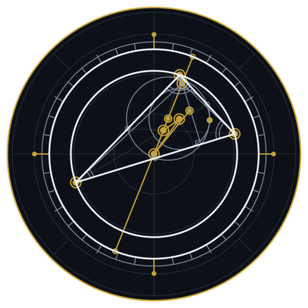

.. container:: author-overline

   semantic digital archive • mathematical catalog

================================
Encyclopedia of Triangle Centers
================================

Clark Kimberling's `Encyclopedia of Triangle Centers <https://faculty.evansville.edu/ck6/encyclopedia/ETC.html>`_ (ETC) at the University of Evansville catalogues tens of thousands of triangle centers (:math:`X_1`–:math:`X_{73310}`, Parts 1–37) across continuous mathematical families. Within the interconnected `GEOMETOR <https://geometor.com/books/>`_ semantic digital archive, these centers are liberated from static tabular listings into exact symbolic algebra, barycentric and trilinear representations, multi-triangle vector constructions, and interactive incidence networks speaking one shared geometric language.

Books & Visual Guides
---------------------

.. container:: etc-home-hero

   .. container:: etc-home-hero-thumb

      .. image:: centers/c-00001-00019/c-00001-00019.svg
         :alt: Collection 1 Constellation (X_1–X_19) on Heronian (15, 13, 14)
         :target: centers/index.html

   .. container:: etc-home-hero-body

      .. rubric:: Book Codex

      **Encyclopedia of Triangle Centers** — Complete live corpus of **73,310 triangle centers** (:math:`X_1`–:math:`X_{73310}`, Parts 1–37) and **925 geometric family constellations** evaluated in exact algebraic number fields across all seven canonical reference triangles (Heronian, Right, Kepler, Kimberling, Golden, Gnomon, Equilateral) with Fullscreen App Mode (``F``). Every center from :ref:`X_1 <X_1>` through :ref:`X_73310 <X_73310>` speaks one unified interactive 5-track format.

      .. container:: etc-home-actions

         * :doc:`Live Center Explorer (X_1–X_73310) → <centers/explore>`
         * :doc:`Browse All 62 Collections → <centers/index>`
         * :doc:`Collection 1 (X_1–X_19) → <centers/c-00001-00019/index>`
         * :ref:`Start at X_1 Incenter → <X_1>`

.. container:: etc-home-grid

   .. container:: etc-home-card

      **Collection 1 Topics** — :doc:`Conjugacies, Lines, Circles & Triangles <topics/index>`

      Twenty-four focused geometric guides covering classical conjugacies (isogonal, isotomic, complement, harmonic, inversion), named central lines (Euler, Nagel, Feuerbach, Brocard, OI, Soddy), notable circles, and derived central triangles.

   .. container:: etc-home-card

      **Coordinates in Pictures** — :doc:`Trilinears & Barycentrics Visual Primer <coordinates>`

      Visual geometric demonstration of orthogonal trilinear distances (:math:`\alpha : \beta : \gamma`), signed barycentric sub-triangle areas (:math:`u : v : w`), the Bridge Identity (:math:`u:v:w = a\alpha:b\beta:c\gamma`), and the classic trio (:ref:`X_1 <X_1>`, :ref:`X_2 <X_2>`, :ref:`X_6 <X_6>`).

   .. container:: etc-home-card

      **Guide to Preambles** — :doc:`925 Inter-Center Group Preambles <preambles>`

      Clark Kimberling's 2026 catalog of 925 preamble essays introducing shared geometric families, central curves, and constructions across all 37 Parts of the *Encyclopedia of Triangle Centers*.

Scholarly Apparatus & Edition
-----------------------------

.. container:: etc-home-columns

   .. container:: etc-home-col

      .. rubric:: Reference Apparatus

      * :doc:`People <people/index>` — Biographical register of classical geometers and modern ETC contributors
      * :doc:`Sources <sources/index>` — Primary archival HTML editions and provenance records (`faculty.evansville.edu/ck6/encyclopedia/ <https://faculty.evansville.edu/ck6/encyclopedia/ETC.html>`_)
      * :doc:`Bibliography <bibliography>` — Primary monographs, journals, catalogs, and research forums
      * :doc:`Glossary <glossary>` — Definitions of classical and modern triangle geometry terms, transformations, and derived triangles

   .. container:: etc-home-col

      .. rubric:: Edition & Code

      * :doc:`About <about/index>` — Architecture and scholarly mission of ``geometor.etc``
      * :doc:`Using This Edition <usage/index>` — Interactive viewer guide, Fullscreen App Mode (``F``), and ``CenterSymbolicRegistry`` Python API
      * :doc:`Engineering Log <log/index>` — Chronological research and implementation journals
      * :doc:`Python API Modules <modules/index>` — Exact symbolic engine, plate generators, and parser reference

.. toctree::
   :hidden:
   :maxdepth: 2

   centers/index
   topics/index
   coordinates
   preambles
   people/index
   sources/index
   bibliography
   glossary
   about/index
   usage/index
   log/index
   modules/index
   demos/index
   todos/index
   changelog
   connect
